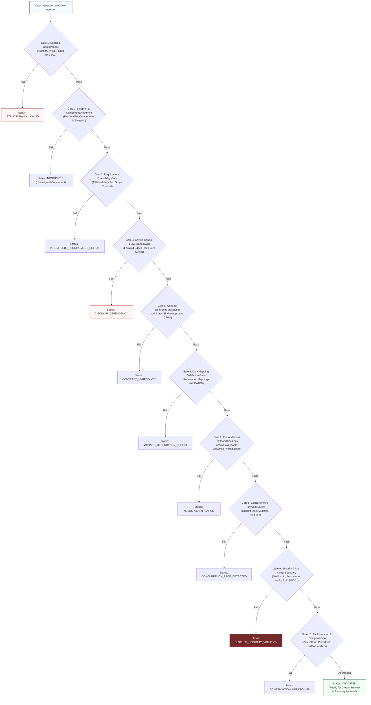

# Cross-Game Workflow Validation & Reassessment Policy

**Document ID:** `NLE-POL-WVR-001`  
**Version:** `1.0.0`  
**Status:** `APPROVED ARCHITECTURAL POLICY`  
**Phase:** `Phase 6 of 12 — Mashup Designer & Integration Planning`  
**Step:** `Step 48 of 100`  
**Classification:** `Workflow Quality Gates, Invalidation Matrix & Reassessment Specification`  
**Related Documents:**
- [CROSS_GAME_INTERACTION_WORKFLOW_AND_SEQUENCING_SPECIFICATION.md](file:///d:/App%20Winrar%20Files/Nexludic%20Engine%20(working)/docs/mashup-designer/CROSS_GAME_INTERACTION_WORKFLOW_AND_SEQUENCING_SPECIFICATION.md) (`NLE-SPC-IWS-001`)
- [WORKFLOW_DEPENDENCY_ORDERING_AND_BRANCHING_RULES.md](file:///d:/App%20Winrar%20Files/Nexludic%20Engine%20(working)/docs/mashup-designer/WORKFLOW_DEPENDENCY_ORDERING_AND_BRANCHING_RULES.md) (`NLE-RUL-WOB-001`)
- [CROSS_GAME_MAPPING_REVISION_AND_INVALIDATION_POLICY.md](file:///d:/App%20Winrar%20Files/Nexludic%20Engine%20(working)/docs/mashup-designer/CROSS_GAME_MAPPING_REVISION_AND_INVALIDATION_POLICY.md) (`NLE-POL-MRI-001`)

---

## 1. The 10 Workflow Quality Gates (`GATE-WFL-01..10`)

Before an interaction workflow descriptor can transition to `VALIDATED` or be accepted for topological planning, it must satisfy ten automated Quality Gates:



---

## 2. The 8-Event Workflow Invalidation Cascade Matrix

When an upstream dependency is modified, the engine evaluates the change against the **Workflow Invalidation Cascade Matrix**:

| Event Code | Upstream Change Event Description | Impact on Workflow | Invalidation Action | Downstream Planning Impact |
| :--- | :--- | :--- | :--- | :--- |
| **`W-INV-01`** | Participating Game Added, Removed, or Swapped | Participant topology fundamentally altered | **`FULL_REASSESSMENT_MANDATORY`** | Clears workflow approval; halts Step 49. |
| **`W-INV-02`** | Game Executable Build Updated (Steam/Epic patch)| IPC hooks or mod offsets may shift | **`PARTIAL_REASSESSMENT_REQUIRED`** | Re-validates component readiness; pauses Step 49. |
| **`W-INV-03`** | Mandatory Requirement Added, Removed, or Edited | Scope of required workflow interactions changed | **`FULL_REASSESSMENT_MANDATORY`** | Re-runs Gate 3 (Requirement Traceability). |
| **`W-INV-04`** | Architecture Blueprint Revised (Step 46) | Component topology or responsibilities shifted | **`FULL_REASSESSMENT_MANDATORY`** | Re-evaluates Gate 2 (Blueprint Alignment). |
| **`W-INV-05`** | Referenced Cross-Game Mapping Modified or Stale | Underlying data translation contract changed | **`PARTIAL_REASSESSMENT_REQUIRED`** | Re-runs Gate 6 for affected transformation steps. |
| **`W-INV-06`** | Kernel Anti-Cheat Detected on Game Executable | Memory hooking or modding prohibited | **`WORKFLOW_REVOKED_BLOCKED`** | Immediately terminates hook-based workflows. |
| **`W-INV-07`** | Evidence Exceeds 90-Day Freshness Window | Provenance validity expired | **`MARK_STALE_ADVISORY`** | Surfaces advisory warning in UI; non-blocking. |
| **`W-INV-08`** | Non-Normative Description or Title Edit | Metadata only | **`NO_ACTION_VALID`** | Workflow remains valid and accepted. |

---

## 3. Historical Snapshot Archiving

1. **Monotonic Workflow Revision:** Every edit increments `workflow_revision` by 1.
2. **Historical Snapshot Archiving (`DEC-009`):** Superseded workflow descriptors are archived to:
   ```
   D:\NexLudic\Projects\<project-id>\workflows\history\<workflow-id>_rev<revision>.json
   ```
3. **Re-Validation Protocol:** Re-validating a `STALE` workflow re-runs the 10 Quality Gates. If all pass, the workflow state is restored to `VALIDATED`.

---
*End of Policy — Document `NLE-POL-WVR-001`.*
