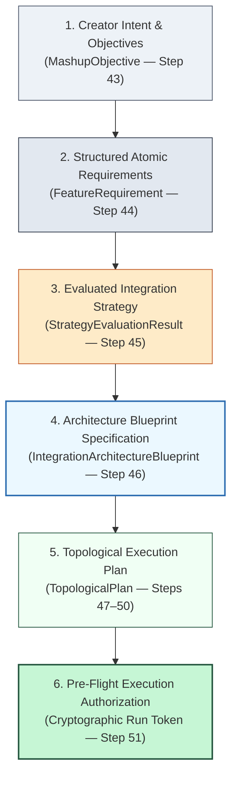

# Integration Architecture Blueprint & Component Responsibility Mapping Specification

**Document ID:** `NLE-SPC-IAB-001`  
**Version:** `1.0.0`  
**Status:** `APPROVED ARCHITECTURAL SPECIFICATION`  
**Phase:** `Phase 6 of 12 — Mashup Designer & Integration Planning`  
**Step:** `Step 46 of 100`  
**Classification:** `Core Integration Architecture & Component Mapping Specification`  
**Related Documents:**
- [MASHUP_PROJECT_DOMAIN_MODEL_AND_RELATIONSHIPS_SPECIFICATION.md](file:///d:/App%20Winrar%20Files/Nexludic%20Engine%20(working)/docs/mashup-designer/MASHUP_PROJECT_DOMAIN_MODEL_AND_RELATIONSHIPS_SPECIFICATION.md) (`NLE-SPC-MPD-001`)
- [MASHUP_REQUIREMENTS_ANALYSIS_AND_FEATURE_DECOMPOSITION_SPECIFICATION.md](file:///d:/App%20Winrar%20Files/Nexludic%20Engine%20(working)/docs/mashup-designer/MASHUP_REQUIREMENTS_ANALYSIS_AND_FEATURE_DECOMPOSITION_SPECIFICATION.md) (`NLE-SPC-MRD-001`)
- [INTEGRATION_STRATEGY_EVALUATION_AND_SELECTION_FRAMEWORK.md](file:///d:/App%20Winrar%20Files/Nexludic%20Engine%20(working)/docs/mashup-designer/INTEGRATION_STRATEGY_EVALUATION_AND_SELECTION_FRAMEWORK.md) (`NLE-SPC-ISE-001`)
- [INTEGRATION_STRATEGY_SELECTION_AND_APPROVAL_POLICY.md](file:///d:/App%20Winrar%20Files/Nexludic%20Engine%20(working)/docs/mashup-designer/INTEGRATION_STRATEGY_SELECTION_AND_APPROVAL_POLICY.md) (`NLE-POL-ISA-001`)
- [UNIVERSAL_ADAPTER_SDK_CORE_SPECIFICATION.md](file:///d:/App%20Winrar%20Files/Nexludic%20Engine%20(working)/docs/adapters/UNIVERSAL_ADAPTER_SDK_CORE_SPECIFICATION.md) (`NLE-SPC-SDK-001`)
- [PHASE_5_PHASE_GATE_AND_EXIT_CRITERIA.md](file:///d:/App%20Winrar%20Files/Nexludic%20Engine%20(working)/docs/adapters/PHASE_5_PHASE_GATE_AND_EXIT_CRITERIA.md) (`NLE-GAT-PH5-001`)

---

## 1. Executive Summary & Purpose

The **Integration Architecture Blueprint & Component Responsibility Mapping Specification** establishes how **NexLudic Engine** formally defines, structures, validates, and reviews the high-level integration architecture for a specific game mashup project before any implementation or code generation begins.

An approved mashup project (Step 43), its decomposed requirements (Step 44), and its evaluated integration strategy (Step 45) do not automatically constitute an architectural plan. A viable integration architecture requires an explicit, reviewable blueprint that translates creator intent and technical feasibility into well-bounded components, clearly allocated responsibilities, unambiguous data and event flows, verified contract references, explicit trust boundaries, and deterministic failure containment mechanisms.

This specification provides the engineering foundation for:
1. **Representing Architecture Blueprints:** Defining an immutable, version-controlled architecture schema (`IntegrationArchitectureBlueprint`) linked to project and requirement snapshots.
2. **Component Taxonomy & Boundary Governance:** Establishing clear component classifications (Universal Core, Game Adapters, Host Extension Boundaries, Live Bridge Daemons, and Supporting Transformers) while enforcing the strict separation between universal platform logic and game-specific adapter code (`ADR-0002`).
3. **Responsibility Mapping & Anti-Duplication:** Enforcing the Single Ownership Principle—every required task has exactly one authoritative owning component, with zero unowned tasks and zero competing sources of truth.
4. **Contractual Interaction Modeling:** Grounding all inter-component interactions in verified Phase 5 SDK wire protocols and Phase 2 IPC mechanisms (`ADR-0009`).
5. **Security & Failure Containment:** Enforcing Windows Medium Integrity Level sandboxing (`DEC-002`), Anti-Cheat Dominance (`BLK-SEC-01`), and Volume D storage anchoring (`DEC-009`).

---

## 2. Epistemic Architecture Hierarchy

To prevent premature commitments, implementation confusion, or unauthorized execution, NexLudic Engine enforces a strict 6-stage architecture progression hierarchy:



### Invariant Rules:
1. **Requirement Primacy (`RUL-IAB-01`):** Every component and relationship in an architecture blueprint must be justified by an approved `FeatureRequirement` or a verified system-level architectural constraint (`BLK-SEC-01`, `DEC-002`). Unjustified or speculative components are strictly rejected.
2. **Strategy Alignment (`RUL-IAB-02`):** The blueprint topology must directly implement the evaluated or selected strategy from Step 45 (`STRAT_HOST_MOD`, `STRAT_LIVE_BRIDGE`, or `STRAT_HYBRID`). An architecture cannot assume a bridge when the selected strategy is pure host modification.
3. **Planning Isolation (`RUL-IAB-03`):** An accepted architecture blueprint represents an engineering plan. It carries zero execution authority and does not modify game binaries, install mods, or launch background IPC processes.

---

## 3. High-Level Architecture Topology Families

The blueprint domain model supports three canonical component topologies mapped directly to the approved strategy families:

```mermaid
flowchart TD
    subgraph TopoA["Topology A: Host-Game Modification (STRAT_HOST_MOD)"]
        CoreA["Universal Core Orchestrator"] --> HostGame["Host Game Binary Process"]
        HostGame --> ModSurface["Host Extension Surface (Mod Loader)"]
        ModSurface --> AdapterA["Game A Host Adapter"]
        AdapterA --> ConvertedAssets["Converted Asset Store (Game B Assets)"]
    end

    subgraph TopoB["Topology B: Live Interoperability Bridge (STRAT_LIVE_BRIDGE)"]
        CoreB["Universal Core Orchestrator"] --> BridgeD["Live Bridge Daemon (Sidecar IPC)"]
        BridgeD <-->|"Named Pipe (ADR-0009)"| AdapterB1["Game A Adapter Sidecar"]
        BridgeD <-->|"Named Pipe (ADR-0009)"| AdapterB2["Game B Adapter Sidecar"]
        AdapterB1 <-->|"Telemetry Hook"| ProcA["Game A Process"]
        AdapterB2 <-->|"Telemetry Hook"| ProcB["Game B Process"]
    end

    subgraph TopoC["Topology C: Hybrid Integration (STRAT_HYBRID)"]
        CoreC["Universal Core Orchestrator"] --> BridgeC["Live Bridge Daemon"]
        CoreC --> HostModC["Host Mod Stager"]
        HostModC --> HostProcC["Host Game (Custom HUD / Proxy Assets)"]
        BridgeC <-->|"Named Pipe"| HostProcC
        BridgeC <-->|"Named Pipe"| GuestProcC["Guest Game Process"]
    end

    style TopoA fill:#f0fff4,stroke:#22543d,stroke-width:1px
    style TopoB fill:#ebf8ff,stroke:#2b6cb0,stroke-width:1px
    TopoC fill:#fffaf0,stroke:#7b341e,stroke-width:1px
```

---

## 4. Architectural Boundaries and Governing Invariants

The blueprint specification is governed by the core platform decisions established in Volumes A through E:

1. **Volume D Storage Sandboxing (`DEC-009`):**  
   All architecture blueprint records, component dependency graphs, and validation logs persist strictly under `D:\NexLudic\Projects\<project-id>\blueprints\`. No configuration or cache files may be stored outside this root.
2. **Windows Medium Integrity Level (`DEC-002`):**  
   Every component specified in the architecture blueprint executes strictly within the standard user integrity level. The blueprint cannot specify components that require elevated UAC administrator tokens or kernel-mode privileges.
3. **Anti-Cheat Dominance (`BLK-SEC-01`):**  
   If any participating game executable is protected by an active kernel-mode anti-cheat engine, the blueprint cannot allocate components that perform in-process injection, debugger attachment, or memory hooking into that game.
4. **Separation of Universal Core & Adapters (`ADR-0002`):**  
   The Universal Core orchestrates workflows, validates schemas, and manages state. It must remain 100% agnostic to game engines, proprietary formats, and game-specific network protocols. Game-specific logic is strictly partitioned into Adapters.
5. **Single Ownership Invariant (`RUL-IAB-04`):**  
   Every data domain and functional responsibility must be owned by exactly one authoritative component. Competing sources of truth or split ownership are strictly invalid.

---

## 5. Scope Boundaries

This specification defines the architectural modeling standards only:
- **Strictly Design-Only:** Contains zero implementation code, zero IPC socket initializers, zero mod package generators, and zero UI graph widgets.
- **Zero Runtime Execution:** No processes are spawned, attached, or debugged during blueprint creation or review.
- **Zero Step 47 Work:** Does not generate concrete visual node graphs or topological execution schedules (reserved for subsequent steps).

---
*End of Specification — Document `NLE-SPC-IAB-001`.*
