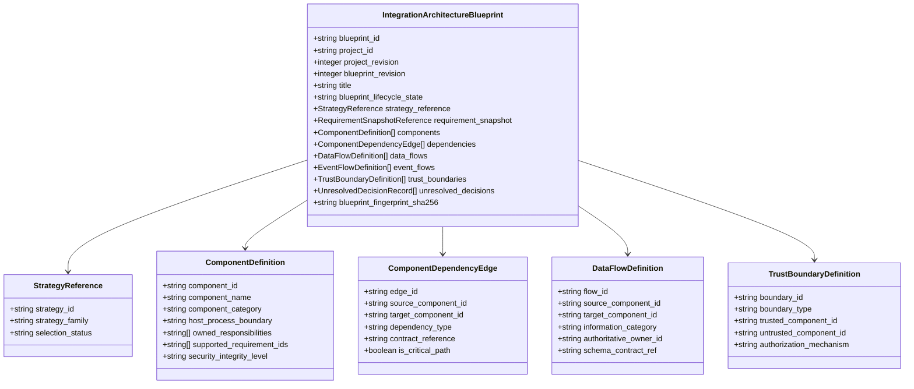
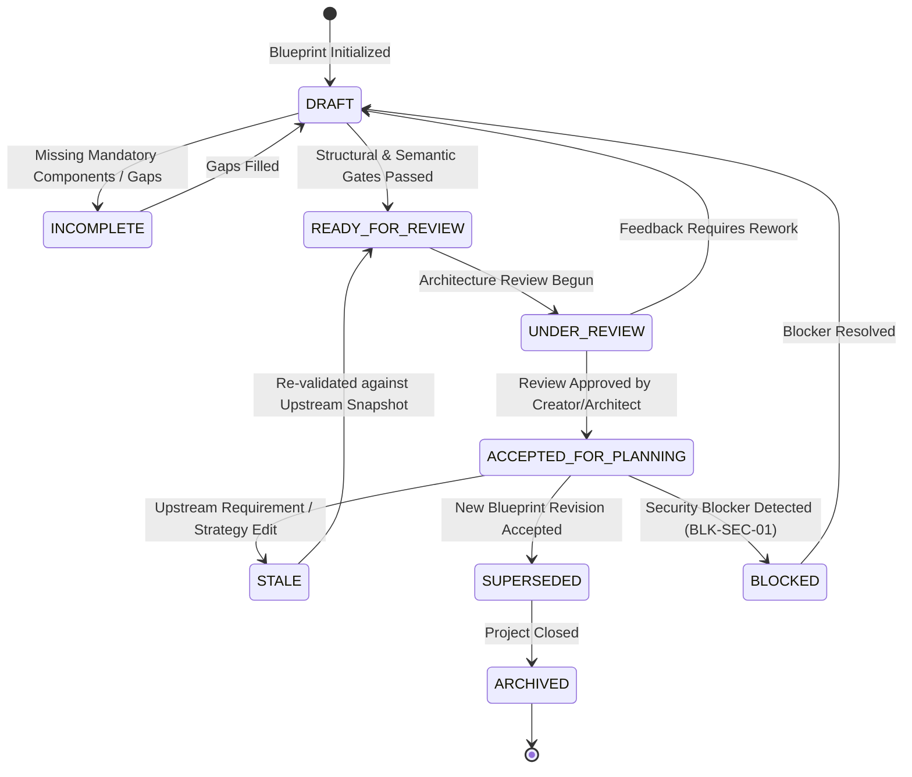

# Integration Architecture Blueprint Domain Model

**Document ID:** `NLE-MOD-ABD-001`  
**Version:** `1.0.0`  
**Status:** `APPROVED DOMAIN MODEL & SCHEMA SPECIFICATION`  
**Phase:** `Phase 6 of 12 — Mashup Designer & Integration Planning`  
**Step:** `Step 46 of 100`  
**Classification:** `Domain Entity Model & JSON Schema Specification`  
**Related Documents:**
- [INTEGRATION_ARCHITECTURE_BLUEPRINT_AND_COMPONENT_MAPPING_SPECIFICATION.md](file:///d:/App%20Winrar%20Files/Nexludic%20Engine%20(working)/docs/mashup-designer/INTEGRATION_ARCHITECTURE_BLUEPRINT_AND_COMPONENT_MAPPING_SPECIFICATION.md) (`NLE-SPC-IAB-001`)
- [MASHUP_PROJECT_SCHEMA_AND_DATA_DICTIONARY.md](file:///d:/App%20Winrar%20Files/Nexludic%20Engine%20(working)/docs/mashup-designer/MASHUP_PROJECT_SCHEMA_AND_DATA_DICTIONARY.md) (`NLE-CAT-MPD-001`)
- [MASHUP_REQUIREMENT_DOMAIN_MODEL_AND_FIELD_DICTIONARY.md](file:///d:/App%20Winrar%20Files/Nexludic%20Engine%20(working)/docs/mashup-designer/MASHUP_REQUIREMENT_DOMAIN_MODEL_AND_FIELD_DICTIONARY.md) (`NLE-CAT-MRD-001`)

---

## 1. Domain Entity Hierarchy & Conceptual Model

An **Integration Architecture Blueprint** (`IntegrationArchitectureBlueprint`) is an authoritative, versioned document representing the planned structural layout of components, interfaces, dependencies, data flows, and trust boundaries for a mashup project:



---

## 2. Blueprint Lifecycle State Machine

A blueprint transitions through nine formal lifecycle states governed by strict validation and review gates:



### Lifecycle States Taxonomy:
1. **`DRAFT`:** Blueprint being drafted; not yet validated against all feasibility gates.
2. **`INCOMPLETE`:** Contains identified gaps (e.g. unowned requirements, missing contracts, or circular dependencies).
3. **`READY_FOR_REVIEW`:** Successfully passed all automated structural, semantic, and security checks (`GATE-ARC-01..08`).
4. **`UNDER_REVIEW`:** Currently being audited by the creator or human software architect.
5. **`ACCEPTED_FOR_PLANNING`:** Formally approved as the authoritative architectural foundation for topological planning (Steps 47–50).
6. **`STALE`:** Upstream requirements, game builds, or adapter declarations modified; requires re-validation.
7. **`SUPERSEDED`:** Replaced by a higher revision of the blueprint.
8. **`BLOCKED`:** Disqualified by a hard security gate (e.g. anti-cheat detection).
9. **`ARCHIVED`:** Read-only historical record retained for audit traceability under `DEC-009`.

---

## 3. Formal JSON Schema: `IntegrationArchitectureBlueprint` (`NLE-SCH-IAB-001`)

```json
{
  "$schema": "https://json-schema.org/draft/2020-12/schema",
  "$id": "https://schemas.nexludic.internal/v1/integration-architecture-blueprint.json",
  "title": "IntegrationArchitectureBlueprint",
  "type": "object",
  "required": [
    "blueprint_id",
    "project_id",
    "project_revision",
    "blueprint_revision",
    "title",
    "blueprint_lifecycle_state",
    "strategy_reference",
    "requirement_snapshot",
    "components",
    "dependencies",
    "data_flows",
    "trust_boundaries",
    "blueprint_fingerprint_sha256"
  ],
  "properties": {
    "blueprint_id": { "type": "string", "format": "uuid" },
    "project_id": { "type": "string", "format": "uuid" },
    "project_revision": { "type": "integer", "minimum": 1 },
    "blueprint_revision": { "type": "integer", "minimum": 1 },
    "title": { "type": "string", "minLength": 1 },
    "description": { "type": "string" },
    "blueprint_lifecycle_state": {
      "type": "string",
      "enum": [
        "DRAFT",
        "INCOMPLETE",
        "READY_FOR_REVIEW",
        "UNDER_REVIEW",
        "ACCEPTED_FOR_PLANNING",
        "SUPERSEDED",
        "STALE",
        "BLOCKED",
        "ARCHIVED"
      ]
    },
    "strategy_reference": {
      "type": "object",
      "required": ["strategy_id", "strategy_family", "selection_status"],
      "properties": {
        "strategy_id": { "type": "string" },
        "strategy_family": { "type": "string", "enum": ["STRAT_HOST_MOD", "STRAT_LIVE_BRIDGE", "STRAT_HYBRID"] },
        "selection_status": { "type": "string", "enum": ["STRATEGY_RECOMMENDED", "STRATEGY_SELECTED", "STRATEGY_PROVISIONAL"] }
      }
    },
    "requirement_snapshot": {
      "type": "object",
      "required": ["requirement_set_id", "requirement_set_version", "requirement_set_hash"],
      "properties": {
        "requirement_set_id": { "type": "string", "format": "uuid" },
        "requirement_set_version": { "type": "integer", "minimum": 1 },
        "requirement_set_hash": { "type": "string", "pattern": "^[a-f0-9]{64}$" }
      }
    },
    "components": {
      "type": "array",
      "minItems": 2,
      "items": {
        "type": "object",
        "required": [
          "component_id",
          "component_name",
          "component_category",
          "host_process_boundary",
          "owned_responsibilities",
          "supported_requirement_ids",
          "security_integrity_level"
        ],
        "properties": {
          "component_id": { "type": "string", "pattern": "^COMP_[A-Z0-9_]+$" },
          "component_name": { "type": "string" },
          "component_category": {
            "type": "string",
            "enum": [
              "UNIVERSAL_CORE",
              "GAME_ADAPTER",
              "HOST_EXTENSION_SURFACE",
              "LIVE_BRIDGE_DAEMON",
              "DATA_TRANSFORMER",
              "STATE_SYNCHRONIZER",
              "DIAGNOSTICS_MONITOR",
              "EXTERNAL_DEPENDENCY"
            ]
          },
          "host_process_boundary": { "type": "string" },
          "owned_responsibilities": { "type": "array", "minItems": 1, "items": { "type": "string" } },
          "supported_requirement_ids": { "type": "array", "items": { "type": "string" } },
          "security_integrity_level": { "type": "string", "enum": ["MEDIUM_INTEGRITY", "UNPRIVILEGED_SANDBOX"] }
        }
      }
    },
    "dependencies": {
      "type": "array",
      "items": {
        "type": "object",
        "required": ["edge_id", "source_component_id", "target_component_id", "dependency_type"],
        "properties": {
          "edge_id": { "type": "string", "pattern": "^EDGE_[A-Z0-9_]+$" },
          "source_component_id": { "type": "string" },
          "target_component_id": { "type": "string" },
          "dependency_type": {
            "type": "string",
            "enum": [
              "DEPENDS_ON",
              "COMMUNICATES_WITH",
              "PROVIDES_CONTRACT_TO",
              "CONSUMES_CONTRACT_FROM",
              "TRANSFORMS_FOR",
              "REQUIRES_AUTHORIZATION_FROM",
              "REPOSES_ON_EXTERNAL",
              "MONITORS_CONDITION_OF",
              "MUST_PRECEDE",
              "ALTERNATIVE_TO"
            ]
          },
          "contract_reference": { "type": ["string", "null"] },
          "is_critical_path": { "type": "boolean" }
        }
      }
    },
    "data_flows": {
      "type": "array",
      "items": {
        "type": "object",
        "required": ["flow_id", "source_component_id", "target_component_id", "information_category", "authoritative_owner_id"],
        "properties": {
          "flow_id": { "type": "string" },
          "source_component_id": { "type": "string" },
          "target_component_id": { "type": "string" },
          "information_category": { "type": "string" },
          "authoritative_owner_id": { "type": "string" },
          "schema_contract_ref": { "type": ["string", "null"] }
        }
      }
    },
    "trust_boundaries": {
      "type": "array",
      "items": {
        "type": "object",
        "required": ["boundary_id", "boundary_type", "trusted_component_id", "untrusted_component_id", "authorization_mechanism"],
        "properties": {
          "boundary_id": { "type": "string" },
          "boundary_type": { "type": "string" },
          "trusted_component_id": { "type": "string" },
          "untrusted_component_id": { "type": "string" },
          "authorization_mechanism": { "type": "string" }
        }
      }
    },
    "unresolved_decisions": { "type": "array", "items": { "type": "object" } },
    "blueprint_fingerprint_sha256": { "type": "string", "pattern": "^[a-f0-9]{64}$" }
  }
}
```

---
*End of Model — Document `NLE-MOD-ABD-001`.*
