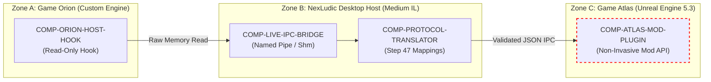

# NexLudic Engine: Architecture Component & Dependency Visualization UX

**Document ID:** `NLE-UX-IPA-001`  
**Phase:** 6 of 12 (Mashup Designer & Integration Planning)  
**Step:** 50 of 100  
**Classification:** Architecture Topography & Dependency UX Specification  
**Status:** IMPLEMENTATION-READY SPECIFICATION  

---

## 1. Architecture Review & Component Topography View

The **Architecture & Components** sub-view (`?view=architecture`) visualizes the component topography defined in Step 46, highlighting component responsibility boundaries, interface bindings, and security trust zones.

```
+----------------------------------------------------------------------------------------------------+
| ARCHITECTURE TOPOGRAPHY VIEWPORT                                                                   |
|                                                                                                    |
| Strategy: HYBRID | Blueprint ID: BP-ORION-ATLAS-v1.0 | Zoom: [ 100% ] [Fit] | View: [Diagram | Table]  |
+----------------------------------------------------------------------------------------------------+
| TRUST ZONE A: GAME ORION PROCESS           | TRUST ZONE B: NEXLUDIC CORE     | TRUST ZONE C: ATLAS  |
| (Unprotected Runtime - Hook Permitted)      | (Medium IL Desktop Host Process)| (Protected by EAC)   |
|                                             |                                 |                      |
| +-----------------------------------------+ | +-----------------------------+ | +------------------+ |
| | [COMP-ORION-HOST-HOOK]                  | | | [COMP-LIVE-IPC-BRIDGE]      | | | [COMP-ATLAS-MOD] | |
| | Type: Native Memory Scraper             | | | Type: Named-Pipe / Shm Ring | | | Type: Non-Invas. | |
| | Responsibility: Extract Telemetry Frame | | | Responsibility: Transport   | | | Resp: Ingest HUD | |
| +-------------------+---------------------+ | +--------------+--------------+ | +---------+--------+ |
|                     |                       |                |                |           |          |
|                     +-----------------------+---------------> |                |           |          |
|                             Export Raw Coordinates           |                |           |          |
|                                                              +----------------+---------> |          |
|                                                                  Pass Normalized Telemetry|          |
|                                                                               |                      |
|                                             | [!] ANTI-CHEAT TRUST BOUNDARY   | [!] BLK-SEC-01 VETO  |
|                                             | IPC only; zero memory injection | Direct hook BLOCKED  |
+----------------------------------------------------------------------------------------------------+
```

### 1.1 Component Classification Matrix

Every architectural node belongs to one of 6 canonical presentation classes:

| Class Key | Display Name | Visual Style | Responsibilities & Constraints |
| :--- | :--- | :--- | :--- |
| `CORE_ENGINE` | NexLudic Core Host | Blue Rounded Box | Orchestration, life-cycle management, memory-mapped buffers. Medium IL. |
| `GAME_ADAPTER` | Universal Game Adapter | Cyan Hexagon | Official adapter conforming to Phase 5 SDK (`NLE-SDK-CAP-001`). |
| `HOST_MOD` | Host-Side Game Mod | Teal Rectangle | Game-specific script or plugin executing inside the game's native mod runtime. |
| `LIVE_BRIDGE` | Inter-Process Bridge | Purple Octagon | Dedicated IPC transport (Named Pipe or Shared Memory Ring) bridging processes. |
| `TRANSFORM_NODE`| Data Transformation | Gold Pill | Pure data translation node (unit conversion, coordinate normalization). |
| `EXTERNAL_RES` | OS / Platform Resource | Grey Cylinder | Windows OS resource (e.g., named pipe handle, display overlay handle). |

---

## 2. Security Trust Boundaries & Anti-Cheat Confinement (`BLK-SEC-01`)

The architecture view makes security trust boundaries explicitly visible:



- **Red Dashed Boundary Line:** Separates untrusted game processes from the NexLudic host.
- **Anti-Cheat Padlock Badge (`BLK-SEC-01`):** Rendered prominently over Game Atlas components, certifying that the blueprint employs **non-invasive mod APIs only** and contains zero DLL injectors or thread hooks.

---

## 3. Dependency Explorer & Kahn Execution Stages ($S_0..S_N$)

The **Dependency Explorer** (`?view=dependencies`) visualizes the execution ordering computed by Kahn's topological sort algorithm in Step 49:

```
+----------------------------------------------------------------------------------------------------+
| DEPENDENCY EXPLORER VIEWPORT                                                                       |
| Graph Status: [✓] Directed Acyclic Graph (DAG Verified) | Stages: 4 Linear Stages | Edges: 18      |
+----------------------------------------------------------------------------------------------------+
| STAGE 0: CORE & ADAPTERS    | STAGE 1: COMPONENTS & IFACES | STAGE 2: DATA MAPPINGS | STAGE 3: WORKFLOWS   |
| (Foundational Lifecycle)    | (Initialization & Binding)   | (Transforms Loaded)    | (Execution Steps)    |
|                             |                              |                        |                      |
| +-------------------------+ | +--------------------------+ | +--------------------+ | +------------------+ |
| | [ADAPT-ORION-INIT]      | | | [COMP-ORION-HOST-HOOK]   | | | [MAP-VELOCITY-MPH] | | | [WF-STEP-001]      | |
| | Orion Universal Adapter | | | Binds to Orion memory    | | | Ingests raw m/s    | | | Poll Telemetry | |
| +------------+------------+ | +------------+-------------+ | +---------+----------+ | +--------+---------+ |
|              |              |              |               |           |            |          |           |
|              +--------------+------------->|               |           |            |          |           |
|                             |              +---------------+---------> |            |          |           |
| +-------------------------+ | +--------------------------+ |           +------------+--------> |           |
| | [ADAPT-ATLAS-INIT]      | | | [COMP-ATLAS-MOD-PLUGIN]  | |                        | | [WF-STEP-002]      | |
| | Atlas Universal Adapter | | | Connects to Mod IPC      | |                        | | Update Atlas HUD   | |
| +-------------------------+ | +--------------------------+ |                        | +------------------+ |
+----------------------------------------------------------------------------------------------------+
```

### 3.1 Circular Dependency Visualization (`ERR_PLAN_CIRCULAR_DEPENDENCY`)
When a dependency cycle is detected:
1. The canvas transitions from stage swimlanes to a **Cycle Isolation View**.
2. All non-involved nodes are dimmed by 75%.
3. The circular loop nodes (e.g., `WF-STEP-003 -> MAP-TRANS-04 -> COMP-BRIDGE -> WF-STEP-003`) are highlighted in high-contrast red with animated directional arrows tracing the deadlock.
4. A diagnostic panel explains the exact cycle path and recommends remediation (e.g., "Decouple synchronous feedback into an asynchronous event notification").

---

## 4. Accessible Semantic Table Alternative

For screen readers, keyboard-only users, and high-contrast accessibility modes, a dedicated **[Accessible Table View]** toggle presents the complete dependency topology as a structured, hierarchical HTML/XAML table:

| Execution Stage | Item Identifier | Item Type | Name / Responsibility | Hard Prerequisites (Must Succeed First) |
| :---: | :--- | :--- | :--- | :--- |
| **Stage 0** | `ADAPT-ORION-INIT` | Adapter | Initialize Game Orion Universal Adapter | *None (Foundational Root)* |
| **Stage 0** | `ADAPT-ATLAS-INIT` | Adapter | Initialize Game Atlas Universal Adapter | *None (Foundational Root)* |
| **Stage 1** | `COMP-ORION-HOOK` | Component | Bind Orion native telemetry hook | `ADAPT-ORION-INIT` |
| **Stage 1** | `COMP-ATLAS-MOD` | Component | Bind Atlas non-invasive mod plugin | `ADAPT-ATLAS-INIT` |
| **Stage 2** | `MAP-VELOCITY-MPH`| Mapping | Velocity normalizer ($m/s \rightarrow mph$) | `COMP-ORION-HOOK` |
| **Stage 3** | `WF-STEP-001` | Workflow | Continuous telemetry streaming loop | `MAP-VELOCITY-MPH`, `COMP-ATLAS-MOD` |
