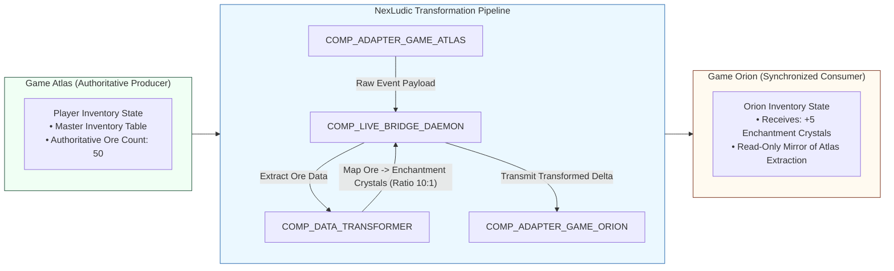
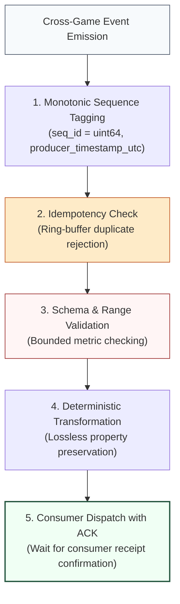

# Integration Architecture Data & Event Flow Specification

**Document ID:** `NLE-SPC-DEF-001`  
**Version:** `1.0.0`  
**Status:** `APPROVED DATA & EVENT FLOW SPECIFICATION`  
**Phase:** `Phase 6 of 12 — Mashup Designer & Integration Planning`  
**Step:** `Step 46 of 100`  
**Classification:** `Data Modeling, Event Architecture & State Flow Specification`  
**Related Documents:**
- [INTEGRATION_ARCHITECTURE_BLUEPRINT_AND_COMPONENT_MAPPING_SPECIFICATION.md](file:///d:/App%20Winrar%20Files/Nexludic%20Engine%20(working)/docs/mashup-designer/INTEGRATION_ARCHITECTURE_BLUEPRINT_AND_COMPONENT_MAPPING_SPECIFICATION.md) (`NLE-SPC-IAB-001`)
- [CROSS_GAME_REQUIREMENT_SEMANTICS_AND_PARTICIPANT_MAPPING.md](file:///d:/App%20Winrar%20Files/Nexludic%20Engine%20(working)/docs/mashup-designer/CROSS_GAME_REQUIREMENT_SEMANTICS_AND_PARTICIPANT_MAPPING.md) (`NLE-SPC-CRS-001`)
- [INTEGRATION_COMPONENT_CATALOG_AND_RESPONSIBILITY_MATRIX.md](file:///d:/App%20Winrar%20Files/Nexludic%20Engine%20(working)/docs/mashup-designer/INTEGRATION_COMPONENT_CATALOG_AND_RESPONSIBILITY_MATRIX.md) (`NLE-CAT-ICR-001`)

---

## 1. Data Flow Architecture & Authoritative Ownership

Data flowing across an integration architecture must respect strict ownership boundaries. NexLudic Engine enforces the **Single Authoritative Writer Principle (`RUL-DEF-01`)**: for every discrete data concept, exactly one participating game or component owns the master state. All other participants receive synchronized read-only projections or explicit transformation deltas:



---

## 2. Information Categories & Flow Contracts

Every `DataFlowDefinition` entry in the blueprint belongs to one of four standardized information categories:

| Information Category | Flow Type | Latency Bound | Ordering Constraint | Transformation Permitted? | Primary Authoritative Owner |
| :--- | :--- | :---: | :---: | :---: | :--- |
| **`TELEMETRY_STREAM`** | Continuous unidirected stream | $\le 16\text{ ms}$ (60 Hz) | Casual / Drop oldest on lag | Unit scaling only (e.g. coordinates) | Producing Game Process |
| **`STATE_SYNCHRONIZATION`** | Bidirectional delta sync | $\le 50\text{ ms}$ | Strictly monotonically ordered | Field mapping & property quantization | Designated Master Game |
| **`DISCRETE_EVENT`** | Asynchronous transactional trigger | $\le 100\text{ ms}$ | Strict total FIFO ordering | Event payload translation | Initiating Participant |
| **`STATIC_ASSET_METADATA`**| Offline batch migration | Non-real-time | Zero ordering dependency | Full format transcoding (mesh, texture) | Extracted Guest Game |

---

## 3. Event Ordering, Idempotence & State Consistency

Cross-game interactions often span unsynchronized game tick loops (e.g., Game Orion running at 60 Hz while Game Atlas runs at 144 Hz). To prevent race conditions, duplicate events, and state desynchronization, the architecture enforces:



### Invariant Rules:
1. **Idempotence Token Invariant (`RUL-DEF-02`):** Every discrete event must carry a unique, monotonically increasing sequence token (`seq_id`) and a UUID transaction token. If a consumer receives a duplicate `seq_id`, the event is acknowledged but discarded without re-processing.
2. **Lossless Property Mapping (`RUL-DEF-03`):** In accordance with `NLE-SPC-CRS-001`, transformations are classified into **Preserved**, **Adapted**, and **Dropped**. Any property classified as mandatory cannot be dropped; if an adapter cannot preserve or adapt a mandatory property, the data flow fails validation (`ERR_MANDATORY_PROPERTY_DROPPED`).
3. **Reconciliation & Stale State Recovery (`RUL-DEF-04`):** If heartbeat telemetry detects a desynchronization between master and consumer states exceeding $100\text{ ms}$, the State Synchronizer (`COMP_STATE_SYNCHRONIZER`) forces a full state resynchronization by broadcasting an authoritative snapshot.

---

## 4. Synthetic Data Flow Definition (Example)

```json
{
  "flow_id": "FLOW_ORION_TO_ATLAS_ORE_CONVERSION",
  "source_component_id": "COMP_ADAPTER_GAME_ATLAS",
  "target_component_id": "COMP_ADAPTER_GAME_ORION",
  "information_category": "DISCRETE_EVENT",
  "authoritative_owner_id": "COMP_ADAPTER_GAME_ATLAS",
  "schema_contract_ref": "CTR-SEM-XFRM",
  "event_type": "EVENT_MINING_HARVEST_COMPLETED",
  "payload_attributes": {
    "source_item_id": "item_atlas_raw_titanium",
    "source_quantity": 10,
    "target_item_id": "item_orion_enchanted_crystal",
    "target_quantity": 1,
    "preserved_properties": ["durability_tier", "rarity_grade"],
    "adapted_properties": ["elemental_affinity_mapped"],
    "dropped_properties": ["radiation_level"]
  },
  "trust_boundary_crossing": true,
  "max_allowed_latency_ms": 100,
  "failure_behavior": "Rollback transaction; emit WARN_EVENT_DELIVERY_FAILED"
}
```

---
*End of Specification — Document `NLE-SPC-DEF-001`.*
