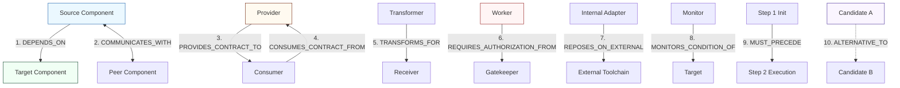
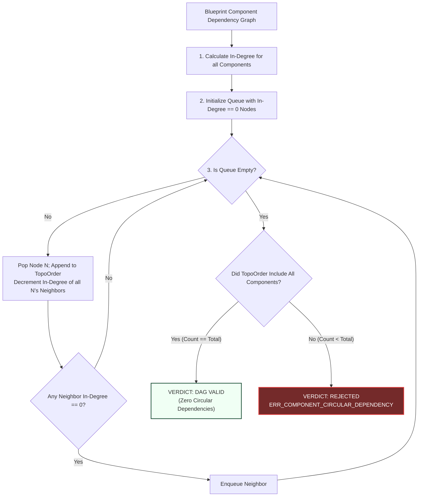
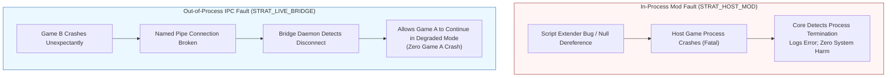

# Integration Architecture Dependency & Failure Boundary Policy

**Document ID:** `NLE-POL-DFB-001`  
**Version:** `1.0.0`  
**Status:** `APPROVED ARCHITECTURAL POLICY`  
**Phase:** `Phase 6 of 12 — Mashup Designer & Integration Planning`  
**Step:** `Step 46 of 100`  
**Classification:** `Component Dependency & Failure Containment Governance`  
**Related Documents:**
- [INTEGRATION_ARCHITECTURE_BLUEPRINT_AND_COMPONENT_MAPPING_SPECIFICATION.md](file:///d:/App%20Winrar%20Files/Nexludic%20Engine%20(working)/docs/mashup-designer/INTEGRATION_ARCHITECTURE_BLUEPRINT_AND_COMPONENT_MAPPING_SPECIFICATION.md) (`NLE-SPC-IAB-001`)
- [INTEGRATION_COMPONENT_CATALOG_AND_RESPONSIBILITY_MATRIX.md](file:///d:/App%20Winrar%20Files/Nexludic%20Engine%20(working)/docs/mashup-designer/INTEGRATION_COMPONENT_CATALOG_AND_RESPONSIBILITY_MATRIX.md) (`NLE-CAT-ICR-001`)
- [ADAPTER_LIFECYCLE_INITIALIZATION_AND_OPERATIONAL_STATE_SPECIFICATION.md](file:///d:/App%20Winrar%20Files/Nexludic%20Engine%20(working)/docs/adapters/ADAPTER_LIFECYCLE_INITIALIZATION_AND_OPERATIONAL_STATE_SPECIFICATION.md) (`NLE-SPC-ALC-001`)

---

## 1. Component Relationship Taxonomy

Dependencies between components in an integration blueprint must have unambiguous semantics. The blueprint framework recognizes ten typed relationship edges:

### Relationship Definitions:
1. **`DEPENDS_ON`:** Directed functional prerequisite. Source cannot operate without target.
2. **`COMMUNICATES_WITH`:** Bidirectional IPC or networking channel.
3. **`PROVIDES_CONTRACT_TO`:** Exposes a formal API or schema endpoint.
4. **`CONSUMES_CONTRACT_FROM`:** Consumes an exposed API or schema endpoint.
5. **`TRANSFORMS_FOR`:** Synthesizes or converts data payloads on behalf of target.
6. **`REQUIRES_AUTHORIZATION_FROM`:** Enforces security or user-consent gate prior to action.
7. **`REPOSES_ON_EXTERNAL`:** Explicit dependency on third-party software outside NexLudic Engine.
8. **`MONITORS_CONDITION_OF`:** Observes heartbeat telemetry or health metrics without mutating state.
9. **`MUST_PRECEDE`:** Strict initialization or execution ordering prerequisite.
10. **`ALTERNATIVE_TO`:** Mutual exclusion. Only one of the linked components is active in a given topology.

---

## 2. Dependency Graph Validation & Cycle Rejection (Kahn's DAG)

The set of structural dependencies (`DEPENDS_ON`, `MUST_PRECEDE`, `CONSUMES_CONTRACT_FROM`) must form a Directed Acyclic Graph (DAG). 

In accordance with platform governance (`NLE-CAT-VRC-001`), the blueprint validator executes **Kahn's Algorithm** to detect and reject cyclic dependencies:

---

## 3. Failure Propagation & Blast Radius Containment

When a component fails, the architecture blueprint must guarantee that the fault is contained within documented blast boundaries:

### Deterministic Failure Containment Rules:
1. **Rule RUL-DFB-01 (Host Modification Crash Containment):** In `STRAT_HOST_MOD`, a crash in mod code directly terminates the Host Game process. The Universal Core isolates the fault by detecting process exit, staging a rollback manifest, and preventing corrupted save-file synchronization.
2. **Rule RUL-DFB-02 (Live Bridge Fault Decoupling):** In `STRAT_LIVE_BRIDGE`, process boundaries are absolute. A crash, freeze, or infinite loop in Game B or Adapter B **must never crash Game A or Adapter A**. The Bridge Daemon raises `EVENT_CHANNEL_TERMINATED` and transitions the mashup to a safe degraded state.
3. **Rule RUL-DFB-03 (Timeout & Backoff Invariant):** If an inter-component IPC call exceeds its specified timeout (e.g. $50\text{ ms}$ for telemetry), the caller must abort the call, increment a fault counter, and retry up to 3 times before raising a disconnect alert. Deadlock loops are mathematically impossible.
4. **Rule RUL-DFB-04 (Hybrid Compound Failure Handler):** In `STRAT_HYBRID`, if the live bridge fails but the host mod continues running, the host mod HUD elements must gracefully display a "Bridge Disconnected" warning overlay rather than freezing the host game thread.

---
*End of Policy — Document `NLE-POL-DFB-001`.*
