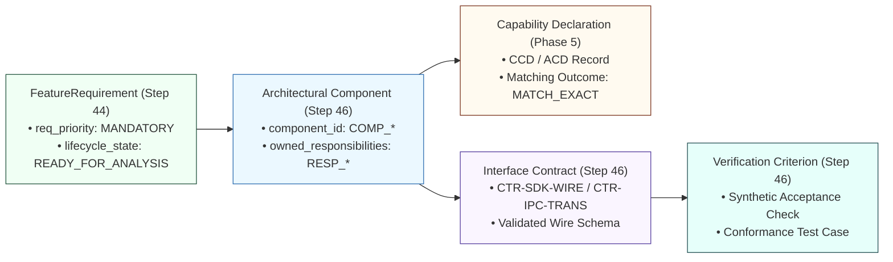

# Integration Architecture Requirement & Capability Traceability

**Document ID:** `NLE-MAT-ARC-001`  
**Version:** `1.0.0`  
**Status:** `APPROVED TRACEABILITY MATRIX`  
**Phase:** `Phase 6 of 12 — Mashup Designer & Integration Planning`  
**Step:** `Step 46 of 100`  
**Classification:** `Architecture Traceability & Coverage Governance`  
**Related Documents:**
- [INTEGRATION_ARCHITECTURE_BLUEPRINT_AND_COMPONENT_MAPPING_SPECIFICATION.md](file:///d:/App%20Winrar%20Files/Nexludic%20Engine%20(working)/docs/mashup-designer/INTEGRATION_ARCHITECTURE_BLUEPRINT_AND_COMPONENT_MAPPING_SPECIFICATION.md) (`NLE-SPC-IAB-001`)
- [INTEGRATION_COMPONENT_CATALOG_AND_RESPONSIBILITY_MATRIX.md](file:///d:/App%20Winrar%20Files/Nexludic%20Engine%20(working)/docs/mashup-designer/INTEGRATION_COMPONENT_CATALOG_AND_RESPONSIBILITY_MATRIX.md) (`NLE-CAT-ICR-001`)
- [MASHUP_REQUIREMENTS_ANALYSIS_AND_FEATURE_DECOMPOSITION_SPECIFICATION.md](file:///d:/App%20Winrar%20Files/Nexludic%20Engine%20(working)/docs/mashup-designer/MASHUP_REQUIREMENTS_ANALYSIS_AND_FEATURE_DECOMPOSITION_SPECIFICATION.md) (`NLE-SPC-MRD-001`)

---

## 1. Traceability Architecture & Coverage Invariants

An architecture blueprint must demonstrate that every planned component serves an approved purpose, and that every mandatory requirement is supported by an authoritative component:

### Traceability Invariants:
1. **Rule RUL-TRC-01 (Zero Speculative Components):** Every component in the blueprint must trace to at least one approved `FeatureRequirement` or platform constraint (`BLK-SEC-01`, `DEC-002`). Unjustified components are rejected (`ERR_UNJUSTIFIED_COMPONENT`).
2. **Rule RUL-TRC-02 (Mandatory Coverage Primacy):** Every requirement tagged `req_priority == "MANDATORY"` must achieve status **`COVERED_TRACEABLE`**. If any mandatory requirement is unmapped or blocked, the blueprint cannot achieve `ACCEPTED_FOR_PLANNING`.

---

## 2. Requirement-to-Component Mapping Matrix

The matrix below maps canonical feature requirements to their implementing components and contracts:

| Requirement ID | Requirement Scope & Objective | Implementing Component | Owned Responsibility | Governing Contract | Capability Ref | Coverage Status |
| :--- | :--- | :--- | :--- | :--- | :--- | :---: |
| **`REQ-CORE-001`** | Manifest & Revision Management | `COMP_CORE_ORCHESTRATOR` | `RESP-ORC-01` | `NLE-SPC-MPD-001` | Core Internal | **`COVERED_TRACEABLE`** |
| **`REQ-CORE-002`** | Anti-Cheat Hard Gating | `COMP_CORE_ORCHESTRATOR` | `RESP-ORC-02` | `BLK-SEC-01` | Security Policy | **`COVERED_TRACEABLE`** |
| **`REQ-ADPA-001`** | Game A Protocol Translation | `COMP_ADAPTER_GAME_A` | `RESP-ADP-01` | `CTR-SDK-WIRE` | `CAP_PROTOCOL_V1` | **`COVERED_TRACEABLE`** |
| **`REQ-ADPB-001`** | Game B Protocol Translation | `COMP_ADAPTER_GAME_B` | `RESP-ADP-02` | `CTR-SDK-WIRE` | `CAP_PROTOCOL_V1` | **`COVERED_TRACEABLE`** |
| **`REQ-MOD-001`**  | In-Engine HUD Rendering | `COMP_HOST_EXTENSION_SURFACE` | `RESP-MOD-01` | `CTR-HST-MOD` | `CAP_IN_ENGINE_UI`| **`COVERED_TRACEABLE`** |
| **`REQ-IPC-001`**  | Low-Latency Telemetry Routing | `COMP_LIVE_BRIDGE_DAEMON` | `RESP-IPC-01` | `CTR-IPC-TRANS` | `CAP_LIVE_IPC_V1` | **`COVERED_TRACEABLE`** |
| **`REQ-XFRM-001`** | Cross-Game Coordinate Mapping | `COMP_DATA_TRANSFORMER` | `RESP-TRN-01` | `CTR-SEM-XFRM` | `CAP_DATA_XFRM` | **`COVERED_TRACEABLE`** |
| **`REQ-SYNC-001`** | Real-Time State Mirroring | `COMP_STATE_SYNCHRONIZER` | `RESP-SYN-01` | `CTR-SEM-XFRM` | `CAP_STATE_SYNC` | **`COVERED_TRACEABLE`** |
| **`REQ-DIAG-001`** | Ring-Buffered Health Monitoring| `COMP_DIAGNOSTICS_MONITOR` | `RESP-DIA-01` | `CTR-DIA-TELE` | `CAP_DIAG_RING_V1`| **`COVERED_TRACEABLE`** |
| **`REQ-REC-001`**  | Disconnection Rollback Manifest| `COMP_RECOVERY_COORDINATOR`| `RESP-REC-01` | `NLE-POL-DFB-001`| Core Internal | **`COVERED_TRACEABLE`** |

---

## 3. Capability-to-Component Mapping Matrix

The matrix below traces Phase 5 canonical capability definitions to the components responsible for executing them:

| Capability Identifier | Canonical Category | Declaring Adapter | Responsible Blueprint Component | Conformance Status | Traceability Status |
| :--- | :--- | :--- | :--- | :--- | :---: |
| `CAP_INPUT_EMISSION` | `INPUT_AND_CONTROL` | Game A Adapter | `COMP_ADAPTER_GAME_A` | Confirmed by Test Harness | **`COVERED_TRACEABLE`** |
| `CAP_WORLD_TRANSFORM`| `ENTITY_AND_SPATIAL` | Game B Adapter | `COMP_DATA_TRANSFORMER` | Confirmed by Test Harness | **`COVERED_TRACEABLE`** |
| `CAP_INVENTORY_DELTA`| `INVENTORY_AND_ITEMS`| Game B Adapter | `COMP_STATE_SYNCHRONIZER` | Confirmed by Test Harness | **`COVERED_TRACEABLE`** |
| `CAP_HUD_OVERLAY` | `UI_AND_PRESENTATION`| Host Game Mod | `COMP_HOST_EXTENSION_SURFACE` | Verified via Mod Loader | **`COVERED_TRACEABLE`** |
| `CAP_LIVE_STREAMING` | `SYSTEM_LIFECYCLE` | Live Bridge | `COMP_LIVE_BRIDGE_DAEMON` | Confirmed by IPC Harness | **`COVERED_TRACEABLE`** |

---
*End of Matrix — Document `NLE-MAT-ARC-001`.*
