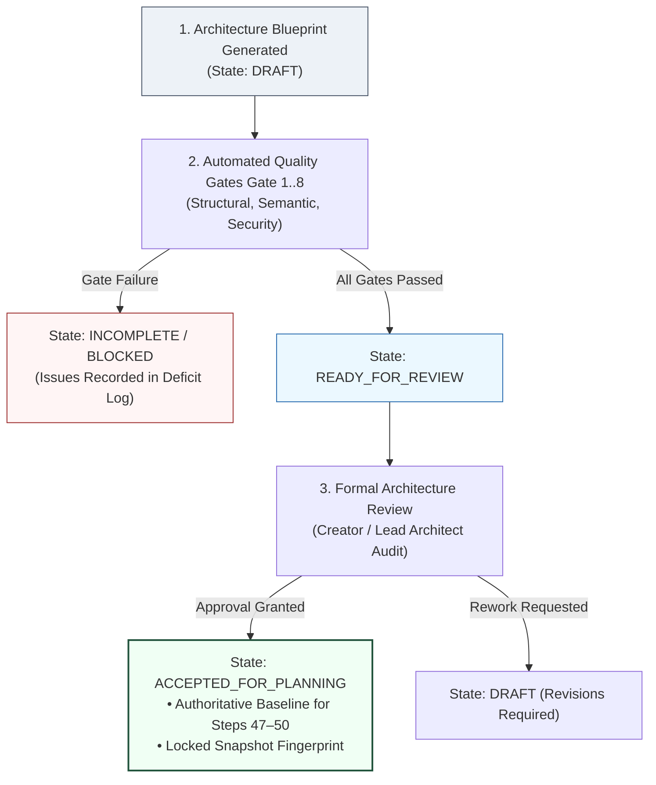

# Integration Architecture Revision, Review & Invalidation Policy

**Document ID:** `NLE-POL-ARI-001`  
**Version:** `1.0.0`  
**Status:** `APPROVED ARCHITECTURAL POLICY`  
**Phase:** `Phase 6 of 12 — Mashup Designer & Integration Planning`  
**Step:** `Step 46 of 100`  
**Classification:** `Lifecycle Governance, Architecture Review & Invalidation Specification`  
**Related Documents:**
- [INTEGRATION_ARCHITECTURE_BLUEPRINT_AND_COMPONENT_MAPPING_SPECIFICATION.md](file:///d:/App%20Winrar%20Files/Nexludic%20Engine%20(working)/docs/mashup-designer/INTEGRATION_ARCHITECTURE_BLUEPRINT_AND_COMPONENT_MAPPING_SPECIFICATION.md) (`NLE-SPC-IAB-001`)
- [INTEGRATION_ARCHITECTURE_BLUEPRINT_DOMAIN_MODEL.md](file:///d:/App%20Winrar%20Files/Nexludic%20Engine%20(working)/docs/mashup-designer/INTEGRATION_ARCHITECTURE_BLUEPRINT_DOMAIN_MODEL.md) (`NLE-MOD-ABD-001`)
- [INTEGRATION_STRATEGY_REASSESSMENT_AND_INVALIDATION_POLICY.md](file:///d:/App%20Winrar%20Files/Nexludic%20Engine%20(working)/docs/mashup-designer/INTEGRATION_STRATEGY_REASSESSMENT_AND_INVALIDATION_POLICY.md) (`NLE-POL-IRI-001`)

---

## 1. Candidate Architecture vs. Accepted Architecture

An architecture blueprint does not automatically become an authoritative commitment upon generation. NexLudic Engine enforces a strict boundary between a **Candidate Architecture** and an **Accepted Architecture**:



### Invariant Rules:
1. **Rule RUL-ARI-01 (Review Prerequisite):** No blueprint can transition to `ACCEPTED_FOR_PLANNING` without explicitly passing all eight automated Architecture Quality Gates (`GATE-ARC-01..08`) and receiving documented human review sign-off.
2. **Rule RUL-ARI-02 (Downstream Planning Lock):** Downstream topological planning (Steps 47–50) requires an `ACCEPTED_FOR_PLANNING` blueprint. Planning algorithms cannot consume `DRAFT`, `INCOMPLETE`, or `STALE` blueprints.

---

## 2. The 8 Architecture Quality Gates (`GATE-ARC-01..08`)

Before a blueprint is marked `READY_FOR_REVIEW`, it must pass eight sequential automated checks:

| Gate ID | Gate Name | Automated Verification Check | Rejection Code / Action |
| :--- | :--- | :--- | :--- |
| **`GATE-ARC-01`** | Structural Integrity Gate | Blueprint conforms 100% to JSON Schema `NLE-SCH-IAB-001`. | `ERR_BLUEPRINT_SCHEMA_INVALID` |
| **`GATE-ARC-02`** | Requirement Primacy Gate | Every component traces to at least one requirement or policy. | `ERR_UNJUSTIFIED_COMPONENT` |
| **`GATE-ARC-03`** | Mandatory Coverage Gate | 100% of mandatory requirements are mapped to owning components. | `ERR_MANDATORY_REQUIREMENTS_UNMAPPED` |
| **`GATE-ARC-04`** | Single Ownership Gate | Zero duplicate owners for any responsibility or state domain. | `ERR_DUPLICATE_RESPONSIBILITY_OWNER` |
| **`GATE-ARC-05`** | Dependency DAG Gate | Component dependency graph contains zero directed cycles (Kahn DAG).| `ERR_COMPONENT_CIRCULAR_DEPENDENCY` |
| **`GATE-ARC-06`** | Contract Purity Gate | Every inter-component edge references an approved contract. | `ERR_CONTRACT_REFERENCE_UNRESOLVED` |
| **`GATE-ARC-07`** | Security & Anti-Cheat Gate | Zero kernel-mode hooks, Medium IL enforced (`BLK-SEC-01`, `DEC-002`).| `ERR_PROHIBITED_SECURITY_ASSUMPTION` |
| **`GATE-ARC-08`** | Storage Sandboxing Gate | All persisted paths reside strictly under Volume D (`DEC-009`). | `ERR_STORAGE_OUTSIDE_VOLUME_D` |

---

## 3. Upstream Invalidation Cascade Matrix

When an upstream entity is modified, the engine evaluates the change against the **Blueprint Invalidation Cascade Matrix**:

| Event Code | Upstream Change Event Description | Impact on Blueprint | Invalidation Action |
| :--- | :--- | :--- | :--- |
| **`B-INV-01`** | Participating Game Added, Removed, or Swapped | Topology fundamentally invalidated | Transitions to **`STALE`**; clears acceptance. |
| **`B-INV-02`** | Mandatory Requirement Added, Removed, or Edited | Scope of responsibilities altered | Transitions to **`STALE`**; re-checks Gate 3. |
| **`B-INV-03`** | Integration Strategy Selection Changed | Strategy topology mismatched | Transitions to **`STALE`**; requires new blueprint. |
| **`B-INV-04`** | Adapter Version Upgraded or Replaced | Capabilities or contracts shifted | Transitions to **`STALE`**; re-runs Gate 6. |
| **`B-INV-05`** | Kernel Anti-Cheat Detected on Game Executable | Security violation (`BLK-SEC-01`) | Transitions immediately to **`BLOCKED`**. |
| **`B-INV-06`** | Compatibility Evidence Exceeds 90-Day Freshness | Evidence provenance expired | Emits advisory warning; preserves acceptance. |
| **`B-INV-07`** | Cosmetic Project Description Text Edit | Non-normative text change | **`NO_ACTION_VALID`**; remains accepted. |

---

## 4. Revision Governance & Historical Snapshot Preservation

1. **Monotonic Revision Tracking:** Every edit increments `blueprint_revision` by 1.
2. **Historical Snapshot Retention (`DEC-009`):** Superseded blueprints are never overwritten. They are archived to:
   ```
   D:\NexLudic\Projects\<project-id>\blueprints\history\<blueprint-id>_rev<revision>.json
   ```
3. **Re-Validation Protocol:** Re-validating a `STALE` blueprint re-executes all 8 Quality Gates against the latest project snapshot. If all pass, the blueprint is restored to `READY_FOR_REVIEW`.

---
*End of Policy — Document `NLE-POL-ARI-001`.*
