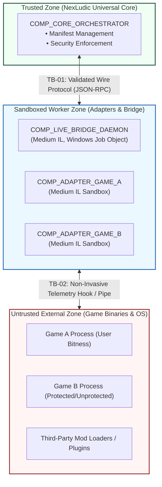
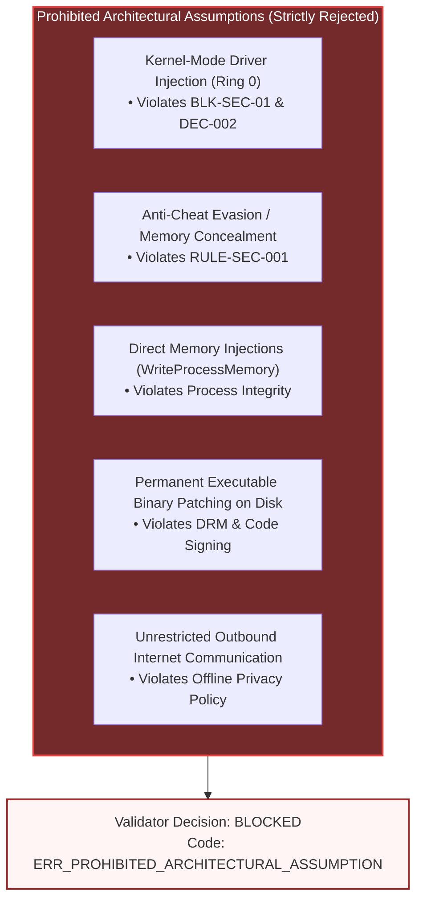

# Integration Architecture Security, Trust & Authorization Specification

**Document ID:** `NLE-SEC-STA-001`  
**Version:** `1.0.0`  
**Status:** `APPROVED SECURITY ARCHITECTURE SPECIFICATION`  
**Phase:** `Phase 6 of 12 — Mashup Designer & Integration Planning`  
**Step:** `Step 46 of 100`  
**Classification:** `Security Architecture, Trust Boundaries & Privilege Specification`  
**Related Documents:**
- [INTEGRATION_ARCHITECTURE_BLUEPRINT_AND_COMPONENT_MAPPING_SPECIFICATION.md](file:///d:/App%20Winrar%20Files/Nexludic%20Engine%20(working)/docs/mashup-designer/INTEGRATION_ARCHITECTURE_BLUEPRINT_AND_COMPONENT_MAPPING_SPECIFICATION.md) (`NLE-SPC-IAB-001`)
- [ADAPTER_SECURITY_SANDBOX_AND_PROCESS_ISOLATION_SPECIFICATION.md](file:///d:/App%20Winrar%20Files/Nexludic%20Engine%20(working)/docs/adapters/ADAPTER_SECURITY_SANDBOX_AND_PROCESS_ISOLATION_SPECIFICATION.md) (`NLE-SPC-ASI-001`)
- [INTEGRATION_STRATEGY_SECURITY_PRIVACY_AND_FAILURE_POLICY.md](file:///d:/App%20Winrar%20Files/Nexludic%20Engine%20(working)/docs/mashup-designer/INTEGRATION_STRATEGY_SECURITY_PRIVACY_AND_FAILURE_POLICY.md) (`NLE-POL-ISS-001`)

---

## 1. Trust Boundaries & Isolation Model

An integration architecture blueprint establishes formal trust boundaries between components. The platform operates on the principle of **Zero Implicit Trust (`RUL-STA-01`)**: no component inherits privileges from another component simply because they belong to the same mashup project:

### Trust Boundary Definitions:
1. **`TB-01` (Core-to-Adapter Boundary):** Separates the Universal Core from game adapters. All payloads traversing `TB-01` must strictly conform to the validated Phase 5 SDK schemas (`NLE-CON-AIR-001`). Malformed or unvalidated payloads are rejected at the gate.
2. **`TB-02` (Adapter-to-Game Process Boundary):** Separates unprivileged adapter sidecars from game executables. Telemetry reading must use documented extension points or unprivileged named pipes. Arbitrary debugger attachment (`OpenProcess(PROCESS_ALL_ACCESS)`) is strictly barred.
3. **`TB-03` (Internal-to-External Toolchain Boundary):** Separates native NexLudic components from third-party mod loaders. External tools are treated as untrusted external dependencies requiring explicit verification.

---

## 2. Least Privilege & Windows Integrity Level Enforcement

In accordance with platform governance (`DEC-002`):

| Component ID | Assigned Integrity Level | OS Privilege Tokens | Filesystem Access Boundary | Process Boundary Permissions |
| :--- | :--- | :--- | :--- | :--- |
| `COMP_CORE_ORCHESTRATOR` | **Medium Integrity Level** | Standard User (`None`) | Read/Write to `D:\NexLudic\Projects\<id>\` | Spawns unprivileged sidecars |
| `COMP_LIVE_BRIDGE_DAEMON`| **Medium Integrity Level** | Standard User (`None`) | Read-only to cache; ephemeral IPC buffers | Manages Named Pipes (`\\.\pipe\nexludic-*`) |
| `COMP_ADAPTER_*` | **Medium Integrity Level** | Standard User (`None`) | Read-only to game directory; isolated scratch | Non-invasive loopback communication |
| `COMP_DATA_TRANSFORMER` | **Restricted Sandbox** | Zero Token (`Restricted`) | In-memory zero-copy buffers only | Pure computational transformation |

### Invariant Rules:
1. **Rule RUL-STA-02 (Zero UAC Elevation):** No component in the blueprint may require Administrator privileges or UAC elevation. If an integration technique demands Administrator elevation, it is rejected as a security defect (`ERR_ELEVATION_PROHIBITED`).
2. **Rule RUL-STA-03 (Storage Sandboxing DEC-009):** All blueprint storage, intermediate transformation buffers, and cached files must reside strictly on Volume D (`D:\NexLudic\Projects\<project-id>\`). Touching `C:\Windows\`, `C:\Program Files\`, or `%APPDATA%` without authorization is prohibited.

---

## 3. Explicitly Prohibited Architecture Assumptions

The blueprint validator rejects any architecture proposal containing the following prohibited technical assumptions:

1. **Kernel Driver Execution (`BLK-SEC-01`):** A blueprint cannot depend on installing or executing kernel-mode drivers (`.sys`).
2. **Anti-Cheat Circumvention (`RULE-SEC-001`):** Any component designed to evade, blind, or hook around kernel anti-cheat engines (e.g. EAC, BattlEye, Vanguard) is barred.
3. **Invasive Memory Injection:** Modifying foreign game process memory via `WriteProcessMemory` or DLL injection without an approved in-engine mod loader is strictly prohibited.
4. **Permanent Executable Patching:** Modifying game `.exe` or `.dll` binaries directly on disk is barred to prevent DRM corruption and irreversible file tampering.
5. **Unauthorized Network Telemetry:** All cross-game IPC must bind strictly to local loopback (`127.0.0.1`) or local named pipes. Transmitting telemetry to external remote clouds is prohibited.

---
*End of Specification — Document `NLE-SEC-STA-001`.*
