# Integration Architecture Synthetic Scenarios & Validation Plan

**Document ID:** `NLE-CAT-ASV-001`  
**Version:** `1.0.0`  
**Status:** `APPROVED VALIDATION PLAN & SCENARIO CATALOG`  
**Phase:** `Phase 6 of 12 — Mashup Designer & Integration Planning`  
**Step:** `Step 46 of 100`  
**Classification:** `Architecture Validation Plan & Synthetic Scenario Catalog`  
**Related Documents:**
- [INTEGRATION_ARCHITECTURE_BLUEPRINT_AND_COMPONENT_MAPPING_SPECIFICATION.md](file:///d:/App%20Winrar%20Files/Nexludic%20Engine%20(working)/docs/mashup-designer/INTEGRATION_ARCHITECTURE_BLUEPRINT_AND_COMPONENT_MAPPING_SPECIFICATION.md) (`NLE-SPC-IAB-001`)
- [INTEGRATION_ARCHITECTURE_REVISION_REVIEW_AND_INVALIDATION_POLICY.md](file:///d:/App%20Winrar%20Files/Nexludic%20Engine%20(working)/docs/mashup-designer/INTEGRATION_ARCHITECTURE_REVISION_REVIEW_AND_INVALIDATION_POLICY.md) (`NLE-POL-ARI-001`)
- [INTEGRATION_ARCHITECTURE_SECURITY_TRUST_AND_AUTHORIZATION_SPECIFICATION.md](file:///d:/App%20Winrar%20Files/Nexludic%20Engine%20(working)/docs/mashup-designer/INTEGRATION_ARCHITECTURE_SECURITY_TRUST_AND_AUTHORIZATION_SPECIFICATION.md) (`NLE-SEC-STA-001`)

---

## 1. Architecture Validation Plan

This document establishes the formal validation plan for the Integration Architecture Blueprint domain. In accordance with platform governance, all scenarios presented are **formal specification benchmarks and synthetic validation test cases**, not executed runtime tests on live commercial games.

The validation harness evaluates four distinct dimensions:
1. **Structural Validation:** Schema conformance, identifier uniqueness, graph connectivity, and Directed Acyclic Graph (DAG) cycle rejection.
2. **Semantic Validation:** Requirement coverage completeness, single ownership enforcement, and contract reference validity.
3. **Security & Boundary Validation:** Anti-cheat compliance (`BLK-SEC-01`), Medium IL sandboxing (`DEC-002`), and Volume D persistence (`DEC-009`).
4. **Explainability Validation:** Auditing that the blueprint explains why every component exists, which requirements it supports, and what failure modes are contained.

---

## 2. Synthetic Acceptance Scenarios (Scenarios A through J)

All scenarios evaluate the canonical fictional titles **Game Orion** (Single-player fantasy RPG; 64-bit; active modding; no anti-cheat) and **Game Atlas** (Multiplayer sci-fi survival simulator; 64-bit; EAC kernel anti-cheat in multiplayer, disabled in offline local mode).

```mermaid
flowchart TD
    ScenA["Scenario A: Host-Game Modification<br/>(Validates Mod Surface Boundaries)"]
    ScenB["Scenario B: Live Interoperability Bridge<br/>(Validates IPC Daemon Boundaries)"]
    ScenC["Scenario C: Hybrid Integration<br/>(Validates Dual Mechanism Topologies)"]
    ScenD["Scenario D: Missing Adapter Capability<br/>(Validates Unmapped Requirement Gating)"]
    ScenE["Scenario E: Conflicting Requirements<br/>(Validates Conflict Halting)"]
    ScenF["Scenario F: Stale Game-Version Evidence<br/>(Validates Invalidation to STALE)"]
    ScenG["Scenario G: Unsupported Comm Assumption<br/>(Validates Security Rejection)"]
    ScenH["Scenario H: Multiple Architecture Alternatives<br/>(Validates Alternative Preservation)"]
    ScenI["Scenario I: Missing Upstream Contract<br/>(Validates Governance Halting)"]
    ScenJ["Scenario J: Unnecessary Component<br/>(Validates Speculative Component Rejection)"]

    style ScenA fill:#f0fff4,stroke:#22543d,stroke-width:1px
    style ScenB fill:#ebf8ff,stroke:#2b6cb0,stroke-width:1px
    style ScenC fill:#fffaf0,stroke:#dd6b20,stroke-width:1px
    style ScenD fill:#fff5f5,stroke:#e53e3e,stroke-width:1px
    style ScenE fill:#fff5f5,stroke:#e53e3e,stroke-width:1px
    style ScenF fill:#fefcbf,stroke:#d69e2e,stroke-width:1px
    style ScenG fill:#742a2a,color:#fff,stroke:#e53e3e,stroke-width:2px
    style ScenH fill:#faf5ff,stroke:#553c9e,stroke-width:1px
    style ScenI fill:#edf2f7,stroke:#2d3748,stroke-width:1px
    style ScenJ fill:#fff5f5,stroke:#9b2c2c,stroke-width:1px
```

---

### Scenario A: Host-Game Modification Architecture
- **Context:** User creates a static armor mashup importing Game Atlas armor into Game Orion. Strategy is `STRAT_HOST_MOD`.
- **Planned Components:** `COMP_CORE_ORCHESTRATOR`, `COMP_ADAPTER_GAME_ORION`, `COMP_HOST_EXTENSION_SURFACE`.
- **Validation Finding:** Passes all 8 Quality Gates. Zero live IPC daemons planned; Game Atlas process is not spawned.
- **Expected Status:** Transitions to **`ACCEPTED_FOR_PLANNING`**.

### Scenario B: Live Interoperability Bridge Architecture
- **Context:** Dynamic inventory synchronization between running instances of Game Orion and Game Atlas. Strategy is `STRAT_LIVE_BRIDGE`.
- **Planned Components:** `COMP_CORE_ORCHESTRATOR`, `COMP_ADAPTER_GAME_ORION`, `COMP_ADAPTER_GAME_ATLAS`, `COMP_LIVE_BRIDGE_DAEMON`, `COMP_STATE_SYNCHRONIZER`.
- **Validation Finding:** Passes Gates 1–8. Named Pipe transport bound to Medium IL; complete process isolation verified.
- **Expected Status:** Transitions to **`ACCEPTED_FOR_PLANNING`**.

### Scenario C: Hybrid Integration Architecture
- **Context:** Real-time health mirroring with custom in-engine Game Orion HUD widget. Strategy is `STRAT_HYBRID`.
- **Planned Components:** Host Mod Surface (HUD), Live Bridge Daemon (Health Sync), Core, and both Adapters.
- **Validation Finding:** Dual mechanisms justified by mandatory requirements (`RULE-STR-HY-002`). Failure boundaries decoupled.
- **Expected Status:** Transitions to **`ACCEPTED_FOR_PLANNING`**.

### Scenario D: Missing Adapter Capability
- **Context:** Requirement mandates dynamic vehicle physics synchronization, but neither adapter declares or validates `CAP_VEHICLE_PHYSICS`.
- **Validation Finding:** Gate 3 fails (`ERR_MANDATORY_REQUIREMENTS_UNMAPPED`).
- **Expected Status:** Blueprint capped at **`INCOMPLETE`**; deficit logged in `unresolved_decisions`.

### Scenario E: Conflicting Requirements
- **Context:** Requirement 1 demands lossy compression for high-frequency telemetry, while Requirement 2 demands lossless transaction verification for inventory.
- **Validation Finding:** Validator detects conflicting property mapping rules in `COMP_DATA_TRANSFORMER`.
- **Expected Status:** Capped at **`INCOMPLETE`**; halts planning until user resolves conflict in Step 44.

### Scenario F: Stale Game-Version Evidence
- **Context:** Blueprint previously accepted. Game Orion receives patch `v1.5.0` on Steam.
- **Validation Finding:** Invalidation event `B-INV-01` triggered; mod loader offsets unverified on new build.
- **Expected Status:** Blueprint state transitions from `ACCEPTED_FOR_PLANNING` to **`STALE`**.

### Scenario G: Unsupported Communication Assumption (Security Violation)
- **Context:** Candidate blueprint proposes using `WriteProcessMemory` directly into Game Atlas while kernel anti-cheat is active.
- **Validation Finding:** Gate 7 fails (`ERR_PROHIBITED_SECURITY_ASSUMPTION`, `BLK-SEC-01`).
- **Expected Status:** Blueprint immediately marked **`BLOCKED`**.

### Scenario H: Multiple Architectural Alternatives
- **Context:** Two viable component arrangements exist for inventory transfer: (1) In-memory Shared Memory ring buffer vs (2) Named Pipe streaming.
- **Validation Finding:** Validator preserves both alternatives under `dependencies` tagged `ALTERNATIVE_TO`.
- **Expected Status:** Preserves both candidates as **`READY_FOR_REVIEW`**; prompts creator decision.

### Scenario I: Missing Upstream Contract
- **Context:** Blueprint references an unreleased Phase 5 capability schema (`NLE-SCH-EXPERIMENTAL`).
- **Validation Finding:** Gate 6 fails (`ERR_CONTRACT_REFERENCE_UNRESOLVED`).
- **Expected Status:** Capped at **`INCOMPLETE`**; halts until contract is approved.

### Scenario J: Unnecessary Component (Speculative Design)
- **Context:** Blueprint includes `COMP_NEURAL_VOICE_SYNTHESIZER`, but zero user requirements involve audio or voice.
- **Validation Finding:** Gate 2 fails (`ERR_UNJUSTIFIED_COMPONENT`).
- **Expected Status:** Rejected; validator requires removing speculative component.

---
*End of Catalog — Document `NLE-CAT-ASV-001`.*
