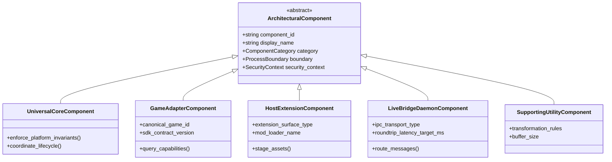
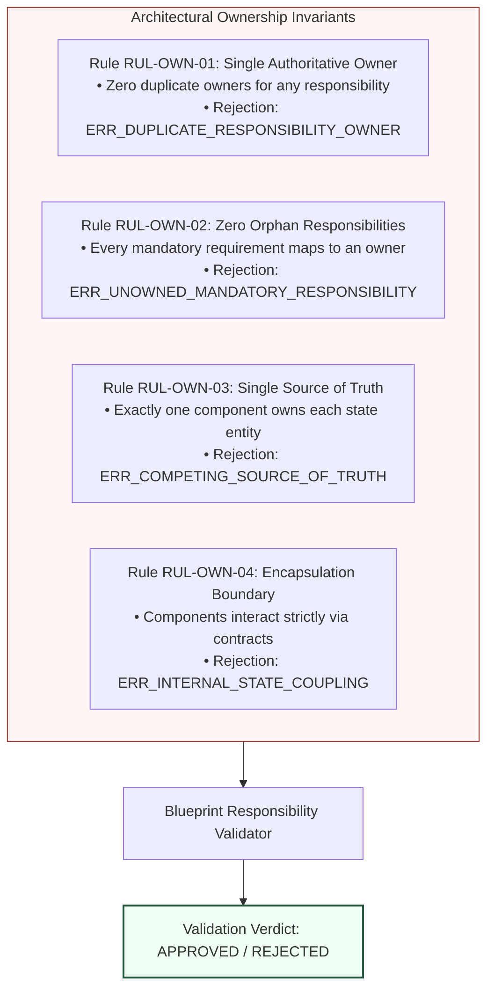

# Integration Component Catalog & Responsibility Matrix

**Document ID:** `NLE-CAT-ICR-001`  
**Version:** `1.0.0`  
**Status:** `APPROVED COMPONENT ARCHITECTURE & RESPONSIBILITY CATALOG`  
**Phase:** `Phase 6 of 12 — Mashup Designer & Integration Planning`  
**Step:** `Step 46 of 100`  
**Classification:** `Component Taxonomy & Responsibility Allocation Specification`  
**Related Documents:**
- [INTEGRATION_ARCHITECTURE_BLUEPRINT_AND_COMPONENT_MAPPING_SPECIFICATION.md](file:///d:/App%20Winrar%20Files/Nexludic%20Engine%20(working)/docs/mashup-designer/INTEGRATION_ARCHITECTURE_BLUEPRINT_AND_COMPONENT_MAPPING_SPECIFICATION.md) (`NLE-SPC-IAB-001`)
- [INTEGRATION_ARCHITECTURE_BLUEPRINT_DOMAIN_MODEL.md](file:///d:/App%20Winrar%20Files/Nexludic%20Engine%20(working)/docs/mashup-designer/INTEGRATION_ARCHITECTURE_BLUEPRINT_DOMAIN_MODEL.md) (`NLE-MOD-ABD-001`)
- [UNIVERSAL_ADAPTER_SDK_CORE_SPECIFICATION.md](file:///d:/App%20Winrar%20Files/Nexludic%20Engine%20(working)/docs/adapters/UNIVERSAL_ADAPTER_SDK_CORE_SPECIFICATION.md) (`NLE-SPC-SDK-001`)

---

## 1. Logical Component Taxonomy

An integration blueprint models a mashup system as a collection of specialized, loosely coupled logical components. Each component belongs to a formal architectural category:

### Component Categories:
1. **Universal Core (`UNIVERSAL_CORE`):**  
   - Representative Component: `COMP_CORE_ORCHESTRATOR`.  
   - Responsibilities: Platform invariant enforcement (`DEC-002`, `DEC-009`, `BLK-SEC-01`), project manifest state management, schema validation, lifecycle handshakes, and diagnostic telemetry routing. Contains strictly **zero** game-specific code.
2. **Game-Specific Adapters (`GAME_ADAPTER`):**  
   - Representative Components: `COMP_ADAPTER_GAME_A`, `COMP_ADAPTER_GAME_B`.  
   - Responsibilities: Translating platform wire protocols to game-specific representations, querying local game installations, exposing declared capabilities, and formatting telemetry.
3. **Host-Game Integration Boundary (`HOST_EXTENSION_SURFACE`):**  
   - Representative Component: `COMP_HOST_EXTENSION_SURFACE`.  
   - Responsibilities: Authorized in-engine extension points (e.g. Creation Kit scripts, Harmony patches, UE4SS pak mounting). Executes in-process within the Host Game.
4. **Communication & Bridge Boundary (`LIVE_BRIDGE_DAEMON`):**  
   - Representative Component: `COMP_LIVE_BRIDGE_DAEMON`.  
   - Responsibilities: Unprivileged out-of-process IPC sidecar (`ADR-0009`). Manages Named Pipes (`\\.\pipe\nexludic-*`) or Shared Memory buffers; handles channel multiplexing, heartbeat timeouts, and message routing.
5. **Supporting Utilities:**  
   - `COMP_DATA_TRANSFORMER`: Performs schema and unit conversions (e.g. mapping Minecraft coordinates to Skyrim Havok physics coordinates).  
   - `COMP_STATE_SYNCHRONIZER`: Maintains delta-compression and consistency tracking for mirrored entities.  
   - `COMP_DIAGNOSTICS_MONITOR`: Collects ring-buffer logs and health heartbeats.  
   - `COMP_RECOVERY_COORDINATOR`: Executes rollback or safe disconnection workflows during unexpected failures.
6. **External Dependencies (`EXTERNAL_DEPENDENCY`):**  
   - Representative Component: `COMP_EXTERNAL_MOD_LOADER`. Third-party frameworks outside NexLudic Engine's codebase.

---

## 2. Component Responsibility Matrix

The matrix below maps the primary architectural responsibilities across components, establishing single authoritative ownership:

| Responsibility ID | Responsibility Title & Scope | Authoritative Component Owner | Collaborator Components | Governing Contract | Data Ownership | Failure Boundary |
| :--- | :--- | :--- | :--- | :--- | :--- | :--- |
| **`RESP-ORC-01`** | Project Manifest & State Governance | `COMP_CORE_ORCHESTRATOR` | All Components | `NLE-SPC-MPD-001` | `project.json` on Volume D | Halts mashup designer |
| **`RESP-ORC-02`** | Security Policy & Anti-Cheat Gatekeeper | `COMP_CORE_ORCHESTRATOR` | OS Process Manager | `BLK-SEC-01`, `DEC-002` | Security audit log | Hard-blocks execution |
| **`RESP-ADP-01`** | Game A Translation & Protocol Unpacking | `COMP_ADAPTER_GAME_A` | `COMP_CORE_ORCHESTRATOR` | `NLE-SPC-SDK-001` | Adapter internal state | Isolates Game A channel |
| **`RESP-ADP-02`** | Game B Translation & Protocol Unpacking | `COMP_ADAPTER_GAME_B` | `COMP_CORE_ORCHESTRATOR` | `NLE-SPC-SDK-001` | Adapter internal state | Isolates Game B channel |
| **`RESP-MOD-01`** | In-Engine Asset Rendering & HUD Injection | `COMP_HOST_EXTENSION_SURFACE` | `COMP_ADAPTER_GAME_A` | Host Mod Loader API | Host game scene graph | Crashes host game |
| **`RESP-IPC-01`** | Inter-Process Message Routing & Framing | `COMP_LIVE_BRIDGE_DAEMON` | Adapters A & B | `ADR-0009` | Transmit ring buffers | Drops channel; signals retry |
| **`RESP-TRN-01`** | Cross-Game Semantic Property Mapping | `COMP_DATA_TRANSFORMER` | Adapters A & B | `NLE-SPC-CRS-001` | Transformation schemas | Emits format error |
| **`RESP-SYN-01`** | State Mirroring & Tick Synchronization | `COMP_STATE_SYNCHRONIZER` | `COMP_LIVE_BRIDGE_DAEMON`| `NLE-SPC-CNA-001` | Shared entity registry | Flags desynchronization |
| **`RESP-DIA-01`** | Heartbeat Monitoring & Log Ring-Buffering | `COMP_DIAGNOSTICS_MONITOR` | All Components | `NLE-SPC-ALC-001` | Diagnostic event stream | Logs monitoring fault |
| **`RESP-REC-01`** | Transaction Rollback & Disconnect Cleanup | `COMP_RECOVERY_COORDINATOR` | Core & Bridge | `NLE-POL-DFB-001` | Rollback manifests | Enters safe fail-stop mode |

---

## 3. Anti-Duplication & Single Ownership Invariants

To eliminate race conditions, architectural drift, and state corruption, the blueprint validator enforces four deterministic ownership invariants:

### Invariant Rules:
1. **Single Authoritative Owner (`RUL-OWN-01`):** A responsibility can be assigned to exactly one component. If both `COMP_CORE_ORCHESTRATOR` and `COMP_DATA_TRANSFORMER` declare ownership of coordinate conversion, the blueprint is rejected (`ERR_DUPLICATE_RESPONSIBILITY_OWNER`).
2. **Zero Orphan Responsibilities (`RUL-OWN-02`):** Every operational requirement derived from Step 44 must be explicitly assigned to an owning component. Any unmapped requirement halts blueprint acceptance (`ERR_UNOWNED_MANDATORY_RESPONSIBILITY`).
3. **Single Source of Truth (`RUL-OWN-03`):** Every data entity in the mashup (e.g., player inventory snapshot, world position) must have an unambiguously designated primary author. Consuming components maintain read-only mirrors.
4. **Encapsulation & Contract Purity (`RUL-OWN-04`):** Components are strictly prohibited from inspecting the private memory or implementation internals of other components. All interaction must traverse documented contracts (`NLE-SPC-ICI-001`).

---
*End of Catalog — Document `NLE-CAT-ICR-001`.*
