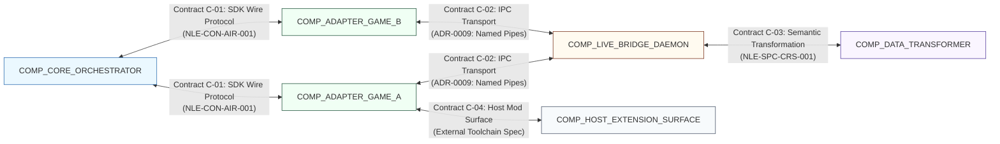

# Integration Component Interface & Contract Reference Specification

**Document ID:** `NLE-SPC-ICI-001`  
**Version:** `1.0.0`  
**Status:** `APPROVED CONTRACT SPECIFICATION`  
**Phase:** `Phase 6 of 12 — Mashup Designer & Integration Planning`  
**Step:** `Step 46 of 100`  
**Classification:** `Interface Governance & Contract Reference Specification`  
**Related Documents:**
- [INTEGRATION_ARCHITECTURE_BLUEPRINT_AND_COMPONENT_MAPPING_SPECIFICATION.md](file:///d:/App%20Winrar%20Files/Nexludic%20Engine%20(working)/docs/mashup-designer/INTEGRATION_ARCHITECTURE_BLUEPRINT_AND_COMPONENT_MAPPING_SPECIFICATION.md) (`NLE-SPC-IAB-001`)
- [UNIVERSAL_ADAPTER_SDK_CORE_SPECIFICATION.md](file:///d:/App%20Winrar%20Files/Nexludic%20Engine%20(working)/docs/adapters/UNIVERSAL_ADAPTER_SDK_CORE_SPECIFICATION.md) (`NLE-SPC-SDK-001`)
- [ADAPTER_ADMISSION_INITIALIZATION_AND_READINESS_CONTRACT.md](file:///d:/App%20Winrar%20Files/Nexludic%20Engine%20(working)/docs/adapters/ADAPTER_ADMISSION_INITIALIZATION_AND_READINESS_CONTRACT.md) (`NLE-CON-AIR-001`)
- [ADAPTER_SECURITY_SANDBOX_AND_PROCESS_ISOLATION_SPECIFICATION.md](file:///d:/App%20Winrar%20Files/Nexludic%20Engine%20(working)/docs/adapters/ADAPTER_SECURITY_SANDBOX_AND_PROCESS_ISOLATION_SPECIFICATION.md) (`NLE-SPC-ASI-001`)

---

## 1. Interface & Contract Governance Principles

Components in an integration architecture blueprint do not invent proprietary communication methods. Every interaction must be bound to an approved, authoritatively specified contract:



### Invariant Rules:
1. **Contract Purity (`RUL-ICI-01`):** No component may communicate across a process or security boundary without an explicit, approved contract reference. Raw memory pointers or unvalidated handles are strictly banned.
2. **Version Pinning (`RUL-ICI-02`):** Every contract reference must explicitly state the minimum supported contract version. If an adapter's contract version is incompatible with the core's contract version, the interface is rejected.
3. **Zero Fabricated Contracts (`RUL-ICI-03`):** If an interaction requires a protocol that does not yet exist in approved platform specifications, the interface must be recorded as `PROVISIONAL_UNRESOLVED_CONTRACT`. The blueprint cannot be accepted for planning until the contract is formally specified.

---

## 2. Authoritative Contract Reference Catalog

The blueprint framework recognizes five formal contract categories:

| Contract Ref ID | Interaction Scope | Producer Component | Consumer Component | Authoritative Specification | Protocol / Transport Mechanism | Timeout / Error Bound |
| :--- | :--- | :--- | :--- | :--- | :--- | :--- |
| **`CTR-SDK-WIRE`** | SDK Lifecycle & Capability Queries | `COMP_CORE_ORCHESTRATOR` | `COMP_ADAPTER_*` | `NLE-CON-AIR-001` | Length-prefixed JSON-RPC over Standard I/O or Named Pipe | $5,000\text{ ms}$ timeout; aborts on desync |
| **`CTR-IPC-TRANS`**| Low-Latency Event & Telemetry IPC | `COMP_ADAPTER_*` | `COMP_LIVE_BRIDGE_DAEMON`| `ADR-0009`, `NLE-SPC-ASI-001` | Windows Local Named Pipes (`\\.\pipe\nexludic-*`) | $50\text{ ms}$ tick timeout; retry 3 times |
| **`CTR-SEM-XFRM`** | Property Mapping & Unit Conversion | `COMP_LIVE_BRIDGE_DAEMON`| `COMP_DATA_TRANSFORMER` | `NLE-SPC-CRS-001` | In-memory zero-copy buffer / shared struct | Synchronous execution; fails on validation error |
| **`CTR-HST-MOD`**  | In-Engine Mod Hook Execution | `COMP_ADAPTER_HOST` | `COMP_HOST_EXTENSION_SURFACE`| Vendor Mod Toolchain | Native in-process C#/C++ function export | In-process execution; unisolated blast radius |
| **`CTR-DIA-TELE`** | Telemetry Streaming & Diagnostics | All Components | `COMP_DIAGNOSTICS_MONITOR` | `NLE-SPC-ALC-001` | Non-blocking 4,096-slot lockless ring buffer | Drops oldest event on overflow; zero caller block |

---

## 3. Interface Interaction Definition Contract

Every interface edge in the blueprint's `dependencies` array must specify the following structured attributes:

```json
{
  "edge_id": "EDGE_BRIDGE_TO_ADAPTER_A",
  "source_component_id": "COMP_LIVE_BRIDGE_DAEMON",
  "target_component_id": "COMP_ADAPTER_GAME_A",
  "dependency_type": "COMMUNICATES_WITH",
  "contract_reference": "CTR-IPC-TRANS",
  "protocol_version_min": "1.0.0",
  "is_critical_path": true,
  "preconditions": [
    "Adapter Game A must be in lifecycle state READY or ACTIVE",
    "Named Pipe security descriptor must restrict access to Medium Integrity Level"
  ],
  "expected_success_behavior": "Bidirectional framing at 60 Hz tick rate with < 10 ms round-trip latency",
  "failure_behavior": "On pipe broken or timeout, Bridge raises EVENT_ADAPTER_DISCONNECTED and signals recovery",
  "timeout_ms": 50,
  "cancellation_supported": true,
  "trust_boundary_crossed": true
}
```

---

## 4. Handling Missing, Incompatible, or Unapproved Interfaces

When an integration requirement necessitates an interface that lacks an approved contract, the engine adheres to the **Unresolved Interface Protocol (`RUL-UIP-01`)**:

| Interface Defect | Verification Finding | Blueprint State Impact | Permitted Action |
| :--- | :--- | :--- | :--- |
| Missing contract specification (e.g. unknown proprietary netcode). | `ERR_CONTRACT_SPECIFICATION_MISSING` | Blueprint capped at `INCOMPLETE`. | Register gap in `unresolved_decisions`; do not assume protocol. |
| Incompatible protocol version (e.g. Adapter supports v1.0; Core requires v2.0). | `ERR_CONTRACT_VERSION_INCOMPATIBLE` | Blueprint marked `BLOCKED`. | Requires adapter upgrade; cannot proceed to planning. |
| Contract requires elevated privileges (e.g. Admin UAC or kernel driver). | `ERR_CONTRACT_SECURITY_VIOLATION` | Blueprint marked `BLOCKED` (`BLK-SEC-01`). | Disqualifies interface; prompt user for unprivileged alternative. |
| Unverified third-party mod hook (e.g. experimental beta script extender). | `WARN_CONTRACT_UNVERIFIED_EXTERNAL` | Blueprint marked `READY_FOR_REVIEW` with condition. | Disclose stability risk in review report. |

---
*End of Specification — Document `NLE-SPC-ICI-001`.*
