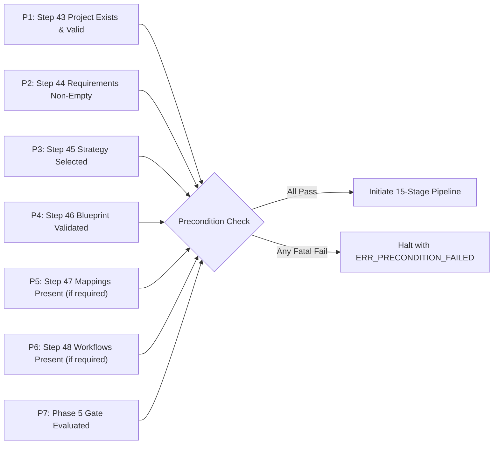

# NexLudic Engine: Integration Plan Assembly Rules & Source Contracts

**Document ID:** `NLE-RUL-IPA-001`  
**Phase:** 6 of 12 (Mashup Designer & Integration Planning)  
**Step:** 49 of 100  
**Classification:** Assembly Rules & Transformation Contract  
**Status:** IMPLEMENTATION-READY SPECIFICATION  

---

## 1. Assembly Preconditions & Gating Criteria

Before the integration plan assembly pipeline initiates execution, it verifies that all prerequisite planning inputs exist, are well-formed, and satisfy minimal structural readiness.

### 1.1 Mandatory Assembly Preconditions

| Precondition ID | Verification Check | Fatal Failure Code |
| :--- | :--- | :--- |
| **PRE-PLN-01** | `project.json` exists, matches schema `NLE-SCH-MPD-001`, and defines at least 2 participating games. | `ERR_PRECONDITION_INVALID_PROJECT` |
| **PRE-PLN-02** | `requirements.json` exists, matches schema `NLE-SCH-MRD-001`, and contains $\ge 1$ requirement with `priority == MANDATORY`. | `ERR_PRECONDITION_EMPTY_REQUIREMENTS` |
| **PRE-PLN-03** | `strategy.json` exists, matches schema `NLE-SCH-ISE-001`, and has a concrete `selected_strategy` (`HOST_MOD_ONLY`, `LIVE_BRIDGE_ONLY`, `HYBRID`). | `ERR_PRECONDITION_UNSELECTED_STRATEGY` |
| **PRE-PLN-04** | `blueprint.json` exists, matches schema `NLE-SCH-IAB-001`, and defines valid component nodes and interfaces. | `ERR_PRECONDITION_INVALID_BLUEPRINT` |
| **PRE-PLN-05** | If requirements involve cross-game data exchange, `mappings.json` must exist and define corresponding transformations. | `ERR_PRECONDITION_MISSING_MAPPINGS` |
| **PRE-PLN-06** | If requirements involve multi-step orchestration, `workflows.json` must exist and define corresponding workflows. | `ERR_PRECONDITION_MISSING_WORKFLOWS` |
| **PRE-PLN-07** | Phase 5 SDK gate status (`NLE-GAT-PH5-001`) must be loaded from `STEP_42_COMPLETION_REPORT.md` (must not be `BLOCKED`). | `ERR_PRECONDITION_PHASE5_BLOCKED` |

---

## 2. Requirement-Driven Inclusion & Pruning Engine

To avoid plan bloat and prevent undocumented side-effects, the planning engine enforces **Requirement-Driven Inclusion**.

### 2.1 Traceability Chains
Every architectural component, data mapping, and workflow step included in the plan descriptor must establish an explicit backwards-traceability chain to an approved requirement:

$$\text{PlanItem}_k \longrightarrow \text{Component / Mapping / Step} \longrightarrow \text{FeatureRequirement}_i \longrightarrow \text{UserObjective}_j$$

### 2.2 Pruning of Ungrounded Items
If an upstream artifact includes components or mappings that have no direct or indirect relationship to any requirement:
1. The assembly engine flags the item with `WARN_UNGROUNDED_PLAN_ITEM`.
2. If the ungrounded item is non-essential (e.g., an experimental debug bridge), it is pruned from the plan execution stages.
3. If the ungrounded item introduces security risks (e.g., unrequested memory hooking), the entire plan is halted with `ERR_UNAUTHORIZED_EXPANSION`.

---

## 3. Plan Assembly Sequence & Transformation Logic

The 15-stage assembly pipeline processes inputs in deterministic order:

### Stage 1: Input Intake & Authority Verification
- Ingest raw JSON payloads.
- Verify that every payload is owned by the expected step authority.

### Stage 2: Freshness & Hash Snapshot Binding
- Compute SHA-256 hashes of all files.
- Store snapshot records in `upstream_snapshots`.

### Stage 3: Upstream Gate & Exception Audit
- Ingest `NLE-GAT-PH5-001`.
- If `READY WITH CONDITIONS`, extract conditions `P5-C01`, `P5-C02`, `P5-C03`.
- Any component or workflow relying on conditional capabilities is tagged `STATUS = PROVISIONAL`.

### Stage 4: Project & Participant Context Ingestion
- Extract canonical game identifiers (e.g., `gm-orion-v1.4`, `gm-atlas-v2.0`).
- Validate compatibility environments and OS constraints (Windows 10/11 x64, Medium IL).

### Stage 5: Requirement Baseline Ingestion
- Ingest all `FeatureRequirement` items.
- Partition requirements into `MANDATORY`, `OPTIONAL`, and `CONDITIONAL` sets.

### Stage 6: Strategy Feasibility & Gate Binding
- Verify that `selected_strategy` is eligible under Step 45 feasibility gates (`F-GATE-01..05`).
- Extract documented trade-offs and residual risks.

### Stage 7: Blueprint & Component Responsibility Binding
- Extract component instances (`HostMod`, `LiveBridge`, `ProtocolTranslator`, `SharedMemoryBuffer`).
- Bind each component to its designated participating game runtime.

### Stage 8: Data Mapping & Transformation Ingestion
- Map source properties to target properties.
- Verify unit conversions and fidelity preservation bounds.

### Stage 9: Workflow & Sequencing Contract Binding
- Ingest workflow execution steps, prerequisites, and retry/compensation handlers.

### Stage 10: Unified Dependency Graph Extraction
- Extract all pairwise dependencies across all ingested items into a uniform dependency edge list.

### Stage 11: Kahn's DAG Cycle & Ordering Resolution
- Run Kahn's algorithm over the unified edge list.
- If cycle detected, identify loop and emit `ERR_PLAN_CIRCULAR_DEPENDENCY`.
- If acyclic, group items into partitioned execution stages (`PlanExecutionStage[0..N]`).

### Stage 12: Requirement Coverage & Completeness Analysis
- Calculate structural coverage, mapping coverage, and workflow coverage for every requirement.
- Compute completeness ratios.

### Stage 13: Risk, Assumption & Open Decision Aggregation
- Merge risk registers from Steps 44, 45, 46, 47, and 48 into a centralized plan ledger.
- Retain open architectural decisions with resolution deadlines.

### Stage 14: Quality Gate Evaluation
- Execute `GATE-PLN-01` through `GATE-PLN-10`.
- Assign tentative lifecycle state (`ACCEPTED_FOR_PLANNING`, `ACCEPTED_WITH_RISKS`, or `INVALID`).

### Stage 15: Descriptor Serialization & Snapshot Storage
- Compute canonical checksum `plan_checksum_sha256`.
- Write descriptor JSON and historical snapshot archive to Volume D.

---

## 4. Partial Assembly Semantics

The engine supports partial plan assembly (`ASSEMBLED_PARTIAL`) under strictly defined conditions:

1. **Permissible Gaps:**
   - Optional requirements (`priority == OPTIONAL`) lack complete mappings or workflows.
   - Conditional requirements (`priority == CONDITIONAL`) await external configuration choices.
   - Non-critical telemetry or diagnostics components are unconfigured.
2. **Prohibited Gaps:**
   - Any mandatory requirement (`priority == MANDATORY`) lacks a blueprint component, data mapping, or workflow step.
   - Core game participant identity is undefined.
   - Strategy is unselected.
3. **State Transition Rules for Partial Plans:**
   - A partial plan can be validated and stored as `ASSEMBLED_PARTIAL`.
   - A partial plan can never reach `ACCEPTED_FOR_PLANNING`. Its highest possible accepted state is `ACCEPTED_WITH_RISKS`.

---

## 5. Duplicate and Conflicting Input Handling

| Occurrence | Identification Rule | Deduplication / Conflict Protocol | Emitted Diagnostic |
| :--- | :--- | :--- | :--- |
| **Duplicate Requirement ID** | Two requirements share identical `requirement_id`. | Reject input set; requirement IDs must be unique within project. | `ERR_DUPLICATE_REQUIREMENT_ID` |
| **Redundant Dependency Edge** | Item A depends on Item B via multiple declarations. | Keep edge with the highest severity (`is_hard_dependency = true`). | `INFO_REDUNDANT_EDGE_MERGED` |
| **Conflicting Property Units** | Step 47 specifies meters $\rightarrow$ feet; Step 48 assumes metric. | Step 47 data mapping specification governs. Workflow step updated. | `WARN_MAPPING_PRECEDENCE_ENFORCED` |
| **Conflicting Component Host** | Blueprint assigns component to Host A; mapping references Host B. | Blueprint governs. Mapping reference corrected or rejected. | `ERR_COMPONENT_HOST_MISMATCH` |
