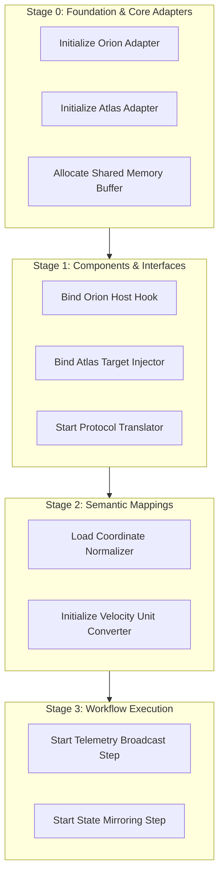

# NexLudic Engine: Integration Plan Dependency Graph & Resolution Policy

**Document ID:** `NLE-POL-IPD-001`  
**Phase:** 6 of 12 (Mashup Designer & Integration Planning)  
**Step:** 49 of 100  
**Classification:** Dependency Architecture & Algorithmic Policy  
**Status:** IMPLEMENTATION-READY SPECIFICATION  

---

## 1. Dependency Taxonomy: The 13 Canonical Categories

To ensure that every prerequisite across all planning domains is systematically captured and resolved, NexLudic Engine defines 13 canonical dependency categories:

| Category ID | Category Name | Description & Semantic Scope | Example Consumer $\rightarrow$ Provider |
| :--- | :--- | :--- | :--- |
| **DEP-CAT-01** | `PREREQUISITE_REQUIREMENT` | High-level feature dependency where Requirement A cannot deliver its acceptance criteria without Requirement B. | `REQ-ORION-VEHICLE-SYNC` $\rightarrow$ `REQ-ATLAS-TERRAIN-STREAM` |
| **DEP-CAT-02** | `STRATEGY_PREREQUISITE` | Requirement or component depends on a prerequisite architectural strategy selection. | `COMP-LIVE-IPC-BRIDGE` $\rightarrow$ `STRAT-LIVE-BRIDGE-SELECTED` |
| **DEP-CAT-03** | `COMPONENT_DEPENDENCY` | Architectural component A requires component B to be instantiated and active. | `COMP-PROTOCOL-TRANSLATOR` $\rightarrow$ `COMP-HOST-MOD-ORION` |
| **DEP-CAT-04** | `INTERFACE_BINDING` | Component binds to an explicit RPC, IPC, or ABI interface exported by another component. | `IFACE-ATLAS-STATE-CONSUMER` $\rightarrow$ `IFACE-ORION-STATE-EMITTER` |
| **DEP-CAT-05** | `DATA_MAPPING_DEPENDENCY` | A data transformation relies upon a prior transformation, dictionary lookup, or normalized type. | `MAP-COORDINATES-WORLD` $\rightarrow$ `MAP-UNITS-METERS-TO-FEET` |
| **DEP-CAT-06** | `EVENT_ORDERING` | Cross-game event A must be acknowledged before event B is allowed to dispatch. | `EVT-ORION-CHECKPOINT-ENTER` $\rightarrow$ `EVT-ATLAS-LIGHTING-FADE` |
| **DEP-CAT-07** | `WORKFLOW_STEP_PRECEDENCE` | A step in a cross-game workflow requires the successful output of an earlier step. | `STEP-ATLAS-SPAWN-ACTOR` $\rightarrow$ `STEP-ORION-CAPTURE-METRICS` |
| **DEP-CAT-08** | `ADAPTER_INITIALIZATION` | Component requires the Universal Adapter for a participating game to reach state `RUNNING`. | `COMP-ATLAS-ADAPTER-BRIDGE` $\rightarrow$ `ADAPT-ATLAS-INIT-DONE` |
| **DEP-CAT-09** | `CAPABILITY_AVAILABILITY` | Feature requires a verified capability (e.g., `CAP-TELEMETRY-STREAM`) to be available and operational. | `REQ-SPEEDOMETER-SYNC` $\rightarrow$ `CAP-HIGH-FREQ-TELEMETRY` |
| **DEP-CAT-10** | `ENVIRONMENT_RESOURCE` | Plan item requires an OS-level resource (e.g., named pipe, shared memory block, specific GPU VRAM). | `COMP-SHARED-MEM-RING` $\rightarrow$ `RES-WIN-SHARED-MEM-PAGE` |
| **DEP-CAT-11** | `SECURITY_AUTHORIZATION_GATE` | Execution or staging step requires explicit user authorization or consent gate clearance. | `STAGE-INJECT-HOST-HOOK` $\rightarrow$ `GATE-USER-CONSENT-ELEVATION` |
| **DEP-CAT-12** | `COMPENSATION_PRECEDENCE` | A rollback or compensation action depends upon the failure state and recorded transaction journal of an interaction. | `COMPENSATE-DESPAWN-ACTOR` $\rightarrow$ `TXN-ORION-HANDOFF-FAILED` |
| **DEP-CAT-13** | `HISTORICAL_STATE_PERSISTENCE` | Plan item requires prior execution run metadata or persistent cache to be committed to disk. | `STAGE-DELTA-SYNC` $\rightarrow$ `DB-SNAPSHOT-PREV-SESSION` |

---

## 2. Dependency Record Specification

Every dependency edge in the plan is modeled via the `DependencyRecord` schema:

```json
{
  "dependency_id": "c7a8b3f1-4e92-4a7b-8912-3f1d8e0a1234",
  "consumer_item_id": "WF-STEP-004-SPAWN-VEHICLE",
  "consumer_item_type": "WORKFLOW_STEP",
  "provider_item_id": "WF-STEP-003-RESOLVE-MAPPING",
  "provider_item_type": "WORKFLOW_STEP",
  "dependency_category": "WORKFLOW_STEP_PRECEDENCE",
  "is_hard_dependency": true,
  "enforcement_policy": {
    "on_provider_failure": "FAIL_CONSUMER_AND_ABORT_STAGE",
    "timeout_ms": 5000,
    "retry_allowed": false
  },
  "rationale": "Vehicle cannot be spawned in Atlas until vehicle class parameters are translated from Orion telemetry format."
}
```

---

## 3. Directed Acyclic Graph (DAG) Resolution via Kahn's Algorithm

The planning engine models all items as vertices $V$ and dependencies as directed edges $E$, where an edge $(u, v)$ indicates that item $u$ depends upon item $v$ ($v$ must complete before $u$).

```mermaid
flowchart LR
    subgraph Resolution["Kahn's Topological Sort Pipeline"]
        G["Construct Graph G = (V, E)"] --> Indegree["Calculate In-Degrees for all V"]
        Indegree --> Queue["Enqueue all V with in-degree == 0"]
        Queue --> Loop{"Queue Empty?"}
        Loop -->|No| Dequeue["Dequeue node v -> Add to Sorted List"]
        Dequeue --> Decrement["For each neighbor u of v: in-degree[u]--"]
        Decrement --> CheckZero{"in-degree[u] == 0?"}
        CheckZero -->|Yes| EnqueueU["Enqueue node u"]
        CheckZero -->|No| Loop
        EnqueueU --> Loop
        Loop -->|Yes| CheckCount{"Count(Sorted) == |V|?"}
        CheckCount -->|Yes (Acyclic)| Success["DAG Validated: Generate Stages"]
        CheckCount -->|No (Cycle)| Cycle["Cycle Detected: Isolate Loop & Fail"]
    end
```

### 3.1 Algorithmic Specification

```
ALGORITHM ResolvePlanDependencyGraph(Items V, Dependencies E):
    1. Initialize in_degree table to 0 for all items v in V.
    2. Build adjacency list adj where adj[v] contains all items u that depend on v.
    3. For each edge (consumer u, provider v) in E:
         in_degree[u] += 1
         adj[v].append(u)
    
    4. Initialize queue Q.
    5. For each item v in V:
         if in_degree[v] == 0:
             Q.enqueue(v)
             stage_assignment[v] = 0
    
    6. visited_count = 0
    7. linear_order = []
    8. current_max_stage = 0
    
    9. While Q is not empty:
         v = Q.dequeue()
         linear_order.append(v)
         visited_count += 1
         
         For each consumer u in adj[v]:
             in_degree[u] -= 1
             stage_assignment[u] = max(stage_assignment[u], stage_assignment[v] + 1)
             current_max_stage = max(current_max_stage, stage_assignment[u])
             if in_degree[u] == 0:
                 Q.enqueue(u)
                 
    10. If visited_count < |V|:
          cycle_members = ExtractCycleNodes(V, in_degree, adj)
          RETURN Error("ERR_PLAN_CIRCULAR_DEPENDENCY", cycle_members)
          
    11. Partition linear_order into ExecutionStages[0 .. current_max_stage] based on stage_assignment.
    12. Compute topological_order_signature = SHA-256(linear_order).
    13. RETURN Success(ExecutionStages, topological_order_signature)
```

---

## 4. Cycle Detection & Isolation Protocol

When `visited_count < |V|`, a dependency loop exists. The planning engine isolates the cycle path to provide unambiguous diagnostic feedback:

1. **Cycle Extraction:** Identify all nodes where `in_degree[u] > 0`.
2. **Path Reconstruction:** Perform a depth-first search (DFS) along the remaining edges until a previously visited node is re-encountered.
3. **Diagnostic Emission:** Construct diagnostic `ERR_PLAN_CIRCULAR_DEPENDENCY` containing:
   - Cycle path (e.g., `WF-STEP-01 -> MAP-TRANS-04 -> COMP-BRIDGE -> WF-STEP-01`);
   - Dependency categories contributing to the loop;
   - Remediation recommendation (e.g., "Decouple synchronous feedback loop into an asynchronous event notification").

---

## 5. Execution Stage Generation & Ordering Constraints

Items assigned to the same execution stage index ($S_k$) have zero inter-dependencies among themselves and have all their prerequisite dependencies satisfied by earlier stages ($S_0, S_1, \dots, S_{k-1}$).



### 5.1 Hard Ordering Rules
- **Stage 0 Invariant:** Universal adapter initialization and core platform resources must always inhabit Stage 0. No application component or workflow may execute in Stage 0.
- **Stage Progression Invariant:** No item in Stage $K$ may begin execution until all items in Stage $K-1$ have reported successful initialization or completion.
- **Atomic Rollback Invariant:** If any hard-dependency item within Stage $K$ fails, execution halts immediately and triggers reverse-order compensation across Stages $K \rightarrow 0$.

