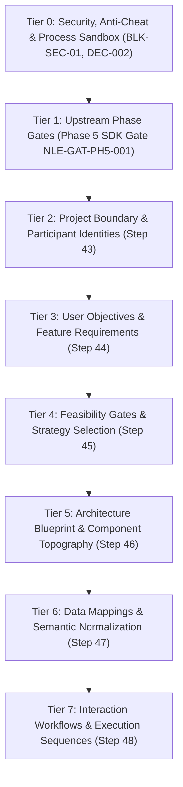

# NexLudic Engine: Integration Plan Input Source & Authority Matrix

**Document ID:** `NLE-MAT-IPA-001`  
**Phase:** 6 of 12 (Mashup Designer & Integration Planning)  
**Step:** 49 of 100  
**Classification:** Authority Matrix & Input Governance  
**Status:** IMPLEMENTATION-READY SPECIFICATION  

---

## 1. Input Source Inventory & Snapshot Registry

The Mashup Integration Plan aggregates information across multiple upstream planning domains. To ensure reproducibility and prevent split-brain states, the assembly engine treats each input as an immutable, cryptographically bound snapshot.

| Step / Phase | Source Domain | Authoritative Reference Document | Primary Entity Ingested | Default Path on Volume D |
| :--- | :--- | :--- | :--- | :--- |
| **Step 43** | Mashup Project Domain | [MASHUP_PROJECT_DOMAIN_MODEL_AND_CREATION_WORKFLOW_SPECIFICATION.md](file:///d:/App%20Winrar%20Files/Nexludic%20Engine%20(working)/docs/mashup-designer/MASHUP_PROJECT_DOMAIN_MODEL_AND_CREATION_WORKFLOW_SPECIFICATION.md) | `MashupProjectDescriptor` (`project.json`) | `docs/mashup-designer/` & project storage |
| **Step 44** | Requirements Analysis | [MASHUP_REQUIREMENTS_ANALYSIS_AND_FEATURE_DECOMPOSITION_SPECIFICATION.md](file:///d:/App%20Winrar%20Files/Nexludic%20Engine%20(working)/docs/mashup-designer/MASHUP_REQUIREMENTS_ANALYSIS_AND_FEATURE_DECOMPOSITION_SPECIFICATION.md) | `FeatureRequirementSet` (`requirements.json`) | `docs/mashup-designer/` |
| **Step 45** | Strategy Evaluation | [INTEGRATION_STRATEGY_EVALUATION_AND_SELECTION_FRAMEWORK.md](file:///d:/App%20Winrar%20Files/Nexludic%20Engine%20(working)/docs/mashup-designer/INTEGRATION_STRATEGY_EVALUATION_AND_SELECTION_FRAMEWORK.md) | `StrategySelectionDecision` (`strategy.json`) | `docs/mashup-designer/` |
| **Step 46** | Architecture Blueprint | [INTEGRATION_ARCHITECTURE_BLUEPRINT_AND_COMPONENT_MAPPING_SPECIFICATION.md](file:///d:/App%20Winrar%20Files/Nexludic%20Engine%20(working)/docs/mashup-designer/INTEGRATION_ARCHITECTURE_BLUEPRINT_AND_COMPONENT_MAPPING_SPECIFICATION.md) | `IntegrationBlueprintDescriptor` (`blueprint.json`) | `docs/mashup-designer/` |
| **Step 47** | Cross-Game Data Mapping | [CROSS_GAME_DATA_MAPPING_AND_TRANSFORMATION_SPECIFICATION.md](file:///d:/App%20Winrar%20Files/Nexludic%20Engine%20(working)/docs/mashup-designer/CROSS_GAME_DATA_MAPPING_AND_TRANSFORMATION_SPECIFICATION.md) | `DataMappingSpecificationSet` (`mappings.json`) | `docs/mashup-designer/` |
| **Step 48** | Interaction Workflows | [CROSS_GAME_INTERACTION_WORKFLOW_AND_SEQUENCING_SPECIFICATION.md](file:///d:/App%20Winrar%20Files/Nexludic%20Engine%20(working)/docs/mashup-designer/CROSS_GAME_INTERACTION_WORKFLOW_AND_SEQUENCING_SPECIFICATION.md) | `WorkflowSpecificationSet` (`workflows.json`) | `docs/mashup-designer/` |
| **Phase 5** | Universal Adapter SDK | [STEP_42_COMPLETION_REPORT.md](file:///d:/App%20Winrar%20Files/Nexludic%20Engine%20(working)/docs/adapters/STEP_42_COMPLETION_REPORT.md) | `NLE-GAT-PH5-001` (Gate Status & Capabilities) | `docs/adapters/` |

---

## 2. Epistemic Authority Hierarchy & Primacy Rules

When inputs overlap or appear to conflict, the planning engine applies an inviolable epistemic authority hierarchy:

### 2.1 Governance Primacy Rules

1. **Security & Anti-Cheat Inviolability (Tier 0 Primacy):**  
   If any architecture blueprint, mapping, or workflow proposes memory modification, code injection, or hooking against a target game protected by anti-cheat (`BLK-SEC-01`), Tier 0 immediately vetoes the item. No user override, strategy selection, or blueprint declaration can bypass this constraint.
2. **Phase Gate Conditionality (Tier 1 Primacy):**  
   If an upstream phase gate has conditional approval (`READY WITH CONDITIONS`, such as Phase 5's `P5-C01`, `P5-C02`, `P5-C03`), any plan item relying on uncertified SDK features is marked `PROVISIONAL`. The plan cannot achieve `ACCEPTED_FOR_PLANNING` until the conditions are cleared.
3. **Project Boundary Governance (Tier 2 Primacy):**  
   Requirements, components, or mappings that reference games, platforms, or engines not declared in the Step 43 project definition are pruned and rejected with diagnostic `ERR_OUT_OF_SCOPE_PARTICIPANT`.
4. **Requirement Primacy Over Architecture (Tier 3 Primacy):**  
   The architecture blueprint (Step 46) and workflows (Step 48) cannot introduce unrequested capabilities or omit mandatory requirements (`MANDATORY`). An architecture component with no parent requirement is flagged as ungrounded (`WARN_UNGROUNDED_COMPONENT`).
5. **Strategy Consistency (Tier 4 Primacy):**  
   The architecture blueprint must strictly adhere to the strategy chosen in Step 45 (`HOST_MOD_ONLY`, `LIVE_BRIDGE_ONLY`, or `HYBRID`). If Step 45 rejected a live bridge strategy due to network latency or anti-cheat constraints, Step 46 cannot include live IPC components.
6. **Interface Primacy Over Implementation (Tier 5 Primacy):**  
   Step 47 data mappings and Step 48 workflows must communicate exclusively through component interfaces and endpoints defined in Step 46. Workflows cannot connect components across undeclared boundaries.

---

## 3. Freshness Verification & Snapshot Binding Contract

To prevent drift between the assembled plan and its source files, the plan engine computes and records content hashes during assembly.

### 3.1 Freshness Calculation Protocol
For each source file $F_i$:
1. Read file bytes from disk using deterministic UTF-8 or raw binary stream.
2. Compute $H_i = \text{SHA-256}(F_i)$.
3. Record tuple $\langle \text{source\_id}, \text{source\_version}, \text{source\_path}, H_i, T_{\text{bound}} \rangle$.
4. During plan validation or re-verification, recompute $H'_i$. If $H'_i \neq H_i$, emit `ERR_STALE_SOURCE_SNAPSHOT` and transition plan to `INVALIDATED`.

### 3.2 Immutability Contract
Once an integration plan reaches `ACCEPTED_FOR_PLANNING` or `ACCEPTED_WITH_RISKS`, its `upstream_snapshots` block is locked. Any update to an upstream artifact requires the creation of a new plan revision (e.g., `v1.0.0` $\rightarrow$ `v1.1.0`).

---

## 4. Conflict Resolution Protocol Matrix

| Conflicting Domains | Nature of Conflict | Resolution Rule | Emitted Diagnostic |
| :--- | :--- | :--- | :--- |
| **Requirements vs. Blueprint** | Blueprint implements features not in Step 44 requirements. | Requirements govern. Unmapped blueprint components marked `UNGROUNDED` and excluded from core execution stages. | `WARN_UNGROUNDED_COMPONENT` |
| **Strategy vs. Blueprint** | Blueprint proposes IPC bridge when strategy is `HOST_MOD_ONLY`. | Strategy governs. Blueprint component rejected. Plan marked `INVALID`. | `ERR_STRATEGY_BLUEPRINT_MISMATCH` |
| **Blueprint vs. Workflow** | Workflow step connects components without a defined blueprint interface. | Blueprint governs. Workflow step rejected as boundary violation. | `ERR_UNDECLARED_COMPONENT_INTERFACE` |
| **Data Mapping vs. Workflow** | Workflow passes unmapped fields between game contexts. | Mapping governs. Workflow step halted until transformation is defined. | `ERR_UNMAPPED_DATA_HANDOFF` |
| **Anti-Cheat vs. Strategy** | Selected strategy requires process attachment on EAC-protected title. | Tier 0 Security governs. Strategy vetoed. Plan marked `INVALID`. | `ERR_ANTI_CHEAT_POLICY_VIOLATION` |

