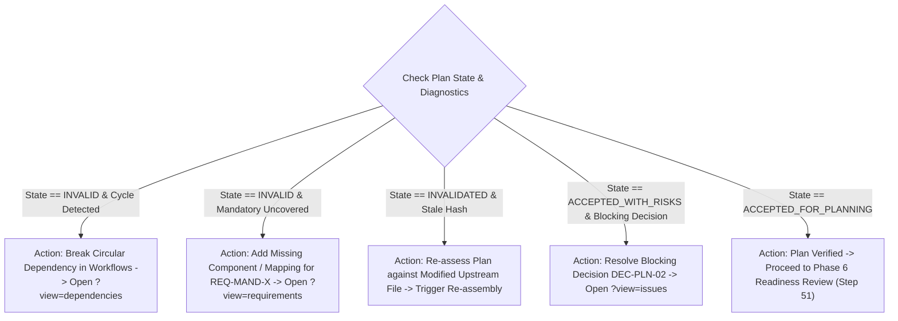

# NexLudic Engine: Integration Plan Overview & Status Presentation Specification

**Document ID:** `NLE-SPC-IPO-001`  
**Phase:** 6 of 12 (Mashup Designer & Integration Planning)  
**Step:** 50 of 100  
**Classification:** Presentation Specification & Status Semantics  
**Status:** IMPLEMENTATION-READY SPECIFICATION  

---

## 1. Plan Overview Layout & Header Topography

The **Plan Overview** (`?view=overview`) is the initial landing screen for any mashup integration plan review. It delivers a comprehensive executive summary designed to be evaluated within seconds, presenting truthful status, summary metrics, participants, and context-sensitive next-action guidance.

```
+----------------------------------------------------------------------------------------------------+
| PLAN HEADER CARD                                                                                   |
|                                                                                                    |
| Plan: High-Speed Vehicle Telemetry Synchronization          Revision: v1.0.0                       |
| Project: Game Orion x Game Atlas Mashup (UUID: 7a8b...1234)   Lifecycle: [ ACCEPTED_WITH_RISKS ]   |
| Created: 2026-11-18 12:00 UTC | Updated: 2026-11-18 14:30 UTC  Checksum: sha256:d41d8cd9...e49b    |
| Participants: [Game Orion v1.4 (Host Engine)] <---> [Game Atlas v2.0 (UE 5.3 Mod)]                |
| Strategy: HYBRID (Host Mod + Non-Invasive Live Bridge)      Platform: Win10/11 x64 (Medium IL)     |
+----------------------------------------------------------------------------------------------------+
| SUMMARY METRIC CARDS                                                                               |
|                                                                                                    |
| +-------------------+  +-------------------+  +-------------------+  +-------------------+         |
| | MANDATORY REQS    |  | OPTIONAL REQS     |  | BLOCKING ISSUES   |  | SNAPSHOT INTEGRITY|         |
| | 9 / 9 (100%)      |  | 3 / 4 (75%)       |  | 0 Critical Block  |  | 6 / 6 Fresh       |         |
| | [✓] FULLY COVERED |  | [!] 1 Incomplete  |  | [!] 2 Open Decs   |  | [✓] All Hashes Ok |         |
| +-------------------+  +-------------------+  +-------------------+  +-------------------+         |
+----------------------------------------------------------------------------------------------------+
| CONTEXT-SENSITIVE NEXT ACTION CARD                                                                 |
|                                                                                                    |
| [!] ACTION REQUIRED: 1 Open Architectural Decision Blocks Phase 7 Staging                          |
| Decision DEC-PLN-02 ("Coordinate Origin Alignment") requires selection before code generation.    |
| [Review Decision Details]    [Explore Architecture Blueprint]                                      |
+----------------------------------------------------------------------------------------------------+
| QUALITY GATE EVALUATION SCORECARD                                                                  |
| Gate 01: [PASS] Schema Integrity         | Gate 06: [PASS] Interface & Mappings                    |
| Gate 02: [PASS] Snapshot Freshness       | Gate 07: [PASS] Kahn DAG Acyclicity                     |
| Gate 03: [PASS] Anti-Cheat & Sandbox     | Gate 08: [PASS] Mandatory Coverage Primacy              |
| Gate 04: [PASS] Phase 5 SDK Gate         | Gate 09: [WARN] Risk & Decision Tolerability (P5-C02)   |
| Gate 05: [PASS] Strategy Consistency     | Gate 10: [PASS] Checksum & Archival                     |
+----------------------------------------------------------------------------------------------------+
```

---

## 2. Truthful Lifecycle Status Presentation

To prevent confusion between documentation completion, architectural feasibility, and runtime execution authorization, the review experience strictly mirrors the 11 authoritative Step 49 lifecycle states. 

**Accessibility Invariant:** Status is never communicated solely through color. Every status badge pairs a distinct icon, high-contrast text label, descriptive tooltip, and an explicit accessibility label:

| Authoritative State | Display Label | Visual Presentation | Meaning in Plain Language | Action Required? |
| :--- | :--- | :--- | :--- | :---: |
| **`DRAFT`** | `Draft Plan` | `[○] Neutral Grey Badge` | Plan metadata initialized; assembly pipeline has not run. | Run Assembly Pipeline |
| **`ASSEMBLING`** | `Assembling...` | `[⟳] Blue Pulsing Badge` | Pipeline is actively ingesting Steps 43–48 files and hashing data. | Wait for completion |
| **`ASSEMBLED_PARTIAL`** | `Assembled (Partial)` | `[▲] Amber Caution Badge` | Assembly succeeded for mandatory items; some optional items are omitted. | Review optional gaps |
| **`ASSEMBLED_FULL`** | `Assembled (Full)` | `[●] Cyan Information Badge` | Full assembly complete across all items; awaiting validation run. | Run Quality Gates |
| **`VALIDATING`** | `Validating...` | `[⟳] Blue Pulsing Badge` | Quality Gates `GATE-PLN-01..10` are actively evaluating graph constraints. | Wait for audit verdict |
| **`INVALID`** | `Plan Invalid` | `[✕] Solid Red Error Badge` | Fatal blocker discovered (e.g., circular dependency or anti-cheat breach). | Resolve fatal blockers |
| **`ACCEPTED_WITH_RISKS`**| `Accepted with Risks`| `[!] Amber Warning Badge` | All mandatory requirements covered, but open medium/high risks or decisions exist. | Review open risks |
| **`ACCEPTED_FOR_PLANNING`**| `Accepted for Planning`| `[✓] Solid Green Success Badge`| 100% mandatory coverage, all 10 gates passed, zero blocking decisions. | Ready for Phase 7 review |
| **`SUPERSEDED`** | `Superseded` | `[↺] Purple History Badge` | A newer valid revision (e.g., v1.1.0) exists for this project. | View latest revision |
| **`INVALIDATED`** | `Invalidated` | `[⚡] Orange Alert Badge` | An upstream file changed on disk; plan hashes are out of date. | Re-assess & Re-assemble |
| **`ABANDONED`** | `Abandoned` | `[⊘] Dark Grey Strikethrough` | Plan was retired or canceled by the user. | Read-only audit only |

### 2.1 The Non-Authorization Warning Callout
For plans in state `ACCEPTED_FOR_PLANNING` or `ACCEPTED_WITH_RISKS`, the header displays a persistent, non-dismissible safety callout:

> **Information Notice:** *Plan acceptance confirms architectural, semantic, and dependency completeness. It does NOT authorize process spawning, DLL injection, or game modification. Runtime staging remains gated under Phase 7+.*

---

## 3. High-Level Summary Metrics Engine

The overview summarizes plan health across 6 core metric dimensions:

### 3.1 Metric Definitions & Evaluation Formulas

1. **Mandatory Requirement Coverage:**  
   $$\text{Coverage} = \frac{C_{\text{mand}}}{T_{\text{mand}}} \times 100\%$$  
   - If $\text{Coverage} == 100\%$: Green check badge (`[✓] 9 / 9 (100%)`).  
   - If $\text{Coverage} < 100\%$: Red alert badge (`[✕] 8 / 9 (88.8% - FATAL GAP)`). Clicking opens the Requirements tab filtered by `priority == MANDATORY & status != FULLY_COVERED`.
2. **Optional Requirement Coverage:**  
   Displays progress on secondary/cosmetic features (e.g., `3 / 4 (75%)`). Non-blocking.
3. **Blocking Dependencies & Deadlocks:**  
   Summarizes hard dependency blockers from Step 49 DAG resolution. Displays `0 Blockers` or `X Blockers Detected` with direct links to the isolated cycle path.
4. **Open Architectural Decisions:**  
   Summarizes unresolved items from Step 49 Decision Ledger (`DEC-PLN-01..03`). Differentiates between blocking decisions (blocks Phase 7) and non-blocking decisions.
5. **Upstream Snapshot Freshness:**  
   Live verification indicator. Compares active file SHA-256 hashes against recorded snapshots across all 6 planning inputs. Displays `6 / 6 Fresh` or `X Stale Files Detected`.
6. **Quality Gate Scorecard:**  
   Summarizes outcomes of `GATE-PLN-01` through `GATE-PLN-10`. Displays pass count and highlights warning/failing gates.

---

## 4. Context-Sensitive Next-Action Guidance Engine

The Overview features a dynamic **Next-Action Engine** that analyzes the plan's exact state, gate evaluations, and open decision records to suggest the single most important next operational step:



### 4.1 Action Card Architecture
Every next-action card provides:
- **Title & Severity:** Clear statement of the bottleneck (e.g., `[CRITICAL BLOCKER] Circular Dependency in Telemetry Loop`).
- **Explanation:** Plain-English description of what is blocked and why it matters.
- **Direct Navigation Button:** Deep-links immediately to the exact sub-view and item requiring remediation (e.g., `[Inspect Cycle in Dependency Explorer]`).
- **Safe Guard:** No automated code execution or arbitrary file mutation can be triggered from an action card.
