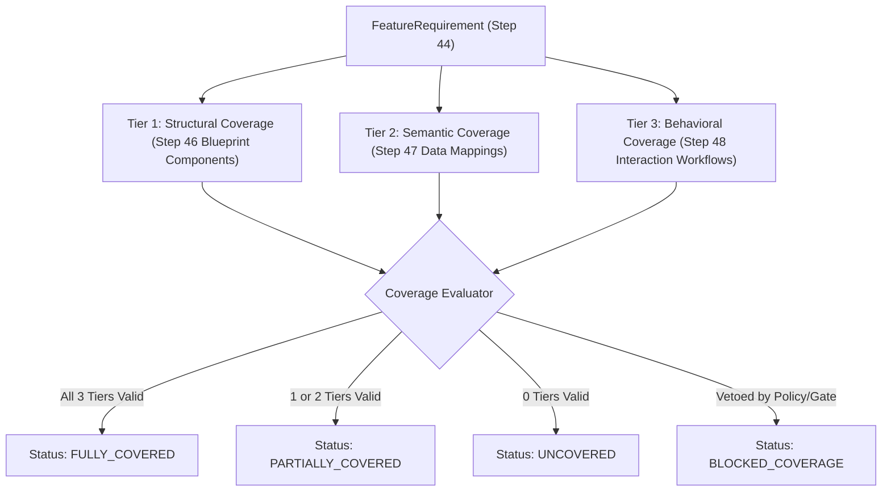

# NexLudic Engine: Integration Plan Requirement Coverage & Completeness Rules

**Document ID:** `NLE-RUL-IPC-001`  
**Phase:** 6 of 12 (Mashup Designer & Integration Planning)  
**Step:** 49 of 100  
**Classification:** Verification Policy & Completeness Governance  
**Status:** IMPLEMENTATION-READY SPECIFICATION  

---

## 1. Multi-Tier Requirement Coverage Model

NexLudic Engine enforces a multi-tier requirement coverage model to ensure that a requirement is not merely referenced on paper, but fully accounted for across architecture, data transformation, and runtime workflow.



### 1.1 The Three Coverage Tiers

1. **Tier 1: Structural Coverage (Component Tier)**  
   The requirement is mapped to at least one concrete integration component (`HostMod`, `LiveBridge`, `ProtocolTranslator`, or `SharedMemoryBuffer`) defined in the Step 46 blueprint that explicitly assumes responsibility for delivering the feature.
2. **Tier 2: Semantic Coverage (Mapping Tier)**  
   If the requirement involves state synchronization, telemetry exchange, or cross-game event dispatch, all involved source-to-target fields, coordinate transforms, and unit normalizations are defined in Step 47 data mapping specifications. (If the requirement is purely intra-game or structural with zero cross-game data transfer, Tier 2 evaluates as `NOT_APPLICABLE` and is treated as satisfied).
3. **Tier 3: Behavioral Coverage (Workflow Tier)**  
   The operational sequencing, triggers, prerequisites, timeouts, and failure compensations necessary to fulfill the requirement's acceptance criteria are modeled as workflow steps in Step 48.

---

## 2. Coverage Evaluation Outcomes

Each requirement in the project's requirement set is evaluated by the assembly engine and assigned exactly one coverage outcome:

| Outcome State | Description & Entry Condition | Impact on Plan Lifecycle |
| :--- | :--- | :--- |
| **`FULLY_COVERED`** | Tier 1, Tier 2, and Tier 3 are satisfied without gaps, circular dependencies, or unresolved exceptions. | Contributes 100% towards completeness ratios. |
| **`PARTIALLY_COVERED`** | At least one tier is satisfied, but another tier is missing, incomplete, or marked `PROVISIONAL`. | If mandatory: **Fatal blocker** (caps state at `ASSEMBLED_PARTIAL` / `INVALID`). If optional: Allowed with risk notation. |
| **`UNCOVERED`** | No blueprint components, mappings, or workflow steps address this requirement. | If mandatory: **Fatal blocker**. If optional: Allowed, omitted from execution stages. |
| **`BLOCKED_COVERAGE`** | Delivery of this requirement is prohibited by anti-cheat dominance (`BLK-SEC-01`), security sandbox (`DEC-002`), or a blocked upstream gate. | If mandatory: **Fatal blocker** (`INVALID`). If optional: Omitted with warning. |

---

## 3. Mandatory Coverage Primacy Principle

NexLudic Engine enforces the **Mandatory Coverage Primacy Principle**:

> **Principle:** No Mashup Integration Plan can achieve the lifecycle state `ACCEPTED_FOR_PLANNING` unless **100%** of all requirements marked with `priority == MANDATORY` evaluate to `FULLY_COVERED`.

$$\text{MandatoryCoverageRatio} = \frac{\sum \text{CoveredMandatoryRequirements}}{\sum \text{TotalMandatoryRequirements}} = 1.000$$

If $\text{MandatoryCoverageRatio} < 1.0$, the plan engine is structurally prohibited from issuing an `ACCEPTED_FOR_PLANNING` state. The plan must be classified as either `INVALID` (if architectural blockers prevent coverage) or `ASSEMBLED_PARTIAL` / `ACCEPTED_WITH_RISKS` (if an authorized exception or staging waiver is granted for non-critical phases).

---

## 4. Optional and Conditional Requirements

- **Optional Requirements (`priority == OPTIONAL`):**  
  Features that enhance user experience but are not required for core interoperability (e.g., secondary ambient audio synchronization, cosmetic particle mirroring). These may remain `UNCOVERED` or `PARTIALLY_COVERED` without invalidating the plan.
- **Conditional Requirements (`priority == CONDITIONAL`):**  
  Features that depend on dynamic runtime factors or optional player hardware (e.g., dual-monitor dashboard mode, VR head-tracking passthrough). The plan must document the exact conditional trigger and fallback behavior. If the fallback behavior is fully defined, the requirement is treated as `FULLY_COVERED (CONDITIONAL)`.

---

## 5. Multi-Dimensional Completeness Index

The plan engine calculates an objective, deterministic completeness index reported in the `completeness` block of the plan descriptor:

```json
{
  "completeness": {
    "total_requirements_count": 14,
    "mandatory_requirements_count": 9,
    "optional_requirements_count": 4,
    "conditional_requirements_count": 1,
    "mandatory_covered_count": 9,
    "optional_covered_count": 3,
    "conditional_covered_count": 1,
    "uncovered_optional_count": 1,
    "mandatory_coverage_ratio": 1.0,
    "optional_coverage_ratio": 0.75,
    "overall_completeness_ratio": 0.928,
    "coverage_verdict": "COMPLETE_MANDATORY_EXCELLENT_OPTIONAL"
  }
}
```

### 5.1 Completeness Index Formula

$$\text{OverallCompleteness} = \frac{W_{\text{mand}} \cdot C_{\text{mand}} + W_{\text{opt}} \cdot C_{\text{opt}} + W_{\text{cond}} \cdot C_{\text{cond}}}{W_{\text{mand}} \cdot T_{\text{mand}} + W_{\text{opt}} \cdot T_{\text{opt}} + W_{\text{cond}} \cdot T_{\text{cond}}}$$

Where default weights are:
- $W_{\text{mand}} = 1.00$
- $W_{\text{opt}} = 0.30$
- $W_{\text{cond}} = 0.50$

