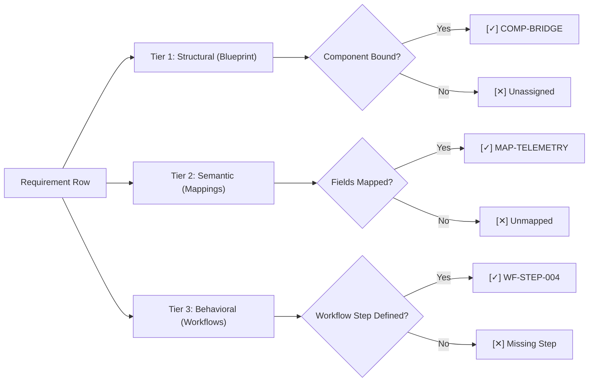

# NexLudic Engine: Integration Plan Requirement Coverage Review UX

**Document ID:** `NLE-UX-IPR-001`  
**Phase:** 6 of 12 (Mashup Designer & Integration Planning)  
**Step:** 50 of 100  
**Classification:** UX Specification & Coverage Presentation  
**Status:** IMPLEMENTATION-READY SPECIFICATION  

---

## 1. Requirement Coverage Views & Presentation Modes

The **Requirement Coverage** view (`?view=requirements`) provides an exhaustive audit of how user objectives and atomic feature requirements (Step 44) are satisfied by architecture components (Step 46), data mappings (Step 47), and interaction workflows (Step 48).

Users can toggle between two primary presentation layouts:
1. **Three-Tier Coverage Matrix (Default):** A dense, tabular audit view displaying structural, semantic, and behavioral coverage side-by-side.
2. **Feature Hierarchy Tree:** A hierarchical view organizing requirements under their parent user objectives with expandable feature groups.

```
+----------------------------------------------------------------------------------------------------+
| REQUIREMENT COVERAGE VIEWPORT                                                                      |
|                                                                                                    |
| Filter: [ All Priorities ▼ ]  [ All Statuses ▼ ]  Search: [ vehicle...       ]  Layout: [ Matrix | Tree]|
+----------------------------------------------------------------------------------------------------+
| UNCOVERED MANDATORY REQUIREMENTS ALERT BANNER (Displayed if any mandatory requirement incomplete) |
| [✕] 1 Mandatory Requirement Uncovered: REQ-MAND-007 ("Vehicle Damage State Mirroring")             |
| Issue: Missing Behavioral Coverage (Step 48 has no workflow step to trigger or sequence repair).  |
| Consequence: Caps Plan Status at ASSEMBLED_PARTIAL / INVALID. Cannot reach ACCEPTED_FOR_PLANNING.  |
| [View REQ-MAND-007 Details]   [Open Step 48 Workflow Designer]                                     |
+----------------------------------------------------------------------------------------------------+
| THREE-TIER COVERAGE MATRIX TABLE                                                                   |
|                                                                                                    |
| REQ ID       | TITLE                  | PRIORITY  | STRUCTURAL | SEMANTIC   | BEHAVIORAL | STATUS      |
| -------------+------------------------+-----------+------------+------------+------------+-------------|
| REQ-MAND-001 | Real-time Speedometer  | MANDATORY | [✓] Pass   | [✓] Pass   | [✓] Pass   | FULLY_COVER |
| REQ-MAND-002 | World Position Sync    | MANDATORY | [✓] Pass   | [✓] Pass   | [✓] Pass   | FULLY_COVER |
| REQ-MAND-003 | Lap Checkpoint Trigger | MANDATORY | [✓] Pass   | [✓] Pass   | [✓] Pass   | FULLY_COVER |
| REQ-MAND-007 | Vehicle Damage State   | MANDATORY | [✓] Pass   | [✓] Pass   | [✕] MISSING| PARTIAL_COV |
| REQ-OPT-001  | Ambient Weather Sync   | OPTIONAL  | [✓] Pass   | [✓] Pass   | [✓] Pass   | FULLY_COVER |
| REQ-OPT-002  | Dynamic Tire Smoke FX  | OPTIONAL  | [?] Prov   | [✕] Unmap  | [✕] No WF  | UNCOVERED   |
| REQ-COND-001 | Dual-Monitor HUD View  | CONDITION | [✓] Pass   | [N/A] None | [✓] Pass   | CONDITIONAL |
+----------------------------------------------------------------------------------------------------+
```

---

## 2. The Three Coverage Tiers in the UI

Every requirement row displays the status of the three distinct coverage tiers established in Step 49:



1. **Structural Tier (Component Responsibility):**  
   - Pass: Displays the bound component ID (`COMP-ORION-TELEMETRY-BRIDGE`). Clicking opens the component in the Contextual Inspector.
   - Fail: Displays `[✕] Unassigned`. Indicates that no architecture component in Step 46 has assumed responsibility for this requirement.
2. **Semantic Tier (Data Mapping):**  
   - Pass: Displays the data mapping ID (`MAP-VEHICLE-COORDINATES`).
   - N/A: If the requirement is purely intra-engine or triggers an event with no data payload, displays `[N/A] No Data Exchange`.
   - Fail: Displays `[✕] Unmapped Data`. Indicates that cross-game properties have not been normalized or mapped in Step 47.
3. **Behavioral Tier (Interaction Workflow):**  
   - Pass: Displays the sequencing workflow step ID (`WF-STEP-003`).
   - Fail: Displays `[✕] Missing Workflow`. Indicates that no workflow in Step 48 models the prerequisite sequence, timeouts, or recovery actions.

---

## 3. Mandatory Coverage Primacy Callout

In compliance with `INV-PLN-03` and `GATE-PLN-08`, if even one mandatory requirement lacks full coverage across all three tiers:
- A persistent red warning banner is pinned above the table.
- The lifecycle state badge in the header shows `[✕] Plan Invalid` or `[▲] Assembled (Partial)`.
- The banner explicitly states:
  > *"Mandatory Coverage Primacy Enforced: Requirement `REQ-MAND-007` is incomplete. The engine prohibits transitioning this plan to `ACCEPTED_FOR_PLANNING` until all mandatory requirements achieve 100% full coverage."*

---

## 4. Requirement Drill-Down & Contextual Inspector Details

When a requirement is selected in the table, the **Contextual Inspector Drawer (340px)** opens to display its complete traceability ledger:

```
+--------------------------------------------------------------------+
| CONTEXTUAL INSPECTOR: Requirement Details                          |
+--------------------------------------------------------------------+
| ID: REQ-MAND-001            Priority: MANDATORY                    |
| Title: High-Frequency Speedometer Mirroring                        |
| Parent Objective: OBJ-01 ("Unified Cockpit Racing Experience")      |
| Status: [✓] FULLY_COVERED                                          |
+--------------------------------------------------------------------+
| ACCEPTANCE CRITERIA:                                               |
| - AC-01: Vehicle speed mirrored from Orion to Atlas within 16.6ms. |
| - AC-02: Unit converted from meters/sec to miles/hour.             |
| - AC-03: Zero display stuttering during high acceleration (>2G).   |
+--------------------------------------------------------------------+
| BIDIRECTIONAL TRACEABILITY CHAIN:                                  |
| 1. Architecture Component:                                         |
|    -> [COMP-ORION-TELEMETRY-HOOK] (Owner: Orion Host Mod)          |
|    -> [COMP-LIVE-IPC-BRIDGE] (Owner: Core Bridge)                  |
| 2. Data Mapping Specification:                                     |
|    -> [MAP-VELOCITY-NORMALIZER] (Transform: m/s * 2.23694 -> mph)  |
| 3. Interaction Workflow Step:                                      |
|    -> [WF-STEP-002-STREAM-TELEMETRY] (Stage 3, Timeout: 50ms)      |
| 4. Verification Evidence:                                          |
|    -> [EVD-CONFORMANCE-PASS] (Phase 5 SDK Conformance Suite)       |
+--------------------------------------------------------------------+
| DIAGNOSTICS & WARNINGS: None (All quality criteria satisfied)      |
+--------------------------------------------------------------------+
```

### 4.1 Traceability Navigation Actions
Users can click any linked item in the traceability chain (e.g., clicking `[MAP-VELOCITY-NORMALIZER]` navigates directly to the Mappings sub-view with that transform pre-selected and highlighted).
