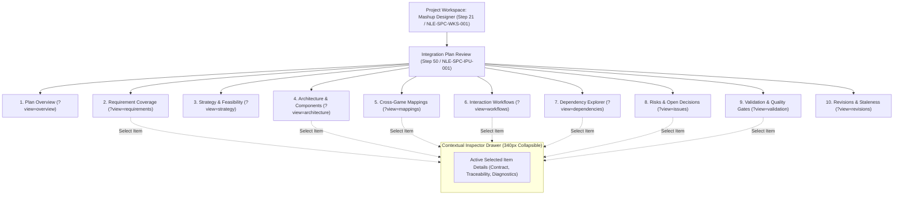

# NexLudic Engine: Integration Plan Review Information Architecture

**Document ID:** `NLE-ARC-IPU-001`  
**Phase:** 6 of 12 (Mashup Designer & Integration Planning)  
**Step:** 50 of 100  
**Classification:** Information Architecture & Navigation Topology  
**Status:** IMPLEMENTATION-READY SPECIFICATION  

---

## 1. Information Architecture & Navigation Model

The Integration Plan Review experience serves as the central synthesis portal for a mashup project. It organizes information across 10 structured functional domains, anchored within the project-scoped workspace navigation:



---

## 2. Review Sub-View Taxonomy & Functional Responsibilities

| Sub-View Key | View Name | Primary User Questions Answered | Primary Data Source | Default Layout Mode |
| :--- | :--- | :--- | :--- | :--- |
| `overview` | **Plan Overview** | What is the overall health, strategy, and readiness of this plan? What is blocking progress? | `plan.json` (Summary, Snapshots) | Metric Cards & Blocker Ledger |
| `requirements` | **Requirement Coverage** | Are all mandatory objectives addressed? Where are the gaps? | `requirements.json`, `coverage_ledger` | 3-Tier Coverage Matrix & Filters |
| `strategy` | **Strategy & Feasibility** | Which strategy is chosen? What trade-offs or anti-cheat constraints govern it? | `strategy.json`, `NLE-MAT-ISE-001` | Side-by-side comparison & trade-offs |
| `architecture` | **Architecture Blueprint** | What components exist, who owns them, and where are trust boundaries? | `blueprint.json`, `NLE-SPC-IAB-001` | Topography Diagram & Component Tree |
| `mappings` | **Data Mappings** | How is data transformed between games? What fidelity loss occurs? | `mappings.json`, `NLE-SPC-DMT-001` | Field-by-field table & loss cards |
| `workflows` | **Interaction Workflows** | What is the exact sequence of cross-game interactions? What happens on timeout? | `workflows.json`, `NLE-SPC-IWS-001` | Step sequence diagram & retry policies |
| `dependencies` | **Dependency Explorer** | In what order must items execute? Are there circular deadlocks? | `dependency_graph`, Kahn stages ($S_0..S_N$) | Execution stage swimlanes & DAG graph |
| `issues` | **Risks & Open Decisions** | What unresolved decisions or assumptions threaten implementation? | `risk_and_decision_ledger` | Prioritized risk cards & decision actions |
| `validation` | **Validation & Gates** | Did the plan clear all 10 Quality Gates? What diagnostics were emitted? | `validation_result`, `GATE-PLN-01..10` | Quality Gate scorecard & error console |
| `revisions` | **Revisions & Staleness** | Has an upstream file changed? What changed between v1.0 and v1.1? | `upstream_snapshots`, git hash checks | Side-by-side JSON diff & stale banners |

---

## 3. Workspace Layout Geometry & Panel Responsibilities

The review interface adheres strictly to the desktop application shell conventions established in Phase 3 (`NLE-SPC-SHL-001`):

```
+----------------------------------------------------------------------------------------------------+
| ZONE 1: Context Header (Project Title, Participant Game Pills, Active Revision, Global State Badge)|
+----------------------------------------------------------------------------------------------------+
| ZONE 2: Sub-Navigation Bar (Horizontal Tabs: Overview | Req | Arch | Maps | WF | Deps | Issues)     |
+--------------------------------------------------------------------+-------------------------------+
| ZONE 3: Main Content Viewport (Dynamic ViewModel Region)           | ZONE 4: Contextual Inspector  |
|                                                                    | (Collapsible 340px Drawer)    |
| - Primary data presentation (Matrix, Flowchart, Swimlane, Table)   |                               |
| - Accessible toggle: [Diagram View] / [Accessible Table View]      | - Selected Item Header        |
| - Filter & Grouping bar (by Stage, Priority, Status, Participant)   | - Backwards Traceability      |
| - Zoom & Viewport controls (Fit, 100%, Zoom In/Out)                | - Forwards Traceability       |
|                                                                    | - Contract & Hash Signature   |
|                                                                    | - Diagnostic Remediation Tips |
+--------------------------------------------------------------------+-------------------------------+
| ZONE 5: Persistent Footer (Snapshot Hash Status: 6/6 Fresh | Kahn DAG: Valid | Zoom: 100%)         |
+----------------------------------------------------------------------------------------------------+
```

### 3.1 Zone Specifications
1. **Zone 1: Project & Plan Context Header:**  
   Displays immutable plan identity: Project display name, participating game badges (`Game Orion v1.4`, `Game Atlas v2.0`), plan version (`v1.0.0`), and the primary lifecycle state badge (e.g., `ACCEPTED_WITH_RISKS`).
2. **Zone 2: Sub-Navigation Bar:**  
   Keyboard-accessible tab bar allowing instantaneous switching between the 10 functional views. Maintains scroll position and active selection during transitions.
3. **Zone 3: Main Content Viewport:**  
   Primary canvas rendering the active view. Supports responsive resizing, horizontal/vertical overflow scrolling, and accessible table fallbacks.
4. **Zone 4: Contextual Inspector Drawer (340px):**  
   Collapsible side-drawer that automatically updates whenever a node, row, or card is selected in Zone 3. Exposes deep contract schemas, exact SHA-256 hashes, diagnostic stack traces, and direct links to upstream source documents.
5. **Zone 5: Persistent Footer:**  
   Displays real-time validation status: live hash check status across all 6 upstream snapshots, Kahn DAG acyclicity verdict, memory consumption footprint, and display scale.

---

## 4. Dual-Audience Navigation & Persona Workflows

### 4.1 Project Creator / Game Mashup Author Persona
- **Goal:** Understand whether their mashup idea is feasible, what features are working, what is blocked, and what decisions need their attention.
- **Primary Journey:**  
  $\text{Plan Overview} \longrightarrow \text{Requirement Coverage} \longrightarrow \text{Risks \& Decisions} \longrightarrow \text{Confirm Decision}$
- **Experience Guardrails:** The interface shields this user from raw JSON contracts and low-level ABI declarations unless explicitly toggled, presenting plain-English summaries, high-level feasibility badges, and clear action items.

### 4.2 Integration Architect / Senior QA Engineer Persona
- **Goal:** Audit technical fidelity, verify contract schemas, detect concurrency bottlenecks, validate anti-cheat compliance, and check topological execution ordering.
- **Primary Journey:**  
  $\text{Quality Gates} \longrightarrow \text{Kahn Execution Stages} \longrightarrow \text{Blueprint Topography} \longrightarrow \text{Mapping Transforms} \longrightarrow \text{Snapshot Hashes}$
- **Experience Guardrails:** Instantaneous one-click access to raw SHA-256 hashes, Kahn DAG stage groupings, unit normalization formulas, and structured JSON diagnostics.

---

## 5. URL Deep-Linking & State Serialization Contract

The review experience enforces deterministic state serialization. Users can bookmark, share, or restore exact review states via structured workspace parameters:

```
project/:projectId/mashup-designer/plan-review
    ?planId=3fa85f64-5717-4562-b3fc-2c963f66afa6
    &revision=1.0.0
    &view=requirements
    &selectedItem=REQ-MAND-003
    &filterPriority=MANDATORY
    &inspectorOpen=true
```

- When the application restores this URL, it loads the specified plan revision, switches directly to the `requirements` tab, filters for mandatory items, highlights `REQ-MAND-003`, and expands the Contextual Inspector drawer with that requirement's full traceability ledger.
