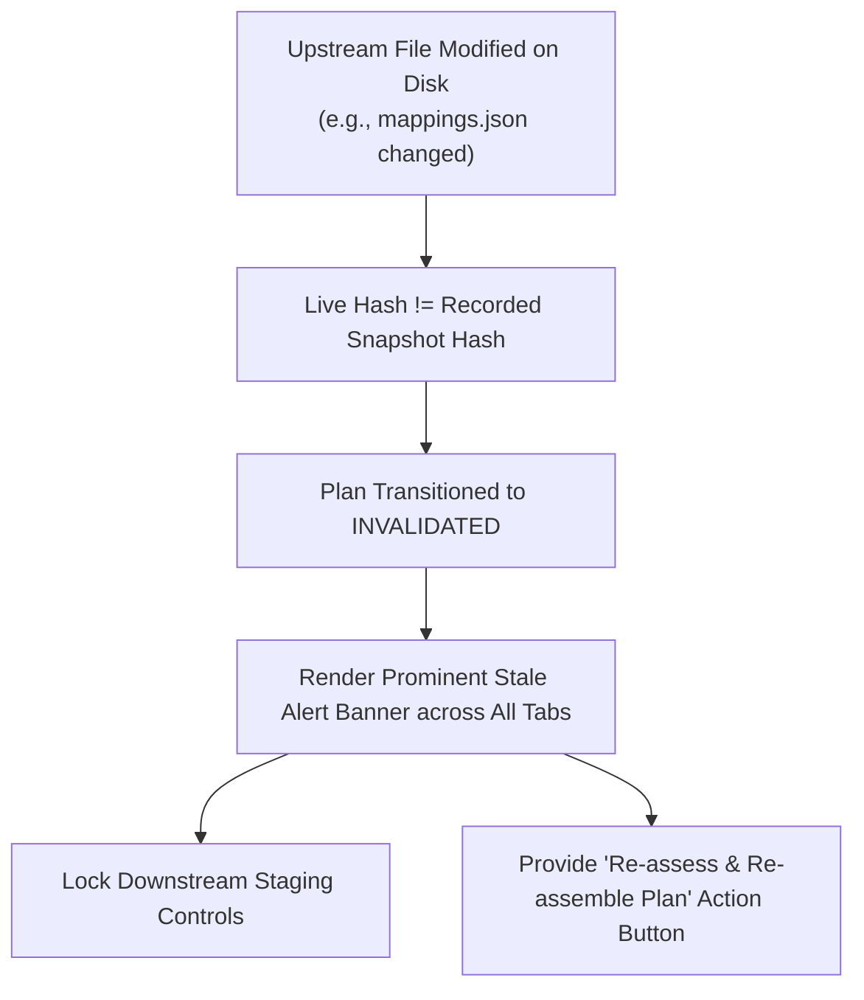

# NexLudic Engine: Revision Comparison & Stale State UX

**Document ID:** `NLE-UX-IPC-001`  
**Phase:** 6 of 12 (Mashup Designer & Integration Planning)  
**Step:** 50 of 100  
**Classification:** Revision Tracking & Invalidation UX Specification  
**Status:** IMPLEMENTATION-READY SPECIFICATION  

---

## 1. Revision Comparison Viewport & Diff Experience

The **Revisions & Staleness** sub-view (`?view=revisions`) enables creators and technical reviewers to perform side-by-side diff comparisons between the active plan revision (e.g., `v1.1.0`) and any historical snapshot archived on Volume D (e.g., `v1.0.0`).

```
+----------------------------------------------------------------------------------------------------+
| REVISION COMPARISON VIEWPORT                                                                       |
|                                                                                                    |
| Compare: [ Active: v1.1.0 (2026-11-18) ▼ ]  against  [ Baseline: v1.0.0 (2026-11-17) ▼ ]         |
+----------------------------------------------------------------------------------------------------+
| REVISION DELTA SUMMARY                                                                             |
| Requirements: +1 Added, ~1 Priority Changed | Mappings: ~1 Transform Updated | Gates: Gate 8 Cleared|
+----------------------------------------------------------------------------------------------------+
| SIDE-BY-SIDE CHANGE INSPECTION TABLE                                                               |
|                                                                                                    |
| DOMAIN ITEM    | BASELINE (v1.0.0)             | ACTIVE (v1.1.0)               | IMPACT / RATIONALE|
| ---------------+-------------------------------+-------------------------------+-------------------|
| REQ-MAND-007   | Status: PARTIAL_COVERED       | Status: FULLY_COVERED         | [✓] Cleared Block |
| WF-STEP-004    | Missing (Not Defined)         | Added: Spawn Vehicle Workflow | Satisfies REQ-007 |
| MAP-COORDS-02  | Formula: AffineMatrixOffset   | Formula: ClampedCoordinateMap | Prevents OOB drift|
| Gate 08 Status | [✕] FAILED (8/9 Mandatory Cov)| [✓] PASSED (9/9 Mandatory Cov)| Enables Acceptance|
| Plan State     | ASSEMBLED_PARTIAL             | ACCEPTED_WITH_RISKS           | Progressed State  |
+----------------------------------------------------------------------------------------------------+
```

### 1.1 Visual Diff Styling Conventions
- **Green Fill (`+`):** Added requirement, component, mapping, or workflow step.
- **Amber Fill (`~`):** Modified parameter, updated formula, altered timeout, or changed priority.
- **Red Strikethrough (`-`):** Removed item or deprecated interface binding.

---

## 2. Stale-State Presentation & Detection UX

In accordance with Step 49 Invalidation Policy (`NLE-POL-IPR-001`), whenever a background file check or plan load discovers that an upstream file hash on disk differs from the recorded snapshot hash, the interface triggers **Stale State Presentation**.



### 2.1 The Stale Alert Banner
The Stale Alert Banner is pinned across the top of all sub-views:

```
+----------------------------------------------------------------------------------------------------+
| [⚡] STALE PLAN ALERT: Upstream Source Artifact Modified on Disk                                   |
| File: docs/mashup-designer/CROSS_GAME_DATA_MAPPING_AND_TRANSFORMATION_SPECIFICATION.md             |
| Cause: Recorded hash sha256:741a... does not match live file hash sha256:9f8e... (Event: EVT-INV-05)|
| Downstream Impact: 2 data mappings (MAP-COORDS-02, MAP-HEALTH-03) and 1 workflow may be out of sync.|
| Status: Plan is currently INVALIDATED. Downstream staging is BLOCKED until reassessment.          |
| [ Re-assess and Re-assemble Plan Now ]           [ View Upstream Git Diff ]                        |
+----------------------------------------------------------------------------------------------------+
```

### 2.2 Impact Radius Visualizer
Clicking `[View Upstream Git Diff]` or expanding the banner opens the **Impact Radius Visualizer**, showing exactly which downstream components, mappings, and workflow steps are invalidated by the change:

```
Invalidated File: CROSS_GAME_DATA_MAPPING_AND_TRANSFORMATION_SPECIFICATION.md
├── Affected Mapping: MAP-COORDS-02 (Coordinate Transform)
│   └── Affected Workflow Step: WF-STEP-002 (Transform Coordinates)
│       └── Affected Requirement: REQ-MAND-002 (World Position Sync)
└── Affected Quality Gate: GATE-PLN-06 (Interface & Mapping Integrity)
```

---

## 3. Reassessment Action & Version Progression Workflow

When the user clicks `[ Re-assess and Re-assemble Plan Now ]`:
1. **Confirmation Dialog:** Confirms that a new plan revision will be generated and the existing revision archived.
2. **Pipeline Execution:** The 15-stage assembly pipeline re-runs against the updated live files.
3. **Version Increment:** In accordance with SemVer rules, the plan automatically increments (e.g., `v1.0.0` $\rightarrow$ `v1.1.0` if mappings were modified).
4. **Archival:** The previous plan snapshot is moved to `projects/<project_id>/plans/snapshots/` as `SUPERSEDED`.
5. **Restoration:** The stale alert banner clears, and the interface loads the newly assembled plan revision.
