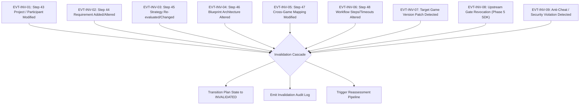

# NexLudic Engine: Integration Plan Revision, Invalidation & Reassessment Policy

**Document ID:** `NLE-POL-IPR-001`  
**Phase:** 6 of 12 (Mashup Designer & Integration Planning)  
**Step:** 49 of 100  
**Classification:** Lifecycle Invalidation & Reassessment Governance  
**Status:** IMPLEMENTATION-READY SPECIFICATION  

---

## 1. Source Revision Tracking & Hash Discrepancy Detection

The Mashup Integration Plan is deterministically bound to the state of its upstream inputs. Because planning is an iterative process, any modification to upstream requirements, strategies, blueprints, mappings, or workflows threatens plan coherence.

### 1.1 Hash Verification Trigger Points
The planning subsystem verifies cryptographic source hashes (`source_content_hash_sha256`) against the live filesystem on Volume D under three distinct conditions:
1. **Plan Load / View:** Whenever a previously accepted plan is opened in the Mashup Designer UI.
2. **Pre-Validation:** Prior to running Quality Gates `GATE-PLN-01..10`.
3. **Downstream Handoff:** Immediately before emitting the plan descriptor to downstream Phase 7 staging tools.

If any file's live hash does not match its recorded snapshot hash, the plan cannot remain accepted; it immediately triggers the Invalidation Cascade.

---

## 2. The 9 Invalidation Trigger Events

NexLudic Engine defines 9 formal events that trigger automatic invalidation or required reassessment of an assembled plan:



### 2.1 Invalidation Trigger Matrix

| Event ID | Triggering Condition | Impact Scope | Automatic Transition | Reassessment Requirement |
| :--- | :--- | :--- | :--- | :--- |
| **EVT-INV-01** | Participating game added, removed, or target OS changed in Step 43. | Total Plan | `INVALIDATED` | Full reassessment from Stage 01. |
| **EVT-INV-02** | Requirement added, deleted, or priority changed to `MANDATORY` in Step 44. | Coverage & Graph | `INVALIDATED` | Re-evaluate coverage and dependency graph. |
| **EVT-INV-03** | Strategy selection changed in Step 45 (e.g., `HYBRID` $\rightarrow$ `HOST_MOD_ONLY`). | Total Architecture | `INVALIDATED` | Full reassembly against new strategy blueprint. |
| **EVT-INV-04** | Component topology, interface definition, or trust boundary modified in Step 46. | Graph & Interfaces | `INVALIDATED` | Re-extract dependency graph and verify DAG. |
| **EVT-INV-05** | Field mapping, coordinate transform, or unit normalization modified in Step 47. | Semantic Mappings | `INVALIDATED` | Re-verify data handoffs in Stage 08. |
| **EVT-INV-06** | Workflow sequence, step dependency, timeout, or compensation modified in Step 48. | Execution Stages | `INVALIDATED` | Re-run Kahn's DAG sort and stage grouping. |
| **EVT-INV-07** | Target game executable updated on local machine (e.g., patch applied). | Platform & Adapters | `INVALIDATED` | Re-verify adapter compatibility and signatures. |
| **EVT-INV-08** | Phase 5 SDK gate status moved to `BLOCKED` or condition revoked. | Upstream Baseline | `INVALIDATED` | Halt plan until SDK gate is cleared. |
| **EVT-INV-09** | Anti-cheat detection added to game or process privilege elevation detected. | Security Sandboxing | `INVALIDATED` | Immediate hard invalidation; veto affected items. |

---

## 3. Invalidation Cascade Protocol

When an invalidation event occurs:
1. **State Mutation:** The plan's `lifecycle_state` is atomically transitioned from `ACCEPTED_FOR_PLANNING` or `ACCEPTED_WITH_RISKS` to **`INVALIDATED`**.
2. **Diagnostic Audit Generation:** A diagnostic event is appended to the project's event journal containing:
   - `invalidation_event_id` (one of `EVT-INV-01..09`);
   - Identity of the modified upstream file and timestamp;
   - Old vs. new SHA-256 hash comparison;
   - List of affected downstream plan items (components, mappings, workflows).
3. **Locking of Execution Handoff:** Any downstream tool or staging harness attempting to ingest the plan is rejected with `ERR_PLAN_INVALIDATED`.

---

## 4. Historical Snapshot Archiving on Volume D

To guarantee full architectural traceability and auditability, superseded or invalidated plans are never overwritten or deleted. They are archived permanently within the project directory structure on Volume D.

### 4.1 Archival Directory Topography
All plan descriptors and their validation audits are stored under:
```
D:\App Winrar Files\Nexludic Engine (working)\
└── projects\
    └── <project_id>\
        └── plans\
            ├── active_plan.json                       # Symbolic pointer or current plan
            └── snapshots\
                ├── plan_<project_id>_v1.0.0_20261118T120000Z.json
                ├── plan_<project_id>_v1.1.0_20261118T143000Z.json
                └── validation_reports\
                    ├── audit_<project_id>_v1.0.0.json
                    └── audit_<project_id>_v1.1.0.json
```

### 4.2 Immutability Guarantee
Archived snapshots are marked read-only on the filesystem. Each snapshot includes its own `plan_checksum_sha256` computed across all fields. Any tampering with archived snapshots is detected upon subsequent directory scans.

---

## 5. Reassessment Workflow & Revision Increment Rules

When an invalidated plan is reassessed, the system does not discard valid, unaffected work. Instead, it follows an incremental reassessment workflow:

```mermaid
flowchart LR
    Inv["Plan INVALIDATED"] --> Intake["Re-intake Modified Upstream Artifact"]
    Intake --> Diff["Diff Upstream Delta"]
    Diff --> Reproc["Re-execute Affected Pipeline Stages"]
    Reproc --> Reeval["Re-run Quality Gates (GATE-PLN-01..10)"]
    Reeval -->|Passed| IncVer["Increment Plan Version (SemVer)"]
    IncVer --> ArchiveOld["Archive Old Plan as SUPERSEDED"]
    ArchiveOld --> AcceptNew["Save New Plan as ACCEPTED"]
```



### 5.1 Semantic Versioning (SemVer) Increment Matrix
- **PATCH Increment (`v1.0.0` $\rightarrow$ `v1.0.1`):**  
  Minor documentation clarifications, non-semantic assumption notes, or optional telemetry adjustments that do not alter the dependency graph or component interfaces.
- **MINOR Increment (`v1.0.0` $\rightarrow$ `v1.1.0`):**  
  Addition or modification of optional/conditional requirements, non-breaking mapping additions, or updated retry timeouts in workflows.
- **MAJOR Increment (`v1.0.0` $\rightarrow$ `v2.0.0`):**  
  Changes to participating games, modification of mandatory requirements, switch in integration strategy (Step 45), architectural component restructuring (Step 46), or breaking data schema transformations (Step 47).

