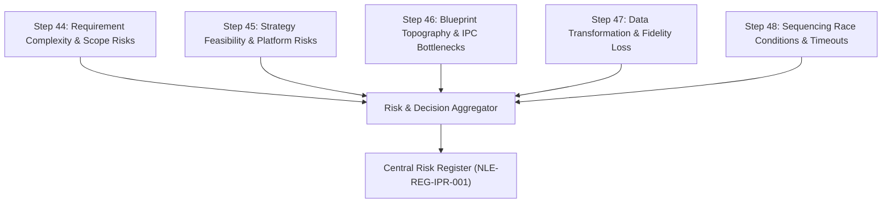

# NexLudic Engine: Integration Plan Risk, Assumption & Open Decision Register

**Document ID:** `NLE-REG-IPR-001`  
**Phase:** 6 of 12 (Mashup Designer & Integration Planning)  
**Step:** 49 of 100  
**Classification:** Risk Governance & Decision Ledger  
**Status:** IMPLEMENTATION-READY SPECIFICATION  

---

## 1. Cross-Phase Risk Aggregation & Synthesis

The Integration Plan serves as the central synthesis point for risks identified across the planning lifecycle. Rather than leaving risks isolated within separate documents, the plan compiles them into a unified ledger, calculates aggregated exposure, and defines mandatory mitigation strategies.

### 1.1 Canonical Risk Taxonomy & Aggregation Ledger

| Risk ID | Source Step | Category | Risk Description | Likelihood (1-5) | Severity (1-5) | Score (L×S) | Risk Tier | Mitigation Strategy |
| :--- | :--- | :--- | :--- | :---: | :---: | :---: | :--- | :--- |
| **RSK-PLN-01** | Step 45 | Security / Anti-Cheat | Target game update introduces heuristic anti-cheat or integrity checks blocking host hooks. | 3 | 5 | 15 | **HIGH** | Strict adherence to `BLK-SEC-01`; zero kernel hooking; fallback to non-invasive telemetry scraping. |
| **RSK-PLN-02** | Step 46 | Concurrency / IPC | Shared-memory circular ring buffer overflows during high-frequency coordinate streaming ($>120\text{ Hz}$). | 2 | 4 | 8 | **MEDIUM** | Dynamic backpressure signaling; drop non-critical cosmetic frames while preserving state deltas. |
| **RSK-PLN-03** | Step 47 | Data Fidelity | Precision loss converting double-precision 64-bit coordinates to 32-bit floats across game engines. | 3 | 3 | 9 | **MEDIUM** | Normalized local coordinate origin offsets; delta-compression to preserve relative positional precision. |
| **RSK-PLN-04** | Step 48 | Orchestration | Network jitter or game freeze triggers premature timeout on cross-game vehicle spawn RPC. | 3 | 3 | 9 | **MEDIUM** | Exponential backoff retry with 5000ms ceiling; idempotency keys on spawn requests. |
| **RSK-PLN-05** | Step 44 | Ambiguity | User requirement for "seamless seamless immersion" lacks quantitative latency or frame-time acceptance bounds. | 4 | 2 | 8 | **MEDIUM** | Step 44 boundary enforcement: decompose into measurable frame-budget criteria ($\le 16.6\text{ ms}$). |
| **RSK-PLN-06** | Step 42 | Upstream SDK | Universal Adapter SDK Phase 5 conditional items (`P5-C01..C03`) delayed prior to Phase 7 staging. | 2 | 4 | 8 | **MEDIUM** | Tag affected components as `PROVISIONAL`; plan achieves `ACCEPTED_WITH_RISKS` until conditions clear. |

---

## 2. Operational Assumption Tracking

Architectural planning relies on explicit operational assumptions regarding platform capabilities, user privileges, and target game environments. Unvalidated assumptions represent potential execution points of failure.

| Assumption ID | Category | Assumption Statement | Source Phase | Verification Method | Current Status |
| :--- | :--- | :--- | :--- | :--- | :--- |
| **ASM-PLN-01** | Environment | Both participating games execute on a single physical host running Windows 10/11 x64 under Medium Integrity Level. | Step 43 | Automated desktop environment detector script during initialization. | `VALIDATED` |
| **ASM-PLN-02** | Concurrency | Host machine possesses $\ge 4$ physical CPU cores capable of running both game processes without starvation. | Step 45 | System hardware capability query via Windows Win32 API. | `VALIDATED` |
| **ASM-PLN-03** | File System | Read/write access to Volume D project workspace is unrestricted by local antivirus sandbox. | Step 43 | File access probe in `scratch/` directory during startup. | `VALIDATED` |
| **ASM-PLN-04** | Adapter SDK | Participating game adapters expose canonical telemetry interface conforming to `NLE-SDK-CAP-001`. | Phase 5 | Conformance test suite execution (`STEP_41_CONFORMANCE_TEST_HARNESS`). | `VALIDATED` |
| **ASM-PLN-05** | Game Versioning | Target games do not force automatic background updates while mashup session is active. | Step 43 | Offline mode or update-lock documentation provided to user. | `UNVERIFIED` |

---

## 3. Open Decision Register & Governance

An assembled plan may identify open design decisions that do not prevent architectural assembly but must be resolved before downstream compilation or runtime execution.

### 3.1 Open Decision Ledger

| Decision ID | Area | Decision Description & Options | Impact / Block Scope | Designated Owner | Resolution Target | Status |
| :--- | :--- | :--- | :--- | :--- | :--- | :--- |
| **DEC-PLN-01** | IPC Transport | Choose between Named Pipes vs. Shared Memory Ring Buffer for high-frequency physics mirroring. | Performance Optimization; Non-blocking for planning. | Systems Architect | Phase 7 Pre-Staging | `OPEN` |
| **DEC-PLN-02** | Coordinate Origin | Establish whether world coordinate origin is pinned to Game Orion terrain anchor or absolute GPS grid. | Step 47 Mapping Precision; Blocks Phase 7 code gen. | Integration Lead | Prior to Phase 7 | `OPEN` |
| **DEC-PLN-03** | UI Overlay | Determine if cross-game speedometer renders via DirectX overlay or dedicated second-screen window. | UX Presentation; Non-blocking for core engine. | UI Lead | Phase 6 Step 50 | `OPEN` |

---

## 4. Decision Resolution Governance & Plan Acceptance Impact

The status of open decisions directly governs whether a plan can achieve full acceptance or is restricted to conditional acceptance:

1. **Blocking Decisions (`BLOCKING_DOWNSTREAM`):**  
   If an open decision directly blocks downstream code generation, interface compilation, or security enforcement (e.g., `DEC-PLN-02`), the plan can be assembled, but its lifecycle state is capped at **`ACCEPTED_WITH_RISKS`**.
2. **Non-Blocking Decisions (`NON_BLOCKING`):**  
   Decisions affecting presentation or optional performance tuning do not prevent the plan from reaching **`ACCEPTED_FOR_PLANNING`**, provided fallback defaults are specified in the architecture blueprint.
3. **Resolution Logging:**  
   When an open decision is resolved, the decision record is updated with:
   - Selected option;
   - Technical rationale;
   - Approval signature;
   - New plan revision increment.

