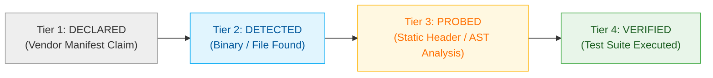

# NexLudic Engine: Integration Plan Risk, Evidence & Validation Review UX

**Document ID:** `NLE-UX-IPV-001`  
**Phase:** 6 of 12 (Mashup Designer & Integration Planning)  
**Step:** 50 of 100  
**Classification:** Risk Governance & Quality Gate Presentation Specification  
**Status:** IMPLEMENTATION-READY SPECIFICATION  

---

## 1. Consolidated Risk, Assumption & Decision Review Experience

The **Risks & Decisions** sub-view (`?view=issues`) aggregates all uncertainties, architectural compromises, and pending decisions identified across Steps 44–49 into a unified, actionable ledger.

```
+----------------------------------------------------------------------------------------------------+
| RISKS, ASSUMPTIONS & OPEN DECISIONS VIEWPORT                                                       |
|                                                                                                    |
| Total Issues: 6 | Critical: 0 | High: 1 | Medium: 4 | Low: 1 | Open Decisions: 3                   |
+----------------------------------------------------------------------------------------------------+
| CONSOLIDATED ISSUE LEDGER TABLE                                                                    |
|                                                                                                    |
| ID          | CATEGORY    | TITLE                       | SEVERITY | STATUS    | ACTION REQUIRED   |
| ------------+-------------+-----------------------------+----------+-----------+-------------------|
| RSK-PLN-01  | Anti-Cheat  | Target Game EAC Detection   | HIGH (15)| MITIGATED | Enforce BLK-SEC-01|
| RSK-PLN-02  | Concurrency | Shared-Memory Buffer O-Flow | MED (8)  | MITIGATED | Drop non-crit frame|
| ASM-PLN-05  | Versioning  | Target Game Auto-Update Lock| MED (8)  | UNVERIFIED| Require offline run|
| DEC-PLN-01  | IPC Trans   | Named Pipe vs Shared Memory | LOW (3)  | OPEN      | Select transport  |
| DEC-PLN-02  | Math/Coord  | Coordinate Origin Anchor    | HIGH (12)| OPEN-BLOCK| P7 CodeGen Blocked|
| DEC-PLN-03  | UX Overlay  | DirectX vs Windowed HUD     | LOW (2)  | OPEN      | UI team selection |
+----------------------------------------------------------------------------------------------------+
```

### 1.1 Open Decision Action Cards
Selecting an open decision displays an interactive decision resolution card:

```
+--------------------------------------------------------------------+
| CONTEXTUAL INSPECTOR: Open Architectural Decision                  |
+--------------------------------------------------------------------+
| Decision ID: DEC-PLN-02                                            |
| Title: Coordinate Origin Anchor Definition                         |
| Scope: BLOCKS PHASE 7 CODE GENERATION                              |
| Designated Owner: Integration Lead                                 |
+--------------------------------------------------------------------+
| DESCRIPTION & OPTIONS CONSIDERED:                                  |
| Option A: Pin origin to Game Orion world coordinate (0,0,0).       |
|   -> Pros: Zero drift for Orion vehicles.                          |
|   -> Cons: Requires large coordinate offsets in Atlas terrain.     |
| Option B: Pin origin to Game Atlas level origin.                   |
|   -> Pros: Natural actor placement in Unreal Engine level.         |
|   -> Cons: Requires dynamic matrix transformation per frame.       |
+--------------------------------------------------------------------+
| RESOLUTION ACTION:                                                 |
| Select Preferred Option: [ (•) Option A  |  ( ) Option B ]         |
| Rationale Note: [ Required for deterministic coordinate sync...  ] |
| [ Record & Submit Decision ] (Increments Plan to v1.1.0)           |
+--------------------------------------------------------------------+
```

---

## 2. Epistemic Certainty Tiers & Evidence Provenance UX

The review interface enforces strict **Epistemic Certainty Visualization** (`NLE-DOM-SPEC-001`). The UI never presents an unverified developer claim or static capability declaration as verified interoperability.



### 2.1 Visual Badging System for Evidence

| Tier Key | Badge Presentation | Meaning in Interface | Example Evidence Document |
| :--- | :--- | :--- | :--- |
| `DECLARED` | `[○] Neutral Grey Badge` | Author claim or manifest entry; unverified by engine. | Mod manifest claiming DirectX 12 support. |
| `DETECTED` | `[●] Blue Information` | Target file, mod directory, or DLL verified to exist on disk. | `OrionHost.exe` located at game install path. |
| `PROBED` | `[▲] Amber Caution` | Static analysis or PE header inspection verified exported functions. | Telemetry export DLL exports `GetVehicleTelemetry()`. |
| `VERIFIED` | `[✓] Solid Green Badge` | Automated conformance or unit test executed successfully. | Universal Adapter SDK Conformance Suite PASS (`Step 41`). |

---

## 3. Quality Gate Scorecard & Diagnostic Presentation

The **Validation & Quality Gates** sub-view (`?view=validation`) displays the formal audit results of `GATE-PLN-01` through `GATE-PLN-10` computed during Step 49 assembly:

```
+----------------------------------------------------------------------------------------------------+
| QUALITY GATE VALIDATION SCORECARD                                                                  |
| Overall Audit Verdict: [!] PASSED_WITH_RISKS | Evaluated: 2026-11-18 14:30 UTC | Evaluator: Step 49|
+----------------------------------------------------------------------------------------------------+
| GATE ID     | QUALITY GATE NAME           | STATUS   | DIAGNOSTIC CODE             | REMEDIATION   |
| ------------+-----------------------------+----------+-----------------------------+---------------|
| GATE-PLN-01 | Schema Conformance          | [✓] PASS | None                        | N/A           |
| GATE-PLN-02 | Snapshot Freshness          | [✓] PASS | None (All 6 hashes match)   | N/A           |
| GATE-PLN-03 | Security & Anti-Cheat       | [✓] PASS | None (Conforms to Medium IL)| N/A           |
| GATE-PLN-04 | Upstream Phase 5 Gate       | [!] WARN | WARN_PROVISIONAL_SDK_DEP    | Track P5-C02  |
| GATE-PLN-05 | Strategy Consistency        | [✓] PASS | None                        | N/A           |
| GATE-PLN-06 | Interface & Mapping Integrity| [✓] PASS | None                        | N/A           |
| GATE-PLN-07 | Dependency Graph Acyclicity | [✓] PASS | None (4 DAG stages verified)| N/A           |
| GATE-PLN-08 | Mandatory Coverage Primacy  | [✓] PASS | None (9/9 Mandatory Covered)| N/A           |
| GATE-PLN-09 | Risk & Decision Tolerability| [!] WARN | WARN_OPEN_BLOCKING_DECISION | Resolve DEC-02|
| GATE-PLN-10 | Checksum & Archival Storage | [✓] PASS | None (Snapshot on Volume D) | N/A           |
+----------------------------------------------------------------------------------------------------+
```

### 3.1 Diagnostic Error Detail & Remediation Drawer
Clicking any warning or failure row displays the complete diagnostic record:
- **Diagnostic Code:** e.g., `WARN_OPEN_BLOCKING_DECISION`
- **Target Item:** `DEC-PLN-02`
- **Message:** *"Architectural decision DEC-PLN-02 ('Coordinate Origin Anchor') remains unresolved and blocks Phase 7 code generation."*
- **Actionable Remediation Button:** `[Jump to Decision in Issues Tab]`
