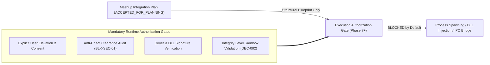
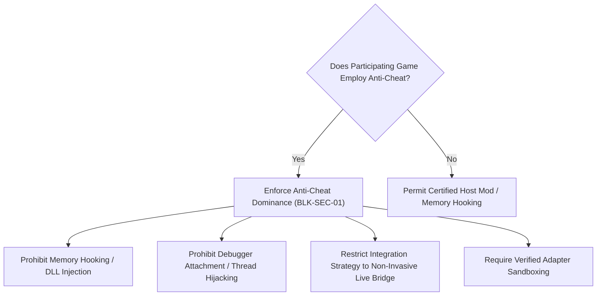

# NexLudic Engine: Integration Plan Security, Privacy & Authorization Requirements

**Document ID:** `NLE-SEC-IPA-001`  
**Phase:** 6 of 12 (Mashup Designer & Integration Planning)  
**Step:** 49 of 100  
**Classification:** Security Architecture & Privacy Specification  
**Status:** IMPLEMENTATION-READY SPECIFICATION  

---

## 1. The Planning vs. Authorization Boundary (The Non-Authorization Invariant)

The fundamental security principle governing Step 49 is the **Non-Authorization Invariant**:

> **Invariant:** The creation, assembly, validation, or acceptance of a Mashup Integration Plan (`ACCEPTED_FOR_PLANNING`) constitutes solely an architectural and structural commitment. **Under no circumstances does plan acceptance authorize, trigger, or initiate code execution, DLL injection, memory modification, process creation, or network communication.**

Plan descriptors are stored as passive data (JSON documents). They contain no executable payloads, macros, shell scripts, or binary stubs.

---

## 2. Integrity Level Confinement & Platform Sandboxing

NexLudic Engine operates within strict Windows platform security boundaries:

### 2.1 Medium Integrity Level Confinement (`DEC-002`)
- The plan assembly engine, validator, and dependency resolver execute strictly at Windows **Medium Integrity Level** (standard user account token).
- Any attempt by an upstream blueprint or workflow to require Administrator privileges (High/System Integrity Level) or prompt a UAC elevation bypass during planning is treated as a critical security failure and rejected under `ERR_PRIVILEGE_ELEVATION_PROHIBITED`.
- Desktop process isolation ensures that neither participating games nor external processes can alter active plan memory.

### 2.2 Deterministic Storage Sandboxing (`DEC-009`)
- All plan files, schema artifacts, historical snapshots, and diagnostic reports must reside exclusively within the project directory on Volume D (`D:\App Winrar Files\Nexludic Engine (working)`).
- Path traversal outside this rooted directory tree (e.g., attempts to write to `%WINDIR%`, `%APPDATA%`, or `%TEMP%`) is strictly blocked and emits `ERR_PATH_SANDBOX_VIOLATION`.

---

## 3. Anti-Cheat Dominance (`BLK-SEC-01`)

Participating games protected by client-side or kernel-level anti-cheat technologies (e.g., Easy Anti-Cheat, BattlEye, Vanguard, Ricochet, Denuvo Anti-Tamper) impose non-negotiable operational boundaries.

### 3.1 Gating Rules
1. **Zero Memory Injection:** Any architecture blueprint (Step 46) or strategy (Step 45) that prescribes live memory writing, DLL injection, or thread injection into an anti-cheat protected game is immediately vetoed during Stage 13 validation (`ERR_ANTI_CHEAT_POLICY_VIOLATION`).
2. **Read-Only / External Telemetry Only:** Protected games may only participate via officially sanctioned mod APIs, external screen/audio capture, or certified read-only telemetry adapters running in separate user-space processes.

---

## 4. Prohibited Behaviors & Attack Surface Defense

The plan assembly engine actively guards against common software supply chain and integration attack vectors:

| Attack Vector / Threat | Protective Mechanism | Enforcement Stage |
| :--- | :--- | :--- |
| **Arbitrary Code Execution in Schemas** | JSON Schema validation disallows executable script tags, expressions, or eval statements. | Stage 01 (Schema Conformance) |
| **Path Traversal / Arbitrary File Overwrite** | Source paths and snapshot outputs are strictly canonicalized relative to Volume D project root. | Stage 02 & Stage 15 |
| **Tampered Planning Inputs (Supply Chain)** | SHA-256 content hashes are captured and asserted prior to assembly. | Stage 02 (Cryptographic Freshness) |
| **Circular Dependency Deadlock (DoS)** | Kahn's algorithm isolates cycles and aborts execution before graph construction deadlocks. | Stage 11 (Kahn DAG Verification) |
| **Privilege Escalation** | Medium IL enforcement prevents spawning elevated child processes. | Stage 13 (Security Audit) |

---

## 5. Privacy & Data Minimization

Mashup planning involves data exchange between distinct games. To protect player privacy and comply with global privacy standards, the plan enforces strict data minimization:

### 5.1 Permitted Data Exchange
- Physical game state variables (e.g., vehicle velocity, world position coordinates, lighting vectors, weather state).
- Gameplay telemetry events (e.g., lap completed, checkpoint reached, weapon fired).
- Abstract inventory or score counters.

### 5.2 Prohibited Data Elements (Hard Privacy Veto)
Under no circumstances may a cross-game data mapping (Step 47) or interaction workflow (Step 48) capture, serialize, or transmit:
- Real-world player identity (e.g., real names, billing information, email addresses);
- Account authentication tokens, session cookies, or passwords;
- Hardware serial numbers, MAC addresses, or persistent machine GUIDs;
- Raw voice chat or unencrypted microphone audio streams;
- Unfiltered clipboard contents.

Any data mapping or workflow referencing prohibited personal data elements triggers diagnostic `ERR_PRIVACY_DATA_LEAK_DETECTED` and immediately marks the plan `INVALID`.

