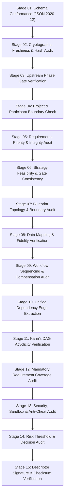

# NexLudic Engine: Integration Plan Validation, Acceptance & Diagnostic Contract

**Document ID:** `NLE-CON-IPV-001`  
**Phase:** 6 of 12 (Mashup Designer & Integration Planning)  
**Step:** 49 of 100  
**Classification:** Quality Assurance Contract & Validation Protocol  
**Status:** IMPLEMENTATION-READY SPECIFICATION  

---

## 1. The 15-Stage Validation Pipeline

Validation is executed as a strictly ordered, 15-stage automated audit before any assembled plan can transition to an accepted state.



### Stage Summary & Verification Scope

| Stage | Name | Verification Objective | Exit Condition |
| :--- | :--- | :--- | :--- |
| **01** | Schema Conformance | Validates descriptor against JSON Schema `NLE-SCH-IPA-001`. | Valid JSON structure. |
| **02** | Cryptographic Freshness | Compares input file hashes with `upstream_snapshots` SHA-256 hashes. | All hashes match active files. |
| **03** | Upstream Gate Audit | Checks Phase 5 gate `NLE-GAT-PH5-001` status in `STEP_42_COMPLETION_REPORT.md`. | Status is `READY` or `READY WITH CONDITIONS`. |
| **04** | Project Boundary Check | Ensures all participants match Step 43 canonical IDs. | Zero undeclared participants. |
| **05** | Requirements Audit | Verifies Step 44 requirement baseline is non-empty and well-formed. | At least 1 mandatory requirement. |
| **06** | Strategy Consistency | Verifies selected strategy matches Step 45 evaluated outcomes. | Strategy is feasible and chosen. |
| **07** | Blueprint Topography | Asserts component nodes and interfaces conform to Step 46. | Zero invalid component boundaries. |
| **08** | Data Mapping Check | Verifies all cross-game data handoffs have corresponding mappings in Step 47. | Zero unmapped data transitions. |
| **09** | Workflow Audit | Verifies step interactions, timeouts, and compensation rules in Step 48. | Every workflow step is valid. |
| **10** | Edge Extraction | Ingests all cross-cutting dependencies into unified edge collection. | All edges reference existing items. |
| **11** | Kahn DAG Acyclicity | Executes Kahn's algorithm over unified dependency graph. | Graph is verified DAG (zero cycles). |
| **12** | Mandatory Coverage | Computes $\text{MandatoryCoverageRatio}$. | Must equal exactly $1.000$ (100%). |
| **13** | Security & Anti-Cheat | Verifies Medium IL (`DEC-002`) and Anti-Cheat Dominance (`BLK-SEC-01`). | Zero anti-cheat or sandbox breaches. |
| **14** | Risk & Decision Audit | Evaluates risk thresholds and blocking status of open decisions. | No unmitigated critical risks. |
| **15** | Signature & Checksum | Computes canonical SHA-256 checksum and packages snapshot archive. | Deterministic checksum generated. |

---

## 2. The 10 Quality Gates (`GATE-PLN-01..10`)

To provide unambiguous, objective pass/fail criteria, the validation pipeline evaluates 10 formal Quality Gates:

```mermaid
flowchart LR
    G1["GATE-PLN-01: Schema"] --> G2["GATE-PLN-02: Freshness"]
    G2 --> G3["GATE-PLN-03: Security/Anti-Cheat"]
    G3 --> G4["GATE-PLN-04: Upstream Gates"]
    G4 --> G5["GATE-PLN-05: Strategy Consistency"]
    G5 --> G6["GATE-PLN-06: Mappings & Interfaces"]
    G6 --> G7["GATE-PLN-07: DAG Acyclicity"]
    G7 --> G8["GATE-PLN-08: Mandatory Coverage"]
    G8 --> G9["GATE-PLN-09: Risk Tolerability"]
    G9 --> G10["GATE-PLN-10: Integrity Signature"]
```



| Gate ID | Quality Gate Name | Gate Evaluation Rule | Severity if Failed |
| :--- | :--- | :--- | :--- |
| **GATE-PLN-01** | Schema & Format Integrity | Plan descriptor conforms 100% to JSON Schema `NLE-SCH-IPA-001`. | **FATAL** (`INVALID`) |
| **GATE-PLN-02** | Source Snapshot Freshness | All SHA-256 hashes of input files match live files on disk. | **FATAL** (`INVALIDATED`) |
| **GATE-PLN-03** | Security & Anti-Cheat Compliance | Conforms to Medium IL (`DEC-002`) and Anti-Cheat Dominance (`BLK-SEC-01`). | **FATAL** (`INVALID`) |
| **GATE-PLN-04** | Upstream Gate Compliance | Phase 5 gate is `READY` or conditional dependencies are tagged `PROVISIONAL`. | **FATAL** (`INVALID`) |
| **GATE-PLN-05** | Strategy & Architecture Consistency | Blueprint components match selected strategy from Step 45. | **FATAL** (`INVALID`) |
| **GATE-PLN-06** | Interface & Mapping Integrity | All data handoffs connect valid interfaces and have verified Step 47 transforms. | **FATAL** (`INVALID`) |
| **GATE-PLN-07** | Dependency Graph Acyclicity | Kahn's algorithm confirms zero circular dependencies across all items. | **FATAL** (`INVALID`) |
| **GATE-PLN-08** | Mandatory Requirement Primacy | 100% of mandatory requirements evaluate to `FULLY_COVERED`. | **FATAL** (Cannot reach `ACCEPTED_FOR_PLANNING`) |
| **GATE-PLN-09** | Risk & Decision Tolerability | Zero unmitigated critical risks; all blocking decisions documented. | **WARNING / CONDITIONAL** |
| **GATE-PLN-10** | Checksum & Archival Verification | Plan checksum is verified and immutable snapshot written to Volume D. | **FATAL** (`INVALID`) |

---

## 3. Diagnostic Data Schema & Taxonomy

Validation failures and warnings emit structured diagnostic records:

```json
{
  "diagnostic_id": "d1e4a7b9-8c23-4f12-a9b0-9876543210ab",
  "code": "ERR_PLAN_CIRCULAR_DEPENDENCY",
  "severity": "FATAL",
  "source_stage": "STAGE_11_KAHN_DAG_ACYCLICITY",
  "target_item_id": "WF-STEP-003-RESOLVE-MAPPING",
  "message": "Circular dependency detected involving items: [WF-STEP-003, MAP-TRANS-04, COMP-BRIDGE, WF-STEP-003].",
  "remediation_guidance": "Decouple synchronous feedback loop by converting MAP-TRANS-04 to asynchronous state emission."
}
```

### 3.1 Canonical Diagnostic Code Ledger

| Diagnostic Code | Severity | Description | Remediation |
| :--- | :--- | :--- | :--- |
| `ERR_PRECONDITION_FAILED` | FATAL | One or more mandatory inputs do not exist on disk. | Author missing upstream planning artifacts. |
| `ERR_STALE_SOURCE_SNAPSHOT` | FATAL | Source file hash does not match hash recorded in snapshot. | Re-run assembly pipeline to incorporate updates. |
| `ERR_ANTI_CHEAT_POLICY_VIOLATION` | FATAL | Plan proposes injection or memory modification on anti-cheat game. | Modify architecture to use non-invasive bridge. |
| `ERR_PLAN_CIRCULAR_DEPENDENCY` | FATAL | Cycle detected in cross-cutting dependency graph. | Break dependency loop using Kahn algorithm report. |
| `ERR_MANDATORY_REQUIREMENT_UNCOVERED` | FATAL | A mandatory requirement lacks blueprint, mapping, or workflow. | Add missing component or workflow step. |
| `ERR_UNMAPPED_DATA_HANDOFF` | FATAL | Workflow passes data across game boundary without Step 47 mapping. | Define field mapping in Step 47. |
| `WARN_OPTIONAL_REQUIREMENT_UNCOVERED` | WARNING | An optional requirement lacks full coverage. | Accept with risks or add optional workflow. |
| `WARN_OPEN_BLOCKING_DECISION` | WARNING | An open architectural decision blocks downstream Phase 7. | Resolve open decision prior to staging. |
| `WARN_PROVISIONAL_SDK_DEPENDENCY` | WARNING | Plan item relies on Phase 5 conditional SDK item (`P5-C01..C03`). | Track Phase 5 condition clearance. |
| `INFO_ASSEMBLY_COMPLETE` | INFO | Assembly and validation completed successfully. | Proceed to plan review. |

---

## 4. Acceptance Criteria & Final Plan Verdict Rules

The overall validation verdict is determined strictly by the outcomes of the 10 Quality Gates:

```
IF Any(Gate[01..07, 10] == FAILED):
    OverallVerdict = "FAILED"
    LifecycleState = "INVALID"
ELSE IF Gate[08] == FAILED:  # Mandatory Coverage < 100%
    OverallVerdict = "FAILED"
    LifecycleState = "ASSEMBLED_PARTIAL" (or "INVALID")
ELSE IF Any(Gate[09] == WARNING) OR HasProvisionalSDKDependency:
    OverallVerdict = "PASSED_WITH_RISKS"
    LifecycleState = "ACCEPTED_WITH_RISKS"
ELSE:
    OverallVerdict = "PASSED"
    LifecycleState = "ACCEPTED_FOR_PLANNING"
```
