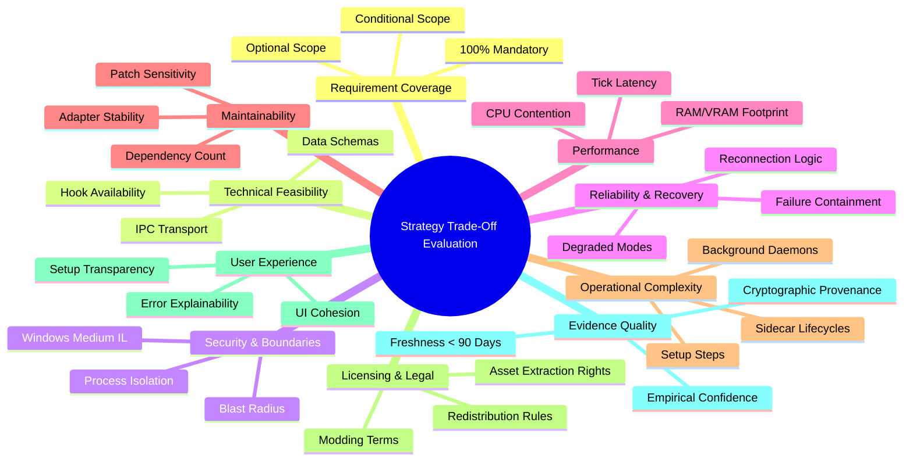

# Integration Strategy Comparison Criteria & Trade-Off Matrix

**Document ID:** `NLE-MAT-ISC-001`  
**Version:** `1.0.0`  
**Status:** `APPROVED ARCHITECTURAL MATRIX & PROPOSED SCORING MODEL`  
**Phase:** `Phase 6 of 12 — Mashup Designer & Integration Planning`  
**Step:** `Step 45 of 100`  
**Classification:** `Trade-Off Analysis & Comparative Evaluation Governance`  
**Related Documents:**
- [INTEGRATION_STRATEGY_EVALUATION_AND_SELECTION_FRAMEWORK.md](file:///d:/App%20Winrar%20Files/Nexludic%20Engine%20(working)/docs/mashup-designer/INTEGRATION_STRATEGY_EVALUATION_AND_SELECTION_FRAMEWORK.md) (`NLE-SPC-ISE-001`)
- [INTEGRATION_STRATEGY_FEASIBILITY_GATES_AND_HARD_CONSTRAINTS.md](file:///d:/App%20Winrar%20Files/Nexludic%20Engine%20(working)/docs/mashup-designer/INTEGRATION_STRATEGY_FEASIBILITY_GATES_AND_HARD_CONSTRAINTS.md) (`NLE-GAT-ISF-001`)
- [COMPATIBILITY_DIMENSION_AND_REQUIREMENT_COVERAGE_CATALOG.md](file:///d:/App%20Winrar%20Files/Nexludic%20Engine%20(working)/docs/game-discovery/COMPATIBILITY_DIMENSION_AND_REQUIREMENT_COVERAGE_CATALOG.md) (`NLE-CAT-CDC-001`)

---

## 1. The 10 Comparison Dimensions

Once candidate strategies have passed the mandatory feasibility gates (`NLE-GAT-ISF-001`), the engine performs a structured trade-off evaluation across ten distinct dimensions:

---

## 2. Multi-Strategy Comparative Trade-Off Matrix

The following matrix contrasts the operational characteristics of the three approved strategy families across all ten dimensions:

| Evaluation Dimension | Strategy A: Host-Game Modification (`STRAT_HOST_MOD`) | Strategy B: Live Interoperability Bridge (`STRAT_LIVE_BRIDGE`) | Strategy C: Hybrid Integration (`STRAT_HYBRID`) |
| :--- | :--- | :--- | :--- |
| **1. Requirement Coverage** | Superior for asset replacement, native rendering, and static item imports. Ineffective for live dynamic multiplayer coordination. | Superior for real-time bidirectional state sync, inventory teleportation, and event triggering. Ineffective for deep native HUD rendering without mods. | Complete coverage for both native UI presentation and real-time state synchronization. |
| **2. Technical Feasibility** | Demands verified in-engine mod loader (e.g. Creation Kit, Harmony, UE4SS) and identical binary bitness. | Demands non-invasive telemetry hook and out-of-process IPC (Named Pipes / Shared Memory). Bitness-independent. | Demands both in-engine mod loader AND telemetry IPC simultaneously. Highest technical hurdle. |
| **3. Security & Boundaries** | In-process execution. Unsandboxed relative to Host Game; a bug can crash the host. Adheres to Medium IL (`DEC-002`). | Full process isolation. Unprivileged bridge sidecar daemon. Clean blast radius; guest crash cannot crash host. | Partial isolation. Host Game is coupled to in-engine mod code; guest game is decoupled via IPC. |
| **4. Reliability & Recovery** | Zero recovery from in-process mod crashes (game process terminates). Fast local tick loop. | High resilience. Bridge detects IPC disconnection, logs failure, and allows Host Game to continue in degraded mode. | Lowest resilience. Compound failure modes: crash in mod loader, IPC daemon, or either game breaks system. |
| **5. Performance & Overhead** | **Lowest Overhead:** Single game running. CPU/RAM footprint minimal. Tick latency effectively $0\text{ ms}$. | **High Overhead:** Dual games + IPC daemon running concurrently. Round-trip tick latency $5\text{--}15\text{ ms}$. | **Highest Overhead:** Dual games + IPC daemon + in-engine script tick overhead. High resource contention. |
| **6. Maintainability & Drift** | Sensitive to Host Game engine updates (mod offsets shift). Guest Game updates have zero impact. | Sensitive to bridge adapter updates. Neither game's internal data formats are permanently modified on disk. | **Highest Fragility:** Subject to breakage from updates to *either* game binary or either mod toolchain. |
| **7. Operational Complexity** | Low operational footprint. No background daemons; single launch executable. Mod files staged on disk. | Moderate footprint. Requires orchestrating two game processes and one local bridge daemon. | High footprint. Multi-step launch coordination: mod loader initialization, dual game booting, IPC handshake. |
| **8. Licensing & Policies** | High legal/EULA risk if assets are extracted from Game B and repackaged into Game A mod format. | Low legal/EULA risk. Zero asset extraction; both games execute unmodified proprietary assets natively. | Moderate risk. Proxy assets created for UI; live bridge handles state synchronization. |
| **9. User Experience** | Seamless in-game feel. Native rendering, native controls, single window. Setup requires mod staging. | Multi-window setup. User manages dual windows, focus, and audio. Zero file modding required. | Complex setup. User must install host mod files AND run bridge background services. |
| **10. Evidence Quality** | Verified by inspecting game mod loader presence, file structure, and script extender documentation. | Verified by testing IPC latency, socket binding, and telemetry event emission in sandbox. | Verified only when both pure strategy evidence chains are simultaneously validated. |

---

## 3. Multi-Candidate Decision Rules

When evaluation reveals multiple viable candidates passing all feasibility gates, the engine applies the following deterministic rules:

### 3.1 Principle of Least Operational Complexity (`RUL-MCD-01`)
If both `STRAT_HOST_MOD` and `STRAT_LIVE_BRIDGE` can satisfy 100% of mandatory requirements, the engine prefers the strategy with the lowest operational complexity and resource footprint unless user preferences prioritize live state dynamism over static assets.

### 3.2 Preservation of Viable Alternatives (`RUL-MCD-02`)
The evaluation report **never discards viable alternatives**. The preferred strategy is highlighted as `RECOMMENDED`, while alternative viable candidates are preserved as `CONDITIONALLY_VIABLE_ALTERNATIVE`. The user retains the authority to choose an alternative.

### 3.3 No False Ties (`RUL-MCD-03`)
If two candidates exhibit identical requirement coverage, the tie is broken using:
1. Process isolation and fault containment (favoring `STRAT_LIVE_BRIDGE`).
2. Installation reversibility (favoring zero-file-modification strategies).
3. Update maintenance sensitivity (favoring single-game sensitivity over dual-game sensitivity).

### 3.4 No Viable Strategy Protocol (`RUL-MCD-04`)
If no candidate strategy satisfies 100% of mandatory requirements, the engine outputs `NO_STRATEGY_FEASIBLE`, sets status to `UNSUPPORTED`, and provides an explainable deficit report detailing:
- Blocked requirements and the missing technical capabilities.
- Security constraints preventing execution.
- Gaps in adapter capability declarations.
- Actionable recommendations (e.g. converting a mandatory requirement to optional or choosing an alternative host role).

---

## 4. Proposed Weighted Scoring Model (PROPOSED, NOT YET APPROVED)

> [!WARNING]
> **GOVERNANCE STATUS: PROPOSED, NOT YET APPROVED FOR PRODUCTION SCORING.**  
> The numerical scoring formula below is a design proposal for future implementation. In accordance with platform governance, **hard feasibility gates (`NLE-GAT-ISF-001`) strictly override any numerical score**. A candidate with a score of 95/100 that fails Gate 1 (Anti-Cheat) is immediately disqualified. Scoring can never be used to average requirement coverage (`RUL-SRC-02`).

### 4.1 Proposed Scoring Formula
For candidates that pass all 7 Feasibility Gates, a multi-dimensional utility index $S_{\text{strat}}$ ($\in [0, 100]$) is computed:

$$S_{\text{strat}} = \sum_{i=1}^{10} w_i \cdot C_i$$

Where:
- $C_i \in [0, 10]$ represents the normalized score for Comparison Dimension $i$.
- $w_i$ represents the dimension weight, constrained such that $\sum w_i = 10.0$.

### 4.2 Proposed Default Dimension Weights

| Dimension $i$ | Evaluation Dimension | Default Weight $w_i$ | Rationale |
| :---: | :--- | :---: | :--- |
| $C_1$ | Mandatory & Optional Requirement Coverage | **2.5** | Core alignment with creator's mashup intent. |
| $C_2$ | Technical Feasibility & Extension Hook Maturity | **1.5** | Empirical stability of underlying hooks. |
| $C_3$ | Security, Isolation & Blast Radius | **1.5** | Protection of user system and process stability. |
| $C_4$ | Reliability, Recovery & Failure Containment | **1.0** | Graceful degradation under runtime fault. |
| $C_5$ | Performance & System Resource Headroom | **1.0** | Smooth gameplay frame-rates and latency. |
| $C_6$ | Maintainability & Update Sensitivity | **0.8** | Resilience against frequent game patches. |
| $C_7$ | Operational Complexity & Setup Friction | **0.7** | Simplicity of installation and execution. |
| $C_8$ | Licensing, EULA & Legal Risk | **0.5** | Compliance with game terms of service. |
| $C_9$ | User Experience & Transparency | **0.5** | Intuitiveness of UI and diagnostic visibility. |
| $C_{10}$| Evidence Quality & Freshness | **0.0** (Gate) | Handled as a prerequisite confidence threshold. |

### 4.3 Sensitivity & Uncertainty Disclaimers
1. **Sensitivity Analysis:** If adjusting any weight $w_i$ by $\pm 10\%$ alters the recommended winner between two viable candidates, the engine flags the evaluation as `SENSITIVE_TO_PREFERENCE_WEIGHTING` and prompts the user to review the trade-offs directly.
2. **Missing Dimension Value:** If an optional dimension cannot be evaluated due to missing telemetry, it is assigned a neutral baseline score ($5.0/10$) and annotated with an evidence gap advisory.

---
*End of Matrix — Document `NLE-MAT-ISC-001`.*
