# Integration Strategy Evaluation & Selection Framework

**Document ID:** `NLE-SPC-ISE-001`  
**Version:** `1.0.0`  
**Status:** `APPROVED ARCHITECTURAL SPECIFICATION`  
**Phase:** `Phase 6 of 12 — Mashup Designer & Integration Planning`  
**Step:** `Step 45 of 100`  
**Classification:** `Core Architecture & Integration Strategy Specification`  
**Related Documents:**
- [MASHUP_PROJECT_DOMAIN_MODEL_AND_RELATIONSHIPS_SPECIFICATION.md](file:///d:/App%20Winrar%20Files/Nexludic%20Engine%20(working)/docs/mashup-designer/MASHUP_PROJECT_DOMAIN_MODEL_AND_RELATIONSHIPS_SPECIFICATION.md) (`NLE-SPC-MPD-001`)
- [MASHUP_REQUIREMENTS_ANALYSIS_AND_FEATURE_DECOMPOSITION_SPECIFICATION.md](file:///d:/App%20Winrar%20Files/Nexludic%20Engine%20(working)/docs/mashup-designer/MASHUP_REQUIREMENTS_ANALYSIS_AND_FEATURE_DECOMPOSITION_SPECIFICATION.md) (`NLE-SPC-MRD-001`)
- [INTEGRATION_STRATEGY_COMPARISON_AND_FEASIBILITY_RULES.md](file:///d:/App%20Winrar%20Files/Nexludic%20Engine%20(working)/docs/game-discovery/INTEGRATION_STRATEGY_COMPARISON_AND_FEASIBILITY_RULES.md) (`NLE-RUL-ISC-001`)
- [STRATEGY_SPECIFIC_RULES_AND_REQUIREMENT_COVERAGE_SPECIFICATION.md](file:///d:/App%20Winrar%20Files/Nexludic%20Engine%20(working)/docs/game-discovery/STRATEGY_SPECIFIC_RULES_AND_REQUIREMENT_COVERAGE_SPECIFICATION.md) (`NLE-SPC-SRC-001`)
- [UNIVERSAL_ADAPTER_SDK_CORE_SPECIFICATION.md](file:///d:/App%20Winrar%20Files/Nexludic%20Engine%20(working)/docs/adapters/UNIVERSAL_ADAPTER_SDK_CORE_SPECIFICATION.md) (`NLE-SPC-SDK-001`)
- [CAPABILITY_MATCHING_AND_REQUIREMENT_RESOLUTION_SPECIFICATION.md](file:///d:/App%20Winrar%20Files/Nexludic%20Engine%20(working)/docs/adapters/CAPABILITY_MATCHING_AND_REQUIREMENT_RESOLUTION_SPECIFICATION.md) (`NLE-SPC-CMR-001`)
- [PHASE_5_PHASE_GATE_AND_EXIT_CRITERIA.md](file:///d:/App%20Winrar%20Files/Nexludic%20Engine%20(working)/docs/adapters/PHASE_5_PHASE_GATE_AND_EXIT_CRITERIA.md) (`NLE-GAT-PH5-001`)

---

## 1. Executive Summary & Purpose

The **Integration Strategy Evaluation & Selection Framework** establishes how **NexLudic Engine** systematically and deterministically evaluates alternative integration approaches for a given user mashup project. 

NexLudic Engine is designed to facilitate interoperability and cross-game experiences across heterogeneous video games. Achieving cross-game interoperability cannot be accomplished using a one-size-fits-all execution pattern. Different game pairs, runtime engines, protection systems, and gameplay objectives necessitate fundamentally different integration mechanisms:
1. **Strategy Family A: Host-Game Modification (`STRAT_HOST_MOD`)** — Injecting custom scripts, assets, or mechanics directly into an authorized host game's extension pipeline, where Guest Game B does not run concurrently at runtime.
2. **Strategy Family B: Live Interoperability Bridge (`STRAT_LIVE_BRIDGE`)** — Running both games concurrently in decoupled operating system processes, bridging events and state bidirectionally across secure local IPC channels.
3. **Strategy Family C: Hybrid Integration (`STRAT_HYBRID`)** — Combining selective host-game UI/asset modifications with a concurrent live bridge daemon to achieve features demanding both native in-engine presentation and real-time cross-game synchronization.

This framework replaces subjective intuition, guessing, and trial-and-error with an evidence-driven, multi-dimensional evaluation pipeline. The framework ingests verified user requirements (`FeatureRequirement` entities from Step 44), canonical game identities and compatibility assessments (from Phase 4), and registered adapter capabilities (from Phase 5). It applies hard architectural gates, evaluates trade-offs, identifies missing evidence, and presents an explainable, auditable recommendation while preserving alternative options.

---

## 2. Epistemic Separation & State Progression Invariant

A central vulnerability of automated systems is conflating theoretical plausibility with technical feasibility, or confusing an algorithmic recommendation with human authorization. NexLudic Engine enforces a strict 9-stage epistemic lifecycle invariant:

```mermaid
flowchart LR
    E1["1. Eligibility<br/>(Architecturally Allowed)"] --> E2["2. Feasibility<br/>(Empirically Supported)"]
    E2 --> E3["3. Sufficiency<br/>(Evidence Complete)"]
    E3 --> E4["4. Preference<br/>(Trade-Off Ranked)"]
    E4 --> E5["5. Recommendation<br/>(System Output)"]
    E5 --> E6["6. Selection<br/>(User Choice)"]
    E6 --> E7["7. Approval<br/>(Plan Approved)"]
    E7 --> E8["8. Authorization<br/>(Security Token)"]
    E8 --> E9["9. Execution<br/>(Runtime Active)"]

    style E1 fill:#edf2f7,stroke:#4a5568,stroke-width:1px
    style E2 fill:#e2e8f0,stroke:#2d3748,stroke-width:1px
    style E3 fill:#feebc8,stroke:#c05621,stroke-width:1px
    style E4 fill:#ebf8ff,stroke:#2b6cb0,stroke-width:1px
    style E5 fill:#e6fffa,stroke:#234e52,stroke-width:1px
    style E6 fill:#faf5ff,stroke:#553c9e,stroke-width:1px
    style E7 fill:#f0fff4,stroke:#22543d,stroke-width:1px
    style E8 fill:#feebc8,stroke:#7b341e,stroke-width:2px
    style E9 fill:#c6f6d5,stroke:#22543d,stroke-width:2px
```

### Invariant Principles:
1. **Eligibility $\neq$ Feasibility:** An approach may be architecturally permitted in the abstract (`Eligible`), yet completely unfeasible for a specific game pair due to a missing modding hook or bitness mismatch.
2. **Feasibility $\neq$ Recommendation:** Two strategies may both be technically feasible; one is recommended based on superior resource efficiency, lower maintenance fragility, or zero asset conversion risk.
3. **Recommendation $\neq$ Selection:** An automated recommendation is an advisory technical opinion. The user owns the project and makes the definitive strategy selection (`STRATEGY_SELECTED`).
4. **Selection $\neq$ Authorization:** Selecting a strategy within the UI does *not* grant permission to inspect memory, modify files, or attach debuggers. Authorization requires passing explicit security policy gates (`BLK-SEC-01`, `DEC-002`).
5. **Authorization $\neq$ Execution:** Authorizing an integration plan prepares runtime configurations; execution only occurs when a user explicitly initiates a mashup runtime session.

---

## 3. The 15-Stage Strategy Evaluation Pipeline

Strategy evaluation executes as a deterministic, reproducible, 15-stage pipeline:

```mermaid
flowchart TD
    P1["Stage 1: Input Validation & Project Snapshot Binding"] --> P2["Stage 2: Upstream Phase Gate Verification (Phase 5 Gate NLE-GAT-PH5-001)"]
    P2 --> P3["Stage 3: Requirement Completeness & Conflict Check (Step 44 Gates QG-01..10)"]
    P3 --> P4["Stage 4: Candidate Strategy Taxonomy Instantiation"]
    P4 --> P5["Stage 5: Hard Security, Policy & Anti-Cheat Gate (BLK-SEC-01, DEC-002)"]
    P5 --> P6["Stage 6: Binary Architecture & Environment Context Resolution"]
    P6 --> P7["Stage 7: Capability & Adapter Discovery Querying (Phase 5 Registry)"]
    P7 --> P8["Stage 8: Mandatory Requirement Coverage Evaluation (RUL-SRC-01)"]
    P8 --> P9["Stage 9: Missing Evidence & Uncertainty Registration"]
    P9 --> P10["Stage 10: Multi-Dimensional Trade-Off Analysis (10 Dimensions)"]
    P10 --> P11["Stage 11: Deterministic Preference Ranking & Rule Synthesis"]
    P11 --> P12["Stage 12: Explainability Synthesis & Structured Finding Generation"]
    P12 --> P13["Stage 13: Required Confirmations & User Decision Gate Identification"]
    P13 --> P14["Stage 14: Result Contract Packaging & Hash Fingerprinting"]
    P14 --> P15["Stage 15: Invalidation Watcher Registration (Dependencies Cascading)"]

    style P1 fill:#f7fafc,stroke:#4a5568,stroke-width:1px
    style P5 fill:#fff5f5,stroke:#9b2c2c,stroke-width:2px
    style P8 fill:#fffaf0,stroke:#c05621,stroke-width:2px
    style P12 fill:#ebf8ff,stroke:#2b6cb0,stroke-width:1px
    style P14 fill:#f0fff4,stroke:#22543d,stroke-width:2px
```

### Stage Summary:
- **Stages 1–3 (Prerequisites):** Validates the immutability of the project snapshot, verifies Phase 5 gate conditions (`P5-C01..C03`), and ensures requirements have achieved `READY_FOR_ANALYSIS`.
- **Stages 4–6 (Hard Filtering):** Filters out prohibited strategies (e.g., kernel injection, anti-cheat tampering) and resolves physical environment facts (OS, bitness, filesystem).
- **Stages 7–9 (Capability Matching):** Slices requirements across available adapters, determines whether every mandatory requirement is supported, and registers evidence gaps.
- **Stages 10–12 (Evaluation & Explanation):** Evaluates performance, stability, maintenance, licensing, and user overhead; generates detailed textual and structured justifications.
- **Stages 13–15 (Finalization):** Highlights open user decisions, records a cryptographic SHA-256 fingerprint of all inputs, and subscribes to project invalidation events.

---

## 4. Architectural Boundaries and Governing Invariants

The evaluation framework strictly adheres to the core architecture defined in Volumes A through E:

1. **Volume D Storage Anchoring (`DEC-009`):**  
   All evaluation manifests, comparison logs, and cached reports persist strictly under `D:\NexLudic\Projects\<project-id>\evaluations\`. No temporary files or caches may be written to user temp or system directories.
2. **Windows Medium Integrity Level (`DEC-002`):**  
   All evaluation computations execute strictly within the unprivileged user context. The evaluation framework cannot require elevated UAC administrator tokens, nor recommend strategies that demand elevation.
3. **Anti-Cheat Dominance (`BLK-SEC-01`):**  
   If any participating game binary is governed by kernel-mode anti-cheat (e.g. Easy Anti-Cheat, BattlEye, Vanguard), all in-process modification strategies and invasive memory-reading bridge hooks are immediately hard-blocked (`PROHIBITED_BLOCKED`).
4. **Mandatory Dominance & Anti-Aggregation (`RUL-SRC-01`, `RUL-SRC-02`):**  
   A strategy cannot be declared feasible if even one mandatory requirement is unmet. Scores are never averaged across requirements.
5. **Hybrid Justification Gate (`RULE-STR-HY-002`):**  
   Hybrid integration is never recommended by default. It requires an explicit, verified justification demonstrating that user requirements demand both in-engine UI/asset rendering AND dynamic live synchronization.

---

## 5. Scope Boundaries

This document defines the specification and evaluation contracts only:
- **Strictly Design-Only:** Contains zero executable evaluation algorithms, zero UI widgets, zero database schemas, and zero network daemons.
- **Zero Game Execution:** No games are launched, modified, or hooked during strategy evaluation.
- **Zero Phase 7/8 Prematurity:** Does not generate integration code, bridge stubs, or mod packages.

---
*End of Specification — Document `NLE-SPC-ISE-001`.*
