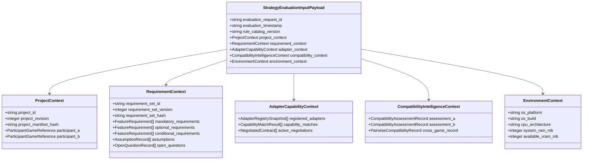

# Integration Strategy Evaluation Input Contract

**Document ID:** `NLE-CON-ISI-001`  
**Version:** `1.0.0`  
**Status:** `APPROVED CONTRACT SPECIFICATION`  
**Phase:** `Phase 6 of 12 — Mashup Designer & Integration Planning`  
**Step:** `Step 45 of 100`  
**Classification:** `Data Contract & Input Schema Specification`  
**Related Documents:**
- [MASHUP_PROJECT_SCHEMA_AND_DATA_DICTIONARY.md](file:///d:/App%20Winrar%20Files/Nexludic%20Engine%20(working)/docs/mashup-designer/MASHUP_PROJECT_SCHEMA_AND_DATA_DICTIONARY.md) (`NLE-CAT-MPD-001`)
- [MASHUP_REQUIREMENT_DOMAIN_MODEL_AND_FIELD_DICTIONARY.md](file:///d:/App%20Winrar%20Files/Nexludic%20Engine%20(working)/docs/mashup-designer/MASHUP_REQUIREMENT_DOMAIN_MODEL_AND_FIELD_DICTIONARY.md) (`NLE-CAT-MRD-001`)
- [CAPABILITY_DECLARATION_REGISTRY_RECORD_SCHEMA.md](file:///d:/App%20Winrar%20Files/Nexludic%20Engine%20(working)/docs/adapters/CAPABILITY_DECLARATION_REGISTRY_RECORD_SCHEMA.md) (`NLE-MOD-RRC-001`)
- [CANONICAL_CAPABILITY_REQUIREMENT_SCHEMA.md](file:///d:/App%20Winrar%20Files/Nexludic%20Engine%20(working)/docs/adapters/CANONICAL_CAPABILITY_REQUIREMENT_SCHEMA.md) (`NLE-CON-CRQ-001`)

---

## 1. Input Contract Architecture & Epistemic Boundaries

A strategy evaluation must be strictly reproducible, deterministic, and traceable. To guarantee this, the evaluation engine accepts a single immutable, validated input payload termed `StrategyEvaluationInputPayload`. 

The engine operates on a point-in-time snapshot. It never queries live mutable database records or dynamic remote state during evaluation execution. Every referenced entity is bound by a cryptographic hash (`SHA-256`) representing its immutable state at evaluation initiation.



---

## 2. Input Context Specifications

### 2.1 Project Context (`ProjectContext`)
Derived directly from Step 43's `project.json` (`NLE-SPC-MPD-001`):
- `project_id`: UUIDv4 uniquely identifying the mashup project.
- `project_revision`: Monotonically increasing integer tracking project edits.
- `participant_a` / `participant_b`: Canonical game identities (`canonical_game_id`, `installed_build_id`, `edition_id`, `assigned_role` $\in \{\text{HOST}, \text{GUEST}, \text{PEER}\}$).
- `project_manifest_hash`: SHA-256 hash of `project.json` preventing race conditions.

### 2.2 Requirement Context (`RequirementContext`)
Derived directly from Step 44's decomposed requirements catalog (`NLE-SPC-MRD-001`):
- `mandatory_requirements`: Array of `FeatureRequirement` records where `req_priority == "MANDATORY"` and `lifecycle_state == "READY_FOR_ANALYSIS"`.
- `optional_requirements`: Array of requirements where `req_priority == "OPTIONAL"`.
- `conditional_requirements`: Array of requirements where `req_priority == "CONDITIONAL"`.
- `assumptions`: Array of `AssumptionRecord` items with validation states.
- `open_questions`: Array of `OpenQuestionRecord` items. **Policy Invariant (`RUL-ISI-01`):** If any open question remains in state `UNRESOLVED` for a mandatory requirement, strategy evaluation cannot proceed to recommendation; it yields `EVALUATION_BLOCKED_UNRESOLVED_QUESTIONS`.

### 2.3 Adapter & Capability Context (`AdapterCapabilityContext`)
Derived from Phase 5 registry and discovery records (`NLE-SPC-VCR-001`, `NLE-SPC-CMR-001`):
- `registered_adapters`: Authoritative snapshots of `RegistryRecord` structures for Game A and Game B adapters.
- `capability_matches`: Authoritative match outcome records matching requirements against adapter capabilities (`MATCH_EXACT`, `MATCH_PARAMETRIC`, etc.).
- `active_negotiations`: Authoritative parameter convergence records from Phase 5 negotiation engine (`NLE-SPC-CNA-001`).

### 2.4 Compatibility & Evidence Context (`CompatibilityIntelligenceContext`)
Derived from Phase 4 discovery intelligence (`NLE-SPC-CAC-001`):
- `assessment_a` / `assessment_b`: Individual game compatibility assessments, anti-cheat detection flags, modding hook availability, and DRM constraints.
- `cross_game_record`: Multi-dimensional compatibility ratings across bitness, renderers, audio subsystems, and tick rates.
- `evidence_provenance`: Cryptographic attestations confirming evidence authenticity and freshness ($< 90\text{ days}$).

### 2.5 Environment Context (`EnvironmentContext`)
Hardware and operating system parameters:
- `cpu_architecture`: `X86_64` or `ARM64`.
- `system_ram_mb`: Available physical RAM.
- `available_vram_mb`: Available dedicated video memory.
- `storage_volume`: Target volume root (strictly adhering to Volume D `DEC-009`).

---

## 3. Handling Incomplete, Ambiguous, or Conflicted Inputs

The evaluation engine adheres to the **Zero Guesswork Invariant (`RUL-ISI-02`)**:

| Input Defect Observed | Invariant Enforcement | Engine Response Code |
| :--- | :--- | :--- |
| Mandatory requirements in `DRAFT` or `UNDER_REVIEW` (not `READY_FOR_ANALYSIS`). | Rejects evaluation execution. Strategy cannot be chosen for unverified requirements. | `ERR_REQUIREMENTS_NOT_READY` |
| Unresolved circular requirement dependency detected (Kahn DAG cycle). | Halts pipeline immediately. Cyclic dependencies invalidate execution ordering. | `ERR_REQ_CIRCULAR_DEPENDENCY` |
| Conflicting mandatory requirements unresolved in Step 44 catalog. | Halts pipeline. Conflicting goals cannot be mapped to a technical strategy. | `ERR_REQUIREMENT_CONFLICT_UNRESOLVED` |
| Participating game installed build unknown or unverified. | Flags compatibility context as unverified. Rejects in-process modding evaluation. | `ERR_GAME_BUILD_UNVERIFIED` |
| Kernel anti-cheat status indeterminate (e.g. unknown driver signature). | Assumes anti-cheat active under conservative safety principle (`BLK-SEC-01`). | `WARN_ANTICHEAT_ASSUMED_ACTIVE` |
| Stale compatibility evidence ($> 90\text{ days}$ old). | Marks evidence as unverified. Downgrades feasibility confidence. | `WARN_EVALUATION_EVIDENCE_STALE` |

---

## 4. Formal JSON Schema: `StrategyEvaluationInputPayload` (`NLE-SCH-ISI-001`)

```json
{
  "$schema": "https://json-schema.org/draft/2020-12/schema",
  "$id": "https://schemas.nexludic.internal/v1/strategy-evaluation-input.json",
  "title": "StrategyEvaluationInputPayload",
  "type": "object",
  "required": [
    "evaluation_request_id",
    "evaluation_timestamp",
    "rule_catalog_version",
    "project_context",
    "requirement_context",
    "adapter_context",
    "compatibility_context",
    "environment_context"
  ],
  "properties": {
    "evaluation_request_id": { "type": "string", "format": "uuid" },
    "evaluation_timestamp": { "type": "string", "format": "date-time" },
    "rule_catalog_version": { "type": "string", "pattern": "^[0-9]+\\.[0-9]+\\.[0-9]+$" },
    "project_context": {
      "type": "object",
      "required": ["project_id", "project_revision", "project_manifest_hash", "participant_a", "participant_b"],
      "properties": {
        "project_id": { "type": "string", "format": "uuid" },
        "project_revision": { "type": "integer", "minimum": 1 },
        "project_manifest_hash": { "type": "string", "pattern": "^[a-f0-9]{64}$" },
        "participant_a": { "$ref": "#/$defs/ParticipantRef" },
        "participant_b": { "$ref": "#/$defs/ParticipantRef" }
      }
    },
    "requirement_context": {
      "type": "object",
      "required": ["requirement_set_id", "requirement_set_version", "requirement_set_hash", "mandatory_requirements"],
      "properties": {
        "requirement_set_id": { "type": "string", "format": "uuid" },
        "requirement_set_version": { "type": "integer", "minimum": 1 },
        "requirement_set_hash": { "type": "string", "pattern": "^[a-f0-9]{64}$" },
        "mandatory_requirements": { "type": "array", "minItems": 1, "items": { "type": "object" } },
        "optional_requirements": { "type": "array", "items": { "type": "object" } },
        "assumptions": { "type": "array", "items": { "type": "object" } },
        "open_questions": { "type": "array", "items": { "type": "object" } }
      }
    },
    "adapter_context": {
      "type": "object",
      "required": ["registered_adapters", "capability_matches"],
      "properties": {
        "registered_adapters": { "type": "array", "items": { "type": "object" } },
        "capability_matches": { "type": "array", "items": { "type": "object" } },
        "active_negotiations": { "type": "array", "items": { "type": "object" } }
      }
    },
    "compatibility_context": {
      "type": "object",
      "required": ["assessment_a", "assessment_b", "cross_game_record"],
      "properties": {
        "assessment_a": { "type": "object" },
        "assessment_b": { "type": "object" },
        "cross_game_record": { "type": "object" }
      }
    },
    "environment_context": {
      "type": "object",
      "required": ["os_platform", "cpu_architecture", "system_ram_mb", "available_vram_mb", "storage_volume"],
      "properties": {
        "os_platform": { "type": "string", "enum": ["WINDOWS_10_X64", "WINDOWS_11_X64"] },
        "cpu_architecture": { "type": "string", "enum": ["X86_64", "ARM64"] },
        "system_ram_mb": { "type": "integer", "minimum": 2048 },
        "available_vram_mb": { "type": "integer", "minimum": 1024 },
        "storage_volume": { "type": "string", "pattern": "^D:\\\\.*" }
      }
    }
  },
  "$defs": {
    "ParticipantRef": {
      "type": "object",
      "required": ["canonical_game_id", "installed_build_id", "assigned_role"],
      "properties": {
        "canonical_game_id": { "type": "string", "format": "uuid" },
        "installed_build_id": { "type": "string" },
        "edition_id": { "type": "string" },
        "assigned_role": { "type": "string", "enum": ["HOST", "GUEST", "PEER"] }
      }
    }
  }
}
```

---
*End of Contract — Document `NLE-CON-ISI-001`.*
