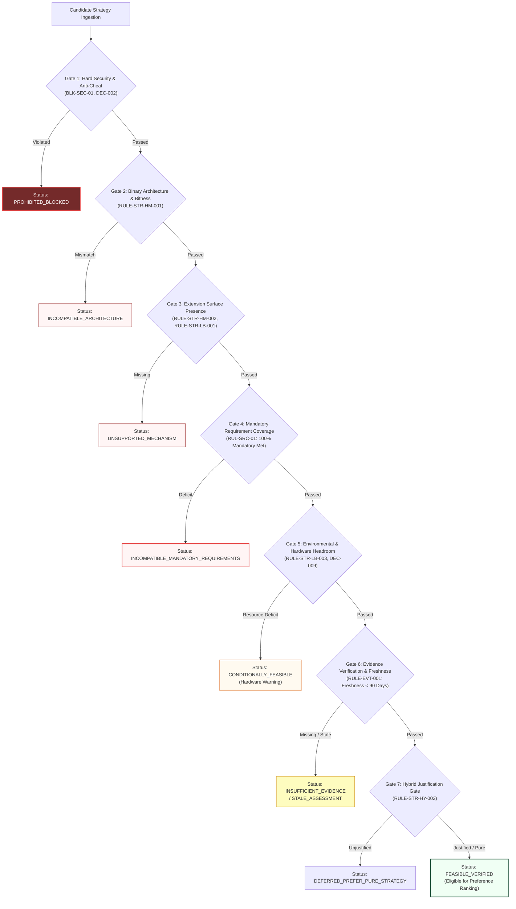

# Integration Strategy Feasibility Gates & Hard Constraints

**Document ID:** `NLE-GAT-ISF-001`  
**Version:** `1.0.0`  
**Status:** `APPROVED ARCHITECTURAL GATES`  
**Phase:** `Phase 6 of 12 — Mashup Designer & Integration Planning`  
**Step:** `Step 45 of 100`  
**Classification:** `Feasibility Gates & Constraint Enforcement Specification`  
**Related Documents:**
- [INTEGRATION_STRATEGY_EVALUATION_AND_SELECTION_FRAMEWORK.md](file:///d:/App%20Winrar%20Files/Nexludic%20Engine%20(working)/docs/mashup-designer/INTEGRATION_STRATEGY_EVALUATION_AND_SELECTION_FRAMEWORK.md) (`NLE-SPC-ISE-001`)
- [INTEGRATION_STRATEGY_TAXONOMY_AND_ELIGIBILITY_RULES.md](file:///d:/App%20Winrar%20Files/Nexludic%20Engine%20(working)/docs/mashup-designer/INTEGRATION_STRATEGY_TAXONOMY_AND_ELIGIBILITY_RULES.md) (`NLE-RUL-IST-001`)
- [STRATEGY_SPECIFIC_RULES_AND_REQUIREMENT_COVERAGE_SPECIFICATION.md](file:///d:/App%20Winrar%20Files/Nexludic%20Engine%20(working)/docs/game-discovery/STRATEGY_SPECIFIC_RULES_AND_REQUIREMENT_COVERAGE_SPECIFICATION.md) (`NLE-SPC-SRC-001`)

---

## 1. Feasibility Gates Architecture

Before the evaluation engine compares trade-offs, evaluates performance, or ranks user preferences, each candidate strategy must successfully pass through seven mandatory, sequential **Feasibility Gates** (`GATE-FEAS-01` through `GATE-FEAS-07`):

---

## 2. Detailed Gate Specifications

### Gate 1: Hard Security & Anti-Cheat Dominance (`GATE-FEAS-01`)
- **Authoritative Anchor:** `BLK-SEC-01`, `DEC-002`, `RULE-SEC-001`.
- **Evaluation Rule:** If either game binary is monitored by an active kernel-mode anti-cheat engine (e.g. EAC, BattlEye, Vanguard), any strategy requiring DLL injection, memory hooking, debugger attachment, or process intrusion is immediately halted.
- **Outcome if Violated:** `PROHIBITED_BLOCKED`. Hard stop. No preference scoring can override this gate.

### Gate 2: Binary Architecture & Bitness Alignment (`GATE-FEAS-02`)
- **Authoritative Anchor:** `RULE-STR-HM-001`.
- **Evaluation Rule:** If the strategy is `STRAT_HOST_MOD`, the Host Game binary and the Guest mod components must share identical processor bitness (`X86_32` vs `X86_64`). A 32-bit DLL cannot be loaded into a 64-bit host game process.
- **Outcome if Violated:** `INCOMPATIBLE_ARCHITECTURE`. Host Modification is excluded; Live Bridge remains eligible because out-of-process IPC bridges differing bitnesses cleanly.

### Gate 3: Extension Surface Presence (`GATE-FEAS-03`)
- **Authoritative Anchor:** `RULE-STR-HM-002`, `RULE-STR-LB-001`.
- **Evaluation Rule:** 
  - For `STRAT_HOST_MOD`: Host Game must possess a verified modding loader (e.g. Harmony, UE4SS, Creation Kit).
  - For `STRAT_LIVE_BRIDGE`: Both games must support non-invasive event emission (telemetry hook, local loopback socket, named pipe).
- **Outcome if Violated:** `UNSUPPORTED_MECHANISM`.

### Gate 4: Mandatory Requirement Coverage (`GATE-FEAS-04`)
- **Authoritative Anchor:** `RUL-SRC-01`, `NLE-SPC-CMR-001`.
- **Evaluation Rule:** Every single `FeatureRequirement` tagged `req_priority == "MANDATORY"` must map to a verified capability in the candidate strategy with outcome `MATCH_EXACT` or `MATCH_PARAMETRIC`. If even one mandatory requirement is unmet or blocked, the strategy cannot proceed.
- **Outcome if Violated:** `INCOMPATIBLE_MANDATORY_REQUIREMENTS`.

### Gate 5: Environmental & Hardware Headroom (`GATE-FEAS-05`)
- **Authoritative Anchor:** `RULE-STR-LB-003`, `DEC-009`.
- **Evaluation Rule:** 
  - For `STRAT_LIVE_BRIDGE` and `STRAT_HYBRID`: Host system physical RAM and VRAM must satisfy the aggregate recommended minimums for running both game binaries concurrently.
  - Storage volume must reside on Volume D (`DEC-009`) with at least $10\text{ GB}$ free staging headroom.
- **Outcome if Violated:** `CONDITIONALLY_FEASIBLE` (with hardware upgrade advisory condition).

### Gate 6: Evidence Verification & Freshness (`GATE-FEAS-06`)
- **Authoritative Anchor:** `RULE-EVT-001`, `NLE-POL-CVG-001`.
- **Evaluation Rule:** All capability claims and compatibility assertions supporting the strategy must possess cryptographic provenance and must have been verified within the last 90 calendar days.
- **Outcome if Violated:** `INSUFFICIENT_EVIDENCE` or `STALE_ASSESSMENT`. Strategy cannot be promoted to `FEASIBLE_VERIFIED` until re-validated.

### Gate 7: Hybrid Justification Gate (`GATE-FEAS-07`)
- **Authoritative Anchor:** `RULE-STR-HY-002`.
- **Evaluation Rule:** For `STRAT_HYBRID`, user mandatory requirements must simultaneously demand native in-engine UI rendering AND real-time dynamic state synchronization. If either pure strategy (`STRAT_HOST_MOD` or `STRAT_LIVE_BRIDGE`) can satisfy the mandatory requirements alone, Hybrid is deferred.
- **Outcome if Violated:** `DEFERRED_PREFER_PURE_STRATEGY`.

---

## 3. Hard Constraints vs. Soft User Preferences

NexLudic Engine enforces a strict boundary between hard constraints and user preferences:

| Attribute | Hard Constraint (Feasibility Gates) | Soft Preference (Trade-Off Matrix) |
| :--- | :--- | :--- |
| **Enforcement Point** | Stages 4–8 (Pre-comparison filter) | Stages 10–11 (Candidate ranking) |
| **Override Allowed?** | **Strictly NEVER.** Even user consent cannot override. | **YES.** User can adjust weighting weights. |
| **Examples** | Kernel anti-cheat block, bitness mismatch, missing mandatory requirement. | Resource consumption preference, installation reversibility preference. |
| **Defect Consequence** | Candidate is disqualified or blocked. | Candidate receives a lower relative preference rank. |

---

## 4. Missing Evidence Protocol (The 6-Step Invariant)

When a candidate strategy is conceptually plausible but lacks verified evidence for an essential integration hook, the engine executes the **6-Step Missing Evidence Protocol (`RUL-MEP-01`)**:

1. **Isolate the Specific Claim:** Identify the precise technical capability lacking empirical proof (e.g. *"Game Orion 1.4 telemetry hook unverified"*).
2. **Document Criticality:** Explain why the missing evidence prevents a definitive feasibility determination.
3. **Specify the Required Evidence Type:** Record the exact evidence required (e.g., automated test run log, vendor documentation citation, or community compatibility report).
4. **Link to Affected Requirement:** Associate the gap with the specific `FeatureRequirement` ID.
5. **Enforce Boundary Cap:** Restrict candidate status to `INSUFFICIENT_EVIDENCE`. The strategy **can never be promoted to `FEASIBLE_VERIFIED`** through assumption.
6. **Trigger Non-Destructive Advisory:** Inform the user of the uncertainty without attempting unpermitted, invasive live memory probing.

---
*End of Gates — Document `NLE-GAT-ISF-001`.*
