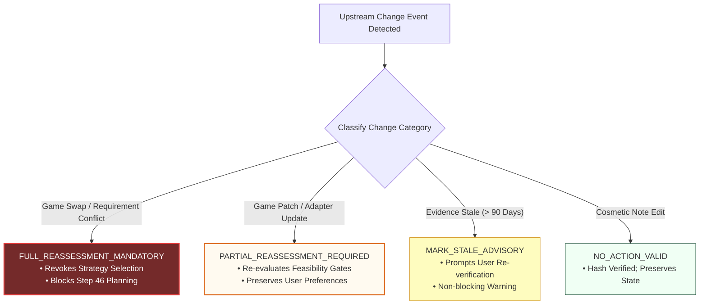

# Integration Strategy Reassessment & Invalidation Policy

**Document ID:** `NLE-POL-IRI-001`  
**Version:** `1.0.0`  
**Status:** `APPROVED ARCHITECTURAL POLICY`  
**Phase:** `Phase 6 of 12 — Mashup Designer & Integration Planning`  
**Step:** `Step 45 of 100`  
**Classification:** `Lifecycle Governance & Reassessment Policy`  
**Related Documents:**
- [INTEGRATION_STRATEGY_EVALUATION_AND_SELECTION_FRAMEWORK.md](file:///d:/App%20Winrar%20Files/Nexludic%20Engine%20(working)/docs/mashup-designer/INTEGRATION_STRATEGY_EVALUATION_AND_SELECTION_FRAMEWORK.md) (`NLE-SPC-ISE-001`)
- [MASHUP_PROJECT_REVISION_TRACKING_AND_INVALIDATION_POLICY.md](file:///d:/App%20Winrar%20Files/Nexludic%20Engine%20(working)/docs/mashup-designer/MASHUP_PROJECT_REVISION_TRACKING_AND_INVALIDATION_POLICY.md) (`NLE-POL-PRI-001`)
- [MASHUP_REQUIREMENT_VERSIONING_CHANGE_AND_INVALIDATION_POLICY.md](file:///d:/App%20Winrar%20Files/Nexludic%20Engine%20(working)/docs/mashup-designer/MASHUP_REQUIREMENT_VERSIONING_CHANGE_AND_INVALIDATION_POLICY.md) (`NLE-POL-RVC-001`)
- [CAPABILITY_VERSIONING_AND_GOVERNANCE_SPECIFICATION.md](file:///d:/App%20Winrar%20Files/Nexludic%20Engine%20(working)/docs/adapters/CAPABILITY_VERSIONING_AND_GOVERNANCE_SPECIFICATION.md) (`NLE-POL-CVG-001`)

---

## 1. Reassessment & Invalidation Architecture

An integration strategy evaluation is valid only for the specific project snapshot, game versions, capability declarations, and environment context under which it was generated. 

When any upstream dependency changes, the engine evaluates the change against the **Strategy Invalidation Cascade Matrix (`NLE-POL-IRI-001`)** to prevent invalid, broken, or dangerous strategies from persisting into downstream planning or execution:



---

## 2. Invalidation Cascade Matrix

The following matrix defines the exact deterministic invalidation action triggered by each upstream event:

| Event Code | Upstream Change Event Description | Impacted Scope | Invalidation Action | Downstream Planning Impact |
| :--- | :--- | :--- | :--- | :--- |
| **`INV-EVT-01`** | Participating Game Added, Removed, or Swapped | Fundamental project topology changed | **`FULL_REASSESSMENT_MANDATORY`** | Clears strategy selection; blocks Step 46. |
| **`INV-EVT-02`** | Game Binary Executable Updated (Steam/Epic patch) | Mod hooks or memory offsets may shift | **`PARTIAL_REASSESSMENT_REQUIRED`** | Pauses Step 46; re-checks extension hooks. |
| **`INV-EVT-03`** | Mandatory `FeatureRequirement` Added or Priority Elevated | Requirements scope expanded | **`FULL_REASSESSMENT_MANDATORY`** | Clears strategy selection; re-checks coverage. |
| **`INV-EVT-04`** | Mandatory `FeatureRequirement` Scope or Verbs Edited | Intent changed; may alter mechanisms | **`PARTIAL_REASSESSMENT_REQUIRED`** | Re-runs capability matching for affected reqs. |
| **`INV-EVT-05`** | Optional `FeatureRequirement` Added, Removed, or Modified | Soft scope changed; no mandatory impact | **`PARTIAL_REASSESSMENT_REQUIRED`** | Re-computes trade-off ranking; preserves selection. |
| **`INV-EVT-06`** | Adapter Version Upgraded in Registry | New capabilities or bug-fixes available | **`PARTIAL_REASSESSMENT_REQUIRED`** | Re-runs Gate 3 and Gate 4 checks. |
| **`INV-EVT-07`** | Adapter Capability Declaration Revoked or Marked Invalid | Underlying technical contract broken | **`FULL_REASSESSMENT_MANDATORY`** | Revokes strategy selection if affected strategy relies on adapter. |
| **`INV-EVT-08`** | Kernel Anti-Cheat Detected on previously clean game | Security risk elevated (`BLK-SEC-01`) | **`SELECTION_REVOKED_BLOCKED`** | Immediately terminates modding/hooking strategies. |
| **`INV-EVT-09`** | Compatibility Evidence Exceeds 90-Day Freshness Window | Evidence provenance expired (`RULE-EVT-001`)| **`MARK_STALE_ADVISORY`** | Surfaces advisory warning in UI; non-blocking. |
| **`INV-EVT-10`** | Evaluation Rule Catalog Upgraded (`v1.0.0` $\rightarrow$ `v1.1.0`) | Architectural evaluation logic changed | **`MARK_STALE_ADVISORY`** | Recommends voluntary re-evaluation. |
| **`INV-EVT-11`** | Cosmetic Project Description / Objective Text Edit | Non-normative text change | **`NO_ACTION_VALID`** | Zero invalidation; evaluation remains valid. |

---

## 3. Reassessment Protocol & Historical Snapshot Preservation

When a reassessment is triggered, the engine strictly maintains historical traceability:

1. **Snapshot Archiving (`DEC-009`):**  
   The superseded `StrategyEvaluationResultPayload` is never overwritten in place. It is archived to:
   ```
   D:\NexLudic\Projects\<project-id>\evaluations\history\<evaluation-id>_rev<revision>.json
   ```
2. **Provenance Linkage:**  
   The new evaluation payload records the `superseded_evaluation_id` and the specific `invalidation_event_code` that provoked the re-evaluation.
3. **User Notification & Re-Authorization:**  
   If an earlier user-selected strategy is revoked by an invalidation event (e.g., `INV-EVT-08` Anti-Cheat detection), the UI alerts the user, clears the selection flag, and requires an explicit new selection before downstream planning can proceed.

---
*End of Policy — Document `NLE-POL-IRI-001`.*
