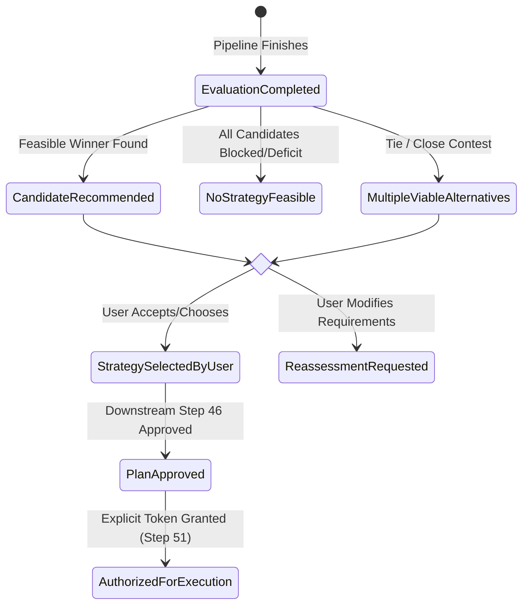
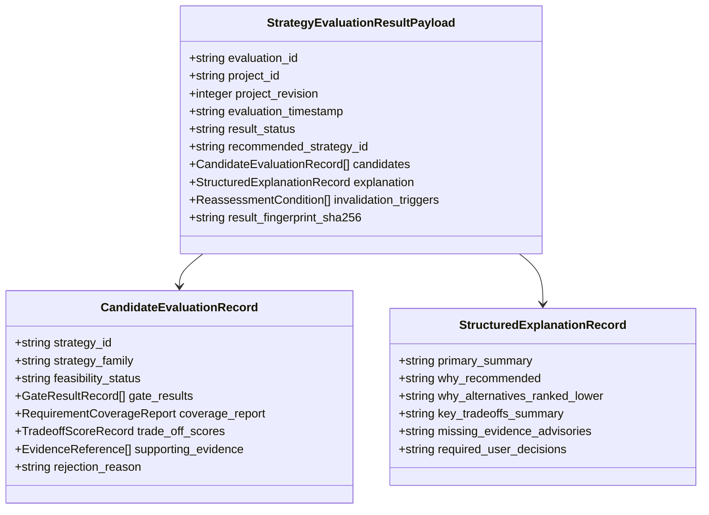

# Integration Strategy Result & Explainability Contract

**Document ID:** `NLE-CON-ISR-001`  
**Version:** `1.0.0`  
**Status:** `APPROVED CONTRACT SPECIFICATION`  
**Phase:** `Phase 6 of 12 — Mashup Designer & Integration Planning`  
**Step:** `Step 45 of 100`  
**Classification:** `Result Data Contract & Explainability Specification`  
**Related Documents:**
- [INTEGRATION_STRATEGY_EVALUATION_AND_SELECTION_FRAMEWORK.md](file:///d:/App%20Winrar%20Files/Nexludic%20Engine%20(working)/docs/mashup-designer/INTEGRATION_STRATEGY_EVALUATION_AND_SELECTION_FRAMEWORK.md) (`NLE-SPC-ISE-001`)
- [INTEGRATION_STRATEGY_COMPARISON_CRITERIA_AND_TRADEOFF_MATRIX.md](file:///d:/App%20Winrar%20Files/Nexludic%20Engine%20(working)/docs/mashup-designer/INTEGRATION_STRATEGY_COMPARISON_CRITERIA_AND_TRADEOFF_MATRIX.md) (`NLE-MAT-ISC-001`)
- [EXPLAINABLE_COMPATIBILITY_EVALUATION_PIPELINE_SPECIFICATION.md](file:///d:/App%20Winrar%20Files/Nexludic%20Engine%20(working)/docs/game-discovery/EXPLAINABLE_COMPATIBILITY_EVALUATION_PIPELINE_SPECIFICATION.md) (`NLE-SPC-EPE-001`)

---

## 1. Result Architecture & State Separation

The strategy evaluation result is published as a formal, immutable payload: `StrategyEvaluationResultPayload`. 

In accordance with platform governance, the result strictly separates technical assessment findings from user decisions and execution permissions:



### Result Status Taxonomy
- `EVALUATION_SUCCESS_SINGLE_RECOMMENDED`: Exactly one strategy cleanly satisfies all gates and outranks alternatives.
- `EVALUATION_SUCCESS_MULTIPLE_VIABLE`: Multiple strategies satisfy all gates; trade-offs are presented for user selection.
- `EVALUATION_UNSUPPORTED_NO_VIABLE_STRATEGY`: No candidate satisfies 100% of mandatory requirements.
- `EVALUATION_BLOCKED_SECURITY_VIOLATION`: One or more candidates violated hard security gates (`BLK-SEC-01`, `DEC-002`).
- `EVALUATION_HALTED_INPUT_DEFECT`: Incomplete, conflicted, or unverified requirements halted execution.

---

## 2. Explainability Structure & Justification Schema

Every result contains a human-readable and machine-parsable `StructuredExplanationRecord` providing clear answers to the user and auditing tools:



---

## 3. Explainability Contract Requirements

For every evaluated candidate, the engine must furnish explicit answers to the following 9 explainability questions:
1. **Considered Scope:** Which mandatory and optional requirements were assessed?
2. **Criteria Evaluated:** Which trade-off dimensions were compared?
3. **Applied Constraints:** Which environmental or security constraints were enforced?
4. **Supporting Evidence:** Which Phase 4 and Phase 5 contracts justify the feasibility determination?
5. **Unverified Assumptions:** Which assumptions remain unproven?
6. **Rejection or Deferral Rationale:** Why was an unrecommended candidate rejected or deferred?
7. **Actionable Resolution:** What modifications to requirements would make an unsupported candidate viable?
8. **Unmet Requirements:** Which specific requirement IDs remain unsatisfied?
9. **Invalidation Conditions:** What future events (game update, requirement edit) will require reassessing this result?

---

## 4. Formal JSON Schema: `StrategyEvaluationResultPayload` (`NLE-SCH-ISR-001`)

```json
{
  "$schema": "https://json-schema.org/draft/2020-12/schema",
  "$id": "https://schemas.nexludic.internal/v1/strategy-evaluation-result.json",
  "title": "StrategyEvaluationResultPayload",
  "type": "object",
  "required": [
    "evaluation_id",
    "project_id",
    "project_revision",
    "evaluation_timestamp",
    "result_status",
    "candidates",
    "explanation",
    "invalidation_triggers",
    "result_fingerprint_sha256"
  ],
  "properties": {
    "evaluation_id": { "type": "string", "format": "uuid" },
    "project_id": { "type": "string", "format": "uuid" },
    "project_revision": { "type": "integer", "minimum": 1 },
    "evaluation_timestamp": { "type": "string", "format": "date-time" },
    "result_status": {
      "type": "string",
      "enum": [
        "EVALUATION_SUCCESS_SINGLE_RECOMMENDED",
        "EVALUATION_SUCCESS_MULTIPLE_VIABLE",
        "EVALUATION_UNSUPPORTED_NO_VIABLE_STRATEGY",
        "EVALUATION_BLOCKED_SECURITY_VIOLATION",
        "EVALUATION_HALTED_INPUT_DEFECT"
      ]
    },
    "recommended_strategy_id": { "type": ["string", "null"] },
    "candidates": {
      "type": "array",
      "minItems": 1,
      "items": {
        "type": "object",
        "required": ["strategy_id", "strategy_family", "feasibility_status", "gate_results", "coverage_report"],
        "properties": {
          "strategy_id": { "type": "string" },
          "strategy_family": { "type": "string", "enum": ["STRAT_HOST_MOD", "STRAT_LIVE_BRIDGE", "STRAT_HYBRID"] },
          "feasibility_status": {
            "type": "string",
            "enum": [
              "FEASIBLE_VERIFIED",
              "CONDITIONALLY_FEASIBLE",
              "PROVISIONALLY_FEASIBLE",
              "INSUFFICIENT_EVIDENCE",
              "INCOMPATIBLE_ARCHITECTURE",
              "UNSUPPORTED_MECHANISM",
              "INCOMPATIBLE_MANDATORY_REQUIREMENTS",
              "DEFERRED_PREFER_PURE_STRATEGY",
              "PROHIBITED_BLOCKED"
            ]
          },
          "gate_results": { "type": "array", "items": { "type": "object" } },
          "coverage_report": {
            "type": "object",
            "required": ["mandatory_coverage_percent", "unsatisfied_mandatory_req_ids"],
            "properties": {
              "mandatory_coverage_percent": { "type": "number", "minimum": 0, "maximum": 100 },
              "unsatisfied_mandatory_req_ids": { "type": "array", "items": { "type": "string" } }
            }
          },
          "trade_off_scores": { "type": "object" },
          "rejection_reason": { "type": ["string", "null"] }
        }
      }
    },
    "explanation": {
      "type": "object",
      "required": ["primary_summary", "why_recommended", "key_tradeoffs_summary"],
      "properties": {
        "primary_summary": { "type": "string" },
        "why_recommended": { "type": "string" },
        "why_alternatives_ranked_lower": { "type": "string" },
        "key_tradeoffs_summary": { "type": "string" },
        "missing_evidence_advisories": { "type": "array", "items": { "type": "string" } },
        "required_user_decisions": { "type": "array", "items": { "type": "string" } }
      }
    },
    "invalidation_triggers": {
      "type": "array",
      "items": {
        "type": "object",
        "required": ["trigger_type", "monitored_entity_id"],
        "properties": {
          "trigger_type": { "type": "string" },
          "monitored_entity_id": { "type": "string" }
        }
      }
    },
    "result_fingerprint_sha256": { "type": "string", "pattern": "^[a-f0-9]{64}$" }
  }
}
```

---
*End of Contract — Document `NLE-CON-ISR-001`.*
