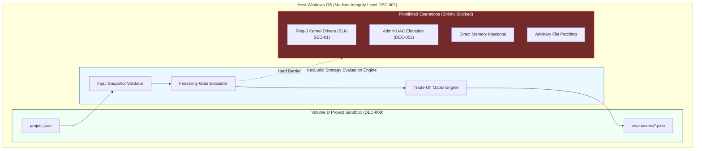

# Integration Strategy Security, Privacy & Failure Policy

**Document ID:** `NLE-POL-ISS-001`  
**Version:** `1.0.0`  
**Status:** `APPROVED ARCHITECTURAL POLICY`  
**Phase:** `Phase 6 of 12 — Mashup Designer & Integration Planning`  
**Step:** `Step 45 of 100`  
**Classification:** `Security, Privacy & Edge-Case Failure Governance`  
**Related Documents:**
- [INTEGRATION_STRATEGY_EVALUATION_AND_SELECTION_FRAMEWORK.md](file:///d:/App%20Winrar%20Files/Nexludic%20Engine%20(working)/docs/mashup-designer/INTEGRATION_STRATEGY_EVALUATION_AND_SELECTION_FRAMEWORK.md) (`NLE-SPC-ISE-001`)
- [INTEGRATION_STRATEGY_FEASIBILITY_GATES_AND_HARD_CONSTRAINTS.md](file:///d:/App%20Winrar%20Files/Nexludic%20Engine%20(working)/docs/mashup-designer/INTEGRATION_STRATEGY_FEASIBILITY_GATES_AND_HARD_CONSTRAINTS.md) (`NLE-GAT-ISF-001`)
- [ADAPTER_SECURITY_SANDBOX_AND_PROCESS_ISOLATION_SPECIFICATION.md](file:///d:/App%20Winrar%20Files/Nexludic%20Engine%20(working)/docs/adapters/ADAPTER_SECURITY_SANDBOX_AND_PROCESS_ISOLATION_SPECIFICATION.md) (`NLE-SPC-ASI-001`)

---

## 1. Security & Trust Boundaries

The evaluation of integration strategies operates across explicit security boundaries. Evaluating an integration strategy must never compromise the integrity of the user's host operating system, game installations, or private data:

### Core Security Invariants:
1. **Windows Medium Integrity Level (`DEC-002`):** Evaluation processes execute exclusively with standard user tokens. No administrative privileges (`SeDebugPrivilege`, UAC elevation) may be requested.
2. **Anti-Cheat Dominance (`BLK-SEC-01`):** Kernel anti-cheat protections override all other considerations. If an anti-cheat driver signature is detected on any participating title, in-process hooking and invasive memory access are hard-blocked.
3. **Non-Authorization Invariant (`RUL-ISS-01`):** An evaluation result is an informational assessment. It carries zero authorization to touch game files or attach debuggers.
4. **Volume D Sandbox Anchoring (`DEC-009`):** All evaluation records persist strictly under `D:\NexLudic\Projects\<id>\evaluations\`.
5. **Privacy & Telemetry Boundary (`RUL-ISS-02`):** Strategy evaluations are 100% offline and local. No project details, user requirements, or system environment data are transmitted over the internet.

---

## 2. Comprehensive Failure Handling & Edge Cases (The 24 Scenarios)

The evaluation framework specifies deterministic behavior for all 24 potential failure modes and edge cases:

| # | Edge Case Scenario | Engine Precondition | Handling & Status Outcome | Explanatory Action |
| :-: | :--- | :--- | :--- | :--- |
| **1** | No mandatory requirements defined. | `mandatory_requirements.length == 0` | `ERR_NO_MANDATORY_REQUIREMENTS` | Rejects evaluation; prompts user to define core objective. |
| **2** | Mandatory requirements ambiguous. | Unresolved ambiguity flags present. | `ERR_AMBIGUOUS_REQUIREMENTS` | Rejects evaluation; points to Step 44 clarification wizard. |
| **3** | Two mandatory requirements conflict. | Mutual exclusion conflict recorded. | `ERR_REQUIREMENT_CONFLICT_UNRESOLVED` | Halts evaluation; requires conflict resolution in Step 44. |
| **4** | Game binary version unknown. | `installed_build_id == null` | `ERR_GAME_BUILD_UNVERIFIED` | Rejects `STRAT_HOST_MOD`; prompts game detection run. |
| **5** | Host environment unidentifiable. | OS or RAM detection failed. | `WARN_ENVIRONMENT_UNVERIFIED` | Assumes baseline specs; marks resource headroom as unverified. |
| **6** | Required capability not declared. | Matching yields `NO_MATCH`. | `UNSUPPORTED_MECHANISM` | Candidate strategy marked unfeasible for this requirement. |
| **7** | Capability declaration invalid. | ACD validation failed (`CRIT-P5-03`). | `ERR_INVALID_CAPABILITY_DECLARATION`| Disqualifies adapter; flags adapter as unverified. |
| **8** | Adapter registered but not eligible. | Admission gate failed (`ADM-GAT-004`). | `ERR_ADAPTER_INELIGIBLE` | Excludes adapter from capability matching. |
| **9** | Adapter lacks verification evidence. | Declaration unverified by test run. | `INSUFFICIENT_EVIDENCE` | Restricts candidate status to unverified proposal. |
| **10**| Evidence stale ($> 90\text{ days}$). | Timestamp $> 90\text{ days}$ old. | `WARN_EVALUATION_EVIDENCE_STALE` | Advisory warning; prompts user to run verification check. |
| **11**| Strategy violates security gate. | Kernel anti-cheat active (`BLK-SEC-01`). | `PROHIBITED_BLOCKED` | Rejects candidate immediately; explains anti-cheat rule. |
| **12**| Missing extension mechanism. | Host has no modding hook. | `UNSUPPORTED_MECHANISM` | Excludes `STRAT_HOST_MOD`; recommends `STRAT_LIVE_BRIDGE`. |
| **13**| Multiple strategies satisfy constraints. | 2+ candidates pass all gates. | `EVALUATION_SUCCESS_MULTIPLE_VIABLE` | Presents trade-offs; retains alternatives for user selection. |
| **14**| No strategy currently viable. | 0 candidates pass all gates. | `EVALUATION_UNSUPPORTED_NO_VIABLE_STRAT`| Provides deficit report; details unmet requirements. |
| **15**| Conditionally viable candidate. | Hardware or environment warnings. | `CONDITIONALLY_FEASIBLE` | Discloses required conditions before user selection. |
| **16**| Previous recommendation stale. | Game patch or requirement edit. | `MARK_STALE_ADVISORY` | Prompts user to trigger reassessment. |
| **17**| Referenced adapter removed. | Adapter uninstalled from registry. | `FULL_REASSESSMENT_MANDATORY` | Clears previous recommendation; triggers reassessment. |
| **18**| Internal evaluation engine error. | Unhandled parser/schema exception. | `ERR_INTERNAL_EVALUATION_FAULT` | Fails safe; outputs diagnostic log without crashing app. |
| **19**| Upstream Phase 5 contract missing. | Required schema or gate missing. | `ERR_UPSTREAM_DEPENDENCY_MISSING` | Preserves uncertainty; halts dependent evaluation pipeline. |
| **20**| User requests prohibited approach. | User asks for kernel memory hook. | `PROHIBITED_BLOCKED` | Explains platform security and legal policy boundary. |
| **21**| Preferred strategy requires relax. | Candidate needs mandatory $\rightarrow$ opt. | `INCOMPATIBLE_MANDATORY_REQUIREMENTS` | Never silently relaxes requirements; user must edit. |
| **22**| Unjustified hybrid complexity. | Pure strategy satisfies requirements. | `DEFERRED_PREFER_PURE_STRATEGY` | Defers Hybrid; explains unnecessary operational complexity. |
| **23**| Unknown licensing status. | EULA extraction policy unclear. | `WARN_LICENSING_STATUS_UNKNOWN` | Surfaces legal advisory note; leaves choice to user. |
| **24**| Objective changed after evaluation. | Project revision incremented. | `INV-EVT-03` triggered | Automatically marks existing evaluation invalid. |

---
*End of Policy — Document `NLE-POL-ISS-001`.*
