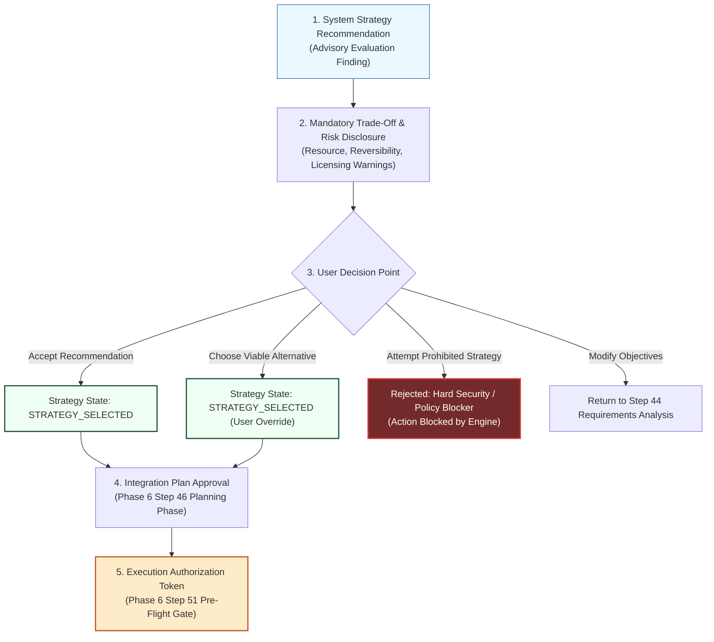
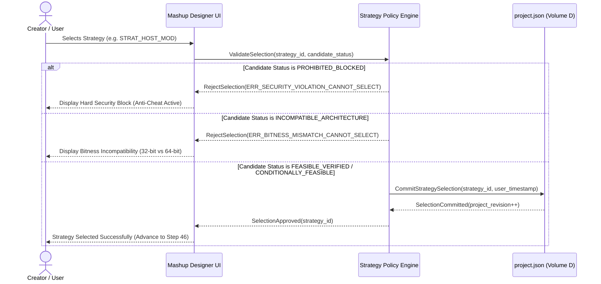

# Integration Strategy Selection & Approval Policy

**Document ID:** `NLE-POL-ISA-001`  
**Version:** `1.0.0`  
**Status:** `APPROVED ARCHITECTURAL POLICY`  
**Phase:** `Phase 6 of 12 — Mashup Designer & Integration Planning`  
**Step:** `Step 45 of 100`  
**Classification:** `User Governance & Authorization Policy`  
**Related Documents:**
- [INTEGRATION_STRATEGY_EVALUATION_AND_SELECTION_FRAMEWORK.md](file:///d:/App%20Winrar%20Files/Nexludic%20Engine%20(working)/docs/mashup-designer/INTEGRATION_STRATEGY_EVALUATION_AND_SELECTION_FRAMEWORK.md) (`NLE-SPC-ISE-001`)
- [INTEGRATION_STRATEGY_RESULT_AND_EXPLAINABILITY_CONTRACT.md](file:///d:/App%20Winrar%20Files/Nexludic%20Engine%20(working)/docs/mashup-designer/INTEGRATION_STRATEGY_RESULT_AND_EXPLAINABILITY_CONTRACT.md) (`NLE-CON-ISR-001`)
- [MASHUP_PROJECT_LIFECYCLE_STATE_MACHINE_AND_GOVERNANCE_SPECIFICATION.md](file:///d:/App%20Winrar%20Files/Nexludic%20Engine%20(working)/docs/mashup-designer/MASHUP_PROJECT_LIFECYCLE_STATE_MACHINE_AND_GOVERNANCE_SPECIFICATION.md) (`NLE-SPC-MLG-001`)

---

## 1. Governance Charter & Decision Authority

The **Integration Strategy Selection & Approval Policy** governs how automated evaluation findings transition into authoritative project planning commitments.

A core principle of **NexLudic Engine** is that **the human creator is the ultimate decision-maker for their mashup project**. Automated algorithms, heuristics, and recommendations serve as decision-support tooling. However, user autonomy is strictly bounded by platform safety, legal integrity, and system stability invariants.

---

## 2. Six-Tier Authority Hierarchy

To prevent security privilege confusion, NexLudic Engine enforces a strict 6-tier hierarchy of authority:

| Tier | Concept | Meaning & Scope | Can Override Lower? | Can Override Higher? |
| :---: | :--- | :--- | :---: | :---: |
| **T-1** | **User Preference** | Desired user weighting or initial inclination. | No | **NO** |
| **T-2** | **System Recommendation** | Advisory technical opinion generated by evaluation engine. | Yes (Advisory) | **NO** |
| **T-3** | **User Strategy Selection** | Explicit commitment by user to pursue a candidate strategy. | Yes | **NO** |
| **T-4** | **Approved Planning Decision** | Formal sign-off on the full topological integration plan (Step 46). | Yes | **NO** |
| **T-5** | **Sensitive Operation Consent** | User consent to stage files or modify local directory trees. | Yes | **NO** |
| **T-6** | **Execution Authorization** | Cryptographic token granting runtime session launch (Step 51). | Yes | **N/A (Apex)** |

### Invariant Rules:
1. **Rule RUL-ISA-01 (Preference Subservience):** A user preference (`T-1`) or user selection (`T-3`) **can never override a hard security policy (`BLK-SEC-01`), Windows Medium IL boundary (`DEC-002`), or binary bitness mismatch (`RULE-STR-HM-001`)**.
2. **Rule RUL-ISA-02 (Selection Isolation):** Selecting a strategy (`T-3`) records an architectural target within `project.json`. It does **not** modify game directories on disk, install mods, or launch background IPC processes.
3. **Rule RUL-ISA-03 (Alternative Selection Freedom):** If multiple strategies achieve `FEASIBLE_VERIFIED` or `CONDITIONALLY_FEASIBLE`, the user has the unconditional right to select any of them, even if it differs from the system's top-ranked recommendation.

---

## 3. Mandatory Risk & Trade-Off Disclosure Gates

Before the system accepts a user strategy selection, it must present a mandatory, unambiguous disclosure based on the strategy chosen:

### 3.1 Disclosures for Strategy A (`STRAT_HOST_MOD`)
- **File Staging Notice:** The user must be informed that mod assets will be staged into the Host Game's installation directory on Volume D (`DEC-009`).
- **Crash Blast Radius Notice:** In-process mod execution means any fatal script error will crash the Host Game process.
- **Game Update Fragility:** Updates to the Host Game via Steam/Epic may disable or break the mod loader until an adapter patch is released.

### 3.2 Disclosures for Strategy B (`STRAT_LIVE_BRIDGE`)
- **System Resource Headroom:** The user must be warned that both games will execute concurrently, requiring sufficient multi-core CPU, RAM, and GPU capacity.
- **Window Management Friction:** The user must be informed that audio focus, borderless windowing, and input mapping will span two active windows.

### 3.3 Disclosures for Strategy C (`STRAT_HYBRID`)
- **Compound Complexity Disclosure:** The user must acknowledge that Hybrid requires *both* mod staging and concurrent game execution, doubling maintenance fragility and failure points.
- **Justification Confirmation:** The user must explicitly confirm that they understand simpler pure strategies were bypassed to achieve dual in-engine and live sync requirements.

---

## 4. Policy Rejection of Prohibited Selections

If a user attempts to select a strategy marked `PROHIBITED_BLOCKED` or `INCOMPATIBLE_ARCHITECTURE`, the engine strictly rejects the selection:

---
*End of Policy — Document `NLE-POL-ISA-001`.*
