# Integration Strategy Synthetic Scenarios & Test Plan

**Document ID:** `NLE-CAT-IST-001`  
**Version:** `1.0.0`  
**Status:** `APPROVED TEST SPECIFICATION & SCENARIO CATALOG`  
**Phase:** `Phase 6 of 12 — Mashup Designer & Integration Planning`  
**Step:** `Step 45 of 100`  
**Classification:** `Verification Plan & Synthetic Scenario Catalog`  
**Related Documents:**
- [INTEGRATION_STRATEGY_EVALUATION_AND_SELECTION_FRAMEWORK.md](file:///d:/App%20Winrar%20Files/Nexludic%20Engine%20(working)/docs/mashup-designer/INTEGRATION_STRATEGY_EVALUATION_AND_SELECTION_FRAMEWORK.md) (`NLE-SPC-ISE-001`)
- [INTEGRATION_STRATEGY_FEASIBILITY_GATES_AND_HARD_CONSTRAINTS.md](file:///d:/App%20Winrar%20Files/Nexludic%20Engine%20(working)/docs/mashup-designer/INTEGRATION_STRATEGY_FEASIBILITY_GATES_AND_HARD_CONSTRAINTS.md) (`NLE-GAT-ISF-001`)
- [INTEGRATION_STRATEGY_COMPARISON_CRITERIA_AND_TRADEOFF_MATRIX.md](file:///d:/App%20Winrar%20Files/Nexludic%20Engine%20(working)/docs/mashup-designer/INTEGRATION_STRATEGY_COMPARISON_CRITERIA_AND_TRADEOFF_MATRIX.md) (`NLE-MAT-ISC-001`)

---

## 1. Testability & Verification Framework

This document defines the formal verification plan for the Integration Strategy Evaluation & Selection Framework. 

> [!NOTE]
> In accordance with Phase 6 design-only discipline, the scenarios described herein are **formal specification benchmarks and synthetic validation test cases**, not executed runtime tests on live commercial games.

The verification plan comprises two primary testing tiers:
1. **Contract & Logic Tests:** Verifying input schema validation, feasibility gate rules, coverage calculations, trade-off matrix algorithms, explainability outputs, and invalidation cascades.
2. **Security & Boundary Tests:** Verifying that anti-cheat blockers, Medium IL restrictions, and non-authorization invariants cannot be bypassed by scoring formulas or user preferences.

---

## 2. Synthetic Acceptance Scenarios (Scenarios A through I)

All scenarios utilize the canonical fictional titles **Game Orion** (Single-player fantasy RPG; 64-bit; active modding community; no anti-cheat) and **Game Atlas** (Multiplayer sci-fi survival simulator; 64-bit; proprietary engine; EAC kernel anti-cheat in multiplayer mode, disabled in offline local mode).

```mermaid
flowchart TD
    ScenA["Scenario A: Host Mod Candidate<br/>(Validates Mod Hooks)"]
    ScenB["Scenario B: Live Bridge Candidate<br/>(Validates IPC Interfaces)"]
    ScenC["Scenario C: Hybrid Candidate<br/>(Validates Dual Mechanism Need)"]
    ScenD["Scenario D: Multiple Viable<br/>(Validates Trade-Off Explanations)"]
    ScenE["Scenario E: Missing Evidence<br/>(Validates Uncertainty Capping)"]
    ScenF["Scenario F: Policy Conflict<br/>(Validates Anti-Cheat Dominance)"]
    ScenG["Scenario G: Changed Requirement<br/>(Validates Invalidation Cascade)"]
    ScenH["Scenario H: No Viable Strategy<br/>(Validates Deficit Reporting)"]
    ScenI["Scenario I: Incomplete Contract<br/>(Validates Upstream Gate Halting)"]

    style ScenA fill:#f0fff4,stroke:#22543d,stroke-width:1px
    style ScenB fill:#ebf8ff,stroke:#2b6cb0,stroke-width:1px
    style ScenC fill:#fffaf0,stroke:#dd6b20,stroke-width:1px
    style ScenD fill:#faf5ff,stroke:#553c9e,stroke-width:1px
    style ScenE fill:#fefcbf,stroke:#d69e2e,stroke-width:1px
    style ScenF fill:#fff5f5,stroke:#9b2c2c,stroke-width:2px
    style ScenG fill:#e2e8f0,stroke:#4a5568,stroke-width:1px
    style ScenH fill:#fff5f5,stroke:#e53e3e,stroke-width:1px
    style ScenI fill:#edf2f7,stroke:#2d3748,stroke-width:1px
```

---

### Scenario A: Host Modification Candidate
- **Context:** User requests importing static weapons and armor from Game Atlas into Game Orion. Game Orion is assigned the Host role.
- **Input Requirements:** `MANDATORY`: Model conversion, weapon stat mapping, native inventory integration. Zero live telemetry required.
- **Gate Findings:** Passes Gates 1–6. Gate 7 defers Hybrid as unjustified.
- **Outcome:** `STRAT_HOST_MOD` is **`RECOMMENDED`**. `STRAT_LIVE_BRIDGE` is `DEFERRED` (unnecessary dual-process overhead).
- **Verification Criteria:** Confirms system does not boot Game Atlas; proves zero-runtime IPC recommendation for static asset mashups (`RUL-ISC-03`).

### Scenario B: Live Bridge Candidate
- **Context:** User requests cross-game resource transfer: mining ore in Game Atlas dynamically awards enchantment crystals in Game Orion. Both games run concurrently.
- **Input Requirements:** `MANDATORY`: Real-time event bridge, $< 50\text{ ms}$ latency, zero asset extraction.
- **Gate Findings:** Passes Gates 1–6. IPC channel verified (Named Pipes).
- **Outcome:** `STRAT_LIVE_BRIDGE` is **`RECOMMENDED`**. `STRAT_HOST_MOD` is excluded (`UNSUPPORTED_MECHANISM` for live cross-process event synchronization).
- **Verification Criteria:** Proves out-of-process IPC selection without requiring invasive executable patching (`RUL-ISC-04`).

### Scenario C: Hybrid Candidate
- **Context:** User requests real-time health synchronization between characters AND demands a custom Game Orion HUD widget rendered directly within the 3D viewport.
- **Input Requirements:** `MANDATORY`: In-engine UI rendering AND real-time dynamic state synchronization.
- **Gate Findings:** Passes Gates 1–6. Passes Gate 7 (`RULE-STR-HY-002`) because neither pure strategy alone satisfies both mandatory requirements.
- **Outcome:** `STRAT_HYBRID` is **`RECOMMENDED`**.
- **Verification Criteria:** Confirms Hybrid is recommended *only* when justified by dual prerequisite conjunction.

### Scenario D: Multiple Viable Candidates
- **Context:** User desires turn-based quest triggering based on Game Atlas achievements.
- **Findings:** Both `STRAT_HOST_MOD` (via quest script save-file parser) and `STRAT_LIVE_BRIDGE` (via local IPC) pass all feasibility gates.
- **Outcome:** `EVALUATION_SUCCESS_MULTIPLE_VIABLE`. `STRAT_HOST_MOD` ranked preferred due to lower resource consumption, but `STRAT_LIVE_BRIDGE` is preserved as a viable alternative.
- **Verification Criteria:** Confirms engine does not force a false winner and preserves user choice (`RUL-MCD-02`).

### Scenario E: Missing Capability Evidence
- **Context:** Proposed integration depends on an experimental telemetry hook for Game Atlas build `v1.4.2`. No test run log or verified declaration exists.
- **Findings:** Gate 6 halts promotion. Missing Evidence Protocol (`RUL-MEP-01`) triggered.
- **Outcome:** Status capped at **`INSUFFICIENT_EVIDENCE`**.
- **Verification Criteria:** Proves system never promotes unverified technical claims to `FEASIBLE_VERIFIED`.

### Scenario F: Mandatory Policy Conflict (Anti-Cheat)
- **Context:** User requests memory-injection bridge into Game Atlas while EAC kernel anti-cheat is active.
- **Findings:** Gate 1 (`GATE-FEAS-01`) detects active kernel anti-cheat driver signature.
- **Outcome:** Candidate immediately rejected with status **`PROHIBITED_BLOCKED`**.
- **Verification Criteria:** Confirms Anti-Cheat Dominance (`BLK-SEC-01`) overrides user preferences and weighted scores.

### Scenario G: Changed Requirement (Invalidation Cascade)
- **Context:** Project previously evaluated and approved for `STRAT_HOST_MOD`. User elevates an optional requirement ("Live World Teleportation") to `MANDATORY`.
- **Findings:** Invalidation event `INV-EVT-03` triggered.
- **Outcome:** Strategy selection revoked; status marked **`FULL_REASSESSMENT_MANDATORY`**; downstream Step 46 planning paused.
- **Verification Criteria:** Proves invalidation cascade enforces requirements integrity (`NLE-POL-IRI-001`).

### Scenario H: No Currently Viable Strategy
- **Context:** User mandates zero-latency in-process script execution, but Game Orion is 32-bit and Game Atlas components are 64-bit.
- **Findings:** Gate 2 fails with `ERR_BITNESS_MISMATCH`. Gate 4 fails because live bridge is rejected by user constraints.
- **Outcome:** **`EVALUATION_UNSUPPORTED_NO_VIABLE_STRATEGY`**.
- **Verification Criteria:** Proves engine generates actionable deficit report without silently relaxing mandatory requirements.

### Scenario I: Incomplete Upstream Contract
- **Context:** Evaluation requested while Phase 5 gate is unverified or an essential capability schema is absent.
- **Findings:** Input verification detects missing upstream contract.
- **Outcome:** Pipeline halts with **`ERR_UPSTREAM_DEPENDENCY_MISSING`**.
- **Verification Criteria:** Preserves platform governance boundaries and avoids building on unverified foundations.

---
*End of Catalog — Document `NLE-CAT-IST-001`.*
