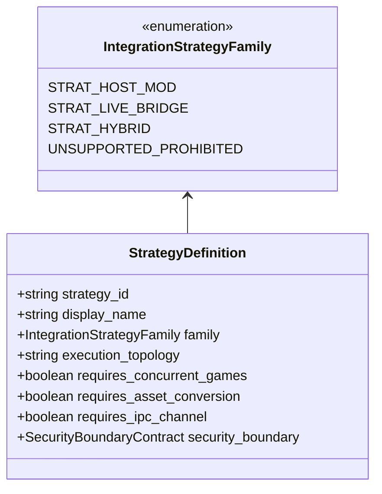
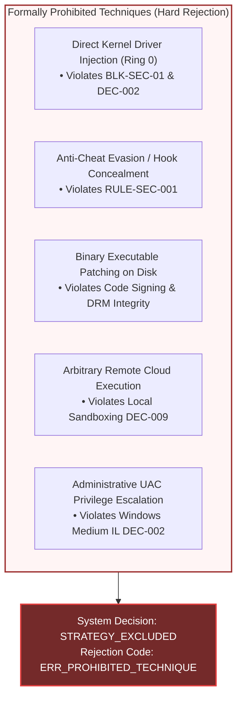

# Integration Strategy Taxonomy & Eligibility Rules

**Document ID:** `NLE-RUL-IST-001`  
**Version:** `1.0.0`  
**Status:** `APPROVED ARCHITECTURAL RULES`  
**Phase:** `Phase 6 of 12 — Mashup Designer & Integration Planning`  
**Step:** `Step 45 of 100`  
**Classification:** `Taxonomy & Strategy Eligibility Governance`  
**Related Documents:**
- [INTEGRATION_STRATEGY_EVALUATION_AND_SELECTION_FRAMEWORK.md](file:///d:/App%20Winrar%20Files/Nexludic%20Engine%20(working)/docs/mashup-designer/INTEGRATION_STRATEGY_EVALUATION_AND_SELECTION_FRAMEWORK.md) (`NLE-SPC-ISE-001`)
- [INTEGRATION_STRATEGY_COMPARISON_AND_FEASIBILITY_RULES.md](file:///d:/App%20Winrar%20Files/Nexludic%20Engine%20(working)/docs/game-discovery/INTEGRATION_STRATEGY_COMPARISON_AND_FEASIBILITY_RULES.md) (`NLE-RUL-ISC-001`)
- [STRATEGY_SPECIFIC_RULES_AND_REQUIREMENT_COVERAGE_SPECIFICATION.md](file:///d:/App%20Winrar%20Files/Nexludic%20Engine%20(working)/docs/game-discovery/STRATEGY_SPECIFIC_RULES_AND_REQUIREMENT_COVERAGE_SPECIFICATION.md) (`NLE-SPC-SRC-001`)
- [ADAPTER_SECURITY_SANDBOX_AND_PROCESS_ISOLATION_SPECIFICATION.md](file:///d:/App%20Winrar%20Files/Nexludic%20Engine%20(working)/docs/adapters/ADAPTER_SECURITY_SANDBOX_AND_PROCESS_ISOLATION_SPECIFICATION.md) (`NLE-SPC-ASI-001`)

---

## 1. Strategy Taxonomy Definition & Family Classifications

NexLudic Engine formally recognizes three permitted architectural strategy families and classifies all other techniques as explicitly unsupported or prohibited:

### 1.1 Strategy Family A: Host-Game Modification (`STRAT_HOST_MOD`)

**Operational Concept:**  
The integration executes entirely within the process boundaries of a designated **Host Game**. Guest Game B does *not* execute concurrently at runtime. Game B's assets, mechanics, data tables, or scripts are extracted, converted, and injected into the Host Game's authorized modding, scripting, or extension interfaces.

**Detailed Architectural Characteristics:**
- **Execution Topology:** Single OS process (Host Game binary).
- **Extension Surfaces Supported:** Authoritatively documented modding engines (e.g., Bethesda Creation Kit / Papyrus, Unity Harmony / BepInEx, Unreal Engine UE4SS / pak file mounting, Godot GDScript add-ons, or custom engine plugin APIs).
- **Runtime Footprint:** Minimal system overhead. The CPU, GPU, and RAM consumed are identical to running the vanilla Host Game plus modest mod asset overhead.
- **Inter-Process Latency:** Effectively zero ($0\text{ ms}$). All computations execute in-process within the game engine's native main thread, script tick, or rendering pipeline.
- **Asset Pipeline Requirements:** Heavy conversion burden. Meshes, skeletons, animations, textures, audio formats, and shaders from Guest Game B must be losslessly translated into Host Game native formats.
- **State Dynamism:** Static snapshot. Does not reflect live, dynamic events happening inside a live running instance of Game B.
- **Crash Blast Radius:** Unisolated. A crash, buffer overflow, or null pointer exception in a mod component directly crashes the Host Game process.
- **Testability & Rollback:** High rollback cleanly handled by deleting mod staging folders or disabling mod entries in the game mod manager.

### 1.2 Strategy Family B: Live Interoperability Bridge (`STRAT_LIVE_BRIDGE`)

**Operational Concept:**  
Both Game A and Game B execute simultaneously as independent, concurrent operating system processes on the local machine. A decoupled, out-of-process bridge daemon orchestrates bidirectional real-time state synchronization, telemetry streaming, or event-driven interaction across secure local IPC channels.

**Detailed Architectural Characteristics:**
- **Execution Topology:** Dual OS processes (Game A + Game B) plus unprivileged bridge sidecar daemon.
- **Communication Mechanisms Supported:** Windows Local Named Pipes (`\\.\pipe\nexludic-*`), unprivileged Shared Memory (Memory-Mapped Files with read/write mutexes), or Localhost loopback WebSockets/TCP bound strictly to `127.0.0.1`.
- **Process & Architecture Isolation:** Complete bitness and address space isolation. A 32-bit (`X86_32`) legacy game can communicate with a 64-bit (`X86_64`) modern game without memory address conflicts or DLL injection.
- **Dynamic State Synchronization:** Real-time bidirectional data flow ($< 15\text{ ms}$ round-trip latency). Enables live health mirroring, continuous inventory syncing, coordinate-based world portals, and live multiplayer event triggers.
- **Asset Conversion Burden:** Zero or negligible. Each game renders its own native assets within its own viewport; no model conversion, re-rigging, or texture transcoding required.
- **Resource Footprint:** High aggregate footprint. Host system must satisfy cumulative CPU cores, VRAM, and RAM for both titles concurrently.
- **Fault Containment:** High resilience. A crash in Game B does not crash Game A. The bridge detects channel termination, raises a disconnection event, and allows Game A to degrade gracefully.
- **Testability:** High testability. The bridge daemon and adapter contracts can be tested with synthetic mock processes without booting actual commercial game binaries.

### 1.3 Strategy Family C: Hybrid Integration (`STRAT_HYBRID`)

**Operational Concept:**  
Combines selective host-game modification (e.g., custom UI HUD elements, proxy placeholder items, custom animation slots) with an active out-of-process live bridge daemon. 

**Detailed Architectural Characteristics:**
- **Execution Topology:** Dual concurrent OS processes plus in-engine mod runtime hooks inside the Host Game plus external IPC sidecar.
- **Justification Mandate (`RULE-STR-HY-002`):** Authorized **only** when mandatory user requirements demand both in-engine UI/native rendering AND dynamic live synchronization. If either pure strategy can satisfy the requirements alone, Hybrid is strictly deferred or excluded.
- **Compounding Complexity:** Requires developing, debugging, and maintaining two separate technical stacks simultaneously (in-engine scripting/assets AND out-of-process networking).
- **Compounding Failure Modes:** A failure in either game engine, the mod loader, the script extender, or the IPC transport breaks the integration.
- **Update Fragility:** Fragile under game patches. Updates to *either* Game A or Game B can break the integration.

---

## 2. Unsupported & Prohibited Integration Approaches (Explicit Exclusions)

To maintain absolute security, stability, anti-cheat compliance, and legal integrity, the following technical mechanisms are formally classified as `PROHIBITED_BLOCKED` and excluded from eligibility:

1. **Kernel Driver Execution (`BLK-SEC-01`):** Ring-0 kernel drivers, memory patchers, or undocumented NT system call hooks are strictly barred.
2. **Anti-Cheat Circumvention (`RULE-SEC-001`):** Any mechanism designed to bypass, disable, blind, or hook around kernel anti-cheat engines (e.g. EAC, BattlEye, Vanguard, Ricochet, Denuvo Anti-Cheat) is strictly banned.
3. **Permanent Executable Patching:** Modifying original game `.exe` or `.dll` binaries directly on disk is barred to prevent DRM corruption and irreversible file tampering. Only non-destructive file overlays and standard mod loaders are permitted.
4. **Elevated Privilege Escalation (`DEC-002`):** Any strategy requiring Administrator privileges, UAC bypasses, or debug privilege elevation (`SeDebugPrivilege`) is rejected. All operations must run at Windows Medium Integrity Level.
5. **Arbitrary Remote Code Execution:** Sending telemetry or execution hooks to unverified external cloud servers is barred. All cross-game communication must remain strictly local on loopback (`127.0.0.1`).

---

## 3. Formal Strategy Candidate Eligibility Rules

Before a strategy candidate can undergo multi-dimensional feasibility evaluation, it must pass five deterministic eligibility rules:

| Rule ID | Rule Name | Evaluation Invariant | Eligibility Determination |
| :--- | :--- | :--- | :--- |
| **`RUL-ELG-01`** | Family Membership Gate | Strategy must belong to `STRAT_HOST_MOD`, `STRAT_LIVE_BRIDGE`, or `STRAT_HYBRID`. | If technique matches prohibited list $\rightarrow$ `INELIGIBLE_PROHIBITED`. |
| **`RUL-ELG-02`** | Bitness Compatibility Gate | If strategy is `STRAT_HOST_MOD`, Host and Guest components must share identical binary bitness (`X86_32` or `X86_64`). | If bitness differs $\rightarrow$ `INELIGIBLE_ARCHITECTURE_MISMATCH`. (Recommends `STRAT_LIVE_BRIDGE`). |
| **`RUL-ELG-03`** | Anti-Cheat Compliance Gate | Neither participating game may have active kernel anti-cheat that blocks the candidate mechanism. | If kernel anti-cheat present and mechanism requires hooks $\rightarrow$ `INELIGIBLE_SECURITY_BLOCK`. |
| **`RUL-ELG-04`** | Extension Surface Presence Gate| For `STRAT_HOST_MOD` or `STRAT_HYBRID`, the Host Game must have a verified, documented extension hook. | If no extension hook exists $\rightarrow$ `INELIGIBLE_UNSUPPORTED_MECHANISM`. |
| **`RUL-ELG-05`** | Adapter Availability Gate | For `STRAT_LIVE_BRIDGE` or `STRAT_HYBRID`, compatible Phase 5 adapters must be registered or discoverable. | If no adapter or protocol spec exists $\rightarrow$ `INELIGIBLE_NO_ADAPTER`. |

---
*End of Rules — Document `NLE-RUL-IST-001`.*
