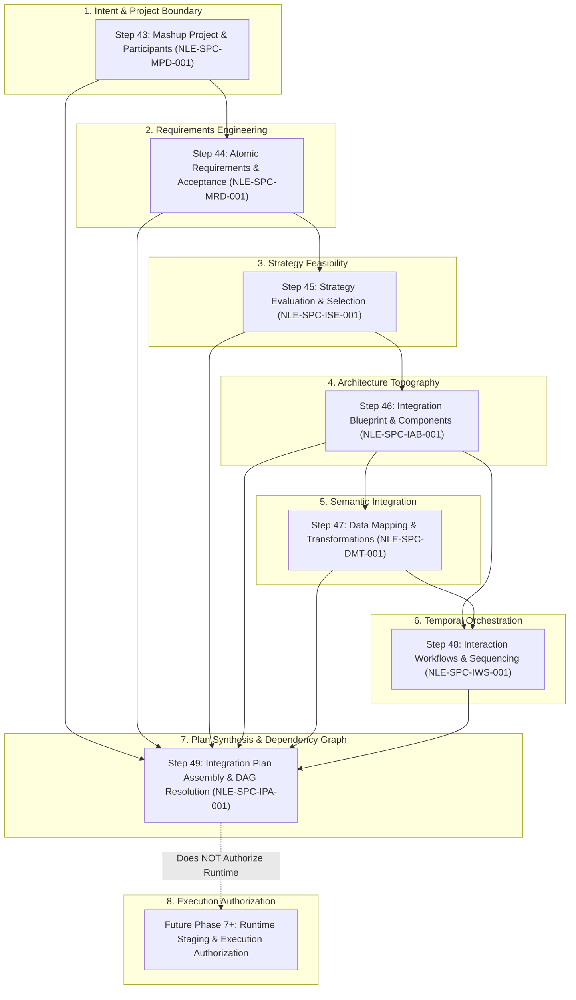
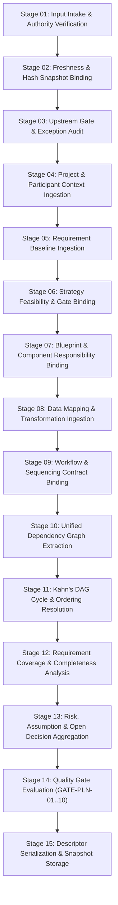

# NexLudic Engine: Mashup Integration Plan Assembly & Dependency Resolution Specification

**Document ID:** `NLE-SPC-IPA-001`  
**Phase:** 6 of 12 (Mashup Designer & Integration Planning)  
**Step:** 49 of 100  
**Classification:** Core System Architecture Specification  
**Status:** IMPLEMENTATION-READY SPECIFICATION  
**Authoritative Scope:** Specification and Contract Definition Only (No Production Code, No Runtime Resolver, No Game Modification)

---

## 1. Executive Summary & System Mission

The **Mashup Integration Plan Assembly & Dependency Resolution Specification** defines the authoritative subsystem within the NexLudic Engine responsible for synthesizing, validating, ordering, and packaging the outputs of all antecedent mashup-planning stages into a singular, reviewable, verifiable, and traceable **Mashup Integration Plan** (`MashupIntegrationPlanDescriptor`).

Prior planning phases and steps within Phase 6 have established discrete aspects of mashup design:
1. **Step 43:** Project domain identity, participating game declarations, environment constraints, and project lifecycle ([MASHUP_PROJECT_DOMAIN_MODEL_AND_CREATION_WORKFLOW_SPECIFICATION.md](file:///d:/App%20Winrar%20Files/Nexludic%20Engine%20(working)/docs/mashup-designer/MASHUP_PROJECT_DOMAIN_MODEL_AND_CREATION_WORKFLOW_SPECIFICATION.md)).
2. **Step 44:** Mashup requirements analysis, feature decomposition, and atomic acceptance criteria ([MASHUP_REQUIREMENTS_ANALYSIS_AND_FEATURE_DECOMPOSITION_SPECIFICATION.md](file:///d:/App%20Winrar%20Files/Nexludic%20Engine%20(working)/docs/mashup-designer/MASHUP_REQUIREMENTS_ANALYSIS_AND_FEATURE_DECOMPOSITION_SPECIFICATION.md)).
3. **Step 45:** Integration strategy evaluation, trade-off matrices, feasibility gates, and selection framework ([INTEGRATION_STRATEGY_EVALUATION_AND_SELECTION_FRAMEWORK.md](file:///d:/App%20Winrar%20Files/Nexludic%20Engine%20(working)/docs/mashup-designer/INTEGRATION_STRATEGY_EVALUATION_AND_SELECTION_FRAMEWORK.md)).
4. **Step 46:** Integration architecture blueprints, component responsibility mappings, and data/event boundaries ([INTEGRATION_ARCHITECTURE_BLUEPRINT_AND_COMPONENT_MAPPING_SPECIFICATION.md](file:///d:/App%20Winrar%20Files/Nexludic%20Engine%20(working)/docs/mashup-designer/INTEGRATION_ARCHITECTURE_BLUEPRINT_AND_COMPONENT_MAPPING_SPECIFICATION.md)).
5. **Step 47:** Cross-game data mapping, semantic correspondence, property transformations, and fidelity policies ([CROSS_GAME_DATA_MAPPING_AND_TRANSFORMATION_SPECIFICATION.md](file:///d:/App%20Winrar%20Files/Nexludic%20Engine%20(working)/docs/mashup-designer/CROSS_GAME_DATA_MAPPING_AND_TRANSFORMATION_SPECIFICATION.md)).
6. **Step 48:** Cross-game interaction workflows, step ordering, data handoffs, retry policies, and compensation logic ([CROSS_GAME_INTERACTION_WORKFLOW_AND_SEQUENCING_SPECIFICATION.md](file:///d:/App%20Winrar%20Files/Nexludic%20Engine%20(working)/docs/mashup-designer/CROSS_GAME_INTERACTION_WORKFLOW_AND_SEQUENCING_SPECIFICATION.md)).

Step 49 synthesizes these independent planning assets into a unified plan. The resulting plan artifact serves as the definitive structural input for downstream implementation, compilation, validation, and staging phases without permitting the planner to act as a secondary source of truth, bypass upstream gates, or grant runtime execution privileges.

---

## 2. Epistemic Planning Progression & Governance Hierarchy

NexLudic Engine enforces a strict unidirectional epistemic hierarchy. Knowledge flows from intent down through structured planning artifacts to execution authorization. No stage can retroactively alter upstream truth without triggering formal invalidation cascades.

### 2.1 The Planning vs. Authorization Invariant
An assembled and accepted integration plan (`ACCEPTED_FOR_PLANNING`) represents a validated, structurally coherent architectural blueprint. **It does NOT constitute authorization to launch processes, modify game binaries, inject code, or establish inter-process bridges.** 

All execution authorization remains strictly gated under:
- Explicit user consent;
- Medium Integrity Level (`DEC-002`) confinement;
- Anti-Cheat Dominance (`BLK-SEC-01`) enforcement;
- Phase 7+ runtime validation gates.

---

## 3. Core Architectural Invariants

The Mashup Integration Plan Assembly subsystem conforms unconditionally to established platform decisions:

| Invariant ID | Principle | Enforcement Mechanism |
| :--- | :--- | :--- |
| **INV-PLN-01** | **Single Source of Truth** | The plan descriptor stores cryptographic content hashes (`source_content_hash_sha256`) and versioned identifiers. It never copies upstream record definitions as primary data. |
| **INV-PLN-02** | **Acyclic Dependency Topology** | All inter-item dependencies across requirements, components, mappings, and workflows must evaluate to a strict Directed Acyclic Graph (DAG) verified via Kahn's algorithm. |
| **INV-PLN-03** | **Mandatory Requirement Primacy** | No plan can reach `ACCEPTED_FOR_PLANNING` if any mandatory requirement (`priority == MANDATORY`) lacks full structural and behavioral coverage. |
| **INV-PLN-04** | **Anti-Cheat Dominance (`BLK-SEC-01`)** | Any participating game flagged with kernel or client-side anti-cheat prohibits memory modification, live injection, or uncertified hooking regardless of user preference. |
| **INV-PLN-05** | **Medium Integrity Confinement (`DEC-002`)** | Plan assembly and dependency resolution run strictly within the desktop application's Medium Integrity Level sandbox. Administrative elevation is disallowed. |
| **INV-PLN-06** | **Deterministic Storage Sandboxing (`DEC-009`)** | All plan artifacts, validation reports, and historical snapshots are persisted exclusively within the project directory tree on Volume D (`D:\App Winrar Files\Nexludic Engine (working)`). |
| **INV-PLN-07** | **Zero Runtime Code Execution** | Step 49 is strictly an analytical, domain-modeling, and specification stage. No code compilation, dynamic link loading, process spawning, or game bridging occurs. |

---

## 4. 15-Stage Plan Assembly & Resolution Pipeline

Plan assembly operates as a deterministic 15-stage pipeline. If any stage encounters a fatal constraint or invariant breach, the pipeline halts or emits structured diagnostics, assigning the appropriate lifecycle state.

### Stage Summary
1. **Stage 01 (Input Intake & Authority Verification):** Ingests raw inputs; asserts ownership and rejects unauthorized overrides.
2. **Stage 02 (Freshness & Hash Snapshot Binding):** Calculates SHA-256 hashes of all input files; asserts source freshness against recorded revisions.
3. **Stage 03 (Upstream Gate & Exception Audit):** Verifies Phase 5 SDK gate status (`READY WITH CONDITIONS`: `P5-C01`, `P5-C02`, `P5-C03`).
4. **Stage 04 (Project & Participant Context Ingestion):** Ingests Step 43 project identity, participants, game versions, and environment constraints.
5. **Stage 05 (Requirement Baseline Ingestion):** Ingests Step 44 atomic feature requirements and acceptance criteria.
6. **Stage 06 (Strategy Feasibility & Gate Binding):** Ingests Step 45 evaluated strategies, feasibility gate results, and strategy selections.
7. **Stage 07 (Blueprint & Component Responsibility Binding):** Ingests Step 46 architecture topology, component nodes, and trust boundaries.
8. **Stage 08 (Data Mapping & Transformation Ingestion):** Ingests Step 47 cross-game schemas, field mappings, and fidelity bounds.
9. **Stage 09 (Workflow & Sequencing Contract Binding):** Ingests Step 48 workflow DAGs, interaction steps, timeouts, and compensations.
10. **Stage 10 (Unified Dependency Graph Extraction):** Synthesizes cross-cutting dependencies into unified dependency records.
11. **Stage 11 (Kahn's DAG Cycle & Ordering Resolution):** Executes Kahn's topological sort algorithm to discover cycles and determine linear stage ordering.
12. **Stage 12 (Requirement Coverage & Completeness Analysis):** Evaluates requirement coverage matrices across structural, transformation, and behavioral tiers.
13. **Stage 13 (Risk, Assumption & Open Decision Aggregation):** Compiles cross-phase risk registers, operational assumptions, and unresolved decisions.
14. **Stage 14 (Quality Gate Evaluation):** Evaluates formal gates `GATE-PLN-01` through `GATE-PLN-10`.
15. **Stage 15 (Descriptor Serialization & Snapshot Storage):** Emits immutable plan descriptor JSON and writes snapshot archive to Volume D.

---

## 5. Document Suite Reference Directory

The Step 49 specification suite consists of 13 interconnected documentation artifacts:

| Ref ID | Filename | Primary Scope & Architectural Content |
| :--- | :--- | :--- |
| **NLE-SPC-IPA-001** | [MASHUP_INTEGRATION_PLAN_ASSEMBLY_AND_DEPENDENCY_RESOLUTION_SPECIFICATION.md](file:///d:/App%20Winrar%20Files/Nexludic%20Engine%20(working)/docs/mashup-designer/MASHUP_INTEGRATION_PLAN_ASSEMBLY_AND_DEPENDENCY_RESOLUTION_SPECIFICATION.md) | Principal architectural specification, epistemic hierarchy, pipeline stages, invariants. |
| **NLE-MOD-IPD-001** | [MASHUP_INTEGRATION_PLAN_DOMAIN_MODEL_AND_LIFECYCLE.md](file:///d:/App%20Winrar%20Files/Nexludic%20Engine%20(working)/docs/mashup-designer/MASHUP_INTEGRATION_PLAN_DOMAIN_MODEL_AND_LIFECYCLE.md) | Domain entity definitions, 11-stage plan lifecycle state machine, JSON Schema Draft 2020-12. |
| **NLE-MAT-IPA-001** | [INTEGRATION_PLAN_INPUT_SOURCE_AND_AUTHORITY_MATRIX.md](file:///d:/App%20Winrar%20Files/Nexludic%20Engine%20(working)/docs/mashup-designer/INTEGRATION_PLAN_INPUT_SOURCE_AND_AUTHORITY_MATRIX.md) | Source artifact inventory, ownership hierarchy, conflict resolution rules, snapshot binding. |
| **NLE-RUL-IPA-001** | [INTEGRATION_PLAN_ASSEMBLY_RULES_AND_SOURCE_CONTRACTS.md](file:///d:/App%20Winrar%20Files/Nexludic%20Engine%20(working)/docs/mashup-designer/INTEGRATION_PLAN_ASSEMBLY_RULES_AND_SOURCE_CONTRACTS.md) | Detailed rules for requirement-driven inclusion, partial assembly, and deduplication. |
| **NLE-POL-IPD-001** | [INTEGRATION_PLAN_DEPENDENCY_GRAPH_AND_RESOLUTION_POLICY.md](file:///d:/App%20Winrar%20Files/Nexludic%20Engine%20(working)/docs/mashup-designer/INTEGRATION_PLAN_DEPENDENCY_GRAPH_AND_RESOLUTION_POLICY.md) | 13 dependency categories, dependency record schema, Kahn's algorithm, cycle resolution. |
| **NLE-RUL-IPC-001** | [INTEGRATION_PLAN_REQUIREMENT_COVERAGE_AND_COMPLETENESS_RULES.md](file:///d:/App%20Winrar%20Files/Nexludic%20Engine%20(working)/docs/mashup-designer/INTEGRATION_PLAN_REQUIREMENT_COVERAGE_AND_COMPLETENESS_RULES.md) | Traceability rules, mandatory coverage primacy, partial plan scoring, completeness index. |
| **NLE-REG-IPR-001** | [INTEGRATION_PLAN_RISK_ASSUMPTION_AND_OPEN_DECISION_REGISTER.md](file:///d:/App%20Winrar%20Files/Nexludic%20Engine%20(working)/docs/mashup-designer/INTEGRATION_PLAN_RISK_ASSUMPTION_AND_OPEN_DECISION_REGISTER.md) | Cross-phase risk synthesis, assumption validity tracking, open decision resolution governance. |
| **NLE-CON-IPV-001** | [INTEGRATION_PLAN_VALIDATION_ACCEPTANCE_AND_DIAGNOSTIC_CONTRACT.md](file:///d:/App%20Winrar%20Files/Nexludic%20Engine%20(working)/docs/mashup-designer/INTEGRATION_PLAN_VALIDATION_ACCEPTANCE_AND_DIAGNOSTIC_CONTRACT.md) | Validation pipeline, Quality Gates `GATE-PLN-01..10`, diagnostic codes, acceptance criteria. |
| **NLE-POL-IPR-001** | [INTEGRATION_PLAN_REVISION_INVALIDATION_AND_REASSESSMENT_POLICY.md](file:///d:/App%20Winrar%20Files/Nexludic%20Engine%20(working)/docs/mashup-designer/INTEGRATION_PLAN_REVISION_INVALIDATION_AND_REASSESSMENT_POLICY.md) | Invalidation trigger matrix (9 events), hash discrepancy handling, snapshot archival. |
| **NLE-SEC-IPA-001** | [INTEGRATION_PLAN_SECURITY_PRIVACY_AND_AUTHORIZATION_REQUIREMENTS.md](file:///d:/App%20Winrar%20Files/Nexludic%20Engine%20(working)/docs/mashup-designer/INTEGRATION_PLAN_SECURITY_PRIVACY_AND_AUTHORIZATION_REQUIREMENTS.md) | Non-authorization principle, trust boundaries, anti-cheat limits, telemetry minimization. |
| **NLE-CAT-IPS-001** | [INTEGRATION_PLAN_SYNTHETIC_SCENARIOS_AND_VERIFICATION_TEST_PLAN.md](file:///d:/App%20Winrar%20Files/Nexludic%20Engine%20(working)/docs/mashup-designer/INTEGRATION_PLAN_SYNTHETIC_SCENARIOS_AND_VERIFICATION_TEST_PLAN.md) | 14 synthetic scenarios (A through N) testing complete, partial, and failing edge cases. |
| **NLE-MAT-STP-049** | [STEP_49_PLAN_REQUIREMENTS_TRACEABILITY_MATRIX.md](file:///d:/App%20Winrar%20Files/Nexludic%20Engine%20(working)/docs/mashup-designer/STEP_49_PLAN_REQUIREMENTS_TRACEABILITY_MATRIX.md) | Bidirectional traceability matrix verifying all 24 requirements (`IPA-REQ-001..024`). |
| **NLE-REP-STP-049** | [STEP_49_COMPLETION_REPORT.md](file:///d:/App%20Winrar%20Files/Nexludic%20Engine%20(working)/docs/mashup-designer/STEP_49_COMPLETION_REPORT.md) | Step completion audit, acceptance criteria verification (AC-01..18), sign-off status. |

---

## 6. Implementation Readiness & Boundary Statement

This specification establishes the contracts, data schemas, validation criteria, and state machine transitions necessary for engineering teams to implement the integration plan assembly module in future phases. No runtime code, background services, build scripts, or game-side hooks are instantiated in this step.

