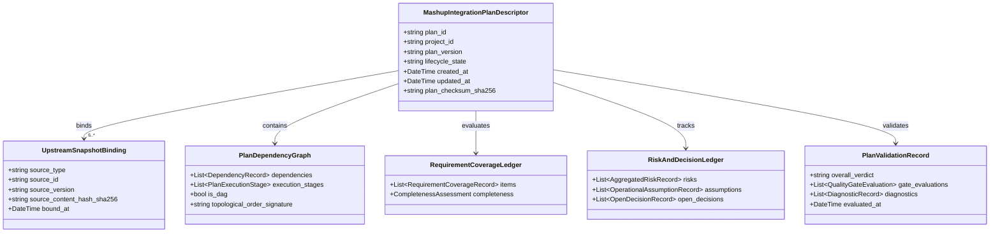
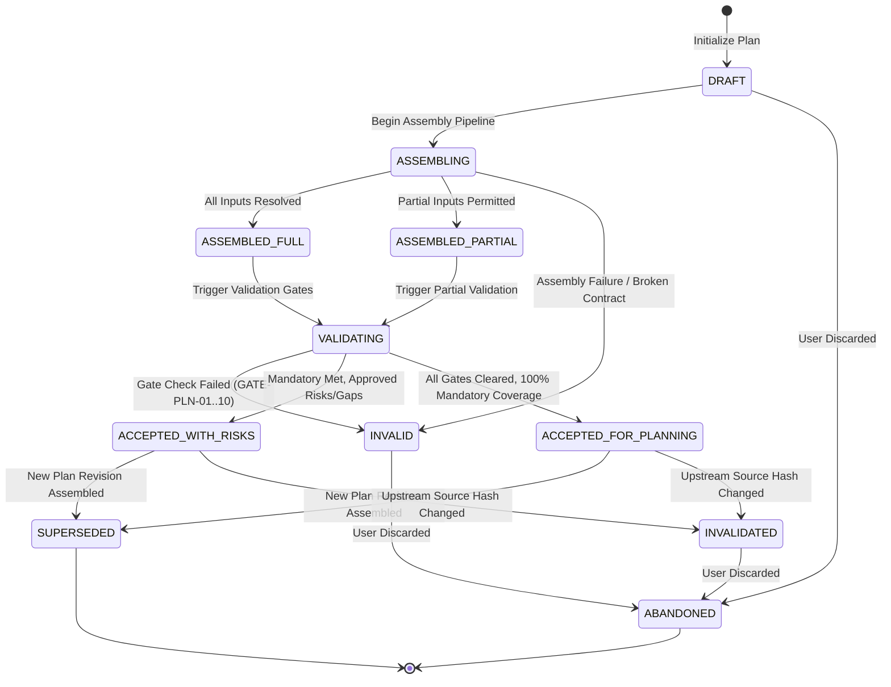

# NexLudic Engine: Mashup Integration Plan Domain Model & Lifecycle

**Document ID:** `NLE-MOD-IPD-001`  
**JSON Schema ID:** `NLE-SCH-IPA-001`  
**Phase:** 6 of 12 (Mashup Designer & Integration Planning)  
**Step:** 49 of 100  
**Classification:** Domain Model & Lifecycle Specification  
**Status:** IMPLEMENTATION-READY SPECIFICATION  

---

## 1. Overview & Conceptual Entity Hierarchy

The **Mashup Integration Plan** domain model establishes the authoritative structural representation of an integrated mashup plan. The plan descriptor does not store duplicated data from upstream models; rather, it maintains cryptographic content hashes, versioned entity identifiers, topological dependency graphs, requirement coverage mappings, risk/assumption registers, and validation diagnostic ledgers.



---

## 2. Plan Lifecycle State Machine

The plan lifecycle governs how an integration plan evolves from unverified draft through assembly, validation, acceptance, and potential invalidation or supersession.



### 2.1 State Definitions & Transition Invariants

| State Name | Definition & Entry Criteria | Exit / Transition Rules |
| :--- | :--- | :--- |
| **`DRAFT`** | Initial allocation of plan metadata and binding of target `project_id`. No pipeline execution has commenced. | Transitions to `ASSEMBLING` when assembly pipeline is triggered, or `ABANDONED` if discarded. |
| **`ASSEMBLING`** | Pipeline actively ingesting Step 43–48 source artifacts, hashing inputs, and extracting dependencies. | Transitions to `ASSEMBLED_FULL`, `ASSEMBLED_PARTIAL`, or `INVALID`. |
| **`ASSEMBLED_PARTIAL`** | Pipeline completed with valid sub-graph, but some optional or conditional items are missing or omitted. | Transitions to `VALIDATING` for partial verification. Cannot transition directly to `ACCEPTED_FOR_PLANNING`. |
| **`ASSEMBLED_FULL`** | Pipeline completed successfully across all mandatory, optional, and conditional items. Graph synthesized. | Transitions to `VALIDATING`. |
| **`VALIDATING`** | Quality Gates `GATE-PLN-01` through `GATE-PLN-10` actively evaluating structural, semantic, and security constraints. | Transitions to `INVALID`, `ACCEPTED_WITH_RISKS`, or `ACCEPTED_FOR_PLANNING`. |
| **`INVALID`** | One or more fatal errors discovered (e.g., circular dependency, hash mismatch, unauthorized anti-cheat bypass). | Terminal for current version; transitions to `ABANDONED` or requires creating a new revision. |
| **`ACCEPTED_WITH_RISKS`** | All mandatory requirements covered, but open medium/high risks, unresolved conditional decisions, or unverified assumptions exist. | May transition to `SUPERSEDED`, `INVALIDATED`, or `ABANDONED`. |
| **`ACCEPTED_FOR_PLANNING`** | Complete, coherent, verified plan with zero fatal blockers, 100% mandatory requirement coverage, and verified upstream hashes. | Authoritative baseline for downstream Phase 7. May transition to `SUPERSEDED` or `INVALIDATED`. |
| **`SUPERSEDED`** | A newer valid revision of the plan has been assembled and accepted for the same project. | Terminal state. Retained read-only on Volume D for historical audit. |
| **`INVALIDATED`** | A bound upstream source artifact was modified, invalidated, or had its hash changed after plan acceptance. | Requires full reassessment and reassembly under a new revision. |
| **`ABANDONED`** | Explicitly canceled or retired by the user or architect. | Terminal state. Retained read-only in project history. |

---

## 3. Plan Domain Entity Definitions

### 3.1 `MashupIntegrationPlanDescriptor`
The root entity representing an assembled integration plan.
- `plan_id` (`string`, UUIDv4, mandatory): Globally unique plan identifier.
- `project_id` (`string`, UUIDv4, mandatory): References the Step 43 mashup project.
- `project_name` (`string`, mandatory): Human-readable project display name.
- `plan_version` (`string`, SemVer `MAJOR.MINOR.PATCH`, mandatory): Version string of the plan.
- `lifecycle_state` (`string`, enum, mandatory): One of the 11 lifecycle states.
- `created_at` (`string`, RFC 3339 timestamp, mandatory): Timestamp of creation.
- `updated_at` (`string`, RFC 3339 timestamp, mandatory): Timestamp of last state update.
- `plan_checksum_sha256` (`string`, hex 64, mandatory): Cryptographic hash of the canonical plan payload.
- `upstream_snapshots` (`array` of `UpstreamSnapshotBinding`, mandatory): Cryptographic bindings to Steps 43–48.
- `dependency_graph` (`PlanDependencyGraph`, mandatory): Synthesized DAG of execution and planning items.
- `coverage_ledger` (`RequirementCoverageLedger`, mandatory): Traceability matrix from Step 44 requirements to plan items.
- `risk_and_decision_ledger` (`RiskAndDecisionLedger`, mandatory): Aggregated risks, assumptions, and open decisions.
- `validation_result` (`PlanValidationRecord`, mandatory): Audit trail of Quality Gate evaluations and diagnostics.

### 3.2 `UpstreamSnapshotBinding`
Binds the plan immutably to a specific version and content hash of an upstream planning deliverable.
- `source_type` (`string`, enum: `PROJECT_DOMAIN`, `REQUIREMENTS_SET`, `STRATEGY_SELECTION`, `ARCHITECTURE_BLUEPRINT`, `DATA_MAPPING_SPEC`, `WORKFLOW_SPEC`, `ADAPTER_CAPABILITY_SET`): Upstream domain type.
- `source_id` (`string`, mandatory): Unique identifier of the source deliverable.
- `source_version` (`string`, mandatory): Version string of the source deliverable.
- `source_path` (`string`, mandatory): Project-relative path to the source deliverable on Volume D.
- `source_content_hash_sha256` (`string`, hex 64, mandatory): SHA-256 hash of the exact file contents when bound.
- `bound_at` (`string`, RFC 3339 timestamp, mandatory): When the snapshot was captured.

### 3.3 `PlanDependencyGraph`
Represents the synthesized, cycle-free dependency structure of the entire integration effort.
- `dependencies` (`array` of `DependencyRecord`, mandatory): List of all directed dependency edges.
- `execution_stages` (`array` of `PlanExecutionStage`, mandatory): Ordered linear stages resolved via Kahn's algorithm.
- `is_dag` (`boolean`, mandatory): Must be `true` for any plan to exit `ASSEMBLING`.
- `topological_order_signature` (`string`, hex 64, mandatory): SHA-256 hash of ordered stage IDs ensuring deterministic sequence.

### 3.4 `DependencyRecord`
A single directed edge within the plan dependency graph ($A \rightarrow B$ means item $A$ depends upon item $B$).
- `dependency_id` (`string`, UUIDv4, mandatory): Unique identifier.
- `consumer_item_id` (`string`, mandatory): ID of the dependent entity.
- `consumer_item_type` (`string`, enum: `REQUIREMENT`, `COMPONENT`, `MAPPING`, `WORKFLOW_STEP`, `ADAPTER`): Type of dependent.
- `provider_item_id` (`string`, mandatory): ID of the entity that must be resolved first.
- `provider_item_type` (`string`, enum: `REQUIREMENT`, `COMPONENT`, `MAPPING`, `WORKFLOW_STEP`, `ADAPTER`): Type of provider.
- `dependency_category` (`string`, enum of 13 categories, mandatory): Nature of dependency (see Policy document).
- `is_hard_dependency` (`boolean`, mandatory): If `true`, failure or omission blocks consumer entirely.

### 3.5 `PlanExecutionStage`
A discrete, sequential phase of plan execution containing items that may execute concurrently once prior stages complete.
- `stage_index` (`integer`, min 0, mandatory): Sequential index (0 = foundational).
- `stage_name` (`string`, mandatory): Descriptive name (e.g., `STAGE_0_CORE_ADAPTER_INITIALIZATION`).
- `item_ids` (`array` of `string`, mandatory): Set of component, mapping, or workflow step IDs belonging to this stage.
- `prerequisite_stage_indices` (`array` of `integer`, mandatory): Indices of stages that must succeed before this stage.

---

## 4. Formal JSON Schema (Draft 2020-12)

```json
{
  "$schema": "https://json-schema.org/draft/2020-12/schema",
  "$id": "https://nexludic.engine/schemas/v1/mashup-integration-plan.json",
  "title": "MashupIntegrationPlanDescriptor",
  "description": "Authoritative descriptor representing an assembled, validated, and traceable mashup integration plan.",
  "type": "object",
  "required": [
    "schema_version",
    "plan_id",
    "project_id",
    "project_name",
    "plan_version",
    "lifecycle_state",
    "created_at",
    "updated_at",
    "plan_checksum_sha256",
    "upstream_snapshots",
    "dependency_graph",
    "coverage_ledger",
    "risk_and_decision_ledger",
    "validation_result"
  ],
  "properties": {
    "schema_version": {
      "type": "string",
      "const": "1.0.0"
    },
    "plan_id": {
      "type": "string",
      "format": "uuid"
    },
    "project_id": {
      "type": "string",
      "format": "uuid"
    },
    "project_name": {
      "type": "string",
      "minLength": 1,
      "maxLength": 128
    },
    "plan_version": {
      "type": "string",
      "pattern": "^[0-9]+\\.[0-9]+\\.[0-9]+$"
    },
    "lifecycle_state": {
      "type": "string",
      "enum": [
        "DRAFT",
        "ASSEMBLING",
        "ASSEMBLED_PARTIAL",
        "ASSEMBLED_FULL",
        "VALIDATING",
        "INVALID",
        "ACCEPTED_WITH_RISKS",
        "ACCEPTED_FOR_PLANNING",
        "SUPERSEDED",
        "INVALIDATED",
        "ABANDONED"
      ]
    },
    "created_at": {
      "type": "string",
      "format": "date-time"
    },
    "updated_at": {
      "type": "string",
      "format": "date-time"
    },
    "plan_checksum_sha256": {
      "type": "string",
      "pattern": "^[a-f0-9]{64}$"
    },
    "upstream_snapshots": {
      "type": "array",
      "minItems": 6,
      "items": {
        "type": "object",
        "required": [
          "source_type",
          "source_id",
          "source_version",
          "source_path",
          "source_content_hash_sha256",
          "bound_at"
        ],
        "properties": {
          "source_type": {
            "type": "string",
            "enum": [
              "PROJECT_DOMAIN",
              "REQUIREMENTS_SET",
              "STRATEGY_SELECTION",
              "ARCHITECTURE_BLUEPRINT",
              "DATA_MAPPING_SPEC",
              "WORKFLOW_SPEC",
              "ADAPTER_CAPABILITY_SET"
            ]
          },
          "source_id": { "type": "string" },
          "source_version": { "type": "string" },
          "source_path": { "type": "string" },
          "source_content_hash_sha256": {
            "type": "string",
            "pattern": "^[a-f0-9]{64}$"
          },
          "bound_at": { "type": "string", "format": "date-time" }
        },
        "additionalProperties": false
      }
    },
    "dependency_graph": {
      "type": "object",
      "required": ["dependencies", "execution_stages", "is_dag", "topological_order_signature"],
      "properties": {
        "dependencies": {
          "type": "array",
          "items": {
            "type": "object",
            "required": [
              "dependency_id",
              "consumer_item_id",
              "consumer_item_type",
              "provider_item_id",
              "provider_item_type",
              "dependency_category",
              "is_hard_dependency"
            ],
            "properties": {
              "dependency_id": { "type": "string", "format": "uuid" },
              "consumer_item_id": { "type": "string" },
              "consumer_item_type": {
                "type": "string",
                "enum": ["REQUIREMENT", "COMPONENT", "MAPPING", "WORKFLOW_STEP", "ADAPTER"]
              },
              "provider_item_id": { "type": "string" },
              "provider_item_type": {
                "type": "string",
                "enum": ["REQUIREMENT", "COMPONENT", "MAPPING", "WORKFLOW_STEP", "ADAPTER"]
              },
              "dependency_category": { "type": "string" },
              "is_hard_dependency": { "type": "boolean" }
            },
            "additionalProperties": false
          }
        },
        "execution_stages": {
          "type": "array",
          "items": {
            "type": "object",
            "required": ["stage_index", "stage_name", "item_ids", "prerequisite_stage_indices"],
            "properties": {
              "stage_index": { "type": "integer", "minimum": 0 },
              "stage_name": { "type": "string" },
              "item_ids": { "type": "array", "items": { "type": "string" } },
              "prerequisite_stage_indices": { "type": "array", "items": { "type": "integer" } }
            },
            "additionalProperties": false
          }
        },
        "is_dag": { "type": "boolean" },
        "topological_order_signature": {
          "type": "string",
          "pattern": "^[a-f0-9]{64}$"
        }
      },
      "additionalProperties": false
    },
    "coverage_ledger": {
      "type": "object",
      "required": ["items", "completeness"],
      "properties": {
        "items": { "type": "array" },
        "completeness": {
          "type": "object",
          "required": [
            "total_requirements_count",
            "mandatory_requirements_count",
            "mandatory_covered_count",
            "optional_covered_count",
            "overall_completeness_ratio",
            "mandatory_coverage_ratio"
          ],
          "properties": {
            "total_requirements_count": { "type": "integer", "minimum": 0 },
            "mandatory_requirements_count": { "type": "integer", "minimum": 0 },
            "mandatory_covered_count": { "type": "integer", "minimum": 0 },
            "optional_covered_count": { "type": "integer", "minimum": 0 },
            "overall_completeness_ratio": { "type": "number", "minimum": 0.0, "maximum": 1.0 },
            "mandatory_coverage_ratio": { "type": "number", "minimum": 0.0, "maximum": 1.0 }
          }
        }
      },
      "additionalProperties": false
    },
    "risk_and_decision_ledger": {
      "type": "object",
      "required": ["risks", "assumptions", "open_decisions"],
      "properties": {
        "risks": { "type": "array" },
        "assumptions": { "type": "array" },
        "open_decisions": { "type": "array" }
      },
      "additionalProperties": false
    },
    "validation_result": {
      "type": "object",
      "required": ["overall_verdict", "gate_evaluations", "diagnostics", "evaluated_at"],
      "properties": {
        "overall_verdict": {
          "type": "string",
          "enum": ["PASSED", "PASSED_WITH_RISKS", "FAILED", "INCONCLUSIVE"]
        },
        "gate_evaluations": { "type": "array" },
        "diagnostics": { "type": "array" },
        "evaluated_at": { "type": "string", "format": "date-time" }
      },
      "additionalProperties": false
    }
  },
  "additionalProperties": false
}
```

