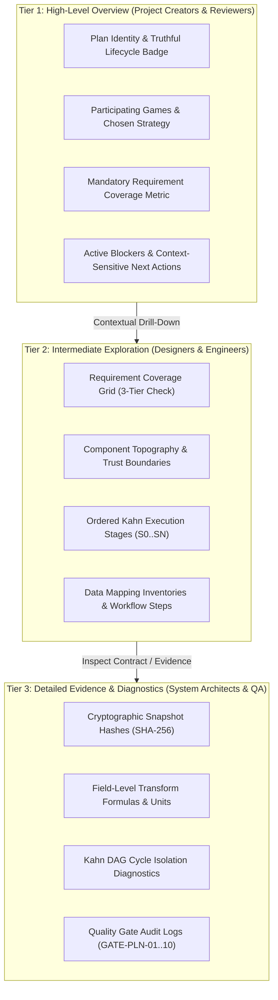

# NexLudic Engine: Mashup Integration Plan Visualization & Review UX Specification

**Document ID:** `NLE-SPC-IPU-001`  
**Phase:** 6 of 12 (Mashup Designer & Integration Planning)  
**Step:** 50 of 100  
**Classification:** Desktop Presentation & Experience Architecture Specification  
**Status:** IMPLEMENTATION-READY SPECIFICATION  
**Authoritative Scope:** Specification, Information Architecture & UX Design Only (No Application Code, No Visual Editor Runtime, No Game Modification)

---

## 1. Executive Summary & Design Mission

The **Mashup Integration Plan Visualization & Review Experience** defines the authoritative user interface and information architecture within the NexLudic Engine desktop application (`NexLudic.App`) for inspecting, exploring, auditing, and validating an assembled **Mashup Integration Plan** (`MashupIntegrationPlanDescriptor`).

An integration plan represents the culmination of all prior Phase 6 planning activities:
1. **Step 43:** Project domain identity, game participants, environment constraints ([MASHUP_PROJECT_DOMAIN_MODEL_AND_CREATION_WORKFLOW_SPECIFICATION.md](file:///d:/App%20Winrar%20Files/Nexludic%20Engine%20(working)/docs/mashup-designer/MASHUP_PROJECT_DOMAIN_MODEL_AND_CREATION_WORKFLOW_SPECIFICATION.md)).
2. **Step 44:** Requirements analysis, feature decomposition, and atomic acceptance criteria ([MASHUP_REQUIREMENTS_ANALYSIS_AND_FEATURE_DECOMPOSITION_SPECIFICATION.md](file:///d:/App%20Winrar%20Files/Nexludic%20Engine%20(working)/docs/mashup-designer/MASHUP_REQUIREMENTS_ANALYSIS_AND_FEATURE_DECOMPOSITION_SPECIFICATION.md)).
3. **Step 45:** Integration strategy evaluation, trade-off matrices, feasibility gates, and selection framework ([INTEGRATION_STRATEGY_EVALUATION_AND_SELECTION_FRAMEWORK.md](file:///d:/App%20Winrar%20Files/Nexludic%20Engine%20(working)/docs/mashup-designer/INTEGRATION_STRATEGY_EVALUATION_AND_SELECTION_FRAMEWORK.md)).
4. **Step 46:** Integration architecture blueprints, component responsibility mappings, and data/event boundaries ([INTEGRATION_ARCHITECTURE_BLUEPRINT_AND_COMPONENT_MAPPING_SPECIFICATION.md](file:///d:/App%20Winrar%20Files/Nexludic%20Engine%20(working)/docs/mashup-designer/INTEGRATION_ARCHITECTURE_BLUEPRINT_AND_COMPONENT_MAPPING_SPECIFICATION.md)).
5. **Step 47:** Cross-game data mapping, semantic correspondence, property transformations, and fidelity policies ([CROSS_GAME_DATA_MAPPING_AND_TRANSFORMATION_SPECIFICATION.md](file:///d:/App%20Winrar%20Files/Nexludic%20Engine%20(working)/docs/mashup-designer/CROSS_GAME_DATA_MAPPING_AND_TRANSFORMATION_SPECIFICATION.md)).
6. **Step 48:** Cross-game interaction workflows, step ordering, data handoffs, retry policies, and compensation logic ([CROSS_GAME_INTERACTION_WORKFLOW_AND_SEQUENCING_SPECIFICATION.md](file:///d:/App%20Winrar%20Files/Nexludic%20Engine%20(working)/docs/mashup-designer/CROSS_GAME_INTERACTION_WORKFLOW_AND_SEQUENCING_SPECIFICATION.md)).
7. **Step 49:** Mashup integration plan assembly, Kahn's DAG dependency resolution, requirement coverage ledger, and quality gate contract ([MASHUP_INTEGRATION_PLAN_ASSEMBLY_AND_DEPENDENCY_RESOLUTION_SPECIFICATION.md](file:///d:/App%20Winrar%20Files/Nexludic%20Engine%20(working)/docs/mashup-designer/MASHUP_INTEGRATION_PLAN_ASSEMBLY_AND_DEPENDENCY_RESOLUTION_SPECIFICATION.md)).

The mission of Step 50 is to translate these complex, multi-tiered JSON descriptors, graphs, and diagnostic ledgers into an intuitive, honest, and navigable desktop experience. The interface must balance two distinct user personas:
- **Project Users / Creators:** Need a lucid explanation of what the mashup does, which strategy is chosen, what trade-offs exist, what blockers prevent progress, and what decisions require their confirmation.
- **Technical Reviewers / Architects:** Require deep, uncompromised traceability across requirements, architecture components, data mappings, interaction workflows, adapter capabilities, security trust boundaries, and execution dependencies.

The experience enforces strict epistemic honesty: it never conceals uncovered mandatory requirements, never misrepresents unverified claims as proven facts, never compresses distinct error states into generic warnings, and strictly preserves the principle that **planning is not runtime authorization**.

---

## 2. Core Architectural & UX Invariants

The Plan Visualization & Review subsystem conforms unconditionally to established platform and design decisions:

| Invariant ID | Principle | Presentation & Enforcement Rule |
| :--- | :--- | :--- |
| **INV-IPU-01** | **The Non-Authorization Invariant** | Reviewing an accepted plan (`ACCEPTED_FOR_PLANNING`) does NOT grant permission to execute code, launch games, inject DLLs, or open network ports. The UI provides **zero** execution trigger controls. |
| **INV-IPU-02** | **Epistemic Honesty & Truthful Status** | Status badges reflect authoritative Step 49 states (`DRAFT` $\rightarrow$ `ACCEPTED_FOR_PLANNING`). Success is never implied for unverified, missing, or provisional artifacts. |
| **INV-IPU-03** | **Mandatory Blocker Prominence** | Uncovered mandatory requirements (`priority == MANDATORY`), circular dependencies (`ERR_PLAN_CIRCULAR_DEPENDENCY`), and security vetoes are displayed prominently at the top level and are never buried in collapsible panels or tooltips. |
| **INV-IPU-04** | **Single Source of Truth** | The review interface renders data exclusively from authoritative descriptors (`project.json`, `requirements.json`, `blueprint.json`, `plan.json`). It creates no secondary or competing presentation data models. |
| **INV-IPU-05** | **Accessible Multi-Modal Representation** | No status, boundary, or dependency is communicated solely through color. All visual graphs and diagrams must have equivalent semantic list/table representations adhering to WCAG 2.1 AA. |
| **INV-IPU-06** | **Medium Integrity Confinement (`DEC-002`)** | The desktop UI executes strictly within Windows Medium Integrity Level. No administrative elevation prompts are permitted during plan review. |
| **INV-IPU-07** | **Deterministic Local Storage (`DEC-009`)** | All displayed plans, snapshots, diffs, and validation logs reside strictly on Volume D (`D:\App Winrar Files\Nexludic Engine (working)`). |

---

## 3. Dual-Audience Experience & Progressive Disclosure

To serve both project creators and systems integration engineers without inducing cognitive overload, the review experience implements a three-tier **Progressive Disclosure Architecture**:



- **Tier 1 (Executive Summary):** Answerable in $\le 5$ seconds. Gives the user immediate situational awareness: Is the plan valid? What strategy was selected? Are there blockers? What is the immediate next step?
- **Tier 2 (Structural Exploration):** Answerable in $\le 30$ seconds. Enables the user to explore components, review data mappings, follow workflow interaction sequences, and verify requirement satisfaction.
- **Tier 3 (Technical Deep-Dive):** Targeted inspection. Provides exact schema payloads, transformation contracts, cryptographic snapshot hashes, diagnostic stack traces, and verification logs.

---

## 4. Integration into NexLudic Application Shell

The review experience lives inside the established **NexLudic Desktop Application Shell** (`NLE-SPC-SHL-001`, [APPLICATION_SHELL_AND_LAYOUT_SPECIFICATION.md](file:///d:/App%20Winrar%20Files/Nexludic%20Engine%20(working)/docs/ui/APPLICATION_SHELL_AND_LAYOUT_SPECIFICATION.md)), built with **WPF on .NET 8.0 LTS** adopting Fluent Design.

```
+----------------------------------------------------------------------------------------------------+
| APPLICATION SHELL: Global Title Bar (Active Project: Game Orion x Game Atlas)         [ _ [] X ]   |
+-------------------+--------------------------------------------------------------------------------+
| GLOBAL NAV RAIL   | PROJECT CONTEXT HEADER: Orion x Atlas Interop | Status: ACCEPTED_WITH_RISKS    |
| [O] Overview      +--------------------------------------------------------------------------------+
| [P] Projects      | WORKSPACE TAB STRIP:                                                           |
| [C] Compat        | [1. Objectives] [2. Strategy] [3. Blueprint] [4. Mappings] [5. Workflows]      |
| [A] Adapters      | [* 6. Integration Plan Review *]                                               |
| [T] Tasks         +----------------------------------------------------+---------------------------+
| [V] Validation    | MAIN WORKSPACE VIEWPORT (Tab Content Area)         | CONTEXTUAL INSPECTOR      |
| [*] Workspace     |                                                    | (Collapsible 340px Drawer)|
| [D] Diagnostics   |  [ Overview ] [ Requirements ] [ Architecture ]    |                           |
|                   |  [ Mappings ] [ Workflows ]    [ Dependencies ]    | [i] Selected Item Details |
|                   |  [ Risks & Decisions ]         [ Validation ]      |                           |
|                   |                                                    | Type: Workflow Step       |
|                   |  +----------------------------------------------+  | ID: WF-STEP-004           |
|                   |  | Active Sub-View / Graph / Matrix Canvas      |  | Stage: Stage 3            |
|                   |  |                                              |  | Status: SATISFIED         |
|                   |  | (Deterministic, Accessible Layout)           |  |                           |
|                   |  |                                              |  | Traceability:             |
|                   |  +----------------------------------------------+  | -> REQ-MAND-003           |
| [S] Settings      | Bottom Action Bar: [Refresh Hashes] [Compare Diffs]| -> COMP-BRIDGE            |
+-------------------+----------------------------------------------------+---------------------------+
| STATUS BAR: Ready | Snapshot Integrity: VERIFIED (6/6 SHA-256) | Memory: 42 MB | Zoom: 100%       |
+----------------------------------------------------------------------------------------------------+
```

### 4.1 Route & State Binding
- **Canonical Workspace Route:** `project/:projectId/mashup-designer/plan-review`
- **Sub-View Query State:** `?view={overview|requirements|architecture|mappings|workflows|dependencies|issues|validation|revisions}`
- **Active Plan Parameter:** `?planId=<guid>&revision=<semver>` (defaults to the project's active plan descriptor).

---

## 5. Specification Suite Reference Directory

The Step 50 documentation suite consists of 12 interconnected specifications:

| # | Document Reference Link | Document ID | Core Architectural & UX Scope |
| :-: | :--- | :--- | :--- |
| 1 | [MASHUP_INTEGRATION_PLAN_VISUALIZATION_AND_REVIEW_UX_SPECIFICATION.md](file:///d:/App%20Winrar%20Files/Nexludic%20Engine%20(working)/docs/mashup-designer/MASHUP_INTEGRATION_PLAN_VISUALIZATION_AND_REVIEW_UX_SPECIFICATION.md) | `NLE-SPC-IPU-001` | Master UX specification, principles, progressive disclosure, shell integration, invariants. |
| 2 | [INTEGRATION_PLAN_REVIEW_INFORMATION_ARCHITECTURE.md](file:///d:/App%20Winrar%20Files/Nexludic%20Engine%20(working)/docs/mashup-designer/INTEGRATION_PLAN_REVIEW_INFORMATION_ARCHITECTURE.md) | `NLE-ARC-IPU-001` | Information architecture, navigation taxonomy, route bindings, audience workflows. |
| 3 | [INTEGRATION_PLAN_OVERVIEW_AND_STATUS_PRESENTATION_SPECIFICATION.md](file:///d:/App%20Winrar%20Files/Nexludic%20Engine%20(working)/docs/mashup-designer/INTEGRATION_PLAN_OVERVIEW_AND_STATUS_PRESENTATION_SPECIFICATION.md) | `NLE-SPC-IPO-001` | High-level overview, truthful 11-state lifecycle badges, metrics, next-action engine. |
| 4 | [INTEGRATION_PLAN_REQUIREMENT_COVERAGE_REVIEW_UX.md](file:///d:/App%20Winrar%20Files/Nexludic%20Engine%20(working)/docs/mashup-designer/INTEGRATION_PLAN_REQUIREMENT_COVERAGE_REVIEW_UX.md) | `NLE-UX-IPR-001` | Requirement coverage views, 3-tier coverage matrix, uncovered mandatory callouts. |
| 5 | [INTEGRATION_ARCHITECTURE_COMPONENT_AND_DEPENDENCY_VISUALIZATION_UX.md](file:///d:/App%20Winrar%20Files/Nexludic%20Engine%20(working)/docs/mashup-designer/INTEGRATION_ARCHITECTURE_COMPONENT_AND_DEPENDENCY_VISUALIZATION_UX.md) | `NLE-UX-IPA-001` | Blueprint topography, trust boundaries (`BLK-SEC-01`), Kahn stages ($S_0..S_N$), DAG explorer. |
| 6 | [CROSS_GAME_MAPPING_AND_WORKFLOW_REVIEW_UX.md](file:///d:/App%20Winrar%20Files/Nexludic%20Engine%20(working)/docs/mashup-designer/CROSS_GAME_MAPPING_AND_WORKFLOW_REVIEW_UX.md) | `NLE-UX-IPM-001` | Data mapping inventory, fidelity loss cards, workflow sequencing, timeouts, compensation. |
| 7 | [INTEGRATION_PLAN_RISK_EVIDENCE_AND_VALIDATION_REVIEW_UX.md](file:///d:/App%20Winrar%20Files/Nexludic%20Engine%20(working)/docs/mashup-designer/INTEGRATION_PLAN_RISK_EVIDENCE_AND_VALIDATION_REVIEW_UX.md) | `NLE-UX-IPV-001` | Risk register, operational assumptions, open decisions, Quality Gates `GATE-PLN-01..10`. |
| 8 | [INTEGRATION_PLAN_REVISION_COMPARISON_AND_STALE_STATE_UX.md](file:///d:/App%20Winrar%20Files/Nexludic%20Engine%20(working)/docs/mashup-designer/INTEGRATION_PLAN_REVISION_COMPARISON_AND_STALE_STATE_UX.md) | `NLE-UX-IPC-001` | Side-by-side revision diffs, 9 invalidation events (`EVT-INV-01..09`), stale warnings. |
| 9 | [INTEGRATION_PLAN_REVIEW_INTERACTION_ACCESSIBILITY_AND_ERROR_STATES.md](file:///d:/App%20Winrar%20Files/Nexludic%20Engine%20(working)/docs/mashup-designer/INTEGRATION_PLAN_REVIEW_INTERACTION_ACCESSIBILITY_AND_ERROR_STATES.md) | `NLE-UX-IPE-001` | Confirmation boundaries, WCAG 2.1 AA keyboard/screen reader access, empty/loading/error states. |
| 10 | [INTEGRATION_PLAN_REVIEW_SYNTHETIC_SCENARIOS_AND_ACCEPTANCE_TEST_CATALOG.md](file:///d:/App%20Winrar%20Files/Nexludic%20Engine%20(working)/docs/mashup-designer/INTEGRATION_PLAN_REVIEW_SYNTHETIC_SCENARIOS_AND_ACCEPTANCE_TEST_CATALOG.md) | `NLE-CAT-IPU-001` | 14 synthetic UX acceptance scenarios (Scenarios A through N) using Orion and Atlas. |
| 11 | [STEP_50_REVIEW_UX_REQUIREMENTS_TRACEABILITY_MATRIX.md](file:///d:/App%20Winrar%20Files/Nexludic%20Engine%20(working)/docs/mashup-designer/STEP_50_REVIEW_UX_REQUIREMENTS_TRACEABILITY_MATRIX.md) | `NLE-MAT-STP-050` | Bidirectional traceability matrix verifying all 24 UX requirements (`IPU-REQ-001..024`). |
| 12 | [STEP_50_COMPLETION_REPORT.md](file:///d:/App%20Winrar%20Files/Nexludic%20Engine%20(working)/docs/mashup-designer/STEP_50_COMPLETION_REPORT.md) | `NLE-REP-STP-050` | Step 50 completion audit, acceptance criteria verification (AC-01..18), sign-off verdict. |

---

## 6. Implementation Readiness & Boundary Statement

This specification suite defines the information architecture, user journeys, visual layout wireframes, keyboard interactions, status semantics, and diagnostic displays for the plan review experience. 

In strict adherence to project scope, **no application code, UI components, XAML templates, graph layout engines, or background services have been implemented.** All specifications are ready for future front-end engineering implementation upon authorization of Phase 6 completion.
