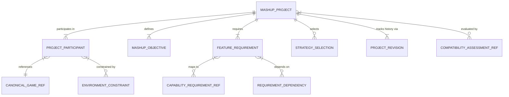

# MASHUP PROJECT DOMAIN MODEL & CREATION WORKFLOW SPECIFICATION
**Document ID:** `NLE-SPC-MPD-001`  
**Version:** 1.0.0  
**Phase:** Phase 6 (Mashup Designer & Integration Planning)  
**Step:** Step 43 of 100  
**Status:** Approved Architectural Standard  
**Authors:** Principal Software Architect, Domain Modeling Specialist, Game Interoperability Engineer, Technical Product Designer  
**Classification:** Core Domain Specification  

---

## 1. PURPOSE AND SCOPE

### 1.1 Purpose
This specification establishes the authoritative, implementation-ready domain model and creation workflow for a **Mashup Project** (`MashupProject`) within NexLudic Engine. 

NexLudic Engine enables creators to conceptualize, evaluate, plan, develop, and eventually validate cross-game mashups between pairs (or groups) of games through host-game modification, live interoperability bridging, or hybrid execution. To ensure that integration planning is grounded in verifiable evidence rather than wishful thinking, the platform requires a formal domain representation that captures the user's creative vision while preserving strict boundaries between what is *desired*, what is *declared*, what is *feasible*, what is *planned*, and what is *executable*.

This document formally specifies:
1. The domain definition, boundary, and identity of a Mashup Project.
2. The epistemic safeguards distinguishing user intent from technical feasibility and runtime execution.
3. The relationship between the project model and upstream Phase 2 architecture, Phase 3 UI wizard contracts, Phase 4 game discovery identities, and Phase 5 SDK capabilities.
4. The high-level multi-stage creation workflow and lifecycle states.
5. The integration strategy representation and downstream planning handoff.

### 1.2 System Scope and Boundaries
```
+--------------------------------------------------------------------------------------------------------+
|                                    MASHUP DESIGNER DOMAIN (PHASE 6)                                    |
|                                                                                                        |
|  +--------------------------------------------------------------------------------------------------+  |
|  |                                  MASHUP PROJECT (MashupProject)                                  |  |
|  |                                                                                                  |  |
|  |  - Project Identity & Metadata (project_id, name, schema_version)                                |  |
|  |  - Participating Games (participants: Game A, Game B, roles: HOST / GUEST / PEER)                |  |
|  |  - Creative Vision & Objective (mashup thesis, intended player experience)                       |  |
|  |  - Feature Requirements Catalog (RequirementRecord: mandatory, optional, conditional)          |  |
|  |  - Strategy Baseline (STRATEGY_1_HOST_MOD, STRATEGY_2_LIVE_BRIDGE, STRATEGY_3_HYBRID, UNDECIDED)   |  |
|  |  - Environment & Version Constraints (target SemVer, editions, build IDs)                       |  |
|  |  - Downstream References (candidate adapters, compatibility reports, planning artifacts)        |  |
|  |  - Lifecycle State (DRAFT -> INCOMPLETE -> READY_FOR_ASSESSMENT -> PLANNING -> ARCHIVED)        |  |
|  +--------------------------------------------------------------------------------------------------+  |
+--------------------------------------------------------------------------------------------------------+
                                                 |
         +---------------------------------------+---------------------------------------+
         |                                       |                                       |
         v                                       v                                       v
+-----------------------+               +-----------------------+               +-----------------------+
|  Phase 4 Game Models  |               |  Phase 5 SDK Models   |               |  Phase 6/7 Planners   |
| - CanonicalGameRecord |               | - CapabilityReq Model |               | - Integration Graph   |
| - GameEnvironment     |               | - ValidatedRegistry   |               | - Mesh Sync Plan      |
| - CompatibilityReport |               | - ContextAvailability |               | - Code Gen Pipeline   |
+-----------------------+               +-----------------------+               +-----------------------+
```

### 1.3 What a Mashup Project Is and Is Not
- **What It IS:**
  - A structured, persistent design workspace capturing a user's cross-game mashup concept.
  - A formal container for participating game identities, user-authored requirements, and environmental constraints.
  - An input artifact for automated compatibility assessments, capability matching, and integration planning.
  - An auditable revision history tracking how mashup requirements and strategy decisions evolve.
- **What It IS NOT:**
  - It is NOT an assertion of technical compatibility between the participating games.
  - It is NOT an executable mod, runtime bridge script, or compiled game package.
  - It is NOT an authorization token to modify game memory, inject DLLs, or bypass anti-cheat systems.
  - It is NOT an alternate game discovery catalog or local file crawler.

---

## 2. GOVERNING ARCHITECTURAL PRINCIPLES & EPISTEMIC SAFEGUARDS

### 2.1 The Five Epistemic Tiers
To prevent the platform from misleading creators or fabricating feasibility, the Mashup Project model enforces five strictly separated epistemic tiers:

```
[ TIER 1: CREATIVE INTENT ]   ---> What the creator desires (User-authored requirements & objectives)
               |  =/=> Intent does NOT prove feasibility
               v
[ TIER 2: DECLARED CAPABILITY] ---> What available adapters claim to provide (ACD Manifests, Step 35)
               |  =/=> Claims do NOT prove compatibility
               v
[ TIER 3: ASSESSED COMPATIBILITY] -> What compatibility rules evaluate (Compatibility Reports, Step 32)
               |  =/=> Compatibility does NOT generate code
               v
[ TIER 4: PLANNED INTEGRATION] ---> How the mashup will be wired (Phase 6 Integration Graph & Plan)
               |  =/=> A plan is NOT an authorized execution
               v
[ TIER 5: EXECUTED RUNTIME ]   ---> Live game memory hooks & bridges under Medium IL (Phases 8-10)
```

### 2.2 Anti-Cheat Dominance & Safe-by-Default Guardrail (`BLK-SEC-01`)
In accordance with platform security invariants:
- A Mashup Project may be created for any conceptual game pair.
- However, if any participating game is identified as an online multiplayer title protected by active kernel anti-cheat software (EasyAntiCheat, BattlEye, Vanguard, Ricochet), the project model flags an immediate non-bypassable warning (`WARN_SEC_ANTI_CHEAT_DETECTED`).
- Live runtime memory injection or hook-based integration strategies are strictly prohibited for such titles (`BLK-SEC-01`).

### 2.3 Volume D Workspace Anchoring (`DEC-009`, `ADR-0009`)
In accordance with `DEC-009` and Phase 3 workspace specifications (`NLE-SPC-WIZ-001`):
- Every Mashup Project is allocated an isolated directory structure anchored strictly to Volume D:  
  `D:\NexLudic\Projects\<projectId>\`
- All project configuration, requirement revisions, candidate references, and audit logs reside within this project root. Writing to Drive C, `%USERPROFILE%`, or Windows system directories is strictly prohibited.

---

## 3. CORE ENTITY RELATIONSHIPS & DOMAIN ARCHITECTURE



### 3.1 Domain Entity Summary
1. **`MashupProject` (Aggregate Root):** Represents the top-level mashup design entity. Owns the project lifecycle, participants, requirements, and revisions.
2. **`ProjectParticipant`:** Models a specific game participating in the mashup, binding a canonical game identity to an assigned architectural role (`HOST`, `GUEST`, `PEER`).
3. **`MashupObjective`:** Captures the creator's creative thesis, intended gameplay experience, and narrative/mechanical goals in user language.
4. **`FeatureRequirement`:** Structured, testable requirement items (e.g. "Transfer player inventory on death", "Render Minimap HUD overlay") with priority and criticality tiers.
5. **`StrategySelection`:** Records the chosen integration strategy (`STRATEGY_1_HOST_MOD`, `STRATEGY_2_LIVE_BRIDGE`, `STRATEGY_3_HYBRID`, or `STRATEGY_UNDECIDED`).
6. **`EnvironmentConstraint`:** Binds target game editions, version ranges (SemVer), runtime architectures (x64), and required third-party modding frameworks (e.g. Forge, Fabric, UE4SS).
7. **`ProjectRevision`:** Immutable snapshot of project configuration captured upon every user save or major state transition.

---

## 4. PROJECT LIFECYCLE AND STATE BOUNDARIES

The Mashup Project aggregate owns an explicit lifecycle distinct from runtime adapter lifecycles (`NLE-MOD-LSM-001`):

```
+--------------------------------------------------------------------------------------------------------+
|                                    MASHUP PROJECT LIFECYCLE STATES                                     |
|                                                                                                        |
|  [ PROJECT_DRAFT ] ------------> Initial entry; partial fields; unsaved or draft state.                |
|         |                                                                                              |
|         v                                                                                              |
|  [ PROJECT_INCOMPLETE ] -------> Saved project missing mandatory participants or requirements.         |
|         |                                                                                              |
|         v                                                                                              |
|  [ PROJECT_READY_FOR_ASSESSMENT ] -> All mandatory fields valid; ready for Phase 4 compatibility scan. |
|         |                                                                                              |
|         v                                                                                              |
|  [ PROJECT_ASSESSMENT_PENDING ] ---> Compatibility scan or capability matching actively running.       |
|         |                                                                                              |
|         v                                                                                              |
|  [ PROJECT_PLANNING_IN_PROGRESS ] -> Compatibility report available; user designing integration plan.  |
|         |                                                                                              |
|         v                                                                                              |
|  [ PROJECT_PLAN_AVAILABLE ] ------> Formal Integration Plan approved; ready for code generation.       |
|         |                                                                                              |
|         +-----------------------+-----------------------+                                              |
|                                 |                       |                                              |
|                                 v                       v                                              |
|                      [ PROJECT_ARCHIVED ]     [ PROJECT_DELETED ]                                      |
+--------------------------------------------------------------------------------------------------------+
```

---

## 5. SEVEN-STAGE CREATION WORKFLOW RECONCILIATION

The creation workflow bridges the user-facing wizard from Phase 3 (`NLE-SPC-WIZ-001`) with the formal domain model:

1. **Stage 1 (Basics):** Assign stable `project_id` (UUIDv4) and unique `display_name`. Allocate workspace on Volume D (`DEC-009`).
2. **Stage 2 (Participants):** Select participating games from the Phase 4 Canonical Game Catalog (`NLE-CAT-CGI-001`). Assign initial roles.
3. **Stage 3 (Environment & Versions):** Capture target game editions, SemVer version ranges, and detect optional local installations.
4. **Stage 4 (Goals & Creative Thesis):** Capture user's high-level mashup objective in unstructured and structured prose.
5. **Stage 5 (Feature Requirements):** Author initial `FeatureRequirement` items with priority (`CRITICAL`, `HIGH`, `MEDIUM`, `LOW`) and criticality (`MANDATORY`, `OPTIONAL`).
6. **Stage 6 (Strategy Selection):** Select initial integration strategy preference or designate as `STRATEGY_UNDECIDED`.
7. **Stage 7 (Review, Validation & Save):** Execute domain validation rules. Emit atomic `project.json` and initialize project revision `1`.

---

## 6. SPECIFICATION SUMMARY AND INVARIANTS

1. **Universal Multi-Game Support:** The domain model supports arbitrary pairs of games and is architected to support $N$-way mashups without structural refactoring.
2. **Immutability of Identity:** Renaming a project modifies its `display_name`; its `project_id` and filesystem directory name remain immutable.
3. **Audit Trail Integrity:** Every project save generates an incremental revision record on Volume D secured by an audit hash.

---
*End of Specification — Document `NLE-SPC-MPD-001`.*
