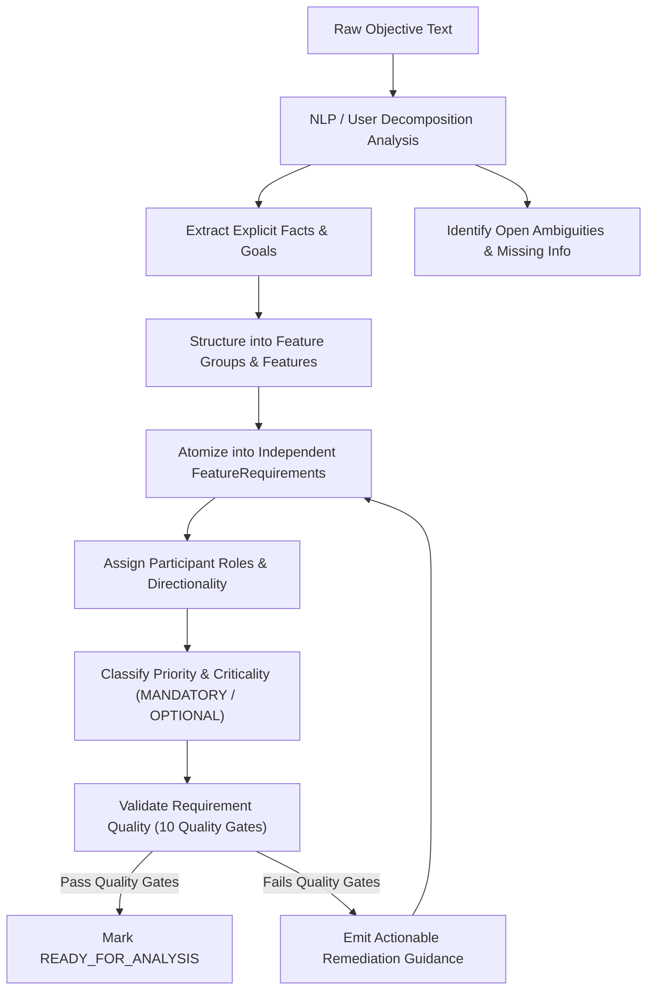

# MASHUP REQUIREMENTS ANALYSIS & FEATURE DECOMPOSITION SPECIFICATION
**Document ID:** `NLE-SPC-MRD-001`  
**Version:** 1.0.0  
**Phase:** Phase 6 (Mashup Designer & Integration Planning)  
**Step:** Step 44 of 100  
**Status:** Approved Architectural Standard  
**Authors:** Principal Software Architect, Requirements Engineering Specialist, Systems Analyst, Senior QA Automation Engineer  
**Classification:** Core Requirements Engineering Specification  

---

## 1. PURPOSE AND SCOPE

### 1.1 Purpose
This specification establishes the authoritative, implementation-ready framework for **Mashup Requirements Analysis and Feature Decomposition** within NexLudic Engine. 

A creator initiates a mashup project with an imaginative, natural-language objective (e.g. *"I want to fight Doom monsters in my Minecraft survival world using the Super Shotgun, with retro sounds and classic HUD elements"*). However, cross-game interoperability cannot be planned, verified, or executed against unstructured prose. This specification defines:
1. The formal requirement hierarchy decomposing high-level creator objectives into structured, atomic, and testable feature requirements.
2. The epistemic boundaries distinguishing what the user *desires* from what is *declared*, *feasible*, *matched*, or *executable*.
3. The behavioral contract for interpreting natural-language intent without fabricating technical feasibility or corrupting user words.
4. The cross-game requirement semantics mapping behavior across source and target participants.
5. The downstream requirements analysis workflow preparing validated requirements for integration planning (Step 45+).

### 1.2 System Scope and Boundaries
```
+--------------------------------------------------------------------------------------------------------+
|                                    MASHUP REQUIREMENTS SUBSYSTEM (STEP 44)                             |
|                                                                                                        |
|  [ MashupObjective ] ---------------------> Raw Creator Vision & Core Thesis (User Verbatim Language)   |
|         |                                                                                              |
|         v (Interpretation & Extraction)                                                                |
|  [ FeatureGroup ] ------------------------> Logical Coherent Experience Area (e.g., Combat System)     |
|         |                                                                                              |
|         v (Decomposition & Atomicity)                                                                  |
|  [ Feature ] -----------------------------> Discrete User-Facing Capability (e.g., Super Shotgun)     |
|         |                                                                                              |
|         v (Cross-Game Mapping & Analysis)                                                              |
|  [ FeatureRequirement ] ------------------> Atomic, Testable Behavioral Unit (e.g., Raycast + Pellets)  |
|         |                                                                                              |
|         +---> [ AcceptanceCriterion ] ----> Measurable Threshold (e.g., Spread <= 15 deg, 20 pellets)   |
|         +---> [ RequirementDependency ] --> Directed Edges (REQUIRES, CONFLICTS_WITH, ENHANCES)        |
|         +---> [ Assumptions & Questions ]-> Unverified Assumptions & Open Decision Points             |
+--------------------------------------------------------------------------------------------------------+
                                                 |
                                                 v
+--------------------------------------------------------------------------------------------------------+
|                                  DOWNSTREAM PLATFORM GATES (PHASE 5/6)                                 |
|                                                                                                        |
|  [ Phase 5 Capability Matching (Step 38) ] <-----> [ Phase 6 Integration Planning Graph (Step 45) ]    |
+--------------------------------------------------------------------------------------------------------+
```

### 1.3 Non-Goals and Explicit Exclusions
This specification governs requirement representation, decomposition rules, and quality verification. It does NOT:
- Implement a natural-language processing (NLP) or LLM parser runtime (contract specification only).
- Design the interactive drag-and-drop visual integration planner (scheduled for Step 45+).
- Perform runtime capability matching or parameter negotiation (governed by Phase 5 Steps 38–39).
- Generate game scripts, mod files, or native executable bridges.
- Connect to or inspect live game memory processes.

---

## 2. GOVERNING PRINCIPLES & EPISTEMIC BOUNDARIES

### 2.1 The Intent vs. Feasibility Invariant
- **Preservation of Verbatim Creator Words:** The system MUST retain the creator's exact original text alongside any structured decomposition. Automated analysis MUST NEVER silently overwrite, sanitize, or replace user intent.
- **Decomposition $\neq$ Feasibility:** Decomposing an objective into clean, structured requirements does NOT imply that the requirements are technically achievable. Feasibility is evaluated exclusively against Phase 4 compatibility rules (`NLE-CAT-MTR-001`) and Phase 5 adapter capabilities (`NLE-SPC-CMR-001`).

### 2.2 Truthful Status & Non-Fabrication
- **Zero Inferred Compatibility:** A requirement cannot be marked as "satisfied" simply because an adapter exists with a similar name.
- **Unverified Assumptions Remain Explicit:** If a requirement presumes an unverified game capability (e.g. assuming a target game allows custom entity spawning), that presumption MUST be captured as an open `AssumptionRecord`, visible to the creator and downstream planners.

### 2.3 Least Privilege & Non-Executing Analysis
- **Non-Executing Requirements Workflow:** Requirements analysis operates strictly as a static data transformation in-memory. It NEVER launches game executables, probes network sockets, or requests administrative privileges (`DEC-002`).

---

## 3. THE 5-LEVEL REQUIREMENT HIERARCHY

The requirements analysis engine organizes creator intent into five strictly typed hierarchical levels:

```
Level 1: MashupObjective        (Global creative vision & narrative/gameplay thesis)
    |
    +--> Level 2: FeatureGroup    (Coherent subsystem: e.g., Weaponry, State Sync, Audio Overlay)
            |
            +--> Level 3: Feature          (Discrete mechanic: e.g., Super Shotgun Integration)
                    |
                    +--> Level 4: FeatureRequirement (Atomic behavioral unit: e.g., Fire Raycast Pellets)
                            |
                            +--> Level 5: AcceptanceCriterion (Measurable pass/fail test assertion)
```

### 3.1 Level Specifications

| Level | Entity Name | Scope & Purpose | Required Fields | Mutability |
| :---: | :--- | :--- | :--- | :---: |
| **L1** | **`MashupObjective`** | Top-level project thesis authored by user. | `objective_id`, `title`, `core_thesis` | User Mutable |
| **L2** | **`FeatureGroup`** | Logical grouping of related cross-game mechanics. | `group_id`, `title`, `category` | Mutable |
| **L3** | **`Feature`** | User-visible cross-game capability. | `feature_id`, `title`, `description`, `priority` | Mutable |
| **L4** | **`FeatureRequirement`** | Atomic, testable behavioral specification. | `requirement_id`, `title`, `category`, `criticality` | State-Bound |
| **L5** | **`AcceptanceCriterion`** | Formal verification threshold. | `criterion_id`, `statement`, `metric`, `threshold` | Mutable |

---

## 4. DECOMPOSITION WORKFLOW & TRANSITION RULES



---

## 5. RECONCILIATION WITH UPSTREAM PHASE CONTRACTS

- **Phase 4 Canonical Game Identity (`NLE-CAT-CGI-001`):** Every cross-game requirement binds its source and target to verified canonical game IDs (`game.[id]`).
- **Phase 5 Capability System (`NLE-CON-CRQ-001`):** Level 4 `FeatureRequirement` items directly map to Phase 5 `CapabilityRequirement` definitions during downstream integration planning (Step 45+).
- **Phase 6 Step 43 Domain Model (`NLE-CAT-MPD-001`):** Step 44 builds directly upon the `FeatureRequirement` and `RequirementDependency` entities established in Step 43, adding structured decomposition rules, atomicity metrics, and ambiguity resolution policies.

---
*End of Specification — Document `NLE-SPC-MRD-001`.*
