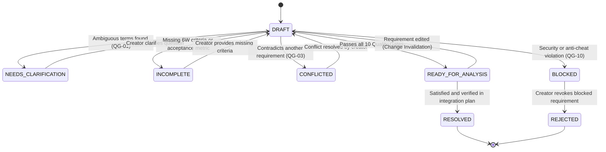

# MASHUP REQUIREMENT ACCEPTANCE CRITERIA AND VERIFICATION READINESS
**Document ID:** `NLE-SPC-ACV-001`  
**Version:** 1.0.0  
**Phase:** Phase 6 (Mashup Designer & Integration Planning)  
**Step:** Step 44 of 100  
**Status:** Approved Architectural Standard  
**Authors:** Senior QA Automation Engineer, Software Testing Architect, Systems Analyst, Principal Architect  
**Classification:** Quality & Verification Specification  

---

## 1. PURPOSE AND VERIFICATION OBJECTIVES

### 1.1 Purpose
This specification establishes the formal standards, metric definitions, quality gates, and verification readiness criteria for **Acceptance Criteria** (`AcceptanceCriterion`) and **Requirement Quality Validation** within NexLudic Engine. 

A requirement that cannot be verified is a wish, not an engineering specification. This document defines:
1. The structured format and quantitative metrics required for acceptance criteria.
2. The 10 formal Quality Gates that determine whether a `FeatureRequirement` is `READY_FOR_ANALYSIS`.
3. The requirement lifecycle states and diagnostic error codes.
4. The handoff criteria required before an integration planner or AI coding agent can begin planning implementation.

---

## 2. STRUCTURED ACCEPTANCE CRITERIA SPECIFICATION

Every `FeatureRequirement` MUST define at least one measurable `AcceptanceCriterion`:

```
+--------------------------------------------------------------------------------------------------------+
|                                  ACCEPTANCE CRITERION STRUCTURE                                        |
|                                                                                                        |
|  [ Given / When / Then Statement ] ---> "Given Game Orion is running, When the player presses Attack,  |
|                                         Then the weapon fires exactly 20 raycast pellets."             |
|  [ Metric Type ]                  ---> NUMERIC_THRESHOLD                                               |
|  [ Target Value ]                 ---> "20"                                                            |
|  [ Tolerance ]                    ---> "0" (Exact integer match required)                              |
|  [ Verification Method ]          ---> AUTOMATED_TEST_DOUBLE (Phase 5 Conformance Harness)             |
+--------------------------------------------------------------------------------------------------------+
```

### 2.1 Metric Types and Verification Methods

| Metric Type | Allowed Operators | Example Target | Applicable Verification Method |
| :--- | :--- | :--- | :--- |
| **`BOOLEAN_ASSERTION`** | `EQUALS` | `"true"`, `"false"` | Automated unit test double or telemetry probe. |
| **`NUMERIC_THRESHOLD`** | `EQUALS`, `LESS_THAN`, `GREATER_THAN` | `">= 100"`, `"<= 15.0 deg"` | In-engine mock test or automated test script. |
| **`LATENCY_MS`** | `LESS_THAN_OR_EQUAL` | `"<= 16.6ms"` (60Hz budget) | 60Hz telemetry frame watcher (`NLE-POL-HSF-001`). |
| **`FRAME_RATE_HZ`** | `GREATER_THAN_OR_EQUAL` | `">= 58.0 fps"` | Graphics pipeline frame performance counter. |
| **`STATE_EQUIVALENCE`** | `EQUALS_WITH_TOLERANCE` | `"+/- 0.05 units"` | Cross-process memory state comparator. |

---

## 3. THE 10 QUALITY GATES FOR REQUIREMENT READINESS

Before a requirement can transition from `DRAFT` to `READY_FOR_ANALYSIS`, it MUST pass all 10 quality gates:

```
+--------------------------------------------------------------------------------------------------------+
|                                    THE 10 REQUIREMENT QUALITY GATES                                    |
|                                                                                                        |
|  [ QG-01 ] Clarity & Unambiguity          - Free from open-ended language; singular interpretation.   |
|  [ QG-02 ] Relevance to Objective        - Directly contributes to parent Feature and Objective.      |
|  [ QG-03 ] Consistency & Non-Conflict     - Zero unresolved CONFLICTS_WITH edges or logical clashes.   |
|  [ QG-04 ] Proper Scope & Atomicity      - Conforms to RUL-SPLIT-01..04 (Single observable behavior). |
|  [ QG-05 ] Feasibility to Evaluate       - Pass/fail condition is objectively determinable.           |
|  [ QG-06 ] End-to-End Traceability       - Binds to valid project_id, feature_id, and intent excerpt. |
|  [ QG-07 ] Verifiable Acceptance Criteria- Defines at least one complete AcceptanceCriterion.         |
|  [ QG-08 ] Explicit Assumptions Recorded - Unverified technical premises logged in AssumptionRecord.   |
|  [ QG-09 ] Completeness (6W Checklist)   - Satisfies Who, What, When, Where, How, and What-If.        |
|  [ QG-10 ] Security & Policy Compliance  - Respects Medium IL, Anti-Cheat Dominance, and Volume D.    |
+--------------------------------------------------------------------------------------------------------+
```

### 3.1 Quality Gate Evaluation Table

| Gate ID | Quality Dimension | Evaluation Check | Failure Action |
| :---: | :--- | :--- | :--- |
| **QG-01** | Clarity | Check for banned ambiguous terms ("seamless", "everything"). | Shift to `NEEDS_CLARIFICATION`; emit `OpenQuestionRecord`. |
| **QG-02** | Relevance | Verify parent `feature_id` exists and is active. | Shift to `INCOMPLETE`; reject orphaned requirement. |
| **QG-03** | Consistency | Scan for mutual exclusion conflicts (`VR-REQ-10`). | Shift to `CONFLICTED`; flag conflict resolution tray. |
| **QG-04** | Atomicity | Check for multi-system statements (`RUL-SPLIT-01`). | Shift to `INCOMPLETE`; prompt splitting. |
| **QG-05** | Feasibility to Eval| Ensure criteria do not require subjective human aesthetic judgment. | Prompt objective threshold definition. |
| **QG-06** | Traceability | Verify UUIDs and participant IDs against project manifest. | Shift to `INCOMPLETE`; flag missing participant. |
| **QG-07** | Acceptance Criteria| Verify criteria array length $\ge 1$ with valid target value. | Shift to `INCOMPLETE`; flag missing acceptance metric. |
| **QG-08** | Assumptions | Confirm unproven mechanics are tagged in `AssumptionRecord`. | Prompt user confirmation or mark assumption unverified. |
| **QG-09** | Completeness | Verify 6W completeness checklist (`NLE-RUL-MFA-001`). | Shift to `INCOMPLETE`; highlight missing field. |
| **QG-10** | Security & Policy | Verify compliance with `DEC-002` and `BLK-SEC-01`. | Shift to `BLOCKED`; emit critical security warning. |

---

## 4. REQUIREMENT LIFECYCLE STATES

A `FeatureRequirement` progresses through eight discrete operational quality states:



---

## 5. DOWNSTREAM HANDOFF TO INTEGRATION PLANNING (STEP 45+)

Once all mandatory requirements for a project achieve `READY_FOR_ANALYSIS`:
1. The project's overall lifecycle transitions to `PROJECT_PLANNING_IN_PROGRESS`.
2. The requirements dataset is compiled into a formal planning payload.
3. The Phase 6 Integration Planner (Step 45+) consumes the requirements to construct the Visual Integration Graph, map capabilities, and generate implementation blueprints.

---
*End of Specification — Document `NLE-SPC-ACV-001`.*
