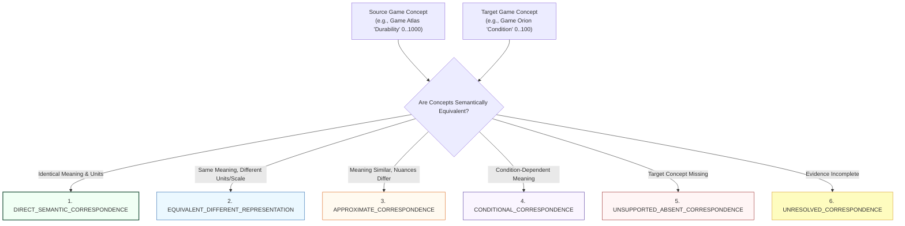

# Source-Target Concept Correspondence & Semantic Mapping Rules

**Document ID:** `NLE-RUL-SCC-001`  
**Version:** `1.0.0`  
**Status:** `APPROVED ARCHITECTURAL RULES`  
**Phase:** `Phase 6 of 12 — Mashup Designer & Integration Planning`  
**Step:** `Step 47 of 100`  
**Classification:** `Semantic Correspondence Governance & Rules Specification`  
**Related Documents:**
- [CROSS_GAME_DATA_MAPPING_AND_TRANSFORMATION_SPECIFICATION.md](file:///d:/App%20Winrar%20Files/Nexludic%20Engine%20(working)/docs/mashup-designer/CROSS_GAME_DATA_MAPPING_AND_TRANSFORMATION_SPECIFICATION.md) (`NLE-SPC-DMT-001`)
- [CROSS_GAME_MAPPING_DOMAIN_MODEL_AND_FIELD_DICTIONARY.md](file:///d:/App%20Winrar%20Files/Nexludic%20Engine%20(working)/docs/mashup-designer/CROSS_GAME_MAPPING_DOMAIN_MODEL_AND_FIELD_DICTIONARY.md) (`NLE-MOD-DMD-001`)
- [CROSS_GAME_REQUIREMENT_SEMANTICS_AND_PARTICIPANT_MAPPING.md](file:///d:/App%20Winrar%20Files/Nexludic%20Engine%20(working)/docs/mashup-designer/CROSS_GAME_REQUIREMENT_SEMANTICS_AND_PARTICIPANT_MAPPING.md) (`NLE-SPC-CRS-001`)

---

## 1. Concept Correspondence Principles

Cross-game concept mapping establishes the semantic relationship between entities in disparate game domains. NexLudic Engine enforces the **Semantic Rigor Invariant (`RUL-SCC-01`)**: concept equivalence cannot be inferred from naming similarity, UI icon resemblance, or shared colloquial terms. Equivalence requires verified documentation or empirical capability attestations:

---

## 2. Taxonomy of Semantic Correspondence

The framework recognizes eight formal correspondence classifications:

| Category Code | Semantic Correspondence Category | Definition & Verification Requirement | Permitted Planning Action |
| :--- | :--- | :--- | :--- |
| **`CORR_DIRECT`** | Direct Semantic Correspondence | Source and target share identical semantic meaning and scale (e.g. integer item count $1\text{--}64$). | Auto-mapped as direct pass-through. |
| **`CORR_REPR`** | Equivalent Different Representation | Meaning is identical, but data type, units, or scale differ (e.g. Celsius vs Fahrenheit, or $0\text{--}1.0$ float vs $0\text{--}255$ byte). | Requires unit conversion or normalization contract. |
| **`CORR_APPROX`** | Approximate Correspondence | Source concept represents a richer model than target (e.g. 5 armor damage types mapped to 2 target defense pools). | Permitted with explicit loss disclosure. |
| **`CORR_COND`** | Conditional Correspondence | Mapping depends on external state (e.g. if character is in vehicle, speed maps to engine RPM; else foot speed). | Requires conditional evaluation contract. |
| **`CORR_ONE_TO_MANY`**| One-to-Many Correspondence | One source concept populates multiple target entities (e.g. combined weapon damage decomposing into physical + fire). | Requires decomposition transformation. |
| **`CORR_MANY_TO_ONE`**| Many-to-One Correspondence | Multiple source attributes synthesize one target value (e.g. player strength + agility determining target stamina). | Requires aggregation transformation. |
| **`CORR_UNSUPPORTED`**| Unsupported / Absent Correspondence| Target game completely lacks a concept equivalent to source (e.g. radiation levels mapped to fantasy game). | Target property dropped; if mandatory, halts planning. |
| **`CORR_UNRESOLVED`** | Unresolved Correspondence | Insufficient documentation to prove or disprove correspondence. | Capped at `NEEDS_CLARIFICATION`. |

---

## 3. Strict Semantic Evaluation Rules

1. **Rule RUL-SCC-02 (False Friend Rejection):** If two concepts have identical names but different gameplay mechanics (e.g. *Stamina* in Game Atlas controlling sprint duration vs. *Stamina* in Game Orion acting as spell casting currency), the mapping validator rejects direct correspondence (`ERR_SEMANTIC_FALSE_FRIEND`). A customized translation contract must be specified.
2. **Rule RUL-SCC-03 (Version Pinning Invariant):** Concept definitions are bound to specific game releases and adapter contract versions. If Game Orion updates to `v1.5.0` and alters its inventory data structure, any mapping referencing the old schema transitions to `STALE`.
3. **Rule RUL-SCC-04 (Mandatory Concept Availability):** If a source concept is required to satisfy a mandatory user requirement, but the target correspondence is `CORR_UNSUPPORTED`, the mapping is marked `BLOCKED_UNSUPPORTED_CONCEPT`. The system cannot silently ignore the concept.

---
*End of Rules — Document `NLE-RUL-SCC-001`.*
