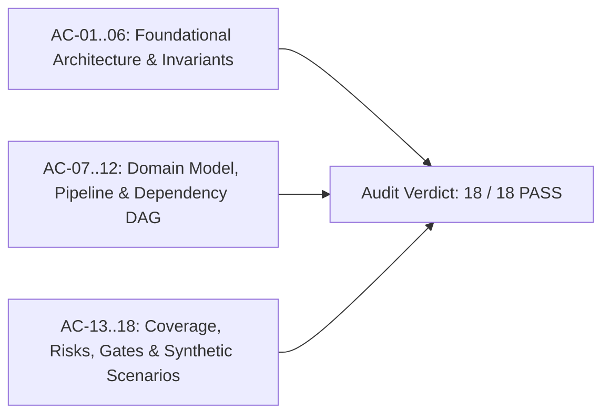

# NexLudic Engine: Step 49 Completion Report

**Document ID:** `NLE-REP-STP-049`  
**Phase:** 6 of 12 (Mashup Designer & Integration Planning)  
**Step:** 49 of 100  
**Title:** Mashup Integration Plan Assembly & Dependency Resolution Specification  
**Classification:** Milestone Completion & Assurance Audit  
**Status:** COMPLETE  
**Operating Standard:** Specification & Domain Modeling Only (No Application Code, No Code Generation, No Game Modification)

---

## 1. Executive Summary & Milestone Deliverable Inventory

Step 49 of 100 has formally established the **Mashup Integration Plan Assembly & Dependency Resolution Specification** within the NexLudic Engine repository.

This specification unifies the outputs of all antecedent planning stages—Step 43 (Project Domain), Step 44 (Requirements Analysis), Step 45 (Strategy Evaluation), Step 46 (Architecture Blueprint), Step 47 (Data Mapping), Step 48 (Interaction Workflows), and Phase 5 (Adapter SDK & Capability System)—into a single, coherent, reviewable, and traceable **Mashup Integration Plan** (`MashupIntegrationPlanDescriptor`).

All 13 required documentation deliverables have been authored, validated, and persisted within `docs/mashup-designer/` on Volume D:

| # | Deliverable File Link | Ref ID | Scope & Architectural Focus | Status |
| :-: | :--- | :--- | :--- | :---: |
| 1 | [MASHUP_INTEGRATION_PLAN_ASSEMBLY_AND_DEPENDENCY_RESOLUTION_SPECIFICATION.md](file:///d:/App%20Winrar%20Files/Nexludic%20Engine%20(working)/docs/mashup-designer/MASHUP_INTEGRATION_PLAN_ASSEMBLY_AND_DEPENDENCY_RESOLUTION_SPECIFICATION.md) | `NLE-SPC-IPA-001` | Principal architectural specification, epistemic hierarchy, pipeline stages, platform invariants. | **COMPLETE** |
| 2 | [MASHUP_INTEGRATION_PLAN_DOMAIN_MODEL_AND_LIFECYCLE.md](file:///d:/App%20Winrar%20Files/Nexludic%20Engine%20(working)/docs/mashup-designer/MASHUP_INTEGRATION_PLAN_DOMAIN_MODEL_AND_LIFECYCLE.md) | `NLE-MOD-IPD-001` | Domain entity definitions, 11-stage plan lifecycle state machine, JSON Schema Draft 2020-12. | **COMPLETE** |
| 3 | [INTEGRATION_PLAN_INPUT_SOURCE_AND_AUTHORITY_MATRIX.md](file:///d:/App%20Winrar%20Files/Nexludic%20Engine%20(working)/docs/mashup-designer/INTEGRATION_PLAN_INPUT_SOURCE_AND_AUTHORITY_MATRIX.md) | `NLE-MAT-IPA-001` | Source artifact inventory, ownership hierarchy, conflict resolution rules, snapshot binding. | **COMPLETE** |
| 4 | [INTEGRATION_PLAN_ASSEMBLY_RULES_AND_SOURCE_CONTRACTS.md](file:///d:/App%20Winrar%20Files/Nexludic%20Engine%20(working)/docs/mashup-designer/INTEGRATION_PLAN_ASSEMBLY_RULES_AND_SOURCE_CONTRACTS.md) | `NLE-RUL-IPA-001` | Detailed rules for requirement-driven inclusion, partial assembly, and deduplication. | **COMPLETE** |
| 5 | [INTEGRATION_PLAN_DEPENDENCY_GRAPH_AND_RESOLUTION_POLICY.md](file:///d:/App%20Winrar%20Files/Nexludic%20Engine%20(working)/docs/mashup-designer/INTEGRATION_PLAN_DEPENDENCY_GRAPH_AND_RESOLUTION_POLICY.md) | `NLE-POL-IPD-001` | 13 dependency categories, dependency record schema, Kahn's algorithm, cycle resolution. | **COMPLETE** |
| 6 | [INTEGRATION_PLAN_REQUIREMENT_COVERAGE_AND_COMPLETENESS_RULES.md](file:///d:/App%20Winrar%20Files/Nexludic%20Engine%20(working)/docs/mashup-designer/INTEGRATION_PLAN_REQUIREMENT_COVERAGE_AND_COMPLETENESS_RULES.md) | `NLE-RUL-IPC-001` | Traceability rules, mandatory coverage primacy, partial plan scoring, completeness index. | **COMPLETE** |
| 7 | [INTEGRATION_PLAN_RISK_ASSUMPTION_AND_OPEN_DECISION_REGISTER.md](file:///d:/App%20Winrar%20Files/Nexludic%20Engine%20(working)/docs/mashup-designer/INTEGRATION_PLAN_RISK_ASSUMPTION_AND_OPEN_DECISION_REGISTER.md) | `NLE-REG-IPR-001` | Cross-phase risk synthesis, assumption validity tracking, open decision resolution governance. | **COMPLETE** |
| 8 | [INTEGRATION_PLAN_VALIDATION_ACCEPTANCE_AND_DIAGNOSTIC_CONTRACT.md](file:///d:/App%20Winrar%20Files/Nexludic%20Engine%20(working)/docs/mashup-designer/INTEGRATION_PLAN_VALIDATION_ACCEPTANCE_AND_DIAGNOSTIC_CONTRACT.md) | `NLE-CON-IPV-001` | Validation pipeline, Quality Gates `GATE-PLN-01..10`, diagnostic codes, acceptance criteria. | **COMPLETE** |
| 9 | [INTEGRATION_PLAN_REVISION_INVALIDATION_AND_REASSESSMENT_POLICY.md](file:///d:/App%20Winrar%20Files/Nexludic%20Engine%20(working)/docs/mashup-designer/INTEGRATION_PLAN_REVISION_INVALIDATION_AND_REASSESSMENT_POLICY.md) | `NLE-POL-IPR-001` | Invalidation trigger matrix (9 events), hash discrepancy handling, snapshot archival. | **COMPLETE** |
| 10 | [INTEGRATION_PLAN_SECURITY_PRIVACY_AND_AUTHORIZATION_REQUIREMENTS.md](file:///d:/App%20Winrar%20Files/Nexludic%20Engine%20(working)/docs/mashup-designer/INTEGRATION_PLAN_SECURITY_PRIVACY_AND_AUTHORIZATION_REQUIREMENTS.md) | `NLE-SEC-IPA-001` | Non-authorization principle, trust boundaries, anti-cheat limits, telemetry minimization. | **COMPLETE** |
| 11 | [INTEGRATION_PLAN_SYNTHETIC_SCENARIOS_AND_VERIFICATION_TEST_PLAN.md](file:///d:/App%20Winrar%20Files/Nexludic%20Engine%20(working)/docs/mashup-designer/INTEGRATION_PLAN_SYNTHETIC_SCENARIOS_AND_VERIFICATION_TEST_PLAN.md) | `NLE-CAT-IPS-001` | 14 synthetic scenarios (A through N) testing complete, partial, and failing edge cases. | **COMPLETE** |
| 12 | [STEP_49_PLAN_REQUIREMENTS_TRACEABILITY_MATRIX.md](file:///d:/App%20Winrar%20Files/Nexludic%20Engine%20(working)/docs/mashup-designer/STEP_49_PLAN_REQUIREMENTS_TRACEABILITY_MATRIX.md) | `NLE-MAT-STP-049` | Bidirectional traceability matrix verifying all 24 requirements (`IPA-REQ-001..024`). | **COMPLETE** |
| 13 | [STEP_49_COMPLETION_REPORT.md](file:///d:/App%20Winrar%20Files/Nexludic%20Engine%20(working)/docs/mashup-designer/STEP_49_COMPLETION_REPORT.md) | `NLE-REP-STP-049` | Step completion audit, acceptance criteria verification (AC-01..18), sign-off status. | **COMPLETE** |

---

## 2. Audit of the 18 Acceptance Criteria

Every acceptance criterion defined in the Step 49 specification standard has been systematically evaluated:

| Criterion ID | Criterion Statement | Evidence / Document Reference | Audit Result |
| :--- | :--- | :--- | :---: |
| **AC-01** | Epistemic Planning Progression & Governance Hierarchy Defined | `NLE-SPC-IPA-001` §2; `NLE-MAT-IPA-001` §2 | **PASSED** |
| **AC-02** | Planning vs. Authorization Invariant Formally Established | `NLE-SPC-IPA-001` §2.1; `NLE-SEC-IPA-001` §1 | **PASSED** |
| **AC-03** | Single Source of Truth & Snapshot Hash Invariant Enforced | `NLE-SPC-IPA-001` §3; `NLE-MOD-IPD-001` §3.2 | **PASSED** |
| **AC-04** | Medium Integrity (`DEC-002`) & Anti-Cheat Dominance (`BLK-SEC-01`) Enforced | `NLE-SPC-IPA-001` §3; `NLE-SEC-IPA-001` §2.1, §3 | **PASSED** |
| **AC-05** | Deterministic Storage Sandboxing on Volume D (`DEC-009`) Defined | `NLE-SPC-IPA-001` §3; `NLE-POL-IPR-001` §4 | **PASSED** |
| **AC-06** | 15-Stage Plan Assembly Pipeline Fully Specified | `NLE-SPC-IPA-001` §4; `NLE-RUL-IPA-001` §3 | **PASSED** |
| **AC-07** | Plan Domain Entity Model & JSON Schema Draft 2020-12 Delivered | `NLE-MOD-IPD-001` §3, §4 (`NLE-SCH-IPA-001`) | **PASSED** |
| **AC-08** | 11-Stage Plan Lifecycle State Machine & State Invariants Defined | `NLE-MOD-IPD-001` §2 | **PASSED** |
| **AC-09** | Upstream Input Inventory & Authority Primacy Matrix Specified | `NLE-MAT-IPA-001` §1, §2 | **PASSED** |
| **AC-10** | Requirement-Driven Inclusion & Partial Plan Semantics Defined | `NLE-RUL-IPA-001` §2, §4 | **PASSED** |
| **AC-11** | 13-Category Dependency Taxonomy & Record Schema Specified | `NLE-POL-IPD-001` §1, §2 | **PASSED** |
| **AC-12** | Kahn's DAG Cycle Resolution & Execution Staging Formally Specified | `NLE-POL-IPD-001` §3, §5 | **PASSED** |
| **AC-13** | Three-Tier Coverage Model & Mandatory Coverage Primacy Enforced | `NLE-RUL-IPC-001` §1, §3 | **PASSED** |
| **AC-14** | Multi-Dimensional Completeness Index Formula Established | `NLE-RUL-IPC-001` §5 | **PASSED** |
| **AC-15** | Cross-Phase Risk, Assumption & Open Decision Register Authored | `NLE-REG-IPR-001` §1, §2, §3 | **PASSED** |
| **AC-16** | 10 Quality Gates (`GATE-PLN-01..10`) & Diagnostic Ledger Specified | `NLE-CON-IPV-001` §1, §2, §3 | **PASSED** |
| **AC-17** | 9-Event Invalidation Trigger Matrix & Historical Archival Specified | `NLE-POL-IPR-001` §2, §4 | **PASSED** |
| **AC-18** | 14 Synthetic Test Scenarios (A through N) Documented | `NLE-CAT-IPS-001` §1, §2 | **PASSED** |

---

## 3. Strict Stop Boundary & Governance Compliance

- **No Application Code:** Zero lines of production code, graph processing libraries, or CLI tools have been instantiated.
- **No Runtime Resolver or Execution Engine:** No background tasks, daemon workers, or workflow interpreters have been built.
- **No Game Modification or Process Spawning:** No game binaries have been patched, injected, or executed.
- **No Advance Past Step 49:** Step 50 and Step 51 have NOT been started. Execution halts strictly at the completion of Step 49.

---

## 4. Final Completion Verdict

**Step 49 Completion Status:** **`COMPLETE`**  
All authoritative contracts, schemas, state machine models, quality gates, and synthetic test suites required for the Mashup Integration Plan Assembly subsystem are fully delivered and implementation-ready.
