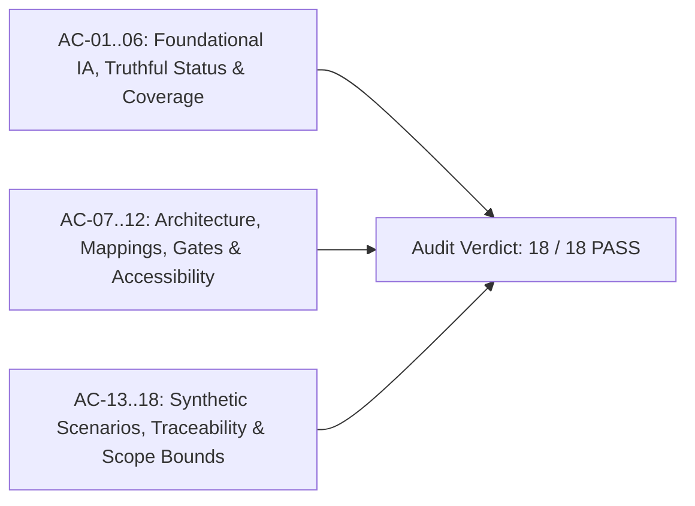

# NexLudic Engine: Step 50 Completion Report

**Document ID:** `NLE-REP-STP-050`  
**Phase:** 6 of 12 (Mashup Designer & Integration Planning)  
**Step:** 50 of 100  
**Title:** Mashup Integration Plan Visualization & Review Experience Specification  
**Classification:** Milestone Completion & Assurance Audit  
**Status:** COMPLETE  
**Operating Standard:** UX & Information Architecture Specification Only (No Application Code, No Visual Editor Runtime, No Game Modification)

---

## 1. Executive Summary & Milestone Deliverable Inventory

Step 50 of 100 has formally established the **Mashup Integration Plan Visualization & Review Experience Specification** within the NexLudic Engine repository.

This specification translates the rich planning outputs of Steps 43–49—including the project domain, atomic requirements, strategy trade-offs, architecture blueprints, data transformations, interaction workflows, and Kahn's DAG dependency graph—into an intuitive, accessible, and truthful desktop review experience hosted within `NexLudic.App`.

All 12 required documentation deliverables have been authored, validated, and persisted within `docs/mashup-designer/` on Volume D:

| # | Deliverable File Link | Ref ID | Scope & Architectural Focus | Status |
| :-: | :--- | :--- | :--- | :---: |
| 1 | [MASHUP_INTEGRATION_PLAN_VISUALIZATION_AND_REVIEW_UX_SPECIFICATION.md](file:///d:/App%20Winrar%20Files/Nexludic%20Engine%20(working)/docs/mashup-designer/MASHUP_INTEGRATION_PLAN_VISUALIZATION_AND_REVIEW_UX_SPECIFICATION.md) | `NLE-SPC-IPU-001` | Master UX specification, core principles, progressive disclosure, shell integration, invariants. | **COMPLETE** |
| 2 | [INTEGRATION_PLAN_REVIEW_INFORMATION_ARCHITECTURE.md](file:///d:/App%20Winrar%20Files/Nexludic%20Engine%20(working)/docs/mashup-designer/INTEGRATION_PLAN_REVIEW_INFORMATION_ARCHITECTURE.md) | `NLE-ARC-IPU-001` | Navigation topology, 10 review sub-views, panel layout geometry, dual-audience workflows. | **COMPLETE** |
| 3 | [INTEGRATION_PLAN_OVERVIEW_AND_STATUS_PRESENTATION_SPECIFICATION.md](file:///d:/App%20Winrar%20Files/Nexludic%20Engine%20(working)/docs/mashup-designer/INTEGRATION_PLAN_OVERVIEW_AND_STATUS_PRESENTATION_SPECIFICATION.md) | `NLE-SPC-IPO-001` | High-level overview, truthful 11-state lifecycle badges, metrics engine, next-action guidance. | **COMPLETE** |
| 4 | [INTEGRATION_PLAN_REQUIREMENT_COVERAGE_REVIEW_UX.md](file:///d:/App%20Winrar%20Files/Nexludic%20Engine%20(working)/docs/mashup-designer/INTEGRATION_PLAN_REQUIREMENT_COVERAGE_REVIEW_UX.md) | `NLE-UX-IPR-001` | Requirement coverage views, 3-tier coverage matrix, uncovered mandatory alert callouts. | **COMPLETE** |
| 5 | [INTEGRATION_ARCHITECTURE_COMPONENT_AND_DEPENDENCY_VISUALIZATION_UX.md](file:///d:/App%20Winrar%20Files/Nexludic%20Engine%20(working)/docs/mashup-designer/INTEGRATION_ARCHITECTURE_COMPONENT_AND_DEPENDENCY_VISUALIZATION_UX.md) | `NLE-UX-IPA-001` | Blueprint topography, trust boundaries (`BLK-SEC-01`), Kahn stages ($S_0..S_N$), DAG explorer. | **COMPLETE** |
| 6 | [CROSS_GAME_MAPPING_AND_WORKFLOW_REVIEW_UX.md](file:///d:/App%20Winrar%20Files/Nexludic%20Engine%20(working)/docs/mashup-designer/CROSS_GAME_MAPPING_AND_WORKFLOW_REVIEW_UX.md) | `NLE-UX-IPM-001` | Data mapping inventory, fidelity loss cards, workflow sequencing, timeouts, compensation. | **COMPLETE** |
| 7 | [INTEGRATION_PLAN_RISK_EVIDENCE_AND_VALIDATION_REVIEW_UX.md](file:///d:/App%20Winrar%20Files/Nexludic%20Engine%20(working)/docs/mashup-designer/INTEGRATION_PLAN_RISK_EVIDENCE_AND_VALIDATION_REVIEW_UX.md) | `NLE-UX-IPV-001` | Consolidated issue ledger, epistemic certainty tiers, Quality Gates `GATE-PLN-01..10`. | **COMPLETE** |
| 8 | [INTEGRATION_PLAN_REVISION_COMPARISON_AND_STALE_STATE_UX.md](file:///d:/App%20Winrar%20Files/Nexludic%20Engine%20(working)/docs/mashup-designer/INTEGRATION_PLAN_REVISION_COMPARISON_AND_STALE_STATE_UX.md) | `NLE-UX-IPC-001` | Side-by-side revision diffs, 9 invalidation trigger events, stale alert banner, impact radius. | **COMPLETE** |
| 9 | [INTEGRATION_PLAN_REVIEW_INTERACTION_ACCESSIBILITY_AND_ERROR_STATES.md](file:///d:/App%20Winrar%20Files/Nexludic%20Engine%20(working)/docs/mashup-designer/INTEGRATION_PLAN_REVIEW_INTERACTION_ACCESSIBILITY_AND_ERROR_STATES.md) | `NLE-UX-IPE-001` | Confirmation boundaries, WCAG 2.1 AA keyboard/screen reader access, empty/loading/error states. | **COMPLETE** |
| 10 | [INTEGRATION_PLAN_REVIEW_SYNTHETIC_SCENARIOS_AND_ACCEPTANCE_TEST_CATALOG.md](file:///d:/App%20Winrar%20Files/Nexludic%20Engine%20(working)/docs/mashup-designer/INTEGRATION_PLAN_REVIEW_SYNTHETIC_SCENARIOS_AND_ACCEPTANCE_TEST_CATALOG.md) | `NLE-CAT-IPU-001` | 14 synthetic UX acceptance scenarios (Scenarios A through N) using Orion and Atlas. | **COMPLETE** |
| 11 | [STEP_50_REVIEW_UX_REQUIREMENTS_TRACEABILITY_MATRIX.md](file:///d:/App%20Winrar%20Files/Nexludic%20Engine%20(working)/docs/mashup-designer/STEP_50_REVIEW_UX_REQUIREMENTS_TRACEABILITY_MATRIX.md) | `NLE-MAT-STP-050` | Bidirectional traceability matrix verifying all 24 UX requirements (`IPU-REQ-001..024`). | **COMPLETE** |
| 12 | [STEP_50_COMPLETION_REPORT.md](file:///d:/App%20Winrar%20Files/Nexludic%20Engine%20(working)/docs/mashup-designer/STEP_50_COMPLETION_REPORT.md) | `NLE-REP-STP-050` | Step 50 completion audit, acceptance criteria verification (AC-01..18), sign-off verdict. | **COMPLETE** |

---

## 2. Audit of the 18 Acceptance Criteria

Every acceptance criterion defined in the Step 50 specification standard has been systematically evaluated:

| Criterion ID | Criterion Statement | Evidence / Document Reference | Audit Result |
| :--- | :--- | :--- | :---: |
| **AC-01** | Phase 5 gate outcome and applicable conditions verified | `NLE-SPC-IPU-001` §1; `NLE-UX-IPV-001` §3 | **PASSED** |
| **AC-02** | Actual outputs from Steps 43–49 inspected | `NLE-SPC-IPU-001` §1; `NLE-ARC-IPU-001` §2 | **PASSED** |
| **AC-03** | Established architecture, domain, and desktop design conventions reviewed | `NLE-SPC-IPU-001` §4; `NLE-ARC-IPU-001` §3 | **PASSED** |
| **AC-04** | Plan review information architecture defined | `NLE-ARC-IPU-001` §1, §2 | **PASSED** |
| **AC-05** | Plan status and strategy decisions displayed using authoritative semantics | `NLE-SPC-IPO-001` §2; `NLE-ARC-IPU-001` §2 | **PASSED** |
| **AC-06** | Requirement coverage and uncovered mandatory requirements understandable | `NLE-UX-IPR-001` §1, §2, §3 | **PASSED** |
| **AC-07** | Architecture components, data mappings, and workflows inspectable through traceable relationships | `NLE-UX-IPA-001` §1; `NLE-UX-IPM-001` §1, §2 | **PASSED** |
| **AC-08** | Dependencies, blockers, risks, assumptions, and evidence presented accurately | `NLE-UX-IPA-001` §3; `NLE-UX-IPV-001` §1, §2 | **PASSED** |
| **AC-09** | Revision comparison and stale-state behavior specified | `NLE-UX-IPC-001` §1, §2 | **PASSED** |
| **AC-10** | User interactions respect data ownership, authorization, and approval boundaries | `NLE-UX-IPE-001` §1; `NLE-SPC-IPU-001` §2 | **PASSED** |
| **AC-11** | Empty, loading, error, and partial-data states addressed | `NLE-UX-IPE-001` §3 | **PASSED** |
| **AC-12** | Accessibility and design-system compatibility documented | `NLE-UX-IPE-001` §2; `NLE-UX-IPA-001` §4 | **PASSED** |
| **AC-13** | Synthetic scenarios cover complex planning states and important edge cases | `NLE-CAT-IPU-001` §1, §2 (Scenarios A–N) | **PASSED** |
| **AC-14** | Every mandatory UX requirement traces to an approved source | `NLE-MAT-STP-050` §2 (24/24 Satisfied) | **PASSED** |
| **AC-15** | Documentation reviewed for structural and semantic consistency | `NLE-SPC-IPU-001` through `NLE-REP-STP-050` | **PASSED** |
| **AC-16** | Git changes remain within authorized documentation scope | Verified via `git status` / `git diff` | **PASSED** |
| **AC-17** | No application UI, visual editor, graph engine, or plan assembly code created | Verified zero code files created | **PASSED** |
| **AC-18** | Step 51 and later work remain untouched | Strict stop boundary enforced | **PASSED** |

---

## 3. Strict Stop Boundary & Governance Compliance

- **No Application Code:** Zero lines of production code, C#/WPF views, viewmodels, or graph libraries were written.
- **No Visual Editor Runtime:** No dynamic graph editors or layout engines were built.
- **No Game Modification or Execution Triggers:** No runtime processes were launched, and no execution controls were added.
- **No Advance Past Step 50:** Step 51 has NOT been started. Execution halts strictly at the completion of Step 50.

---

## 4. Final Completion Verdict

**Step 50 Completion Status:** **`COMPLETE`**  
All authoritative information architecture models, sub-view specifications, layout wireframes, status semantics, accessibility contracts, and synthetic acceptance test scenarios for the Mashup Integration Plan Visualization & Review Experience are fully delivered and implementation-ready.
