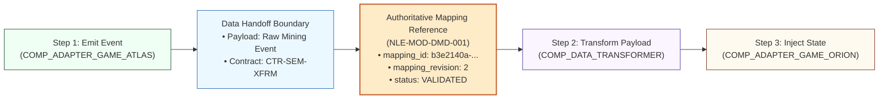

# Workflow Data Handoff & Mapping Reference Contract

**Document ID:** `NLE-CON-DHM-001`  
**Version:** `1.0.0`  
**Status:** `APPROVED CONTRACT SPECIFICATION`  
**Phase:** `Phase 6 of 12 — Mashup Designer & Integration Planning`  
**Step:** `Step 48 of 100`  
**Classification:** `Data Handoff Governance & Mapping Reference Specification`  
**Related Documents:**
- [CROSS_GAME_INTERACTION_WORKFLOW_AND_SEQUENCING_SPECIFICATION.md](file:///d:/App%20Winrar%20Files/Nexludic%20Engine%20(working)/docs/mashup-designer/CROSS_GAME_INTERACTION_WORKFLOW_AND_SEQUENCING_SPECIFICATION.md) (`NLE-SPC-IWS-001`)
- [CROSS_GAME_DATA_MAPPING_AND_TRANSFORMATION_SPECIFICATION.md](file:///d:/App%20Winrar%20Files/Nexludic%20Engine%20(working)/docs/mashup-designer/CROSS_GAME_DATA_MAPPING_AND_TRANSFORMATION_SPECIFICATION.md) (`NLE-SPC-DMT-001`)
- [CROSS_GAME_MAPPING_DOMAIN_MODEL_AND_FIELD_DICTIONARY.md](file:///d:/App%20Winrar%20Files/Nexludic%20Engine%20(working)/docs/mashup-designer/CROSS_GAME_MAPPING_DOMAIN_MODEL_AND_FIELD_DICTIONARY.md) (`NLE-MOD-DMD-001`)

---

## 1. Data Handoff Governance & Anti-Duplication

Workflow steps do not define property transformation logic or internal data schemas. When a workflow step requires translating information between game domains, it references an authoritative, versioned mapping created in Step 47 (`CrossGameDataMapping`):



### Invariant Rules:
1. **Zero Schema Duplication (`RUL-DHM-01`):** A workflow step descriptor cannot define inline field conversion rules. It must link directly to an approved `mapping_reference_id`. Duplicating transformation algorithms in workflow manifests is rejected (`ERR_DUPLICATE_MAPPING_DEFINITION`).
2. **Validated Mapping Prerequisite (`RUL-DHM-02`):** A workflow step cannot enter `READY_FOR_EXECUTION` if its referenced mapping is in state `DRAFT`, `INCOMPLETE`, `NEEDS_CLARIFICATION`, or `STALE`.

---

## 2. Data Handoff Envelope Schema

Data passed between sequential steps across the IPC bus conforms to the standard workflow handoff envelope:

```json
{
  "$schema": "https://json-schema.org/draft/2020-12/schema",
  "$id": "https://schemas.nexludic.internal/v1/workflow-data-handoff.json",
  "title": "WorkflowDataHandoffEnvelope",
  "type": "object",
  "required": [
    "handoff_id",
    "workflow_id",
    "source_step_id",
    "target_step_id",
    "mapping_reference_id",
    "schema_version",
    "timestamp_utc",
    "payload_data",
    "is_ephemeral"
  ],
  "properties": {
    "handoff_id": { "type": "string", "format": "uuid" },
    "workflow_id": { "type": "string", "format": "uuid" },
    "source_step_id": { "type": "string", "pattern": "^STEP_[A-Z0-9_]+$" },
    "target_step_id": { "type": "string", "pattern": "^STEP_[A-Z0-9_]+$" },
    "mapping_reference_id": { "type": "string", "format": "uuid" },
    "schema_version": { "type": "string", "pattern": "^[0-9]+\\.[0-9]+\\.[0-9]+$" },
    "timestamp_utc": { "type": "string", "format": "date-time" },
    "payload_data": { "type": "object" },
    "is_ephemeral": { "type": "boolean" },
    "trace_parent_id": { "type": ["string", "null"] }
  }
}
```

---

## 3. Ephemeral Handshake & Storage Boundaries

1. **In-Memory Zero-Copy Transport (`DEC-002`):** Continuous high-frequency handoffs (such as spatial coordinate streaming) are transmitted in-memory via named pipe ring buffers and are strictly ephemeral (`is_ephemeral == true`). They are never persisted to disk to avoid I/O bottlenecks.
2. **Transaction Checkpoint Auditing (`DEC-009`):** Discrete transactional handoffs (such as item transfers or quest completions) are logged to the workflow transaction checkpoint store under `D:\NexLudic\Projects\<project-id>\workflows\checkpoints\` for crash recovery and auditability.

---
*End of Contract — Document `NLE-CON-DHM-001`.*
