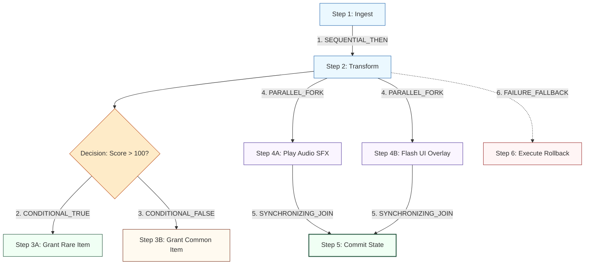
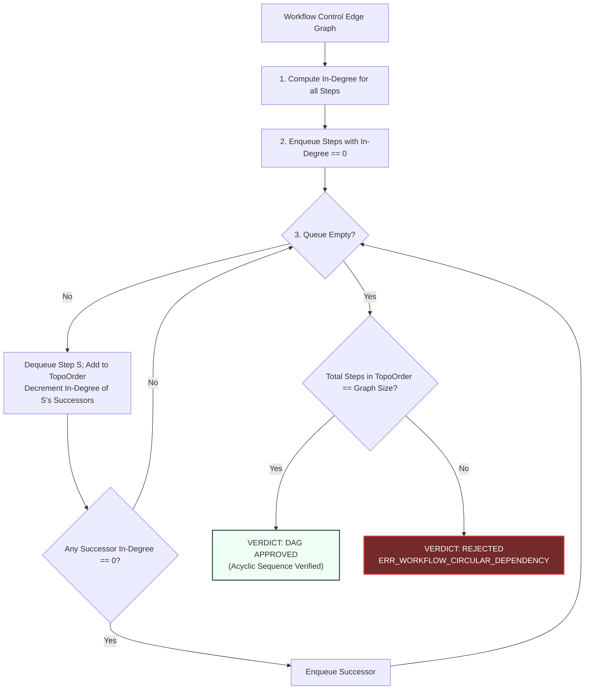
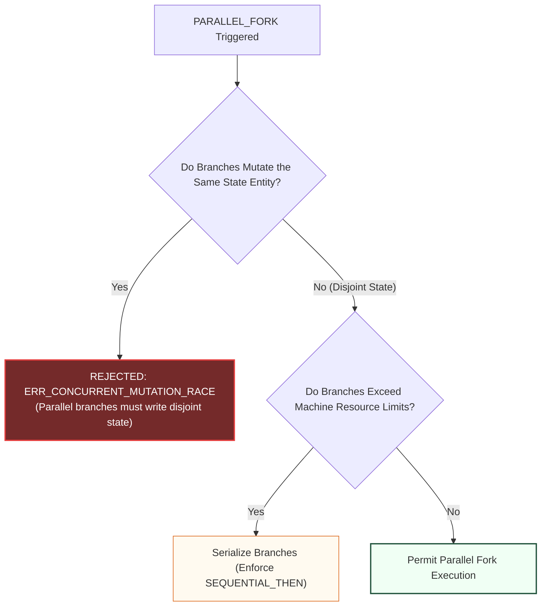

# Workflow Dependency, Ordering & Branching Rules

**Document ID:** `NLE-RUL-WOB-001`  
**Version:** `1.0.0`  
**Status:** `APPROVED ARCHITECTURAL RULES`  
**Phase:** `Phase 6 of 12 — Mashup Designer & Integration Planning`  
**Step:** `Step 48 of 100`  
**Classification:** `Control Flow, Dependency Ordering & Concurrency Rules`  
**Related Documents:**
- [CROSS_GAME_INTERACTION_WORKFLOW_AND_SEQUENCING_SPECIFICATION.md](file:///d:/App%20Winrar%20Files/Nexludic%20Engine%20(working)/docs/mashup-designer/CROSS_GAME_INTERACTION_WORKFLOW_AND_SEQUENCING_SPECIFICATION.md) (`NLE-SPC-IWS-001`)
- [CROSS_GAME_WORKFLOW_STEP_AND_INTERACTION_CONTRACT.md](file:///d:/App%20Winrar%20Files/Nexludic%20Engine%20(working)/docs/mashup-designer/CROSS_GAME_WORKFLOW_STEP_AND_INTERACTION_CONTRACT.md) (`NLE-CON-WSI-001`)
- [INTEGRATION_ARCHITECTURE_DEPENDENCY_AND_FAILURE_BOUNDARY_POLICY.md](file:///d:/App%20Winrar%20Files/Nexludic%20Engine%20(working)/docs/mashup-designer/INTEGRATION_ARCHITECTURE_DEPENDENCY_AND_FAILURE_BOUNDARY_POLICY.md) (`NLE-POL-DFB-001`)

---

## 1. Control-Flow Edge Taxonomy

Workflow steps are interconnected by typed control-flow edges (`WorkflowControlEdge`). The framework defines six formal edge types:

### Edge Definitions:
1. **`SEQUENTIAL_THEN`:** Target step executes strictly after source step completes successfully.
2. **`CONDITIONAL_TRUE`:** Target step executes if the associated condition predicate evaluates to `TRUE`.
3. **`CONDITIONAL_FALSE`:** Target step executes if the associated condition predicate evaluates to `FALSE`.
4. **`PARALLEL_FORK`:** Initiates concurrent execution of multiple independent downstream branches.
5. **`SYNCHRONIZING_JOIN`:** Blocks execution until all parent fork branches have completed successfully (Barrier synchronization).
6. **`FAILURE_FALLBACK`:** Activates an alternative recovery path if the source step encounters an unhandled error or timeout.

---

## 2. Acyclic Graph Enforcement (Kahn's DAG Algorithm)

Forward workflow execution paths must form a Directed Acyclic Graph (DAG). 

In accordance with platform governance (`NLE-CAT-VRC-001`), the workflow validator executes **Kahn's Algorithm** to reject unintentional or unbounded circular loops:

### Invariant Rules:
1. **Rule RUL-WOB-01 (Circular Loop Rejection):** Workflows containing directed cycles across forward control edges are rejected (`ERR_WORKFLOW_CIRCULAR_DEPENDENCY`).
2. **Rule RUL-WOB-02 (Bounded Polling Invariant):** Where continuous polling or recurring telemetry monitoring is required, it must be modeled as a bounded timer loop with an explicit maximum iteration count ($max\_ticks \le 1,000$) or terminal predicate. Unbounded loops are strictly prohibited.

---

## 3. Concurrency Safety & Fork/Join Rules

Parallel execution paths (`PARALLEL_FORK`) introduce concurrency hazards: race conditions, out-of-order writes, and GPU/RAM contention. The framework enforces three concurrency safety rules:

### Invariant Rules:
1. **Rule RUL-WOB-03 (Disjoint Mutation Invariant):** Concurrent branches spawned from a `PARALLEL_FORK` **must never mutate the same target state variable or entity**. If Branch A updates player position and Branch B also updates player position, the validator rejects the workflow (`ERR_CONCURRENT_MUTATION_RACE`).
2. **Rule RUL-WOB-04 (Join Barrier Synchronization):** A `SYNCHRONIZING_JOIN` step cannot begin execution until all inbound parallel branches have arrived and verified their postconditions. If one branch fails or times out, the join barrier fails immediately (`ERR_JOIN_BARRIER_PARTIAL_FAILURE`).

---

## 4. Tri-State Branch Evaluation Logic

Condition predicates are evaluated using **Strict Tri-State Logic** (`TRUE`, `FALSE`, `UNKNOWN`):

| Predicate Evaluation Finding | Follow `CONDITIONAL_TRUE`? | Follow `CONDITIONAL_FALSE`? | Engine Action |
| :--- | :---: | :---: | :--- |
| Predicate evaluates to `TRUE` | **YES** | No | Follow true branch. |
| Predicate evaluates to `FALSE` | No | **YES** | Follow false branch. |
| Input data missing / unverified | **NO** | **NO** | State marked `UNKNOWN`; triggers `FAILURE_FALLBACK` or halts (`ERR_PREDICATE_EVALUATION_UNDETERMINED`). |

> [!CAUTION]
> **Anti-Coercion Rule (`RUL-WOB-05`):** An `UNKNOWN` predicate outcome **must never be coerced to `FALSE` or `TRUE`**. Silently defaulting an unknown condition conceals missing telemetry or adapter failure and can trigger unintended game actions.

---
*End of Rules — Document `NLE-RUL-WOB-001`.*
