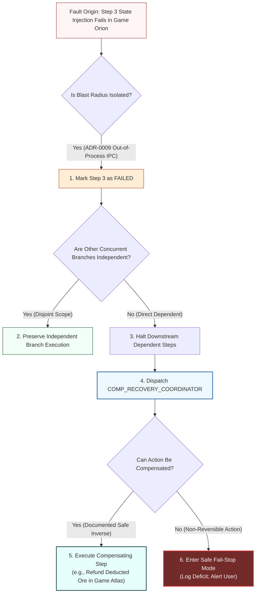
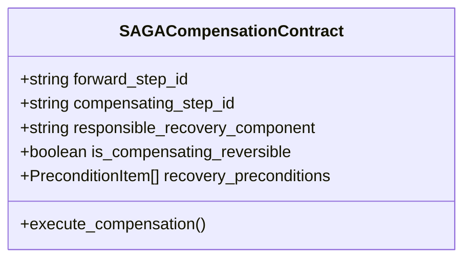

# Workflow Failure Propagation, Recovery & Compensation Specification

**Document ID:** `NLE-SPC-FPC-001`  
**Version:** `1.0.0`  
**Status:** `APPROVED ARCHITECTURAL SPECIFICATION`  
**Phase:** `Phase 6 of 12 — Mashup Designer & Integration Planning`  
**Step:** `Step 48 of 100`  
**Classification:** `Fault Isolation, Recovery Architecture & Compensation Specification`  
**Related Documents:**
- [CROSS_GAME_INTERACTION_WORKFLOW_AND_SEQUENCING_SPECIFICATION.md](file:///d:/App%20Winrar%20Files/Nexludic%20Engine%20(working)/docs/mashup-designer/CROSS_GAME_INTERACTION_WORKFLOW_AND_SEQUENCING_SPECIFICATION.md) (`NLE-SPC-IWS-001`)
- [WORKFLOW_STATE_TIMEOUT_CANCELLATION_AND_RETRY_POLICY.md](file:///d:/App%20Winrar%20Files/Nexludic%20Engine%20(working)/docs/mashup-designer/WORKFLOW_STATE_TIMEOUT_CANCELLATION_AND_RETRY_POLICY.md) (`NLE-POL-WTC-001`)
- [INTEGRATION_ARCHITECTURE_DEPENDENCY_AND_FAILURE_BOUNDARY_POLICY.md](file:///d:/App%20Winrar%20Files/Nexludic%20Engine%20(working)/docs/mashup-designer/INTEGRATION_ARCHITECTURE_DEPENDENCY_AND_FAILURE_BOUNDARY_POLICY.md) (`NLE-POL-DFB-001`)

---

## 1. Fault Isolation & Blast Radius Architecture

Commercial games do not participate in distributed two-phase commit transactions. A failure during a cross-game workflow (e.g. an item deducted in Game Atlas, but Game Orion crashes before receiving the crystal) must be rigorously contained without corrupting game save files or crashing the platform:

---

## 2. Failure Classification & Impact Matrix

| Error Class | Root Cause Example | Immediate Effect | Containment Boundary | Recovery Action |
| :--- | :--- | :--- | :--- | :--- |
| **`PRECONDITION_FAILED`** | Adapter is in `INITIALIZING` state. | Step dispatch aborted. | Isolated to originating step. | Defer step; wait for component ready. |
| **`TIMEOUT_EXPIRED`** | Target game tick lagged $> 100\text{ ms}$. | Step marked `FAILED`. | IPC channel queues drained. | Retry if idempotent; else prompt user. |
| **`SCHEMA_VALIDATION_ERROR`** | Transformed payload malformed. | Injection blocked. | In-memory transformer. | Log diagnostic; discard corrupted frame. |
| **`SECURITY_VIOLATION`** | Kernel anti-cheat active on game. | Immediate hard halt. | Entire mashup workflow. | Mark workflow `BLOCKED` (`BLK-SEC-01`). |
| **`CHANNEL_DISCONNECTED`** | Game process exited or crashed. | IPC pipe broken. | Isolated to peer adapter. | Enter degraded mode; prompt game restart. |
| **`AUTHORIZATION_DENIED`** | File staging lacks user consent. | Step blocked. | Storage boundary. | Display consent dialog; do not write. |

---

## 3. Compensating Action Contracts (The SAGA Pattern)

Because commercial game engines cannot rollback memory state, cross-game workflows utilize the **SAGA Compensating Action Pattern (`RUL-FPC-01`)**:

### Invariant Rules:
1. **Compensating Action Specificity (`RUL-FPC-02`):** Every forward step that produces an external side effect (e.g. inventory item deletion, quest progress mutation) must declare a paired `compensating_step_id` or be explicitly marked `NON_COMPENSATABLE`.
2. **Residual Side-Effect Disclosure (`RUL-FPC-03`):** Compensating actions (such as re-granting an item) cannot undo game time elapsed, animation playback, or player perception. The recovery coordinator must record residual side effects in the project audit log on Volume D (`DEC-009`).
3. **Fail-Stop on Compensation Failure (`RUL-FPC-04`):** If a compensating step itself fails (e.g. Game Atlas crashes during an item refund attempt), the engine must immediately halt all recovery automation, transition to `FAIL_STOP_MANUAL_INTERVENTION`, and alert the creator.

---
*End of Specification — Document `NLE-SPC-FPC-001`.*
