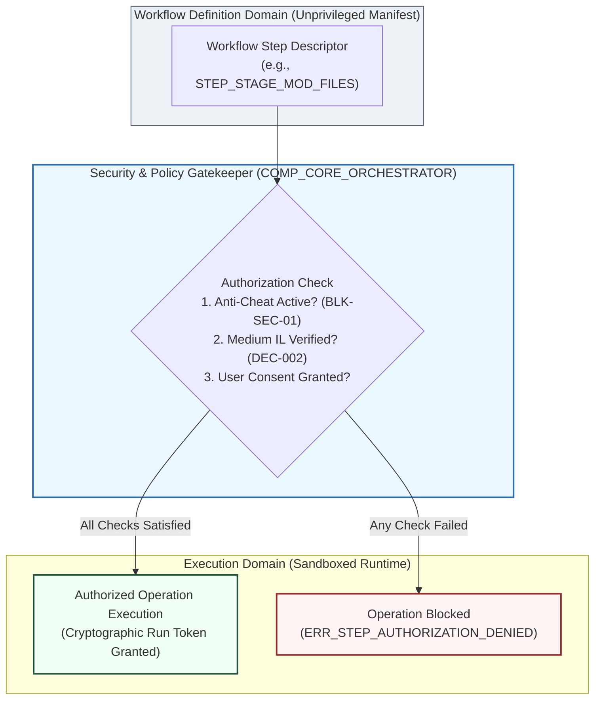

# Workflow Security, Authorization & Trust Boundary Specification

**Document ID:** `NLE-SEC-WAT-001`  
**Version:** `1.0.0`  
**Status:** `APPROVED SECURITY SPECIFICATION`  
**Phase:** `Phase 6 of 12 — Mashup Designer & Integration Planning`  
**Step:** `Step 48 of 100`  
**Classification:** `Workflow Security, Authorization Gates & Trust Boundary Specification`  
**Related Documents:**
- [CROSS_GAME_INTERACTION_WORKFLOW_AND_SEQUENCING_SPECIFICATION.md](file:///d:/App%20Winrar%20Files/Nexludic%20Engine%20(working)/docs/mashup-designer/CROSS_GAME_INTERACTION_WORKFLOW_AND_SEQUENCING_SPECIFICATION.md) (`NLE-SPC-IWS-001`)
- [INTEGRATION_ARCHITECTURE_SECURITY_TRUST_AND_AUTHORIZATION_SPECIFICATION.md](file:///d:/App%20Winrar%20Files/Nexludic%20Engine%20(working)/docs/mashup-designer/INTEGRATION_ARCHITECTURE_SECURITY_TRUST_AND_AUTHORIZATION_SPECIFICATION.md) (`NLE-SEC-STA-001`)
- [CROSS_GAME_MAPPING_EVIDENCE_SECURITY_AND_AUTHORIZATION_POLICY.md](file:///d:/App%20Winrar%20Files/Nexludic%20Engine%20(working)/docs/mashup-designer/CROSS_GAME_MAPPING_EVIDENCE_SECURITY_AND_AUTHORIZATION_POLICY.md) (`NLE-POL-ESA-001`)

---

## 1. Trust Boundaries & Step Authorization

Cross-game workflows span multiple security domains. NexLudic Engine enforces the **Explicit Authorization Boundary Invariant (`RUL-WAT-01`)**: describing an action in a workflow manifest does not grant the security token to execute it:

---

## 2. Prohibited Workflow Operations

The workflow validator automatically disqualifies any sequence that incorporates prohibited mechanisms:

| Prohibited Action | Governing Invariant | Enforced Consequence |
| :--- | :--- | :--- |
| Injecting DLLs or hooking memory of games with active kernel anti-cheat. | Anti-Cheat Dominance (`BLK-SEC-01`) | **Immediate Workflow Disqualification** (`ERR_PROHIBITED_SECURITY_ASSUMPTION`). |
| Requesting Administrator UAC elevation (`runas /admin`). | Windows Medium IL (`DEC-002`) | **Rejected at Gate 9** (`ERR_ELEVATION_PROHIBITED`). |
| Direct foreign memory writing via `WriteProcessMemory`. | Process Boundary Isolation | **Rejected at Gate 9**; requires approved IPC or mod surface. |
| Extracting DRM-protected binary files or modifying `.exe` code on disk. | Code Integrity & DRM Protection | **Rejected at Gate 9** (`ERR_BINARY_TAMPERING_PROHIBITED`). |
| Transmitting telemetry or game state to remote cloud servers. | Offline Privacy Mandate | **Rejected at Gate 9**; local loopback (`127.0.0.1`) strictly required. |

---

## 3. Privacy, Diagnostic Redaction & Audit Integrity

1. **Volume D Sandbox Storage (`DEC-009`):** All workflow execution traces, step logs, and checkpoint states must persist strictly under `D:\NexLudic\Projects\<project-id>\workflows\`.
2. **Diagnostic Redaction:** Workflow execution logs must automatically redact sensitive local file paths (e.g. `C:\Users\<username>\...` is masked to `<USER_HOME>\...`) and any proprietary game binary keys.
3. **Audit Immutability:** Once a workflow is marked `APPROVED_FOR_PLANNING`, its cryptographic fingerprint (`workflow_fingerprint_sha256`) is locked. Any tampering with step descriptors invalidates the approval token.

---
*End of Specification — Document `NLE-SEC-WAT-001`.*
