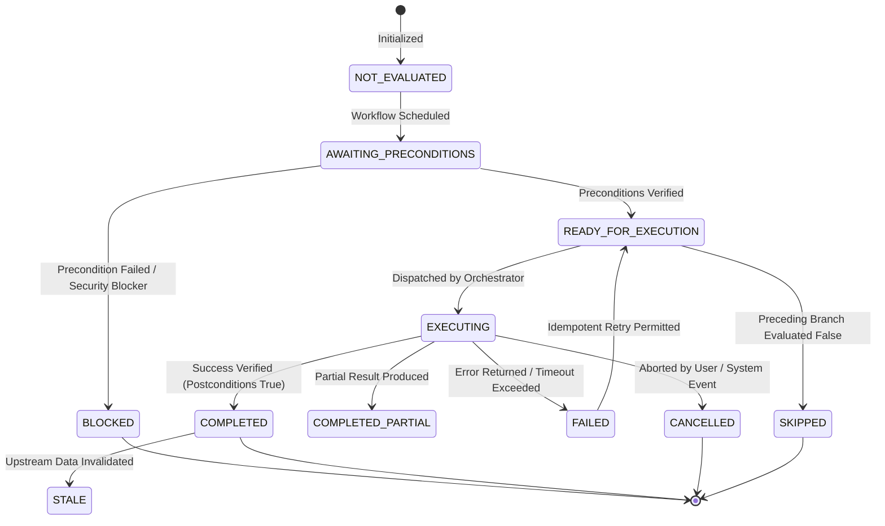
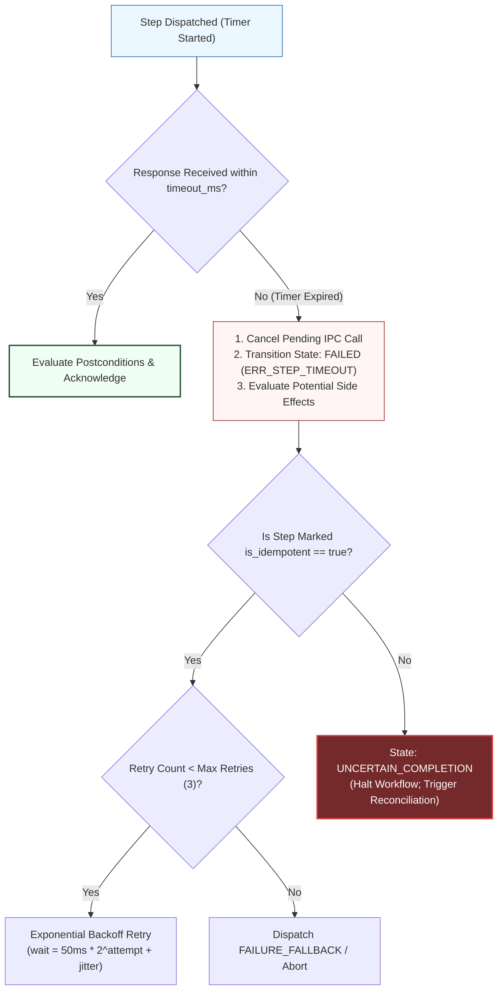
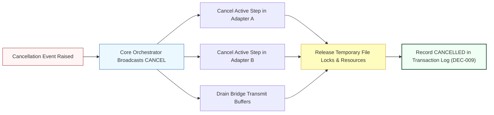

# Workflow State, Timeout, Cancellation & Retry Policy

**Document ID:** `NLE-POL-WTC-001`  
**Version:** `1.0.0`  
**Status:** `APPROVED ARCHITECTURAL POLICY`  
**Phase:** `Phase 6 of 12 — Mashup Designer & Integration Planning`  
**Step:** `Step 48 of 100`  
**Classification:** `Execution Semantics, Timeouts, Cancellation & Retry Policy`  
**Related Documents:**
- [CROSS_GAME_INTERACTION_WORKFLOW_AND_SEQUENCING_SPECIFICATION.md](file:///d:/App%20Winrar%20Files/Nexludic%20Engine%20(working)/docs/mashup-designer/CROSS_GAME_INTERACTION_WORKFLOW_AND_SEQUENCING_SPECIFICATION.md) (`NLE-SPC-IWS-001`)
- [CROSS_GAME_WORKFLOW_STEP_AND_INTERACTION_CONTRACT.md](file:///d:/App%20Winrar%20Files/Nexludic%20Engine%20(working)/docs/mashup-designer/CROSS_GAME_WORKFLOW_STEP_AND_INTERACTION_CONTRACT.md) (`NLE-CON-WSI-001`)
- [ADAPTER_LIFECYCLE_INITIALIZATION_AND_OPERATIONAL_STATE_SPECIFICATION.md](file:///d:/App%20Winrar%20Files/Nexludic%20Engine%20(working)/docs/adapters/ADAPTER_LIFECYCLE_INITIALIZATION_AND_OPERATIONAL_STATE_SPECIFICATION.md) (`NLE-SPC-ALC-001`)

---

## 1. Step-Level Operational State Taxonomy

An interaction step advances through twelve formal operational states during its lifecycle:

---

## 2. Timeout & Bounded Execution Policy

Every step in an interaction workflow must specify a deterministic timeout limit (`timeout_ms`), constrained within $[10\text{ ms}, 60,000\text{ ms}]$:

### Invariant Rules:
1. **Rule RUL-WTC-01 (Mandatory Timeout Bounds):** Unbounded steps with infinite timeouts are prohibited (`timeout_ms == null` is rejected by schema `NLE-SCH-IWS-001`).
2. **Rule RUL-WTC-02 (Uncertain Completion Isolation):** If a non-idempotent operation (e.g. inventory item deduction) times out after the dispatch frame was transmitted, the system **must never blindly repeat the action**. The state is classified as `UNCERTAIN_COMPLETION`, and the engine triggers an authoritative snapshot query to verify whether the side effect occurred.

---

## 3. Cancellation Propagation & Cleanup Governance

Workflows can be cancelled at any point by creator intervention, game process crash, or security violation:

### Invariant Rules:
1. **Rule RUL-WTC-03 (Immediate Resource De-allocation):** Upon receiving a cancellation event, components must immediately release temporary staging file handles on Volume D, drop unacknowledged queue buffers, and revert volatile in-memory mirrors.
2. **Rule RUL-WTC-04 (Safe Process State):** Cancelling a cross-game workflow must never terminate or destabilize participating commercial game processes. The engine detaches cleanly without injecting crash signals.

---

## 4. Retry Safety & Idempotency Tokens

Automatic step retries are strictly constrained by the **Idempotency Verification Invariant (`RUL-WTC-05`)**:

| Step Characteristic | `is_idempotent` | Permitted Automated Retries | Maximum Retry Limit | Backoff Algorithm |
| :--- | :---: | :---: | :---: | :--- |
| Read-Only State Query | `true` | **YES** | 3 attempts | Exponential: $50\text{ ms} \times 2^{\text{attempt}} + \text{jitter}$ |
| Telemetry Heartbeat Poll | `true` | **YES** | 3 attempts | Fixed: $16\text{ ms}$ interval |
| Transactional Item Grant | `false` | **NO (Prohibited)** | 0 attempts | Requires manual reconciliation / query |
| Discrete Entity Spawning | `false` | **NO (Prohibited)** | 0 attempts | Requires unique entity ID query before retry |
| UI Overlay Toast Display | `true` | **YES** | 2 attempts | Fixed: $100\text{ ms}$ |

---
*End of Policy — Document `NLE-POL-WTC-001`.*
