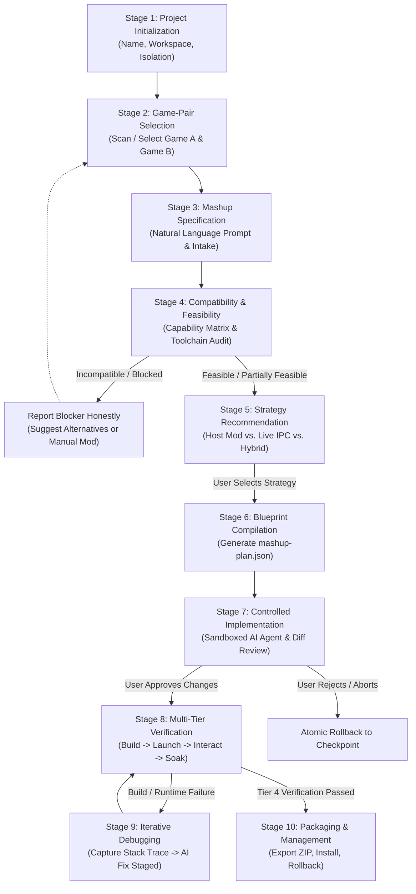

# NEXLUDIC ENGINE — MASHUP USER WORKFLOWS & LIFECYCLE
## Document ID: NLE-DOC-WORKFLOW-001
**Phase:** 1 — Product Definition & Research  
**Step:** 2 of 100 — Universal Product Scope, User Journeys, Mashup Workflow, and Release Boundaries  
**Date:** November 15, 2026  
**Auditor / Architect:** UX Systems Analyst & AI Workflow Designer  

---

## 1. End-to-End Mashup Lifecycle Diagram

The following Mermaid diagram visualizes the complete 10-stage user journey, decision gates, error branches, and iterative debugging feedback loops.

---

## 2. Stage-by-Stage Workflow Specifications

---

### Stage 1: Start a New Mashup Project

- **Entry Conditions:** User launches the NexLudic Engine desktop application.
- **Inputs:**
  - Project Display Name (e.g. `SpiderCraft-Swing`, `RedDeadMinecraft`).
  - Target Project Location (defaults to `<AppData>/NexLudic/Projects/<ProjectName>`).
  - Optional Project Description / Tags.
- **User Interactions:**
  - Clicks "Create New Mashup Project".
  - Enters project title and selects custom directory if desired.
  - Clicks "Initialize Workspace".
- **System Responsibilities:**
  - Validates project title for filesystem compatibility.
  - Generates isolated project scaffold containing `manifest.json`, `/staging/`, `/backups/`, `/logs/`, and `/artifacts/`.
  - Initializes local git tracking within the project folder (strictly independent of the platform repository).
- **Outputs:** Newly initialized, isolated mashup project workspace.
- **State Transition:** `Idle` -> `ProjectCreated`
- **Failure Paths & Errors:** Path permission errors, disk space exhaustion (<500 MB free). System reports explicit folder permission error with browse dialogue.
- **Cancellation & Recovery:** User can click "Cancel"; system removes temporary staging folders cleanly without touching existing files.
- **Requirements Satisfied:** `REQ-CORE-004`, `REQ-SAFE-003`.
- **Acceptance Evidence:** Project folder exists on disk with valid `manifest.json` and empty `/staging` directory.

---

### Stage 2: Select Two Games

- **Entry Conditions:** Project initialized (`ProjectCreated` state).
- **Inputs:**
  - Game A Selection (Primary/Host candidate).
  - Game B Selection (Secondary/Guest candidate).
- **User Interactions:**
  - Views list of auto-discovered games (Steam, Epic, GOG, Windows Registry).
  - Searches/filters library by title.
  - Optionally clicks "Add Game Manually" to browse for standalone executables.
  - Designates Game A and Game B, then clicks "Confirm Selection".
- **System Responsibilities:**
  - Queries local game scanners (`SteamScanner`, `RegistryScanner`, `EpicScanner`).
  - Validates executable presence, extracts version metadata, and computes file checksums.
  - Identifies known anti-cheat systems (Vanguard, EAC, BattlEye) and flags protection status.
  - Queries Adapter Registry to link installed games to known adapter manifests (`adapter.json`).
- **Outputs:** Validated game-pair record containing install paths, executables, versions, and adapter IDs.
- **State Transition:** `ProjectCreated` -> `GamesSelected`
- **Failure Paths & Errors:**
  - Selected executable missing or corrupted: System marks game invalid and prompts re-scan.
  - Both games are identical: System disallows identical selections for cross-game mashups.
- **Cancellation & Recovery:** User can swap or clear selected games at any point prior to Blueprint Compilation.
- **Requirements Satisfied:** `REQ-CORE-001`, `REQ-DISC-001`, `REQ-DISC-002`, `REQ-DISC-003`, `REQ-DISC-005`.
- **Acceptance Evidence:** `manifest.json` updated with validated paths and version signatures for both games.

---

### Stage 3: Describe the Desired Mashup

- **Entry Conditions:** Two valid games confirmed (`GamesSelected` state).
- **Inputs:**
  - Free-form natural language description from the user (e.g., *"I want to swing like Spider-Man between Minecraft mountains using webs that attach to blocks"*).
  - Optional style/genre preferences (e.g. realistic physics, arcade controls, HUD styling).
- **User Interactions:**
  - Types or pastes desired gameplay description into the intake text area.
  - Answers targeted, multiple-choice clarification questions generated by the engine:
    1. *World Provider:* "Which game provides the primary playable world?" [Minecraft / Spider-Man]
    2. *Control Scheme:* "Should web-swinging use gamepad triggers or keyboard keys?" [Gamepad / Keyboard / Both]
    3. *Combat / Survival:* "Should swinging consume web fluid or stamina?" [Yes / No]
- **System Responsibilities:**
  - Analyzes prompt syntax and extracts gameplay entities, verbs, and interactions.
  - Identifies architectural ambiguities and generates 2–4 targeted clarification prompts.
  - Compiles responses into a normalized structured requirement set (`gameplay-requirements.json`).
- **Outputs:** Normalized gameplay requirement matrix categorized into Mandatory vs. Optional preferences.
- **State Transition:** `GamesSelected` -> `RequirementsDrafted`
- **Failure Paths & Errors:** User prompt is empty or completely unintelligible. Engine prompts user for minimum description with helpful examples.
- **Cancellation & Recovery:** User can edit or wipe the prompt at any time without resetting game selections.
- **Requirements Satisfied:** `REQ-MASH-001`, `REQ-MASH-002`.
- **Acceptance Evidence:** Structured `gameplay-requirements.json` saved in project directory.

---

### Stage 4: Analyze Compatibility and Feasibility

- **Entry Conditions:** Gameplay requirements drafted (`RequirementsDrafted` state).
- **Inputs:**
  - Game A & Game B capability manifests (`adapter.json`).
  - Extracted gameplay requirements.
  - Detected local toolchains (JDK, Gradle, Python, MSBuild, CMake).
- **User Interactions:**
  - Clicks "Run Compatibility & Feasibility Analysis".
  - Observes real-time progress indicators across toolchain, API, and anti-cheat checks.
  - Reviews detailed Compatibility Matrix Report.
- **System Responsibilities:**
  - Cross-references desired mechanics against adapter capabilities:
    - *Can Host Game spawn custom projectile entities?* -> Checked against Fabric API manifest.
    - *Can Guest Game stream live physics or telemetry?* -> Checked against Spider-Man adapter.
  - Audits local system for missing build tools (e.g. warns if JDK is missing for Minecraft modding).
  - Evaluates anti-cheat restrictions.
  - Classifies every requested feature as `Verified`, `Partially Supported`, `Experimental`, or `Unsupported`.
- **Outputs:** Comprehensive Feasibility Report (`feasibility-report.json`) with an overall viability score.
- **State Transition:** `RequirementsDrafted` -> `FeasibilityAssessed`
- **Failure Paths & Errors:**
  - Hard Blocker: Target game uses active kernel anti-cheat preventing modification. System halts and explains that automated live integration is blocked for safety.
  - Toolchain Missing: System highlights missing prerequisite (e.g., "JDK 21 required for compilation") with a direct link to official download page.
- **Cancellation & Recovery:** User can modify requirements in Stage 3 to bypass unsupported features.
- **Requirements Satisfied:** `REQ-CORE-005`, `REQ-DISC-004`, `REQ-SAFE-001`.
- **Acceptance Evidence:** Validated `feasibility-report.json` generated with zero false-positive claims.

---

### Stage 5: Recommend an Integration Strategy

- **Entry Conditions:** Feasibility report complete (`FeasibilityAssessed` state).
- **Inputs:**
  - `feasibility-report.json`
  - Strategy evaluation scoring algorithms.
- **User Interactions:**
  - Reviews the system's recommended integration strategy:
    - **Strategy A: Host-Game Modification** (Primary Default if host mod loader exists).
    - **Strategy B: Live Interoperability Bridge** (If both games support live IPC/input).
    - **Strategy C: Hybrid Integration** (If deep telemetry-driven mod is requested).
  - Inspects trade-offs: Hardware requirements, latency, mod installation complexity.
  - Confirms the recommended approach or overrides with an alternative if feasible.
- **System Responsibilities:**
  - Evaluates scores across latency, stability, user friction, and agent feasibility.
  - Presents reasoned justifications, prerequisites, risks, and required human permissions.
- **Outputs:** Approved Strategy Determination (`strategy-decision.json`).
- **State Transition:** `FeasibilityAssessed` -> `StrategyConfirmed`
- **Failure Paths & Errors:** Zero strategies viable. System enters `UnsupportedPair` state and displays actionable diagnostic summary.
- **Cancellation & Recovery:** User can return to Stage 2 or 3 to modify inputs.
- **Requirements Satisfied:** `REQ-CORE-003`, `REQ-MASH-003`, `DEC-004`.
- **Acceptance Evidence:** User-approved strategy recorded in project manifest.

---

### Stage 6: Generate the Mashup Implementation Plan

- **Entry Conditions:** Strategy confirmed (`StrategyConfirmed` state).
- **Inputs:**
  - Confirmed requirements, feasibility data, and selected strategy.
  - Project scaffolding blueprints from the host game adapter.
- **User Interactions:**
  - Clicks "Compile Implementation Blueprint".
  - Reviews generated blueprint summary: Module layout, target files, planned AI agent tasks, and test acceptance criteria.
  - Clicks "Approve Blueprint".
- **System Responsibilities:**
  - Assembles the complete `mashup-blueprint.json` containing:
    - Host mod scaffolding layout (e.g. Fabric Loom Gradle project structure).
    - AI task sequence (Task 1: Item registry, Task 2: Physics hook, Task 3: HUD).
    - Multi-tier test acceptance suite definitions.
    - Backup and rollback checkpoints.
- **Outputs:** Immutable, versioned `mashup-blueprint.json`.
- **State Transition:** `StrategyConfirmed` -> `BlueprintApproved`
- **Failure Paths & Errors:** Template generation fails due to missing adapter assets. System flags adapter error.
- **Cancellation & Recovery:** User can edit requirements prior to final blueprint approval.
- **Requirements Satisfied:** `REQ-MASH-004`, `REQ-AI-001`.
- **Acceptance Evidence:** `mashup-blueprint.json` compiled and validated against schema.

---

### Stage 7: Approve and Execute Implementation

- **Entry Conditions:** Blueprint approved (`BlueprintApproved` state).
- **Inputs:**
  - `mashup-blueprint.json`
  - Staging workspace (`<project>/staging/`).
- **User Interactions:**
  - Clicks "Start AI-Assisted Implementation".
  - Watches live execution console showing coding agent file generation and edits.
  - Inspects side-by-side colorized diff view of staged files.
  - Reviews consequential action prompt (e.g. "Execute Gradle build script?").
  - Clicks "Approve & Apply Changes" or "Reject & Re-generate".
- **System Responsibilities:**
  - Spawns sandboxed coding agent worker process confined strictly to `/staging/`.
  - Dispatches sequential task prompts derived from the blueprint.
  - Intercepts all file mutations and computes structured git diffs.
  - Enforces human-in-the-loop gating for any shell execution or file overwrites.
  - Maintains a full audit log of agent operations.
- **Outputs:** Staged, compiled, and diff-audited mod/bridge project files.
- **State Transition:** `BlueprintApproved` -> `ImplementationStaged`
- **Failure Paths & Errors:**
  - Agent generates invalid syntax or uncompilable code: Captured in build logs.
  - Agent attempts out-of-sandbox file write: Intercepted and blocked immediately by filesystem sandbox guard.
- **Cancellation & Recovery:** User clicks "Abort Implementation"; workspace rolls back to initial checkpoint within 1 second.
- **Requirements Satisfied:** `REQ-AI-002`, `REQ-AI-003`, `REQ-AI-004`, `REQ-SAFE-003`.
- **Acceptance Evidence:** Full diff log and staged project files compiled inside `/staging/`.

---

### Stage 8: Test the Resulting Mashup

- **Entry Conditions:** Implementation approved and staged (`ImplementationStaged` state).
- **Inputs:**
  - Staged mod files and build scripts.
  - Test scenario configurations from `mashup-blueprint.json`.
- **User Interactions:**
  - Clicks "Execute Verification Suite".
  - Observes multi-tier progress bar across all 4 validation tiers:
    - **Tier 1 (Build OK):** Automated headless compilation check.
    - **Tier 2 (Launch OK):** Automated or guided game process boot check.
    - **Tier 3 (Interaction OK):** In-game mechanic verification (e.g. web item swings player).
    - **Tier 4 (Session Stable):** Sustained 10-minute gameplay stability check.
  - Confirms observed in-game behavior via verification checklist.
- **System Responsibilities:**
  - Executes build runner, capturing compiler stdout/stderr.
  - Monitors game process PID and verifies heartbeat stability.
  - For Strategy B/C: Tests IPC roundtrip latency and E-Stop hotkey responsiveness.
  - Records granular test results into `test-results.json`.
- **Outputs:** Formal `test-results.json` documenting status across all tiers.
- **State Transition:** `ImplementationStaged` -> `VerificationComplete`
- **Failure Paths & Errors:** Compilation fails (Tier 1 fail) or game crashes on boot (Tier 2 fail). System marks step failed, extracts error trace, and initiates Stage 9.
- **Cancellation & Recovery:** User can terminate running test session instantly via UI or E-Stop (`Ctrl+Alt+Escape`).
- **Requirements Satisfied:** `REQ-TEST-002`, `REQ-TEST-003`, `REQ-TEST-004`, `REQ-BRIDGE-005`.
- **Acceptance Evidence:** `test-results.json` with verified exit codes and logs for each tier.

---

### Stage 9: Debug and Improve

- **Entry Conditions:** Verification failure detected in Stage 8 (`VerificationFailed` state).
- **Inputs:**
  - Compiler error logs, JVM crash reports, or IPC exception traces.
  - Exact failing source files from `/staging/`.
- **User Interactions:**
  - Reviews highlighted root-cause error diagnostics in the UI.
  - Clicks "Generate AI Diagnostic Fix".
  - Reviews proposed patch diff in side-by-side viewer.
  - Clicks "Apply Fix & Re-verify".
- **System Responsibilities:**
  - Parses error logs and isolates crashing classes/methods.
  - Assembles focused corrective prompt containing error context and failing code.
  - Invokes coding agent to produce minimal surgical bug fix.
  - Applies patch in `/staging/` and transitions back to Stage 8 (Re-testing).
- **Outputs:** Surgical patch diff applied to staged project files.
- **State Transition:** `VerificationFailed` -> `ImplementationStaged` -> `Re-Testing`
- **Failure Paths & Errors:** Agent enters repetitive loop without fixing error. System caps automated fix attempts at 3 iterations, then surfaces manual modder override options.
- **Cancellation & Recovery:** User can revert to any prior stable checkpoint with one click.
- **Requirements Satisfied:** `REQ-AI-005`, `REQ-TEST-004`.
- **Acceptance Evidence:** Structured fix commit applied to staging branch and logged in audit history.

---

### Stage 10: Package and Manage the Result

- **Entry Conditions:** All required verification tiers passed (`VerificationComplete` state).
- **Inputs:**
  - Verified mod files / bridge binaries.
  - Target game install directories.
- **User Interactions:**
  - Reviews deployment options:
    - "Install into Game Directory" (One-click active play).
    - "Export Standalone Mashup Package" (Creates distributable ZIP for other players).
  - Clicks "Install & Launch" or "Export ZIP".
  - Can return anytime to click "One-Click Rollback / Uninstall".
- **System Responsibilities:**
  - Creates bit-for-bit timestamped backup of target game mod folders in `<project>/backups/`.
  - Atomically deploys mod files to game's active mod directory (e.g. `.minecraft/mods/`).
  - For export: Bundles open source scripts, configurations, README, and local asset extraction utilities (strictly excluding proprietary game binaries per `REQ-MOD-003`).
  - Updates central engine registry with installed mashup profile.
- **Outputs:**
  - Active, installed mashup in target game directory.
  - Exported standalone distribution ZIP (`<ProjectName>-v1.0.zip`).
  - Restorable backup snapshot in `<project>/backups/`.
- **State Transition:** `VerificationComplete` -> `DeployedAndActive`
- **Failure Paths & Errors:** File lock on game directory (game running). System alerts user to close game before installation.
- **Cancellation & Recovery:** Clicking "Uninstall / Rollback" completely restores original game directory within 2 seconds using the backup snapshot.
- **Requirements Satisfied:** `REQ-PKG-001`, `REQ-PKG-002`, `REQ-PKG-003`, `REQ-MOD-003`.
- **Acceptance Evidence:** Verified pre-mod backup created; clean installation verified; rollback test succeeds cleanly.

